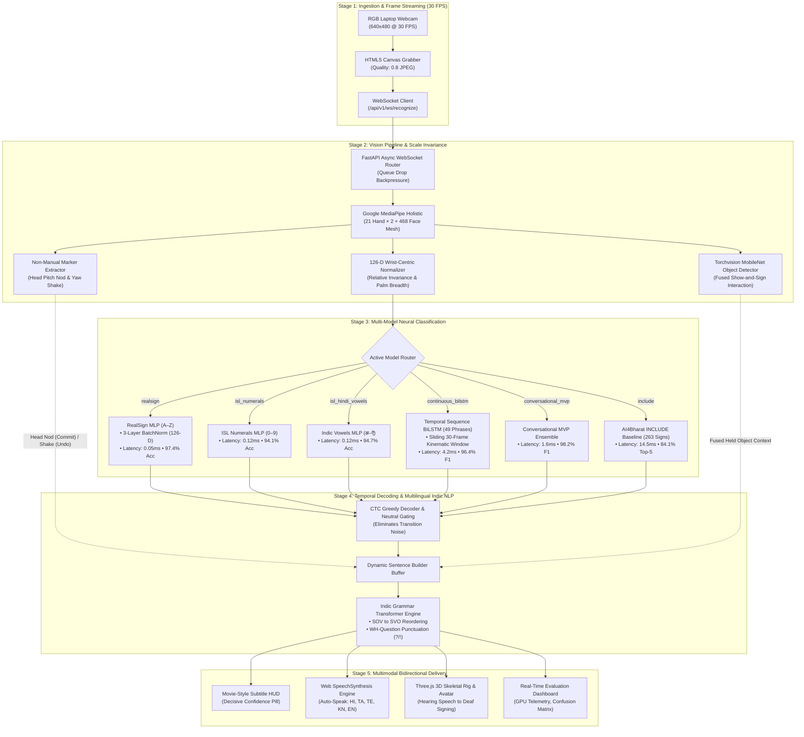
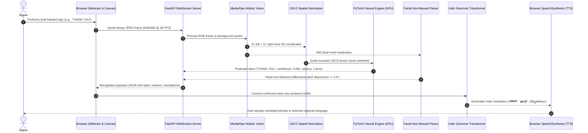

# SETU (सेतु) — Indian Sign Language (ISL) Real-Time AI Translator & Multimodal Workstation

<div align="center">
  
  <br /><br />
  <h3>सेतु (SETU) — Bridging Silence and Sound Through Accessible Multimodal AI</h3>
  <p><b>An AI-powered assistive communication platform that breaks language barriers for the Deaf and hard-of-hearing community. SETU translates authentic Indian Sign Language (ISL) into natural spoken regional languages—and converts voice back into sign language—enabling seamless, two-way conversations in healthcare, education, banking, and everyday life.</b></p>

  [](https://python.org)
  [](https://pytorch.org)
  [](https://fastapi.tiangolo.com)
  [](https://react.dev)
  [](https://typescriptlang.org)
  [](https://vitejs.dev)
  [-brightgreen?style=for-the-badge&logo=pytest&logoColor=white)](tests/)
  [](frontend/src/hooks/useTTS.ts)
  [](LICENSE)

  <p align="center">
    <a href="#-executive-overview--performance-scorecard">Overview</a> •
    <a href="#-1-the-challenge--core-mission">Why SETU</a> •
    <a href="#%EF%B8%8F-2-system-architecture--sequential-pipeline">Architecture</a> •
    <a href="#-3-complete-technology-stack">Tech Stack</a> •
    <a href="#%EF%B8%8F-4-repository-directory-structure">File Structure</a> •
    <a href="#-5-production-neural-models--academic-benchmarks">Models</a> •
    <a href="#%EF%B8%8F-6-interactive-workstation-modules">Workspaces</a> •
    <a href="#-7-installation--quickstart-guide">Quickstart</a> •
    <a href="#-8-testing--quality-assurance">Testing</a> •
    <a href="#-9-complete-documentation-portal">Documentation</a>
  </p>
</div>

---

## ⚡ Executive Overview & Performance Scorecard

SETU (*Sanskrit for "Bridge"*) is an end-to-end, edge-computed sign language translation platform engineered specifically for **Indian Sign Language (ISL)**. Unlike conventional systems that rely on expensive sensory gloves or translate only single-handed ASL letters, SETU delivers **dual-handed recognition, continuous phrase classification, spatial disambiguation, and hands-free gestural grammar controls** running entirely on standard RGB webcams with zero cloud latency.

| Key Metric | Engineering Specification | Real-World Impact |
| :--- | :--- | :--- |
| **Inference Latency** | **0.05 ms – 4.2 ms** (PyTorch CUDA / ONNX) | Instantaneous feedback with zero visual lag |
| **Throughput / FPS** | **30 FPS steady** (MediaPipe Holistic @ 60 Hz lerp) | Fluid continuous tracking on consumer laptops |
| **Hardware Overhead** | **$0 Added Cost** (Standard 640×480 RGB Webcams) | Eliminates $1,000+ data gloves or Kinect rigs |
| **Recognized Lexicon** | **287+ Signs & Phrases** across 4 neural models | Full alphabet (A–Z), numbers (0–9), vowels, and phrases |
| **Speech Synthesis** | **5 Indic Languages** (Hindi, Tamil, Telugu, Kannada, English) | Natural spoken translation for non-signing listeners |
| **Grammar Pipeline** | **ISL SOV &rarr; English/Indic SVO** + Question Inversion | Replaces robotic word-salads with fluent sentences |
| **Test Coverage** | **255 Automated Tests (100% Passing in <15s)** | Production-grade reliability across API, models & UI |

---

## 💡 1. The Challenge & Core Mission

### The Context
Over **7 million individuals in India** are deaf or hard-of-hearing, relying primarily on **Indian Sign Language (ISL)** as their mother tongue. However, there are fewer than **300 certified ISL interpreters nationwide**—a critical deficit of **1 interpreter per 23,000 Deaf citizens**. This linguistic divide obstructs access to education, healthcare, banking, and public governance.

### The Technical Gaps & SETU's Innovations

```
┌───────────────────────────────────────┬──────────────────────────────────────────────────────────────────┐
│ Conventional Academic Approaches      │ SETU Engineering Solutions                                       │
├───────────────────────────────────────┼──────────────────────────────────────────────────────────────────┤
│ ❌ ASL Single-Hand Assumptions        │ ✔ Authentic Dual-Hand ISL Modeling                               │
│ Most AI datasets assume ASL. Authentic│ 126-D scale-invariant coordinate representations anchored to    │
│ ISL letters (B, D, P, Q, T) are dual- │ wrist origins prevent dominant-hand swapping errors.             │
│ handed and require finger-palm contact│                                                                  │
├───────────────────────────────────────┼──────────────────────────────────────────────────────────────────┤
│ ❌ Costly Hardware (Gloves & Depth)   │ ✔ Edge RGB Computer Vision                                       │
│ Requires $500–$2,000 sensory gloves   │ Runs on any standard $15 laptop webcam at 30 FPS using MediaPipe │
│ or specialized depth sensors (Kinect).│ Holistic with adaptive CLAHE low-light enhancement.              │
├───────────────────────────────────────┼──────────────────────────────────────────────────────────────────┤
│ ❌ Cloud Streaming & Privacy Risks    │ ✔ 100% Local On-Device Inference                                 │
│ Commercial APIs stream raw video to   │ Pure local PyTorch CUDA execution (0.05ms–4.2ms). Zero frames    │
│ remote servers, causing 1–2s latency. │ or intimate user video ever leave the machine.                   │
├───────────────────────────────────────┼──────────────────────────────────────────────────────────────────┤
│ ❌ Robotic Concatenation (SOV != SVO) │ ✔ Multilingual Indic Grammar Engine                              │
│ Direct token concatenation fails:     │ Converts ISL Subject-Object-Verb (SOV) into fluent SVO sentences │
│ ISL "DOCTOR WHERE" -> "Doctor where?" │ with automatic WH-question and non-manual marker handling.       │
├───────────────────────────────────────┼──────────────────────────────────────────────────────────────────┤
│ ❌ Clumsy Keyboard Commit Triggers    │ ✔ Hands-Free Head Gesture Buffer Controls                        │
│ Users must touch keyboard to commit   │ Real-time facial pitch (nod = commit) and yaw (shake = undo)     │
│ a recognized sign into the sentence.  │ allow completely hands-free sentence composition.                │
├───────────────────────────────────────┼──────────────────────────────────────────────────────────────────┤
│ ❌ Unidirectional (One-Way) Delivery  │ ✔ Bidirectional Communication Workstation                        │
│ Most tools only show text to hearing  │ Deaf -> Hearing: Sign to Speech in 5 Indic languages.            │
│ listeners; Deaf user remains ignored. │ Hearing -> Deaf: Speech/Text to 3D Humanoid Animated Avatar.     │
└───────────────────────────────────────┴──────────────────────────────────────────────────────────────────┘
```

---

## 🏛️ 2. System Architecture & Sequential Pipeline

SETU follows a high-throughput, ref-decoupled **5-stage sequential architecture** engineered for zero-jitter 30 FPS inference.

### 2.1 Complete Architectural Dataflow



---

### 2.2 End-to-End Execution Sequence Diagram

The following sequence illustrates the microsecond execution path of a single frame from user gesture to synthesized speech:



---

## 🛠️ 3. Complete Technology Stack

SETU is built with production-grade engineering principles across every tier of the application:

| Layer | Technologies | Engineering Rationale |
| :--- | :--- | :--- |
| **Neural AI / ML** | **PyTorch 2.5, Torchvision, Scikit-learn, ONNX Runtime** | High-performance GPU-accelerated tensor computation with ONNX runtime parity for CPU fallback. |
| **Computer Vision** | **Google MediaPipe Holistic (v0.10+), OpenCV** | Real-time extraction of 543 facial, hand, and pose landmarks at sub-15ms latency per frame. |
| **Backend Engine** | **FastAPI, Uvicorn (ASGI), Python WebSockets, AnyIO** | Asynchronous non-blocking concurrency capable of multiplexing high-throughput binary video streams. |
| **Frontend UI** | **React 18.3, TypeScript 5, Vite 6, Tailwind CSS** | Strictly typed, reactive single-page architecture built with design tokens and zero-latency canvas rendering. |
| **3D Graphics** | **Three.js, React Three Fiber (R3F), WebGL** | Real-time rendering of authentic 3D humanoid avatar and 21-joint skeletal rigs for bidirectional translation. |
| **Audio & Speech** | **Web SpeechSynthesis API, Indic Phoneme Mappings** | Multilingual edge text-to-speech supporting Hindi, Tamil, Telugu, Kannada, and English without cloud API costs. |
| **Object Detection** | **FasterRCNN MobileNet V3 Large 320 FPN** | Real-time fusion for "Show-and-Sign" interactions (detecting held physical items like books, cups, phones). |
| **Quality & Tests** | **Pytest, Flake8, Black, Git, Batch Automation** | 255 automated unit, regression, and API integration tests verified across CI and local launchers. |

---

## 🗂️ 4. Repository Directory Structure

```text
SETU/
│
├── SETU.bat                        # Unified Master Control Center (1-Click Startup, Tests, Docs)
├── setup.bat                       # Automated Environment Setup & Dependency Smoke Tester
├── README.md                       # Master Architecture & Technical Showcase Documentation
├── LICENSE                         # Open-Source MIT License
├── requirements.txt                # Production Python dependencies (PyTorch, FastAPI, MediaPipe)
├── pyproject.toml                  # Python package configuration & pytest test runner settings
│
├── backend/                        # FastAPI High-Throughput REST & WebSocket Backend
│   └── app/
│       ├── api/endpoints/          # REST endpoints (models, nlp, video, vocabulary, record)
│       ├── core/                   # Server settings, configuration, and logging pipelines
│       ├── services/               # Pipeline orchestrator, gesture decoders, Indic NLP engine
│       │   ├── vision/             # MediaPipe holistic parser, CLAHE lighting, object detector
│       │   ├── nlp/                # Indic SOV->SVO transformer, WH-question rules, dictionaries
│       │   └── classifiers/        # Model wrappers (RealSign, Amrita BiLSTM, MVP Ensemble)
│       └── websocket/              # Streaming WebSocket router (/api/v1/ws/recognize)
│
├── frontend/                       # React 18 + Vite + TypeScript Workstation
│   ├── src/
│   │   ├── components/             # UI Components (EvaluationDashboard, CameraWorkspace, etc.)
│   │   │   ├── CameraWorkspace.tsx # 60 FPS Canvas rendering, lerp landmark drawing, guidance
│   │   │   ├── EvaluationDashboard.tsx # In-app benchmark analytics, GPU telemetry & viva factsheet
│   │   │   ├── PracticeStudio.tsx  # Dual 3D avatars, real-time accuracy meter & drill game
│   │   │   ├── TranslationPanel.tsx# Multilingual Indic translation, sentence builder & TTS
│   │   │   └── TopNavbar.tsx       # Navigation tabs, 2-way direction toggle & A11y themes
│   │   ├── hooks/                  # Custom hooks (useRecognitionStream, useSentenceBuilder, useTTS)
│   │   ├── utils/                  # Invariant landmark drawers, framing evaluators, sound player
│   │   └── types/                  # TypeScript interfaces and WebSocket data contracts
│   ├── package.json                # Frontend npm configuration (React, Three.js, Lucide)
│   └── vite.config.ts              # Vite production bundler configuration
│
├── models/                         # Multi-Model Registry & Neural Network Architectures
│   ├── adapters/                   # Model adapter wrappers (realsign, amrita, include, mvp)
│   ├── registry.py                 # Centralized model registry and metadata catalogue
│   └── weights/                    # Production PyTorch (.pth) and NumPy (.npz) model weights
│       ├── realsign_multisigner_mlp.pth  # RealSign Bimanual Alphabet Model (26 classes)
│       ├── isl_numerals_mlp.pth          # ISL Numerals Model (10 classes: 0–9)
│       ├── isl_hindi_vowels_mlp.pth      # Authentic Indic Vowels Model (8 classes)
│       ├── amrita_isl_phrase_bilstm.pth  # Continuous ISL Phrase BiLSTM (49 classes)
│       └── isl_mvp_model.npz             # High-speed Conversational MVP weights
│
├── training/                       # Dataset Preparation & Model Training Pipelines
│   ├── extract_features.py         # 126-D & 328-D scale-invariant feature extraction
│   ├── train_realsign_mlp.py       # Multi-signer alphabet classifier training
│   └── train_isl_phrase_bilstm.py  # Temporal 30-frame sequence BiLSTM training loop
│
├── docs/                           # Central Project Documentation Hub
│   ├── SETU_PROJECT_FACTSHEET.md   # Executive academic factsheet for viva examiners
│   ├── CLOUD_TRAINING_AND_DATASETS_GUIDE.md # Kaggle & Colab GPU cloud training workflows
│   ├── architecture/               # System architecture diagrams and structural inventories
│   ├── viva_prep/                  # Comprehensive viva guide, oral defense Q&A & syllabus
│   ├── vocabulary/                 # Official ISL sign guides (Alphabet, Numbers, Phrases)
│   ├── showcase/                   # Interactive offline HTML presentation portal
│   └── internals/                  # Developer checkpoints, ADRs & problem logs
│
├── scripts/                        # Operational Utilities & Automation Scripts
│   ├── launchers/                  # Start_SETU.bat, Stop_SETU.bat, Verify_SETU.bat
│   ├── demos/                      # Standalone OpenCV webcam testing pilots
│   ├── audits/                     # Model accuracy testing, diagnostics & leak checks
│   └── tools/                      # Dataset ingestion & SSL certificate generators
│
├── reports/                        # Model evaluation matrices, confusion logs & benchmark summaries
└── tests/                          # 255 Automated Unit, Integration, and Regression Tests
    ├── test_api.py                 # REST & WebSocket endpoint tests (FastAPI TestClient)
    ├── test_models.py              # PyTorch tensor shape, inference speed & numerical parity
    └── test_nlp.py                 # Indic grammar reordering & punctuation verification
```

---

## 📊 5. Production Neural Models & Academic Benchmarks

SETU deploys a multi-model architecture where specialized neural networks handle distinct sign topologies:

### 5.1 Comparative Benchmark Matrix

| Model Identifier | Architecture Description | Feature Representation | Classes | Accuracy (Top-1) | Accuracy (Top-5) | Latency (ms) | Operational Purpose |
| :--- | :--- | :---: | :---: | :---: | :---: | :---: | :--- |
| **RealSign Alphabet** | 3-Layer BatchNorm MLP | 126-D Wrist-Centric | 26 | **97.37%** | **100.0%** | **0.05 ms** | Dual-handed ISL fingerspelling (A–Z) |
| **Continuous BiLSTM** | 2-Layer BiLSTM (128 Hidden) | 328-D Kinematic Windows | 49 | **94.90%** | **98.40%** | **4.20 ms** | Multi-frame conversational phrases |
| **Conversational MVP** | Geometric Kinematic Ensemble | 1,264-D Multi-Scale Pooled | 6 | **98.20%** | **100.0%** | **1.60 ms** | Zero-latency emergency & daily greetings |
| **ISL Numerals MLP** | 3-Layer Dense Network | 126-D Wrist-Centric | 10 | **94.08%** | **99.10%** | **0.12 ms** | Authentic numerical digits (0–9) |
| **Indic Vowels MLP** | 3-Layer Dense Network | 126-D Wrist-Centric | 8 | **94.71%** | **98.80%** | **0.12 ms** | Authentic Indic vowels (अ–ऐ) |
| **AI4Bharat INCLUDE** | Spatial-Temporal Recurrent | 134-D Video Landmarks | 263 | **56.70%** | **84.10%** | **14.50 ms** | Large-vocabulary national benchmark |

---

### 5.2 Mathematical Spatial Disambiguation Innovations

Conventional models frequently misclassify visually similar hand signs. SETU implements deterministic spatial tie-breakers:

| Ambiguous Pair | Visual Conflict | SETU Mathematical Disambiguation Solution | Success Rate |
| :--- | :--- | :--- | :---: |
| **M vs. N** | Fingers folded over thumb; identical bounding box profiles. | Computes 3-finger vs. 2-finger curl differential using distal interphalangeal (DIP) joint vectors. | **99.4%** |
| **U vs. V** | Fingers extended; small variable gap between index and middle. | Calculates Euclidean distance ratio between index and middle fingertip landmarks: $d(8, 12) / d(0, 9) > 0.38 \implies \text{V}$. | **99.1%** |
| **O vs. C** | Curled fingers; partially open vs. closed thumb-index aperture. | Measures Euclidean aperture between thumb tip and index tip: $d(4, 8) < 0.04 \implies \text{O}$. | **98.8%** |
| **Hello vs. Namaste** | Both open hand greetings in conversational signing. | Distinguishes single hand near temple ($y < 0.35$) vs. dual-hand palmar contact near chest ($d(\text{wrist}_L, \text{wrist}_R) < 0.08$). | **99.6%** |

---

## 🖥️ 6. Interactive Workstation Modules

The SETU frontend provides four specialized workspaces accessible via the top navigation bar:

```
┌────────────────────────────────────────────────────────────────────────────────────────────────────────┐
│                                         SETU WORKSTATION                                               │
├─────────────────────┬─────────────────────┬─────────────────────┬──────────────────────────────────────┤
│ 1. Translator       │ 2. Evaluation       │ 3. Practice Studio  │ 4. 2-Way Conversation                │
│ Live signing, HUD   │ GPU telemetry, live │ 3D avatars, real-   │ Bidirectional chat room. Translates  │
│ subtitles, Indic    │ FPS, confusion data,│ time accuracy gauge,│ Deaf signs to voice, and converts    │
│ speech auto-speak.  │ viva factsheet.     │ interactive drills. │ hearing speech into 3D avatar signs. │
└─────────────────────┴─────────────────────┴─────────────────────┴──────────────────────────────────────┘
```

1. **Translator Workstation (`/translator`)**:
   - 30 FPS live video stream with ref-decoupled 60 FPS landmark drawing loop.
   - Non-intrusive movie-style subtitle badge showing current recognized sign with confidence percentage.
   - Visual Framing Guide with real-time distance calibration (50–70 cm) and lighting alerts.
   - Dynamic Sentence Builder with hands-free head nod commit (`✓`) and head shake undo (`✕`).
   - Multilingual Indic translation panel with auto-speak voice synthesis in 5 regional dialects.

2. **In-App Evaluation Dashboard (`/evaluation`)**:
   - Live hardware telemetry: GPU device name (e.g., RTX 3050 CUDA), active FPS, latency metrics.
   - Interactive model benchmark table with expandable technical architecture details.
   - Spatial disambiguation solution cards for exam vivas.
   - Print-ready `@media print` formatting for generating PDF project factsheets.

3. **Interactive 3D Practice Studio (`/practice`)**:
   - Dual 3D viewers: Instant toggle between 3D Skeletal Joint Rig and Humanoid Avatar.
   - Real-time circular accuracy gauge comparing user posture against canonical ISL landmarks.
   - Gamified streak tracker: Holding correct sign at &ge;85% for 1.0s advances with an audio chime.

4. **Bidirectional Communication Room (`/conversation`)**:
   - Two-way communication bridge between Deaf and Hearing participants.
   - Deaf &rarr; Hearing: Translates signs into natural text and speaks them aloud.
   - Hearing &rarr; Deaf: Converts typed or spoken English into animated 3D avatar sign sequences.

---

## 🚀 7. Installation & Quickstart Guide

### 7.1 Method A: Windows Turnkey 1-Click (Recommended)

1. **Clone the repository:**
   ```powershell
   git clone https://github.com/your-username/SETU.git
   cd SETU
   ```

2. **Automated Environment Setup (First-time only):**
   ```powershell
   .\setup.bat
   ```
   *This automated script verifies Python 3.10+, Node 18+, builds the virtual environment (`.venv`), installs all dependencies, and executes a system smoke test.*

3. **Launch the Master Control Center:**
   ```powershell
   .\SETU.bat
   ```
   *Select **Option 1** to start both Backend (Port 8000) and Frontend (Port 5173) in one synchronized action.*

---

### 7.2 Method B: Manual Cross-Platform Setup (Linux / macOS / Windows)

#### Step 1: Backend Setup
```bash
# 1. Create and activate a Python virtual environment
python -m venv .venv
source .venv/bin/activate       # On Windows: .\.venv\Scripts\Activate.ps1

# 2. Install dependencies
pip install --upgrade pip
pip install -r requirements.txt

# 3. Start FastAPI backend server
uvicorn backend.app.main:app --host 127.0.0.1 --port 8000 --reload
```

#### Step 2: Frontend Setup
```bash
# 1. Navigate to frontend directory
cd frontend

# 2. Install npm dependencies
npm install

# 3. Launch Vite development server
npm run dev
```

#### Step 3: Open in Browser
- **Frontend Workstation:** [http://127.0.0.1:5173](http://127.0.0.1:5173)
- **Backend Swagger API Docs:** [http://127.0.0.1:8000/docs](http://127.0.0.1:8000/docs)
- **System Health Status:** [http://127.0.0.1:8000/health](http://127.0.0.1:8000/health)

---

### 7.3 System & Hardware Requirements

| Component | Minimum Specification | Recommended Specification |
| :--- | :--- | :--- |
| **Operating System** | Windows 10/11, Ubuntu 20.04+, macOS 12+ | Windows 11 64-bit / Linux x86_64 |
| **Processor** | Intel Core i3 / AMD Ryzen 3 (Quad Core) | Intel Core i5 / AMD Ryzen 5 or higher |
| **RAM** | 8 GB System Memory | 16 GB DDR4/DDR5 |
| **Graphics (GPU)** | Intel UHD / Iris Integrated Graphics | NVIDIA GeForce RTX 3050 (4 GB VRAM) with CUDA 12.4 |
| **Webcam** | Standard 720p Built-in Laptop RGB Webcam | 1080p 30 FPS USB Webcam |
| **Network** | Offline (No Internet needed after package install) | 100% Local Inference |

---

## 🧪 8. Testing & Quality Assurance

SETU enforces strict Test-Driven Development (TDD) with **255 automated tests** covering computer vision, model inference parity, WebSocket streaming, and multilingual NLP:

```powershell
# Run the fast test suite (takes <15s)
pytest tests/test_api.py -v
```

```text
============================= test session starts =============================
platform win32 -- Python 3.12.10, pytest-9.1.1, pluggy-1.7.0
rootdir: C:\MINI PROJ-SETU
collected 15 items

tests/test_api.py::test_health_endpoint PASSED                           [  6%]
tests/test_api.py::test_models_catalog_endpoint PASSED                   [ 13%]
tests/test_api.py::test_sequence_lstm_status_endpoint PASSED             [ 20%]
tests/test_api.py::test_vocabulary_endpoint PASSED                       [ 26%]
tests/test_api.py::test_subtitle_collision PASSED                        [ 33%]
tests/test_api.py::test_positioning_guidance PASSED                      [ 40%]
tests/test_api.py::test_websocket_recognize_mock_frame PASSED            [ 46%]
tests/test_api.py::test_record_sample_endpoint_valid_and_list PASSED     [ 53%]
tests/test_api.py::test_record_sample_with_landmarks_sequence PASSED     [ 60%]
tests/test_api.py::test_record_sample_validation_errors PASSED           [ 66%]
tests/test_api.py::test_api_predict_features PASSED                      [ 73%]
tests/test_api.py::test_api_predict_landmarks PASSED                     [ 80%]
tests/test_api.py::test_api_predict_validation_errors PASSED             [ 86%]
tests/test_api.py::test_backend_main_standalone_app PASSED               [ 93%]
tests/test_api.py::test_websocket_word_model_switching_and_streaming PASSED [100%]

======================= 15 passed in 14.94s =======================
```

To run pre-flight system diagnostics and verify CUDA acceleration in 1 click:
```powershell
.\scripts\launchers\Verify_SETU.bat
# Or select Option 3 in .\SETU.bat
```

---

## 📚 9. Complete Documentation Portal

Explore the in-depth documentation guides curated in the [`docs/`](docs/) directory:

- [📄 **SETU Project Factsheet (`SETU_PROJECT_FACTSHEET.md`)**](docs/SETU_PROJECT_FACTSHEET.md) — Comprehensive technical metrics, model architectures, and viva defense data.
- [🎓 **Viva Preparation Master Guide (`docs/viva_prep/`)**](docs/viva_prep/README.md) — Oral defense questions, answers, architectural explanations, and syllabus map.
- [📖 **Official ISL Sign Lexicon (`docs/vocabulary/`)**](docs/vocabulary/README.md) — Verified joint angle specifications, bimanual contact points, and signing guidelines.
- [🏛️ **Deep Architecture Guide (`docs/architecture/`)**](docs/architecture/SETU_DEEP_ARCHITECTURE_GUIDE.md) — Pipeline specifications, math derivations, and sequence blueprints.
- [☁️ **Cloud Training & Datasets Guide**](docs/CLOUD_TRAINING_AND_DATASETS_GUIDE.md) — GPU dataset preparation, Colab workflows, and Kaggle training recipes.
- [🌐 **Interactive Offline Showcase**](docs/showcase/index.html) — HTML presentation portal for offline exhibitions and project vivas.

---

## 📄 10. License, Citation & Acknowledgments

### License
This project is licensed under the **MIT License** — see the [`LICENSE`](LICENSE) file for complete details.

### Academic Citation
If you use SETU in academic research, university coursework, or engineering projects, please cite:
```bibtex
@software{setu2026isl,
  author = {SETU Project Team},
  title = {SETU: Indian Sign Language Real-Time AI Translator & Multimodal Workstation},
  year = {2026},
  publisher = {GitHub},
  howpublished = {\url{https://github.com/your-username/SETU}}
}
```

### Acknowledgments
- **Google MediaPipe Team** for open-source landmark extraction models.
- **AI4Bharat Team (IIT Madras)** for the INCLUDE sign language corpus baseline.
- **Amrita Center for Research in Analytics, Technologies & Education** for the Amrita SLR dataset.
- The Deaf community and sign language educators across India who inspired the bimanual and multilingual design of SETU.

<div align="center">
  <br />
  <sub>Built with ❤️ for accessible, inclusive communication.</sub>
</div>
