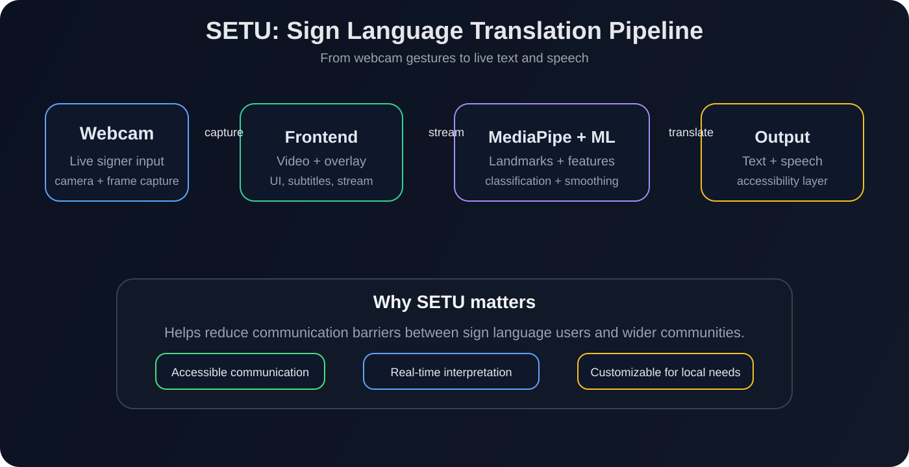

<div align="center">
  
  <br />

  [](https://python.org)
  [](https://fastapi.tiangolo.com)
  [](https://pytorch.org)
  [](https://google.github.io/mediapipe/)
  [](https://react.dev)
  [](https://typescriptlang.org)
  [](https://vitejs.dev)
  []()
</div>

# SETU

SETU is a real-time Indian Sign Language (ISL) translation system designed to bridge communication gaps between sign language users and people who do not understand sign language.

It captures live webcam input, extracts hand and face landmarks, infers signs using machine learning, and converts the output into readable text and spoken feedback. In short, SETU turns sign gestures into real-time communication.

## Why this matters

Communication is a basic human need. For many Deaf and hard-of-hearing users, sign language is a natural and expressive way to communicate, but it is still not widely supported in everyday digital tools.

SETU addresses that gap by creating an accessible translation experience that can help in:

- classrooms and learning environments
- public communication support
- daily conversation assistance
- assistive technology and accessibility research
- custom sign vocabulary for specific communities or teams

## The problem SETU solves

Many sign-language recognition systems are limited to static alphabets, require expensive hardware, or work only in controlled lab conditions. Others are too slow, too inaccurate, or too rigid for real-life communication.

SETU was built to solve a more practical challenge:

- detect signs in real time from a normal webcam
- support alphabets and phrase-like gestures
- reduce noisy predictions with confidence filtering and temporal smoothing
- display understandable output as text and subtitles
- speak the result aloud using browser-based speech synthesis
- allow users to extend the system with custom recorded signs

## How it works

SETU follows a simple pipeline:

1. A webcam captures the signer
2. MediaPipe extracts face and hand landmarks
3. Important gesture features are engineered from those landmarks
4. A trained model predicts the sign or phrase
5. Temporal smoothing and confidence checks reduce flicker and false results
6. The output is shown as live text and can be spoken aloud



## What makes SETU useful

### Real-time recognition
- live webcam-based sign recognition
- support for static alphabet signs and phrase-level gestures
- low-latency workflow for interactive use

### Accessibility-first design
- subtitle-style translation output
- browser speech synthesis for spoken feedback
- visual guidance to help with camera setup and hand visibility

### Practical ML workflow
- custom sign recording from webcam samples
- `.npz` dataset generation for feature-based learning
- retraining support for domain-specific or user-specific signs

### Modern architecture
- FastAPI backend for streaming, inference, and APIs
- React + TypeScript frontend for user interaction
- MediaPipe + PyTorch stack for computer vision and machine learning

## System architecture at a glance

```text
User webcam
  ↓
Frontend captures frames
  ↓
FastAPI WebSocket server receives them
  ↓
MediaPipe Holistic analyzes hands and face
  ↓
Feature extraction + model inference
  ↓
Temporal filtering + confidence validation
  ↓
Text output + subtitle HUD + speech synthesis
```

## Tech stack

- Python 3.10+
- FastAPI
- PyTorch
- MediaPipe
- OpenCV
- NumPy
- React 19
- TypeScript
- Vite
- Tailwind CSS

## Repository structure

```text
SETU/
├── .agent/                     # project support files
├── configs/                    # configuration and constants
├── data/
│   ├── manifests/              # signer-isolated train/val/test manifests
│   └── processed/              # processed feature arrays (.npz)
├── docs/                       # documentation and notes
├── frontend/                   # React + TypeScript + Vite app
├── models/                     # trained weights and labels
├── Project Main Files/         # strategy, architecture, and product docs
├── reports/                    # analysis and evaluation reports
├── scripts/                    # recording and demo scripts
├── setu/                       # backend Python package
│   ├── api/                    # FastAPI API + WebSocket server
│   ├── features/               # feature engineering logic
│   ├── models/                 # classifiers and ML logic
│   ├── utils/                  # helper and geometry utilities
│   ├── vision/                 # MediaPipe wrappers and vision utilities
│   ├── config.py               # configuration values
│   └── __init__.py             # package marker
├── tests/                      # automated tests
├── training/                   # training and model scripts
├── .env.example                # environment example
├── .gitignore                  # repository ignore rules
├── logo.png                    # SETU logo
├── pyproject.toml              # Python package metadata
├── README.md                   # project overview
├── Start_SETU.bat              # Windows launcher for full app
├── Start_Alphabet_Demo.bat     # Windows alphabet demo launcher
├── SETU_Sign_Language_Translator_Build_Handbook.docx
├── SETU_Foundation_Documents_2026-10-17_Updated.zip
└── ...
```

## Quick start

### Windows one-click launch

```powershell
./Start_SETU.bat
```

For the standalone alphabet demo:

```powershell
./Start_Alphabet_Demo.bat
```

### Manual setup

#### 1) Backend

```powershell
cd <path-to-SETU>
python -m venv .venv
.\.venv\Scripts\Activate.ps1
pip install -e .
pytest -v
uvicorn setu.api.server:app --host 0.0.0.0 --port 8000 --reload
```

#### 2) Frontend

```powershell
cd frontend
npm install
npm run dev
```

Then open:

```text
http://localhost:5173
```

The backend is expected to run on:

```text
http://localhost:8000
```

## API overview

The backend exposes REST and WebSocket endpoints for recognition.

### WebSocket stream

```text
ws://localhost:8000/api/v1/ws/recognize?model=realsign&threshold=0.35
```

This endpoint receives webcam frames and responds with prediction payloads that may include:

- label and confidence
- recognition stability state
- model selection
- camera guidance feedback
- landmark metadata
- speech-ready translation output

### Common REST routes

- `GET /api/v1/models`
- `GET /api/v1/models/realsign/classes`
- `GET /api/v1/vocabulary`
- `POST /api/v1/dataset/record_sample`
- `GET /api/v1/dataset/custom_samples`

## Training and custom sign recording

SETU supports user-recorded sign collection to extend recognition for specific communities or vocabularies.

Example:

```powershell
.\.venv\Scripts\python scripts/record_custom_signs.py --label namaste --takes 10
```

Example training run:

```powershell
.\.venv\Scripts\python training/train_sequence_lstm.py --epochs 60 --lr 0.001
```

This makes it easier to personalize the system and add domain-specific signs without redesigning the whole pipeline.

## Documentation

The `Project Main Files/` directory contains the deepest project documentation, including product requirements, architecture, design intent, and roadmap.

Recommended documents:

- `Project Main Files/README.md`
- `Project Main Files/PRD.md`
- `Project Main Files/architecture.md`
- `Project Main Files/design.md`
- `Project Main Files/phase.md`
- `Project Main Files/rules.md`

## Testing

```powershell
.\.venv\Scripts\pytest.exe -v
```

## Troubleshooting

Common issues:

- webcam blocked or not detected by the browser
- backend not running on port 8000
- poor lighting or low visibility of hands
- unstable predictions due to low confidence thresholds
- dependency issues during first-time setup

## License

This project is distributed under the MIT license unless otherwise stated in the repository files.

## Contributing

Key areas to explore:

- `setu/features/` for feature extraction improvements
- `setu/models/` for model architecture and inference logic
- `training/` for retraining and dataset experimentation
- `frontend/src/` for UI and interaction improvements
- `Project Main Files/` for architecture and roadmap updates

If you want to understand the project deeply, start with `Project Main Files/` and then move into the backend and frontend entry points.

---

SETU is a step toward making sign language more accessible through practical, real-time AI.
