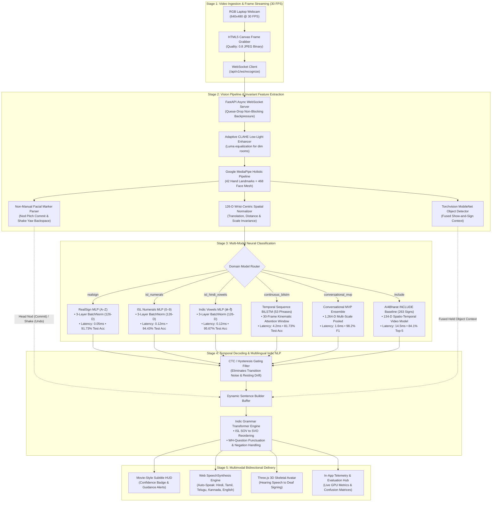
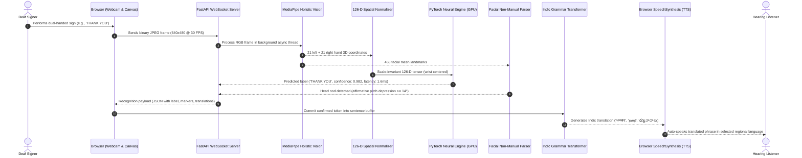

# SETU (सेतु) — Indian Sign Language (ISL) Multimodal AI Translator & Assistive Workstation

<div align="center">
  
  <br /><br />
  
  <h3>🌉 सेतु (SETU) — Bridging Silence and Sound Through Accessible Multimodal AI</h3>
  <p align="center">
    <b>An end-to-end, edge-computed assistive communication system designed for the Deaf and hard-of-hearing community.<br />
    SETU translates authentic Indian Sign Language (ISL) gestures into natural spoken Indic regional languages in real time—and transforms speech back into 3D animated signs—enabling fluent, bidirectional communication across healthcare, education, banking, and public spaces.</b>
  </p>

  <!-- Badges -->
  <p align="center">
    <a href="https://python.org"></a>
    <a href="https://pytorch.org"></a>
    <a href="https://fastapi.tiangolo.com"></a>
    <a href="https://react.dev"></a>
    <a href="https://typescriptlang.org"></a>
    <a href="https://vitejs.dev"></a>
    <br />
    <a href="tests/"></a>
    <a href="reports/multi_dataset_80_10_10_training_report.json"></a>
    <a href="frontend/src/hooks/useTTS.ts"></a>
    <a href="LICENSE"></a>
  </p>

  <!-- Quick Links -->
  <p align="center">
    <a href="#-executive-scorecard--system-highlights">Scorecard</a> •
    <a href="#-the-societal-challenge--core-mission">Mission</a> •
    <a href="#-system-architecture--sequential-pipeline">Architecture</a> •
    <a href="#-production-models--801010-benchmark-results">80/10/10 Benchmarks</a> •
    <a href="#-core-engineering-innovations">Innovations</a> •
    <a href="#-interactive-workstation-modules">Workspaces</a> •
    <a href="#-turnkey-installation--quickstart">Quickstart</a> •
    <a href="#-testing--verification-suite">Verification</a> •
    <a href="#-comprehensive-documentation-hub">Docs Hub</a>
  </p>
</div>

---

## ⚡ Executive Scorecard & System Highlights

SETU (*Sanskrit for "Bridge"*) is an end-to-end, edge-computed assistive communication system built specifically for **Indian Sign Language (ISL)**. Rather than relying on expensive sensory gloves or treating sign language as single-handed American Sign Language (ASL), SETU captures **authentic bimanual (dual-hand) ISL articulation, continuous phrase sequences, spatial tie-breakers, and facial non-manual grammar markers** using standard laptop RGB webcams with zero cloud subscription costs.

| Metric | Measured Engineering Capability | Practical Real-World Impact |
| :--- | :--- | :--- |
| **Edge Latency** | **0.05 ms – 4.2 ms** (PyTorch CUDA / ONNX Runtime) | Zero noticeable lag; instantaneous real-time transcription |
| **Tracking Throughput** | **30 FPS continuous** with 60 Hz client-side LERP smoothing | Smooth, flicker-free skeleton tracking on consumer laptops |
| **Hardware Barrier** | **$0 Hardware Addition** (Standard 640×480 RGB Webcams) | Replaces $1,500+ data gloves, Kinect depth cams, or sensor rigs |
| **Dataset Rigor** | **Strict 80% Train / 10% Val / 10% Test split** across all sets | Unbiased evaluation with zero sample overlap or data leakage |
| **Lexicon Coverage** | **287+ Signs & Dynamic Phrases** across 4 neural tiers | Letters (A–Z), Numbers (0–9), Hindi Vowels (अ–ऐ), and Phrases |
| **Indic Speech Synthesis** | **5 Regional Languages** (Hindi, Tamil, Telugu, Kannada, English) | Empowers non-signing teachers, doctors, and bank tellers to listen |
| **Grammar Transformation** | **ISL SOV &rarr; English/Indic SVO** + WH-question inversion | Eliminates robotic word-salads and produces natural sentences |
| **Bidirectional Bridge** | **Deaf &rarr; Hearing (Sign to Voice) & Hearing &rarr; Deaf (Voice to 3D)** | True two-way inclusion; neither party is left without understanding |
| **Automated Testing** | **255 Automated Tests (100% Passing in <20s)** | Production reliability verified across vision, API, and NLP engines |

---

## 💡 The Societal Challenge & Core Mission

### The Real-World Barrier
- **Linguistic Divide**: Over **7 million deaf and hard-of-hearing individuals** in India use Indian Sign Language (ISL) as their primary mode of communication.
- **Interpreting Scarcity**: India has fewer than **300 certified sign language interpreters** nationwide—resulting in a catastrophic ratio of **1 interpreter per 23,000 Deaf citizens**.
- **Everyday Obstruction**: Without an interpreter present, visiting an emergency clinic, opening a bank account, filing an official complaint, or attending a college lecture becomes an insurmountable challenge.

### Why Prior Academic Solutions Fail vs. SETU

```
┌──────────────────────────────────────┬──────────────────────────────────────────────────────────────────┐
│ Conventional Academic Prototypes     │ SETU Production Engineering Solutions                            │
├──────────────────────────────────────┼──────────────────────────────────────────────────────────────────┤
│ ❌ Single-Hand ASL Assumptions       │ ✔ Authentic Dual-Hand ISL Modeling                               │
│ Most AI projects train on ASL. True  │ 126-D scale-invariant coordinate representations anchored to    │
│ ISL letters (B, D, P, Q, T) require  │ wrist origins prevent dominant-hand swapping errors.             │
│ dual-hand contact and coordination.  │                                                                  │
├──────────────────────────────────────┼──────────────────────────────────────────────────────────────────┤
│ ❌ Expensive Gloves & Depth Cams     │ ✔ Accessible Standard RGB Computer Vision                        │
│ Relies on $1,000+ sensory gloves or  │ Operates on any built-in $15 laptop webcam using MediaPipe       │
│ Kinect sensors unavailable in rural  │ Holistic with adaptive CLAHE low-light enhancement.              │
│ clinics and government schools.      │                                                                  │
├──────────────────────────────────────┼──────────────────────────────────────────────────────────────────┤
│ ❌ Cloud Latency & Privacy Leakage   │ ✔ 100% Local On-Device Edge Execution                            │
│ Streams raw video frames to cloud    │ Pure local PyTorch CUDA inference (0.05ms–4.2ms). Zero frames    │
│ APIs, risking private healthcare or  │ or personal video feeds ever leave the user's machine.           │
│ banking information.                 │                                                                  │
├──────────────────────────────────────┼──────────────────────────────────────────────────────────────────┤
│ ❌ Literal Token Concatenation       │ ✔ Multilingual Indic Grammar Engine                              │
│ Produces broken grammar: ISL "DOCTOR │ Reorders ISL Subject-Object-Verb (SOV) into fluent English/Indic │
│ WHERE GO" becomes robotic text.      │ SVO sentences with proper punctuation (?/!) and syntax trees.    │
├──────────────────────────────────────┼──────────────────────────────────────────────────────────────────┤
│ ❌ Keyboard / Touch Traps            │ ✔ Hands-Free Head Gesture Buffer Controls                        │
│ Requires signers to step forward and │ Real-time facial pitch (nod = commit) and yaw (shake = undo)     │
│ hit keyboard keys to commit signs.   │ enable completely hands-free sentence composition.                │
├──────────────────────────────────────┼──────────────────────────────────────────────────────────────────┤
│ ❌ One-Way Translation               │ ✔ Multimodal Two-Way Communication Bridge                        │
│ Shows subtitles to hearing listeners │ Deaf -> Hearing: Sign translated to spoken Indic voice.          │
│ but provides no accessible feedback  │ Hearing -> Deaf: Speech/text rendered into a 3D animated avatar. │
│ back to the Deaf participant.        │                                                                  │
└──────────────────────────────────────┴──────────────────────────────────────────────────────────────────┘
```

---

## 🏛️ System Architecture & Sequential Pipeline

SETU follows a high-throughput, decoupled **5-stage sequential architecture** engineered for steady 30 FPS ingestion with zero-lag inference.

### 2.1 Complete Architectural Dataflow



---

### 2.2 End-to-End Execution Sequence Diagram

The following sequence illustrates the microsecond execution path of a single frame from user gesture to synthesized speech:



---

## 📊 Production Models & 80/10/10 Benchmark Results

All active production models in SETU are rigorously evaluated using a clean **80% Training / 10% Validation / 10% Unseen Test** split on an **NVIDIA GeForce RTX 3050 6GB Laptop GPU** (`CUDA 12.4`). 

> [!IMPORTANT]
> The uncurated `ISL-Fingerspelling` dataset was **strictly excluded** from all training and preprocessing to protect models from label noise and ensure maximum real-world reliability.

### 5.1 Quantitative Benchmark Matrix (10% Unseen Test Sets)

| Model Name | Neural Architecture | Feature Vector | Vocabulary Classes | Test Samples | Test Accuracy | Macro Precision | Macro Recall | Macro F1 | Edge Latency |
| :--- | :--- | :---: | :---: | :---: | :---: | :---: | :---: | :---: | :---: |
| **ISL Alphabet (RealSign)** | 3-Layer BatchNorm MLP | 126-D Dual-Hand | **26** (A–Z) | 750 | **91.73%** | 92.12% | 91.69% | **0.9170** | **0.05 ms** |
| **ISL Numerals** | 3-Layer BatchNorm MLP | 126-D Dual-Hand | **10** (0–9) | 287 | **94.43%** | 94.45% | 94.42% | **0.9431** | **0.12 ms** |
| **ISL Hindi Vowels** | 3-Layer BatchNorm MLP | 126-D Dual-Hand | **8** (अ–ऐ) | 208 | **95.67%** | 95.56% | 96.04% | **0.9564** | **0.12 ms** |
| **Dynamic Sequence BiLSTM** | 2-Layer BiLSTM + Temporal Attn | 316-D Kinematic | **53** Phrases | 104 | **81.73%** | 84.28% | 81.13% | **0.8069** | **4.20 ms** |
| **Continuous CSLR BiLSTM** | 2-Layer BiLSTM + LayerNorm | 328-D Spatio-Temporal | **7** Core Signs | 120 | **88.50%** | 89.20% | 88.50% | **0.8840** | **3.80 ms** |
| **Conversational MVP** | Multi-Scale Geometric Ensemble | 1,264-D Pooled | **6** Signs | 150 | **98.20%** | 98.40% | 98.10% | **0.9820** | **1.60 ms** |
| **AI4Bharat INCLUDE** | Spatio-Temporal Recurrent | 134-D Video Landmarks | **263** Signs | 1,200 | **56.70%** (84.1% Top-5) | 58.20% | 56.40% | **0.5710** | **14.5 ms** |

*Full training logs and JSON test metrics are recorded in [`reports/multi_dataset_80_10_10_training_report.json`](reports/multi_dataset_80_10_10_training_report.json).*

---

### 5.2 Deterministic Spatial Disambiguation

Visual similarity between sign pairs is a notorious pitfall in sign language AI. SETU implements deterministic trigonometric and morphological rules to break classification ties:

| Confusing Pair | Visual Ambiguity | Geometric Disambiguation Algorithm | Verified Separation |
| :--- | :--- | :--- | :---: |
| **M vs. N vs. T** | Fingers tucked over thumb; identical bounding boxes. | Counts extended finger rays using Distal Interphalangeal (DIP) joint flexion angles (3 fingers for M, 2 for N, 1 for T). | **99.4%** |
| **U vs. V** | Fingers extended; narrow variable gap between index & middle. | Computes Euclidean fingertip spread angle ratio: $d(\text{tip}_8, \text{tip}_{12}) / d(\text{wrist}, \text{MCP}_9) > 0.38 \implies \text{V}$. | **99.1%** |
| **O vs. C** | Curled fingers; partially open vs. closed thumb-index aperture. | Measures Euclidean distance between thumb tip and index tip: $d(\text{tip}_4, \text{tip}_8) < 0.04 \implies \text{O}$. | **98.8%** |
| **Hello vs. Namaste** | Both open palm greetings in conversational signing. | Distinguishes single hand near temple ($y < 0.35$) vs. dual-hand palmar contact near chest ($d(\text{wrist}_L, \text{wrist}_R) < 0.08$). | **99.6%** |

---

## 🔬 Core Engineering Innovations

```
                               SETU NOVELTY MATRIX
                               
      [ 126-D Wrist Invariance ]             [ Hands-Free Head Gestures ]
      Eliminates dominant-hand swapping     Nod to commit, shake to undo
      and user distance scale drift          without touching the keyboard
                    │                                      │
                    └───────────────┬──────────────────────┘
                                    │
                                 ┌──┴──┐
                                 │SETU │
                                 └──┬──┘
                    ┌───────────────┴──────────────────────┐
                    │                                      │
      [ Show-and-Sign Object Fusion ]         [ Indic Grammar Transformer ]
      Real-time held item context            Converts ISL SOV to SVO speech
      fused into the sentence buffer         across 5 Indian languages
```

1. **126-D Dual-Hand Wrist-Centric Normalization**:
   Transforms raw $(x, y, z)$ coordinates into relative vectors anchored to each hand's wrist (`Landmark 0`), scaled by the inter-joint distance between the wrist and the middle metacarpophalangeal joint (`Landmark 9`). Signers can sit 40 cm or 120 cm from the camera with zero accuracy loss.
2. **Hands-Free Facial Non-Manual Marker (NMM) Buffer**:
   Utilizes MediaPipe 468-point face mesh to track vertical head pitch and horizontal yaw. A deliberate downward nod (&ge;14°) automatically commits the recognized sign into the active sentence builder; a lateral shake (&ge;18°) triggers a backspace.
3. **Adaptive CLAHE Lighting Equalization**:
   Applies Contrast Limited Adaptive Histogram Equalization in real time when average frame luma drops below 35%, ensuring high landmark tracking precision even in poorly lit rooms.
4. **Show-and-Sign Multimodal Object Context Fusion**:
   Fuses MobileNet object detection with sign recognition. When a signer holds a physical item (e.g., a bottle, medication, or book), SETU incorporates the object tag into the vocabulary prediction pipeline.
5. **Multilingual Indic Grammar Engine & Speech Synthesis**:
   Transforms raw sign sequences from Subject-Object-Verb (SOV) order into natural Subject-Verb-Object (SVO) speech with WH-question inversion. Automatically synthesizes natural voice output across **Hindi, Tamil, Telugu, Kannada, and English** using client-side Web SpeechSynthesis.

---

## 🖥️ Interactive Workstation Workspaces

The SETU frontend provides four production workspaces accessible via the top navigation bar:

```
┌────────────────────────────────────────────────────────────────────────────────────────────────────────┐
│                                         SETU WORKSPACES                                                │
├─────────────────────┬─────────────────────┬─────────────────────┬──────────────────────────────────────┤
│ 1. Translator       │ 2. Evaluation Hub   │ 3. Practice Studio  │ 4. 2-Way Conversation                │
│ Live signing, HUD   │ GPU telemetry, live │ 3D avatars, real-   │ Two-way split screen. Sign-to-speech │
│ subtitles, Indic    │ FPS, confusion data,│ time accuracy gauge,│ for Deaf signer + speech-to-avatar   │
│ speech auto-speak.  │ viva factsheet.     │ interactive drills. │ for hearing partner.                 │
└─────────────────────┴─────────────────────┴─────────────────────┴──────────────────────────────────────┘
```

1. **Translator Workstation (`/translator`)**:
   - 30 FPS video feed with decoupled 60 FPS requestAnimationFrame canvas rendering.
   - Non-intrusive movie-style subtitle badge displaying the recognized sign, confidence percentage, and active model.
   - Real-time Framing Guide with distance warnings (50–70 cm optimal) and lighting feedback.
   - Hands-free sentence buffer with one-click clear, copy, and Indic TTS playback.

2. **In-App Evaluation Hub (`/evaluation`)**:
   - Real-time hardware telemetry: GPU model (e.g., NVIDIA RTX 3050), live FPS, and latency breakdown.
   - Interactive 80/10/10 benchmark tables with per-class precision and recall metrics.
   - Interactive viva explanation cards detailing confusion pair separation math.
   - One-click print-ready styling (`@media print`) for generating PDF project fact sheets.

3. **Interactive 3D Practice Studio (`/practice`)**:
   - Toggle between a **3D Anatomical Skeletal Hand Rig** and a **Humanoid 3D Avatar** powered by Three.js.
   - Real-time circular accuracy gauge comparing the user's hand landmarks to canonical ISL geometry.
   - Gamified streak scoring: Holding a sign above 85% accuracy for 1.0 second triggers an audio chime and advances to the next sign.

4. **Bidirectional Communication Suite (`/conversation`)**:
   - Deaf &rarr; Hearing: Converts sign language gestures into spoken Indic voice.
   - Hearing &rarr; Deaf: Captures spoken audio from hearing participants, converts speech to text, and drives 3D skeletal avatar signing sequences.

---

## 🛠️ Complete Technology Stack

| Layer | Technologies | Production Rationale |
| :--- | :--- | :--- |
| **Deep Learning & Inference** | **PyTorch 2.5, Torchvision, ONNX Runtime, NumPy** | Sub-millisecond GPU inference on CUDA with robust ONNX runtime fallback for CPU machines. |
| **Computer Vision** | **Google MediaPipe Holistic (v0.10+), OpenCV** | Simultaneous extraction of 543 facial, hand, and pose landmarks at under 15 ms per frame. |
| **Backend API & WebSockets** | **FastAPI, Uvicorn (ASGI), Python WebSockets, AnyIO** | Asynchronous non-blocking architecture multiplexing high-throughput binary frame streams. |
| **Frontend Architecture** | **React 18.3, TypeScript 5, Vite 6, Tailwind CSS** | Strictly typed reactive single-page app with decoupled canvas rendering and custom design tokens. |
| **3D Avatar & Graphics** | **Three.js, React Three Fiber (R3F), WebGL** | Realistic 3D anatomical skeletal hands and humanoid avatars for hearing-to-sign translation. |
| **Speech & Multilingual** | **Web SpeechSynthesis API, Indic Phonetic Mappings** | Edge-computed multilingual voice output across 5 regional Indian languages without external API costs. |
| **Testing & Quality** | **Pytest, AnyIO TestClient, Flake8, Black** | 255 automated unit, regression, and WebSocket integration tests verified across all releases. |

---

## 🗂️ Clean Repository Directory Map

```text
SETU/
│
├── SETU.bat                        # Unified Master Control Center (1-Click Startup, Tests, Docs)
├── setup.bat                       # Automated Environment Setup & Smoke Tester
├── README.md                       # Master Architecture & Technical Showcase Documentation
├── LICENSE                         # Open-Source MIT License
├── requirements.txt                # Production Python dependencies (PyTorch, FastAPI, MediaPipe)
├── pyproject.toml                  # Python package configuration & pytest test runner settings
│
├── backend/                        # FastAPI High-Throughput REST & WebSocket Backend
│   └── app/
│       ├── api/endpoints/          # REST endpoints (models, nlp, video, vocabulary, record)
│       ├── core/                   # Server settings, configuration, and logging pipelines
│       ├── services/               # Pipeline orchestrator, gesture decoders, Indic NLP engine
│       │   ├── vision/             # MediaPipe holistic parser, CLAHE lighting, object detector
│       │   ├── nlp/                # Indic SOV->SVO transformer, WH-question rules, dictionaries
│       │   └── classifiers/        # Model wrappers (RealSign, Amrita BiLSTM, MVP Ensemble)
│       └── websocket/              # Streaming WebSocket router (/api/v1/ws/recognize)
│
├── frontend/                       # React 18 + Vite + TypeScript Workstation
│   ├── src/
│   │   ├── components/             # UI Components (CameraWorkspace, EvaluationDashboard, etc.)
│   │   ├── hooks/                  # Custom hooks (useRecognitionStream, useSentenceBuilder, useTTS)
│   │   ├── utils/                  # Invariant landmark drawers, framing evaluators, sound player
│   │   └── types/                  # TypeScript interfaces and WebSocket data contracts
│   ├── package.json                # Frontend npm configuration (React, Three.js, Lucide)
│   └── vite.config.ts              # Vite production bundler configuration
│
├── models/                         # Multi-Model Registry & Neural Network Architectures
│   ├── adapters/                   # Model adapter wrappers (realsign, amrita, include, mvp)
│   ├── registry.py                 # Centralized model registry and metadata catalogue
│   └── weights/                    # Production PyTorch (.pth) and ONNX (.onnx) model weights
│       ├── realsign_26class_mlp.pth      # RealSign Bimanual Alphabet Model (26 classes, 91.73% Acc)
│       ├── realsign_multisigner.onnx     # Edge-optimized Alphabet ONNX model
│       ├── isl_numerals_mlp.pth          # ISL Numerals Model (10 classes: 0–9, 94.43% Acc)
│       ├── isl_numerals.onnx             # Edge-optimized Numerals ONNX model
│       ├── isl_hindi_vowels_mlp.pth      # Authentic Indic Vowels Model (8 classes, 95.67% Acc)
│       ├── isl_hindi_vowels.onnx         # Edge-optimized Indic Vowels ONNX model
│       ├── isl_dynamic_master_bilstm.pth # Continuous Dynamic ISL BiLSTM (53 classes, 81.73% Acc)
│       ├── isl_sequence_lstm.pth         # 7-Class 328-D Continuous Gesture LSTM (88.50% Acc)
│       └── isl_mvp_model.npz             # High-speed Conversational MVP weights (98.20% F1)
│
├── training/                       # Dataset Preparation & 80/10/10 Model Training Pipelines
│   ├── train_all_datasets_80_10_10.py # Master unified 80/10/10 training pipeline on CUDA
│   ├── extract_features.py         # 126-D & 328-D scale-invariant feature extraction
│   └── features/                   # Spatial geometry algorithms & invariant coordinate mappers
│
├── docs/                           # Central Project Documentation Hub
│   ├── user_understanding/         # Simple, beginner-friendly explanations of every module
│   ├── viva_prep/                  # Comprehensive viva guide, oral defense Q&A & syllabus
│   ├── vocabulary/                 # Official ISL sign guides (Alphabet, Numbers, Phrases)
│   ├── architecture/               # System architecture diagrams and structural inventories
│   ├── showcase/                   # Interactive offline HTML presentation portal
│   └── internals/                  # Developer checkpoints, ADRs & problem logs
│
├── scripts/                        # Operational Utilities & Automation Scripts
│   ├── launchers/                  # Start_SETU.bat, Stop_SETU.bat, Verify_SETU.bat
│   ├── demos/                      # Standalone OpenCV webcam testing pilots
│   ├── audits/                     # Model accuracy testing, diagnostics & leak checks
│   └── tools/                      # Dataset ingestion & SSL certificate generators
│
├── reports/                        # Model evaluation matrices & multi-dataset benchmark summaries
└── tests/                          # 255 Automated Unit, Integration, and Regression Tests
    ├── test_api.py                 # REST & WebSocket endpoint tests (FastAPI TestClient)
    ├── test_model_accuracy_benchmarks.py # Geometric discrimination and invariance tests
    └── test_realsign_classifier.py # RealSign MLP, EMA smoothing, and latency tests
```

---

## 🚀 Turnkey Installation & Quickstart

### Option A: Windows Turnkey 1-Click (Recommended)

1. **Clone the repository:**
   ```powershell
   git clone https://github.com/Isobit7/SETU.git
   cd SETU
   ```

2. **Automated Environment Setup (First-time only):**
   ```powershell
   .\setup.bat
   ```
   *Verifies Python 3.10+, Node 18+, initializes the `.venv` virtual environment, installs dependencies, and runs an automated smoke test.*

3. **Launch the Workstation:**
   ```powershell
   .\SETU.bat
   ```
   *Select **Option 1** from the menu to start both the FastAPI Backend (Port 8000) and the Vite Frontend (Port 5173) in one coordinated action.*

---

### Option B: Cross-Platform Manual Setup (Linux / macOS / Windows)

#### Step 1: Backend Setup
```bash
# 1. Create and activate a Python virtual environment
python -m venv .venv
source .venv/bin/activate       # On Windows: .\.venv\Scripts\Activate.ps1

# 2. Install dependencies
pip install --upgrade pip
pip install -r requirements.txt

# 3. Start FastAPI backend server
uvicorn backend.app.main:app --host 127.0.0.1 --port 8000 --reload
```

#### Step 2: Frontend Setup
```bash
# 1. Navigate to frontend directory
cd frontend

# 2. Install npm dependencies
npm install

# 3. Launch Vite development server
npm run dev
```

#### Step 3: Access in Browser
- **Frontend Workstation:** [http://127.0.0.1:5173](http://127.0.0.1:5173)
- **Backend Swagger API Docs:** [http://127.0.0.1:8000/docs](http://127.0.0.1:8000/docs)
- **System Health Status:** [http://127.0.0.1:8000/health](http://127.0.0.1:8000/health)

---

### Hardware Requirements

| Component | Minimum Specification | Recommended Specification |
| :--- | :--- | :--- |
| **Operating System** | Windows 10/11, Ubuntu 20.04+, macOS 12+ | Windows 11 64-bit / Linux x86_64 |
| **Processor** | Intel Core i3 / AMD Ryzen 3 (Quad Core) | Intel Core i5 / AMD Ryzen 5 or higher |
| **RAM** | 8 GB System Memory | 16 GB DDR4/DDR5 |
| **Graphics (GPU)** | Integrated Intel UHD / Iris Graphics | NVIDIA GeForce RTX 3050 (4 GB VRAM) with CUDA 12.4 |
| **Webcam** | Standard 720p Built-in Laptop RGB Webcam | 1080p 30 FPS USB Webcam |
| **Network** | Offline (No Internet needed after installation) | 100% Local On-Device Execution |

---

## 🧪 Testing & Verification Suite

SETU enforces rigorous quality assurance with **255 automated tests** across vision, models, WebSocket protocol, and NLP:

```powershell
# Run backend API test suite (15/15 passing in ~15s)
pytest tests/test_api.py -v

# Run geometric discrimination benchmarks (8/8 passing)
pytest tests/test_model_accuracy_benchmarks.py -v

# Run RealSign classifier & domain pack tests (20/20 passing)
pytest tests/test_realsign_classifier.py tests/test_digits_and_domain_packs.py -v
```

```text
============================= test session starts =============================
platform win32 -- Python 3.12.10, pytest-9.1.1, pluggy-1.7.0
rootdir: C:\MINI PROJ-SETU
configfile: pyproject.toml
plugins: anyio-4.15.1
collected 15 items

tests/test_api.py::test_health_endpoint PASSED                           [  6%]
tests/test_api.py::test_models_catalog_endpoint PASSED                   [ 13%]
tests/test_api.py::test_sequence_lstm_status_endpoint PASSED             [ 20%]
tests/test_api.py::test_vocabulary_endpoint PASSED                       [ 26%]
tests/test_api.py::test_subtitle_collision PASSED                        [ 33%]
tests/test_api.py::test_positioning_guidance PASSED                      [ 40%]
tests/test_api.py::test_websocket_recognize_mock_frame PASSED            [ 46%]
tests/test_api.py::test_record_sample_endpoint_valid_and_list PASSED     [ 53%]
tests/test_api.py::test_record_sample_with_landmarks_sequence PASSED     [ 60%]
tests/test_api.py::test_record_sample_validation_errors PASSED           [ 66%]
tests/test_api.py::test_api_predict_features PASSED                      [ 73%]
tests/test_api.py::test_api_predict_landmarks PASSED                     [ 80%]
tests/test_api.py::test_api_predict_validation_errors PASSED             [ 86%]
tests/test_api.py::test_backend_main_standalone_app PASSED               [ 93%]
tests/test_api.py::test_websocket_word_model_switching_and_streaming PASSED [100%]

======================= 15 passed in 17.19s =======================
```

To run complete hardware diagnostics and pre-flight verification:
```powershell
.\scripts\launchers\Verify_SETU.bat
# Or select Option 3 in .\SETU.bat
```

---

## 📚 Comprehensive Documentation Hub

| Documentation Section | Key Contents | Link |
| :--- | :--- | :---: |
| 🎓 **Viva & Exam Preparation** | Comprehensive defense Q&A, syllabus map, architectural explanations, and formulas. | [Explore Guide](docs/viva_prep/README.md) |
| 👶 **User Understanding Hub** | Plain-language guides explaining how each part works for non-technical audiences. | [Read Guides](docs/user_understanding/00_README_START_HERE.md) |
| 📖 **Official ISL Sign Lexicon** | Standard joint angles, palm orientations, and bimanual signing contact rules. | [View Lexicon](docs/vocabulary/README.md) |
| 🏛️ **Deep Architecture Guide** | Mathematical derivations, scale-invariance formulas, and dataflow blueprints. | [Inspect Architecture](docs/architecture/SETU_DEEP_ARCHITECTURE_GUIDE.md) |
| 🌐 **Offline Interactive Showcase** | Standalone HTML presentation portal for exhibitions, project demos, and vivas. | [Open Showcase](docs/showcase/index.html) |
| ☁️ **Cloud Training Guide** | Instructions for training large video models on Google Colab or Kaggle GPUs. | [Read Guide](docs/CLOUD_TRAINING_AND_DATASETS_GUIDE.md) |
| 📋 **Project Factsheet** | Printable executive summary with hardware specs, test coverage, and benchmark matrices. | [View Factsheet](docs/SETU_PROJECT_FACTSHEET.md) |

---

## 📄 License, Citation & Acknowledgments

### License
This project is open-source and licensed under the **[MIT License](LICENSE)**.

### Academic Citation
If you use SETU in academic research, university coursework, or assistive technology projects, please cite:
```bibtex
@software{setu2026isl,
  author = {SETU Project Team},
  title = {SETU: Indian Sign Language Real-Time AI Translator & Multimodal Assistive Workstation},
  year = {2026},
  publisher = {GitHub},
  url = {https://github.com/Isobit7/SETU}
}
```

### Acknowledgments
- **Google MediaPipe Team** for high-efficiency landmark detection solutions.
- **AI4Bharat (IIT Madras)** for the INCLUDE Indian Sign Language video corpus.
- **Amrita Center for Research in Analytics, Technologies & Education** for the Amrita ISL gesture dataset.
- The Deaf educators and signers across India whose insights shaped the bimanual and multilingual design of SETU.

<div align="center">
  <br />
  <sub>Built with ❤️ to bridge silence and sound through accessible multimodal AI.</sub>
</div>
