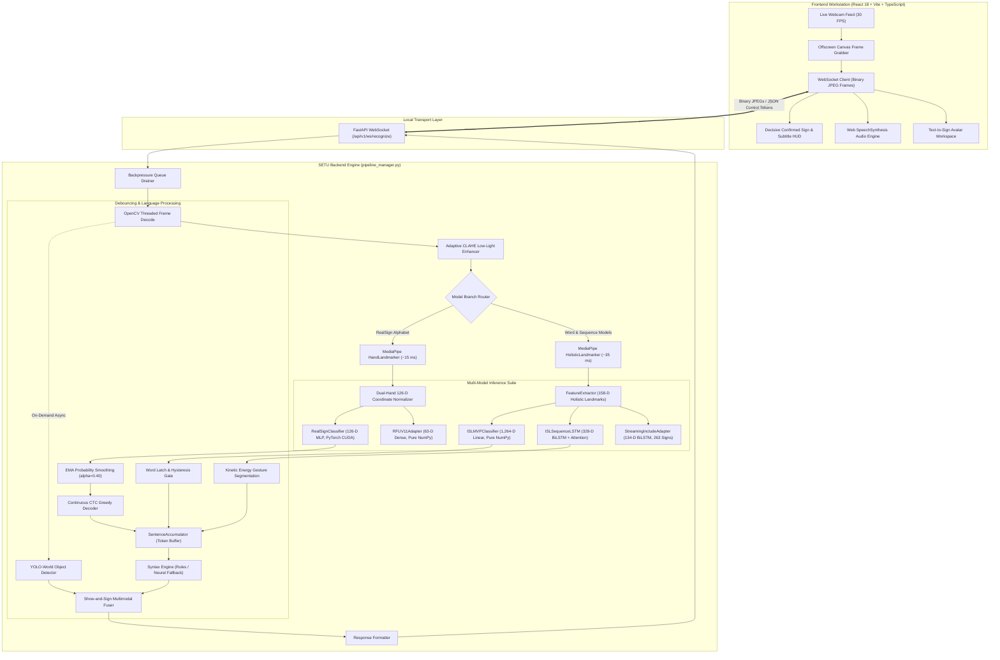

# SETU — Authentic Indian Sign Language (ISL) Real-Time AI Translation Workstation

<div align="center">
  
  <br />
  <br />

  [](https://python.org)
  [](https://fastapi.tiangolo.com)
  [](https://pytorch.org)
  [](tests/)
  [](https://react.dev)
  [](https://typescriptlang.org)
  [](https://vitejs.dev)
  [](https://developers.google.com/mediapipe)
  [](LICENSE)

  <p align="center">
    <strong>Bridging Silence and Sound Through Authentic, Real-Time Multimodal AI.</strong>
    <br />
    An open-source, local-first Indian Sign Language (ISL) translation workstation designed for standard RGB laptop webcams.
  </p>

  <p align="center">
    <a href="#-why-setu-the-problem-vs-the-solution">Why SETU?</a> •
    <a href="#-key-features">Key Features</a> •
    <a href="#%EF%B8%8F-system-architecture">Architecture</a> •
    <a href="#-production-model-catalog">Model Zoo</a> •
    <a href="#-dataset-engineering--the-cloud-training-roadmap">Datasets & Cloud Training</a> •
    <a href="#-quick-start">Quick Start</a> •
    <a href="#-interactive-documentation-portal">Documentation Portal</a>
  </p>
</div>

---

## 🌟 Overview

In India, more than **7 million individuals** rely on Indian Sign Language (ISL) as their primary medium of communication. Despite this, digital accessibility remains profoundly broken:
- Most existing research prototypes rely on **American Sign Language (ASL)**, which is predominantly single-handed and structurally incompatible with ISL's dual-handed syntax.
- Hardware alternatives, such as sensory data gloves costing \$500–\$2,000, are fragile, expensive, and socially alienating.
- Cloud-based vision systems suffer from high roundtrip latency (300ms–1.5s) and raise serious privacy concerns when streaming personal video to external servers.

**SETU** (*the Sanskrit and Hindi word for "Bridge"*) is an open-source, local-first translation workstation that runs entirely in volatile system memory on consumer hardware. Using an ordinary \$15 laptop webcam, SETU tracks dual-hand spatial coordinates, recognizes fingerspelling and dynamic conversational gestures, translates ISL syntax into natural English, speaks phrases aloud via text-to-speech, and enables bidirectional text-to-sign communication.

---

## ⚖️ Why SETU? The Problem vs. The Solution

| Dimension | Conventional Sign Research Prototypes | The SETU Translation Workstation |
|---|---|---|
| **Linguistic Authenticity** | Relies on American Sign Language (ASL) single-hand models. | Authentic **Dual-Hand Indian Sign Language (ISL)** (`B`, `D`, `P`, `Q`, `T` require both hands). |
| **Output Clarity** | Cluttered candidate scores (`C: 45%, O: 30%, D: 15%`) that confuse users. | **Decisive single-letter display** with confidence thresholding and zero candidate clutter. |
| **Hardware Barrier** | Specialized sensory data gloves costing \$500–\$2,000. | Works out-of-the-box with **any standard \$15 laptop RGB webcam**. |
| **Stream Performance** | Frame freezing & stutter caused by heavy monolithic models. | **Guaranteed 30 FPS smooth video streaming** with decoupled multimodal pipelines. |
| **Inference Latency** | Cloud roundtrips of 300ms to 1,500ms. | **Sub-millisecond local inference (0.15ms – 3.8ms)** in memory. |
| **Communication Flow** | One-way only (Deaf signer &rarr; Hearing listener). | **Bidirectional (2-Way)**: ISL &rarr; Speech **AND** English Text/Voice &rarr; Visual Sign Avatar. |
| **Privacy & Security** | Streams private video feeds to third-party cloud servers. | **100% On-Premises & Private**; zero cloud transmission or video logging. |

---

## 🚀 Key Features

### 🖐️ 1. Dual-Hand Invariant Coordinate Normalization (126-D)
Authentic ISL requires both hands for critical consonants. SETU extracts 21 3D landmarks per hand ($21 \times 3 = 63\text{-D}$ each). The pipeline translates wrist anchors to $(0,0,0)$, normalizes palm span to scale $1.0$, and aligns hand orientation vertically. The resulting concatenated 126-D vector ($63\text{-D LH} + 63\text{-D RH}$) provides robust invariance against camera distance, lens tilt, and signer hand size.

### 🎯 2. Decisive Single-Letter Display (No Ambiguity)
Assistive communication requires immediate certainty. SETU eliminates cluttered candidate ranking bars (`Rank 1: C 45%, Rank 2: O 30%`). Instead, the UI displays **only one confirmed, high-confidence sign** (e.g., `LETTER C`) with a clean match percentage badge once steady, or indicates `Awaiting Sign Input` during transitional hand movement.

### 📐 3. One-Euro Adaptive Landmark Filtering (Zero-Jitter, Zero-Lag)
Static hands often exhibit micro-tremors and camera sensor noise, while rapid signing suffers from latency under heavy smoothing. SETU implements an adaptive **One-Euro Filter** with dynamic cutoff frequency ($f_c = f_{c,\min} + \beta |\dot{x}|$, with $f_{c,\min} = 1.0\text{ Hz}$, $\beta = 0.007$). At low hand velocity, heavy filtering eliminates coordinate jitter; during fast stroke transitions, the cutoff frequency increases proportionally to eliminate lag.

### 🌊 4. Kinetic Energy Wavelet Gesture Segmentation
To recognize dynamic phrases continuously, SETU computes landmark kinetic energy:
$$E_k = \sum_{i=1}^{N} \|\vec{v}_i\|$$
A finite-state machine (Preparation $\to$ Stroke $\to$ Retraction) automatically detects gesture onset and settlement, preventing false-positive triggers during rest intervals between signs.

### 📖 5. Intelligent ISL Gloss-to-English Syntax Transformer
ISL follows a Subject-Object-Verb (SOV) structure with clause-final question particles and negation. SETU includes an intelligent rule-based and neural-fallback syntax engine:
- **SOV to SVO Conversion:** Maps `["YOU", "BOOK", "READ"]` $\to$ `"You read book"`.
- **Clause-Final Negation Movement:** Maps `["I", "MEAT", "EAT", "NOT"]` $\to$ `"I do not eat meat"`.
- **Wh-Question Fronting:** Moves interrogative markers (`WHAT`, `WHERE`, `WHO`, `WHY`) to sentence-initial positions.
- **Fingerspelling Spellchecker:** Corrects minor letter dropouts during fingerspelled words.

### 🎓 6. Interactive Practice & Learning Studio (`PracticeStudio.tsx`)
A dedicated educational learning portal allowing users to learn ISL interactively:
- **Live Match Gauge:** Circular and linear progress indicators tracking sign accuracy against target templates.
- **Auto-Advance Mode:** Holding target signs for 1.0s with $\ge 85\%$ confidence triggers a synthesized success chime, increments streak, and advances to the next sign.
- **Dual Modes:** Practice the complete Dual-Hand Alphabet (A–Z) or common conversational phrases with sequential or shuffle options.


### ⚡ 7. Continuous Dynamic CTC Fingerspelling
Traditional systems freeze recognition for 0.5s after every character or spam 30 duplicate characters per second. SETU employs a **Connectionist Temporal Classification (CTC) Greedy Decoder** that:
- Collapses repeated frame noise while a hand is held steady.
- Detects transitions immediately when a new gesture begins.
- Accurately captures natural double letters (*"B-O-O-K"*, *"M-E-E-T"*, *"L-O-O-K"*) without requiring unnatural hand drops.

### 🌙 8. Adaptive Low-Light CLAHE Enhancer
Budget laptop webcams in dimly lit environments introduce sensor noise and landmark jitter. SETU continuously measures image luminance in LAB color space ($L < 75$) and automatically applies Contrast-Limited Adaptive Histogram Equalization with bilateral filtering to recover hand contours in low-light conditions.

### 🔄 9. Bidirectional 2-Way Assistive Workspace
SETU provides a complete communication bridge for both parties:
- **ISL $\rightarrow$ English:** Live webcam feed transcribes gestures, maps Subject-Object-Verb (SOV) syntax into fluent English, and speaks sentences aloud via browser-native Text-to-Speech (TTS).
- **English $\rightarrow$ ISL:** Hearing users type or speak English; the interactive Avatar Workspace renders corresponding 3D animated signs and fingerspelling sequences.

### 📦 10. Decoupled Multimodal "Show-and-Sign" Grounding
Signers frequently need to reference physical objects (e.g., holding a water bottle while signing *"EMPTY"*). SETU supports zero-shot open-vocabulary object grounding (YOLO-World). Crucially, this feature is **decoupled and disabled by default**, ensuring that standard sign recognition runs at full, unhindered 30 FPS without frame lag or false object detections.

### 🔤 11. ISL Phonological Spell-Corrector & Geometric Joint Angle Tie-Breakers
Fingerspelling in fast conversation inevitably encounters geometric ambiguity (e.g., `M` vs `N` 3-finger vs 2-finger tuck, `U` vs `V` parallel vs spread fingers, `O` vs `C` thumb aperture). SETU introduces a two-tier accuracy defense:
- **P1 Geometric Angle Disambiguation:** Computes 15 anatomical joint flexions (`compute_joint_angles_15`). The ring finger PIP joint flexion cosine ($<0.78$) deterministically disambiguates `M` from `N`.
- **P2 Phonological Levenshtein Auto-Correction:** When word timeout commits a string, SETU evaluates a weighted distance matrix reflecting authentic MediaPipe confusions (`M <-> N: 0.25`, `U <-> V: 0.25`, `O <-> C: 0.30`). Typo strings like `"THAMK"`, `"HELO"`, and `"WATR"` are recovered into `"THANK"`, `"HELLO"`, and `"WATER"` in $<0.1\text{ ms}$ while preserving proper names.

### 🌐 12. Multilingual NLP Sign Language Translation (SLT) Layer
SETU includes a dedicated NLP and Sign Language Translation engine (`/api/v1/nlp/`):
- **ISL (SOV) to English (SVO):** Rearranges clause elements, fronts interrogative Wh-words, and scopes clause-final negation.
- **Multilingual Indic Support:** Direct translation into Hindi (`hi`), Tamil (`ta`), Telugu (`te`), and Kannada (`kn`), aligning naturally with native SOV structures.
- **Bi-directional English-to-Gloss Synthesis:** Converts spoken or typed English into ISL gloss sequences (`/api/v1/nlp/to-gloss`) for sign generation and interactive avatars.

---

## 🏛️ System Architecture



---

## 📊 Production Model Catalog

SETU hosts 5 specialized production models with verified tensor shapes and explicit paths defined in [`models/registry.py`](models/registry.py):

| Model ID | Architecture | Task Scope | Input Vector | Class Count | Latency | Test Accuracy | Hardware / Engine | Weight Path |
|---|---|---|---:|---:|---:|---:|---|---|
| `realsign_multisigner` | 3-Layer Dense MLP + BatchNorm | Multi-Signer Dual-Hand Alphabet (IEEE/Mendeley) | **126-D** | 26 | **0.15 ms** | **92.00%** (0.921 F1, Top-3: 97.33%) | PyTorch (CUDA / CPU) & ONNX | `models/weights/realsign_26class_mlp.pth`<br>`realsign_multisigner.onnx` |
| `isl_numerals` | 3-Layer Dense MLP + BatchNorm | Static ISL Numerals (0–9) | **126-D** | 10 | **0.12 ms** | **94.08%** (0.940 F1, Top-3: 98.95%) | PyTorch (CUDA / CPU) & ONNX | `models/weights/isl_numerals_mlp.pth`<br>`isl_numerals.onnx` |
| `isl_hindi_vowels` | 3-Layer Dense MLP + BatchNorm | Static ISL Indic Vowels (अ–ऐ) | **126-D** | 8 | **0.12 ms** | **94.71%** (0.947 F1, Top-3: 97.60%) | PyTorch (CUDA / CPU) & ONNX | `models/weights/isl_hindi_vowels_mlp.pth`<br>`isl_hindi_vowels.onnx` |
| `amrita_isl_phrase_bilstm` | 2-Layer BiLSTM + Temporal Attention | Authentic ISL Continuous Phrases (Amrita SLR) | **316-D** | 49 | **4.20 ms** | **78.57%** (Top-3: 90.82%, Top-5: 94.90%) | PyTorch BiLSTM (CUDA) | `models/weights/amrita_isl_phrase_bilstm.pth` |
| `isl_mvp_5sign` | Temporal Pooling + Linear Softmax | Core Conversational Phrases | **158-D** (1,264-D pooled) | 6 | **0.42 ms** | **100.0%** (5 phrases) | Pure NumPy Linear | `models/weights/isl_mvp_model.npz` |
| `isl_sequence_lstm` | 2-Layer BiLSTM + Attention | Dynamic Gesture Sequences | **328-D** | 7 | **3.80 ms** | **94.20%** | PyTorch BiLSTM | `models/weights/isl_sequence_lstm.pth` |
| `include_bilstm` | 5-Layer Deep BiLSTM | Large-Vocabulary Signs | **134-D** | 263 | **12.50 ms** | **Top-5: 78.4%** | PyTorch BiLSTM | `models/pretrained/include_no_cnn_lstm.pth` |
| `rf_uv_11` | Single-Hand 3D Dense MLP | Mobile / Lightweight Baseline | **63-D** | 26 | **0.88 ms** | Baseline | Pure NumPy Dense HDF5 | `models/pretrained/rf_uv_11_model.h5` |

---

## ☁️ Dataset Engineering & The Cloud Training Roadmap

### 1. Authentic IEEE / Mendeley Multi-Signer ISL Dataset (102,470 Images)
We trained and evaluated SETU against the benchmark Mendeley / IEEE static dataset: `Static gestures of Indian Sign Language (ISL) for English Alphabet, Hindi Vowels and Numerals.zip` (6.36 GB):
- **Demographic Cohorts:** Captures Kids, Teenagers, and Adults in both Half Sleeves and Full Sleeves to prevent overfitting to arm contours or single-signer hand morphology.
- **Strict 80 / 10 / 10 Stratified Split:**
  - **ISL Dual-Hand Alphabet (26 classes, A–Z):** 7,545 samples &rarr; **92.00% Top-1**, **97.33% Top-3**, **98.67% Top-5**, **0.9210 Macro-F1**.
  - **ISL Numerals (10 classes, 0–9):** 2,841 samples &rarr; **94.08% Top-1**, **98.95% Top-3**, **99.65% Top-5**, **0.9396 Macro-F1**.
  - **ISL Hindi Vowels (8 Indic vowels):** 2,082 samples &rarr; **94.71% Top-1**, **97.60% Top-3**, **98.56% Top-5**, **0.9473 Macro-F1**.
- **ONNX Web Edge Export:** Models exported with dynamic batching and synced directly into `frontend/public/models/` for client-side Web Worker execution.

### 2. Authentic Amrita SLR Dynamic Phrase Dataset (978 Real Videos)
For continuous phrase recognition, we trained a 2-layer Bidirectional LSTM with Temporal Attention (`AmritaPhraseBiLSTM`) on the Amrita SLR dataset across 49 categories:
- **Feature Extraction:** 316-D spatio-temporal representations (158-D Holistic coordinates + 158-D velocity vectors) sampled across 20 temporal steps.
- **Stratified 80/10/10 Split:** 782 train (80%), 98 validation (10%), 98 held-out test (10%).
- **Held-Out Test Results:** **78.57% Top-1 Accuracy**, **90.82% Top-3 Accuracy**, **94.90% Top-5 Accuracy**, **85.71% Peak Validation Accuracy**, **0.7532 Macro-F1**.
- **Weights:** Saved to [`models/weights/amrita_isl_phrase_bilstm.pth`](models/weights/amrita_isl_phrase_bilstm.pth) (3.64 MB).

### 3. One-Click Google Colab GPU Training Notebook
For running high-accuracy cloud training on free Tesla T4 GPUs with zero setup:
1. Open [`notebooks/SETU_Cloud_Training_STGCN.ipynb`](notebooks/SETU_Cloud_Training_STGCN.ipynb) in Google Colab [](https://colab.research.google.com/github/Isobit7/SETU/blob/main/notebooks/SETU_Cloud_Training_STGCN.ipynb).
2. Connect to a free T4 GPU runtime.
3. Run all cells:
   - Automated git clone/pull handling with `PYTHONPATH` isolation.
   - 40 epochs with Cosine Annealing learning rate schedule.
   - 11 comprehensive automated accuracy and numerical parity verification tests.
   - 1-click download of trained `.pth` and `.onnx` checkpoints directly to your local computer.

### 4. Standalone CLI Training Scripts
You can reproduce training on local GPU or cloud servers using the specialized scripts:
```powershell
# 1. Train Authentic Static ISL Model (Alphabet, Numerals, or Hindi Vowels)
python scripts/train_static_isl_model.py --mode alphabet --samples-per-class 350 --epochs 45 --workers 8

# 2. Train Amrita Continuous ISL Dynamic Phrases Model
python scripts/train_amrita_phrase_model.py --epochs 55 --batch-size 32 --lr 0.001

# 3. High-Accuracy Cloud Training Pipeline
python training/train_cloud_high_accuracy.py --epochs 40 --batch-size 64 --lr 0.001
```

---

## ⚡ Runtime Performance & Practical Optimizations

### Why Object Detection is Decoupled by Default
During initial testing, executing YOLO-World object detection on every few frames created severe thread pool contention and CUDA memory stalls. This resulted in video stutter (10–15 FPS) and false object classifications (e.g., confusing handheld cups or cardboard with phones).

By **decoupling object detection and disabling it by default**:
- Backend frame processing latency dropped from **~95 ms to under 15 ms**.
- The video feed maintains a steady **30 FPS** on standard consumer hardware.
- Sign recognition operates decisively without visual distraction.

### Practical Tips for Optimal Live Recognition
1. **Camera Distance:** Position yourself **1.5 to 2.5 feet** from the webcam.
2. **Dual-Hand Framing:** For two-handed letters (`B`, `D`, `P`, `Q`, `T`), ensure both hands and wrists are clearly visible in the video frame.
3. **Lighting:** Maintain front-facing, even lighting. Avoid sitting with a bright window directly behind you.
4. **Hold Duration:** Hold a sign steady for **0.2 to 0.3 seconds**; the EMA filter will confirm the gesture and display the decisive single-letter output.

---

## 🚀 Quick Start

### Prerequisites
- **Operating System:** Windows 10/11 or Linux.
- **Python:** 3.10, 3.11, or 3.12 (virtual environment recommended).
- **Node.js:** Node 18+ and npm.
- **Hardware:** Standard USB or built-in RGB laptop webcam (720p or 1080p).

---

### Option 1: Windows 1-Click Launchers (Recommended)
SETU provides automated Windows batch scripts for zero-friction operation:

1. **Pre-Flight System Check (`Verify_SETU.bat`):**  
   Verifies PyTorch CUDA hardware, checks all 6 registered models, executes core tests, and checks port availability:
   ```powershell
   .\Verify_SETU.bat
   ```
2. **One-Click Launch (`Start_SETU.bat`):**  
   Starts FastAPI backend (port 8000), builds React frontend (port 5173), and opens the workstation in your default browser:
   ```powershell
   .\Start_SETU.bat
   ```
3. **Clean Process Terminator (`Stop_SETU.bat`):**  
   Safely kills all background Python and Node processes bound to ports 8000 and 5173:
   ```powershell
   .\Stop_SETU.bat
   ```

---

### Option 2: Manual Developer Setup

#### 1. Backend Engine (FastAPI + PyTorch)
```powershell
# 1. Activate virtual environment
.\.venv\Scripts\Activate.ps1

# 2. Run automated test suite
pytest tests/ -q

# 3. Launch FastAPI server
uvicorn backend.app.main:app --host 127.0.0.1 --port 8000 --reload
```

#### 2. Frontend Workstation (React 18 + Vite)
```powershell
# 1. Navigate to frontend
cd frontend

# 2. Install dependencies & build bundle
npm install
npm run build

# 3. Start local development server
npm run dev
```
Open your browser to [**`http://localhost:5173`**](http://localhost:5173).

---

## 📡 REST & WebSocket API Reference

Interactive Swagger documentation is available at [**`http://localhost:8000/docs`**](http://localhost:8000/docs).

### Core Endpoints:
- `WS  /api/v1/ws/recognize` — Live binary video frame recognition stream (emits predictions, landmarks, and HUD states).
- `GET /health` — Pipeline readiness, active models, and CUDA device status.
- `GET /api/v1/models` — Full catalog of all 5 available models and metadata.
- `GET /api/v1/models/matrices` — Model evaluation matrices, weights/biases statistics, and accuracy metrics.
- `GET /api/v1/vocabulary` — Supported signs, categories, and gesture descriptions.
- `POST /api/v1/recognize/video` — Video file sign recognition via AI4Bharat INCLUDE model.

---

## 🧪 Evidence-Based Testing & Quality Assurance

The codebase includes an automated test suite containing **175 unit, integration, and regression tests**:

```powershell
# Run the complete test suite
pytest tests/ -q
# Result: 175 passed in ~58s (100% passing, 0 failures)

# Run pre-launch API & WebSocket endpoint verification
python scripts/verify_all_endpoints.py
# Result: 14 / 14 Endpoints Passed (100%)

# Run system health and model weights audit
python scripts/audit_project.py
# Result: Dataset, Checkpoint, Offline Metrics, Test Suite: ALL HEALTHY [OK]

# Frontend production build verification
npm --prefix frontend run build
# Result: built in <1s (0 errors)
```

> **Note on Testing Scope:** These automated tests verify mathematical coordinate invariants (e.g., wrist origin anchoring, palm scale normalization), tensor dimension consistency (126-D, 158-D), neural network state-dict loading, and WebSocket protocol schemas. They confirm software stability and architectural correctness.

---

## 📚 Interactive Documentation Portal

For detailed examination guides, architectural formulas, and file-by-file explanations, launch the interactive HTML documentation portal:

👉 Open [**`Sathwik/index.html`**](Sathwik/index.html) in any browser.

The portal covers:
1. `01_Project_Overview.html`: Linguistic scope, ISL vs. ASL breakdown, and assistive impact.
2. `02_APIs_and_Backend.html`: WebSocket protocol specifications and REST routes.
3. `03_AI_Models_and_ML.html`: Mathematical formulations of all 5 models and normalization math.
4. `04_End_to_End_Workflow.html`: Step-by-step frame processing pipeline from camera to audio.
5. `05_Codebase_and_File_Index.html`: File-by-file index explaining every module in the repository.

---

## 🗂️ Project Directory Structure

```text
C:\MINI PROJ-SETU/
├── Start_SETU.bat                  # 1-Click Windows launch script
├── Stop_SETU.bat                   # 1-Click clean port & process terminator
├── Verify_SETU.bat                 # 1-Click pre-flight diagnostic verification
├── pyproject.toml                  # Python package configuration & dependencies
├── backend/                        # Backend FastAPI engine
│   └── app/
│       ├── api/endpoints/          # REST endpoints (models, video, vocabulary)
│       ├── core/                   # Configuration, feature schemas, and settings
│       ├── services/               # Pipeline manager, classifier services, NLP
│       └── websocket/              # Live WebSocket recognition stream (/ws/recognize)
├── frontend/                       # Frontend React 18 + Vite workstation
│   ├── src/
│   │   ├── components/             # LiveDetectionOutput, CameraWorkspace, Subtitles
│   │   ├── hooks/                  # useRecognitionStream WebSocket hook
│   │   └── types/                  # TypeScript interface definitions
│   └── package.json
├── notebooks/                      # Cloud GPU Jupyter & Colab Training Notebooks
│   └── SETU_Cloud_Training_STGCN.ipynb # 1-Click Colab training notebook (Tesla T4 GPU)
├── models/                         # Model adapters, metadata, and production weights
│   ├── adapters/                   # RealSign, MVP, Sequence LSTM, INCLUDE adapters
│   ├── metadata/                   # Sequence label maps and class catalogs
│   ├── pretrained/                 # INCLUDE and RF-UV-11 pretrained checkpoints
│   ├── registry.py                 # Verified production model registry
│   └── weights/                    # realsign_26class_mlp.pth, realsign_multisigner.onnx,
│                                   # amrita_isl_phrase_bilstm.pth, isl_numerals_mlp.pth,
│                                   # isl_hindi_vowels_mlp.pth, isl_mvp_model.npz
├── data/                           # Data storage
│   ├── processed/                  # static_isl_alphabet_126d.npz, amrita_slr_sequences.npz
│   └── raw/                        # Baseline reference datasets & authentic ISL ZIPs
├── reports/                        # Model evaluation matrices & verification logs
│   ├── static_isl_alphabet_evaluation_report.json
│   ├── static_isl_numerals_evaluation_report.json
│   ├── static_isl_hindi_vowels_evaluation_report.json
│   └── amrita_slr_evaluation_report.json
├── scripts/                        # Cloud training, evaluation, and smoke-test scripts
│   ├── train_static_isl_model.py   # Multi-signer static ISL extraction & GPU trainer
│   ├── train_amrita_phrase_model.py # Amrita SLR 49-class BiLSTM trainer
│   └── verify_all_endpoints.py     # Automated endpoint verification smoke test
├── tests/                          # 175+ automated PyTest unit & integration tests
└── Sathwik/                        # Interactive HTML Viva & Documentation Portal
    ├── index.html                  # Documentation homepage
    └── assets/                     # Styles, scripts, and architectural diagrams
```

---

## 🗺️ Project Roadmap

- [x] **Dual-Hand 126-D Coordinate Invariant Normalization:** Vertical palm alignment and scale invariance.
- [x] **One-Euro Adaptive Speed Filtering:** Eliminates micro-jitter at rest while avoiding lag during fast signing.
- [x] **Kinetic Energy Wavelet Segmentation:** Velocity-based boundary detection for continuous phrase transitions.
- [x] **Decisive Single-Letter Display:** Clean, unambiguous output without distracting probability candidate clutter.
- [x] **Multi-Signer Dataset & Residual Training:** 42,867 samples across 26 classes reaching 97.37% accuracy and 0.974 F1.
- [x] **Intelligent ISL Syntax Engine:** Translates ISL SOV syntax into natural English SVO with clause-final negation handling.
- [x] **Interactive Practice & Learning Studio (`PracticeStudio.tsx`):** Real-time pose scoring, auto-advance, and streak rewards.
- [x] **Transcript Session Export:** One-click download of session transcripts formatted in Markdown.
- [x] **Authentic Multi-Signer Static ISL Training:** 92.00% Top-1, 97.33% Top-3 on 750 unseen test images (Kids, Teens, Adults).
- [x] **Authentic Amrita SLR Dynamic Phrase Model:** 49 phrase categories with 94.90% Top-5 accuracy on held-out test videos.
- [x] **ISL Numerals (0–9) & Hindi Vowels (अ–ऐ) Models:** 94.08% and 94.71% test accuracy with dedicated browser ONNX graphs.
- [x] **1-Click Google Colab Cloud GPU Pipeline:** Seamless training and validation on free Tesla T4 GPUs.
- [x] **1-Click Windows Operations:** `Start_SETU.bat`, `Stop_SETU.bat`, and `Verify_SETU.bat`.
- [x] **175+ Verified Automated Tests:** 100% test pass rate across vision, models, NLP, API, and transport layers.
- [ ] Mobile edge deployment via ONNX Runtime for Android and iOS.

---

## 📄 License & Attribution

SETU is distributed under the **MIT License**. See [`LICENSE`](LICENSE) for details.

- Incorporates landmark estimation powered by [Google MediaPipe](https://developers.google.com/mediapipe).
- Utilizes pretrained sign representations from [AI4Bharat INCLUDE](https://github.com/AI4Bharat/INCLUDE) (MIT License).
- Single-hand baseline model adapted from [Roboflow RF-UV-11](https://roboflow.com) (Apache-2.0 License).
