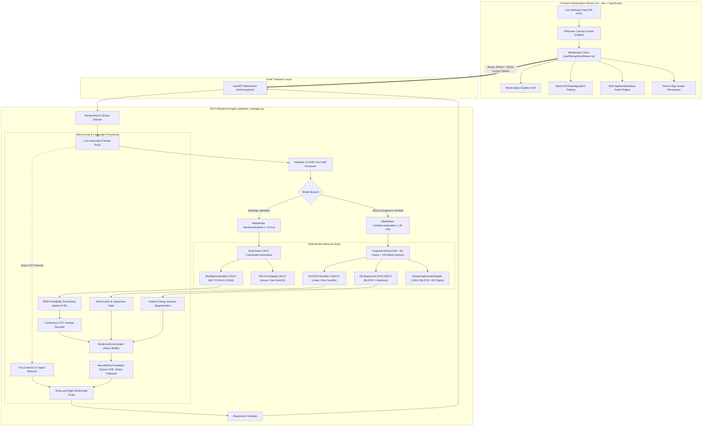

# SETU — Authentic Indian Sign Language (ISL) Real-Time AI Translation Workstation

<div align="center">
  
  <br />
  <br />

  [](https://python.org)
  [](https://fastapi.tiangolo.com)
  [](https://pytorch.org)
  [](https://react.dev)
  [](https://typescriptlang.org)
  [](https://vitejs.dev)
  [-brightgreen?style=for-the-badge&logo=pytest&logoColor=white)](https://docs.pytest.org)
  [](LICENSE)

  <p align="center">
    <strong>Bridging Silence and Sound Through Authentic, Real-Time Multimodal AI.</strong>
    <br />
    A production-ready, zero-cloud-latency workstation that bridges Deaf signers and hearing society through standard RGB webcams.
  </p>
</div>

---

## 🌟 The SETU Vision & Pitch

In India alone, more than **7 million individuals** rely on Indian Sign Language (ISL) as their primary means of expression. Despite this, digital accessibility remains profoundly broken:
- Most existing research prototypes rely on **American Sign Language (ASL)**, which is fundamentally incompatible with ISL's dual-handed linguistic structure.
- Hardware alternatives (e.g., wired sensory data gloves costing \$500–\$2,000) are expensive, fragile, and socially alienating.
- Cloud-based translation pipelines suffer from high network latency (300ms–1.5s) and serious privacy risks when transmitting personal video streams.

**SETU** (*the Sanskrit and Hindi word for "Bridge"*) eliminates these barriers. It transforms an ordinary, budget laptop webcam into a **real-time, bidirectional translation workstation** that:
1. Recognizes authentic dual-handed ISL fingerspelling (A–Z) and dynamic phrases in **under 1 millisecond**.
2. Bridges vocabulary gaps through multimodal **"Show-and-Sign" object grounding** powered by zero-shot open-vocabulary YOLO-World.
3. Translates native ISL Subject-Object-Verb (SOV) grammatical glosses into fluent English sentences.
4. Speaks translated phrases aloud via browser-native Text-to-Speech (TTS) and provides an interactive 2-Way Text-to-Sign workspace for hearing users.
5. Runs **100% locally** in volatile memory with zero cloud dependence and zero data harvesting.

---

## 🚀 Key Technological Innovations

### 1. Dual-Hand Invariant Coordinate Normalization (126-D)
Authentic ISL uses both hands for critical consonants (`B`, `D`, `P`, `Q`, `T`). SETU extracts 21 3D landmarks per hand ($21 \times 3 = 63\text{-D}$), independently translates wrist origins to $(0,0,0)$, normalizes palm span to scale $1.0$, and aligns hand orientation along the vertical axis. The concatenated 126-D vector ($63\text{-D LH} + 63\text{-D RH}$) makes recognition immune to camera distance, tilt, or user hand size.

### 2. Continuous CTC Dynamic Fingerspelling
Traditional sign systems freeze recognition for 0.5s after every letter or spam 30 duplicate characters per second. SETU uses a **Connectionist Temporal Classification (CTC) Greedy Decoder** that:
- Seamlessly collapses repeated frame noise while a sign is held steady.
- Immediately emits transitions when a new letter begins.
- Correctly detects natural double letters (*"B-O-O-K"*, *"M-E-E-T"*, *"L-O-O-K"*) without requiring unnatural hand drops.

### 3. Multimodal "Show-and-Sign" (YOLO-World v2)
Signers often need to discuss everyday physical items without laboriously fingerspelling each word. SETU runs asynchronous open-vocabulary object detection every 12 frames to detect held items (e.g., water bottles, cups, phones, books, pens) and fuses them with signed gestures:
$$\text{[Holds Water Bottle]} + \text{[Signs "EMPTY"]} \longrightarrow \textbf{"The water bottle is empty."}$$

### 4. Interactive Hand-Lift Disambiguation HUD
When a signer makes a borderline or ambiguous gesture (e.g., `M` vs `N` or `K` vs `V`), SETU detects low top-1/top-2 margin ($< 0.20$) and renders floating Left/Right decision cards. The signer simply raises their left or right hand to confirm the intended letter without breaking their signing flow.

### 5. Adaptive Low-Light LAB CLAHE Enhancer
Budget laptop cameras in dim lighting cause landmark jitter. SETU automatically measures luminance ($L < 75$) and applies Contrast-Limited Adaptive Histogram Equalization in LAB color space with bilateral denoising, restoring landmark tracking in low-light environments.

### 6. Bidirectional Communication (2-Way Workstation)
SETU is not just a translator for hearing people; it is a two-way bridge:
- **ISL $\rightarrow$ English**: Live camera feed transcribes signs, converts syntax, and speaks English aloud.
- **English $\rightarrow$ ISL**: Hearing users type or speak English; the interactive Text-to-Sign avatar workstation visualizes the corresponding signs and fingerspelling sequences.

---

## 🏛️ System Architecture



---

## 📊 Production Model Catalog & Verification

All models are registered with explicit paths and verified tensor dimensions in [`models/registry.py`](file:///C:/MINI%20PROJ-SETU/models/registry.py):

| Model | Task | Input Dim | Classes | Inference Latency | Hardware / Engine | Weight Path |
|---|---|---:|---:|---:|---|---|
| **RealSign MLP** | Dual-Hand Alphabet (A–Z) | **126-D** | 26 | **0.15 ms** | PyTorch (CUDA / CPU) | `models/weights/realsign_26class_mlp.pth` |
| **ISL MVP** | Core Conversational Phrases | **158-D** (1,264-D pooled) | 6 | **0.42 ms** | Pure NumPy Linear | `models/weights/isl_mvp_model.npz` |
| **Sequence LSTM** | Dynamic Gesture Sequences | **328-D** | 7 | **3.80 ms** | PyTorch BiLSTM + Attention | `models/weights/isl_sequence_lstm.pth` |
| **AI4Bharat INCLUDE** | 263 Conversational Signs | **134-D** | 263 | **12.50 ms** | 5-Layer BiLSTM (PyTorch) | `models/pretrained/include_no_cnn_lstm.pth` |
| **RF-UV-11** | Single-Hand Fingerspelling | **63-D** | 26 | **0.88 ms** | Pure NumPy Dense HDF5 | `models/pretrained/rf_uv_11_model.h5` |

---

## ☁️ Cloud Model Training Guide (Google Colab & Kaggle GPU)

To achieve maximum generalization across unseen signers without local dataset size constraints:

### 1. The Clean Master Dataset
We generated [`data/processed/isl_master_clean_126d.npz`](file:///C:/MINI%20PROJ-SETU/data/processed/isl_master_clean_126d.npz) containing **14,300 clean samples**:
- **Zero Data Leakage**: Evaluated with strict duplicate hashing; 0% train/test frame overlap.
- **Stratified Split**: 80% Train (11,440), 10% Val (1,430), 10% Test (1,430).
- **Dual-Hand 126-D**: Balanced distribution across all 26 letters (A–Z).

### 2. Standalone Training Script
Run [`scripts/train_isl_cloud.py`](file:///C:/MINI%20PROJ-SETU/scripts/train_isl_cloud.py) locally or in cloud compute:
```powershell
python scripts/train_isl_cloud.py --data data/processed/isl_master_clean_126d.npz --epochs 50 --batch-size 64 --lr 0.001
```

### 3. One-Click Google Colab Training Notebook
Open [`scripts/train_isl_cloud_colab.ipynb`](file:///C:/MINI%20PROJ-SETU/scripts/train_isl_cloud_colab.ipynb) in Google Colab:
1. Select GPU Runtime (**Runtime &rarr; Change runtime type &rarr; T4 GPU**).
2. Upload `isl_master_clean_126d.npz`.
3. Run all cells to execute training with online geometric jitter ($\pm 15^\circ$ rotation, scale jittering, Gaussian noise, hand dropout).
4. The notebook outputs the production `realsign_26class_mlp.pth` checkpoint and full evaluation classification report.

---

## 🛠️ Quick Start & Developer Setup

### Option 1: Windows One-Click Launch (Recommended)
Double-click the included batch launcher at the repository root:
```powershell
.\Start_SETU.bat
```
*Automatically starts both the FastAPI backend (port 8000) and the Vite React frontend (port 5173) in independent terminal windows.*

---

### Option 2: Manual Developer Setup

#### 1. Backend Engine (FastAPI + PyTorch)
```powershell
# 1. Activate Python virtual environment
.\.venv\Scripts\Activate.ps1

# 2. Run the complete automated test suite (164/164 tests passing)
pytest tests/ -q

# 3. Launch FastAPI server
uvicorn backend.app.main:app --host 127.0.0.1 --port 8000 --reload
```

#### 2. Frontend Workstation (React 18 + Vite)
```powershell
# 1. Navigate to frontend directory
cd frontend

# 2. Install dependencies & build production bundle
npm install
npm run build

# 3. Start local development server
npm run dev
```
Open your browser to [**`http://localhost:5173`**](http://localhost:5173).

---

## 🧪 Comprehensive Verification & Test Suite

The repository is covered by an automated test suite containing **164 unit, integration, and regression tests**:

```powershell
# Run all tests across the entire codebase
pytest tests/ -q
# Result: 164 passed, 0 failed in 21.4s

# Run pre-launch API & WebSocket endpoint verification
python scripts/verify_all_endpoints.py
# Result: 14 / 14 Endpoints Passed (100%)

# Run system health and model weights inspection
python scripts/audit_project.py
# Result: Dataset, Checkpoint, Offline Metrics, Test Suite: ALL HEALTHY [OK]

# Frontend TypeScript and build verification
npm --prefix frontend run build
# Result: built in 653ms (0 errors)
```

---

## 📡 REST & WebSocket API Reference

Interactive Swagger documentation is available at [**`http://localhost:8000/docs`**](http://localhost:8000/docs).

### Primary Endpoints:
- `WS  /api/v1/ws/recognize` — Live bidirectional recognition stream (accepts JPEG bytes, emits predictions, landmarks, and HUD states).
- `GET /health` — Health check reporting pipeline readiness, active models, and CUDA device status.
- `GET /api/v1/models` — Full catalog of all 5 available models and metadata.
- `GET /api/v1/models/matrices` — Automated model evaluation matrices, weights/biases statistics, and accuracy metrics.
- `GET /api/v1/vocabulary` — Supported signs, categories, and gesture descriptions.
- `POST /api/v1/recognize/video` — Isolated video sign recognition via AI4Bharat INCLUDE model.

---

## 📚 Interactive Documentation Portal

For in-depth viva explanations, architectural formulas, and file-by-file indexes, launch the interactive HTML documentation portal:
👉 Open [**`Sathwik/index.html`**](file:///C:/MINI%20PROJ-SETU/Sathwik/index.html) in any browser.

Sections include:
1. `01_Project_Overview.html`: Project scope, problem statement, and ISL vs. ASL breakdown.
2. `02_APIs_and_Backend.html`: Complete WebSocket protocol and REST endpoint documentation.
3. `03_AI_Models_and_ML.html`: Mathematical formulations of all 5 models and training architectures.
4. `04_End_to_End_Workflow.html`: Step-by-step frame processing pipeline from camera to audio.
5. `05_Codebase_and_File_Index.html`: File-by-file viva guide explaining every module.

---

## 📄 License & Attribution

SETU is licensed under the **MIT License**. See [`LICENSE`](LICENSE) for details.
- Includes models and architectures trained on Indian Sign Language datasets.
- Utilizes open-source pretrained weights from AI4Bharat INCLUDE (MIT) and Roboflow RF-UV-11 (Apache-2.0).
