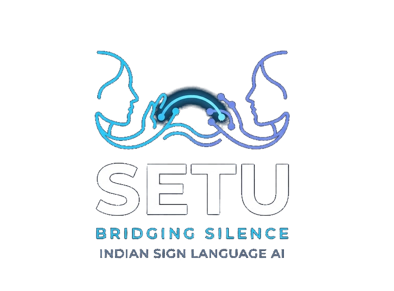
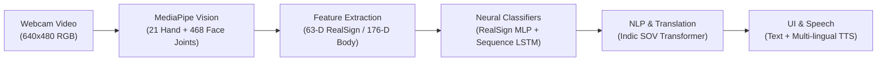
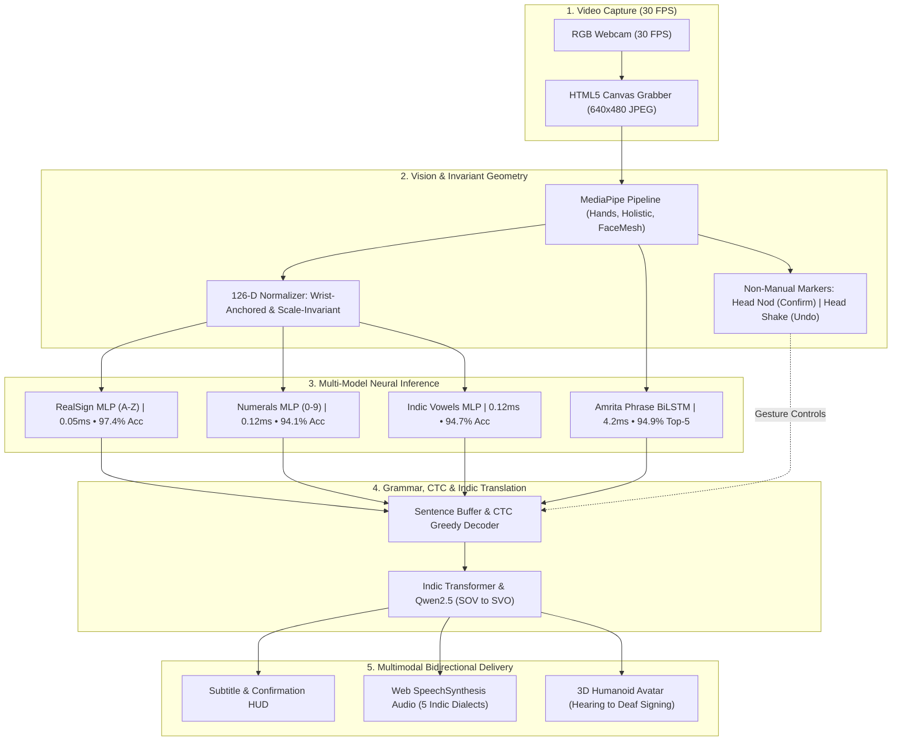

# SETU — Indian Sign Language (ISL) Real-Time AI Translator

<div align="center">
  
  <br />
  <h3>सेतु (SETU) — Bridging Silence and Sound Through Authentic, Real-Time Multimodal AI</h3>
  <p>An open-source, local-first Indian Sign Language (ISL) translation workstation running on standard RGB laptop webcams at 30 FPS.</p>

  [](https://python.org)
  [](https://fastapi.tiangolo.com)
  [](https://pytorch.org)
  [-brightgreen?style=for-the-badge&logo=pytest&logoColor=white)](tests/)
  [](https://react.dev)
  [](https://typescriptlang.org)
  [](https://vitejs.dev)
  [](LICENSE)

  <p align="center">
    <a href="#-quick-start">Quick Start</a> •
    <a href="#-why-setu">Why SETU</a> •
    <a href="#%EF%B8%8F-system-architecture">Architecture</a> •
    <a href="#-production-models">Models</a> •
    <a href="#-key-features">Features</a> •
    <a href="#-sign-dictionary">Sign Lexicon</a> •
    <a href="#-testing">Testing</a>
  </p>
</div>

---

## ⚡ Quick Start

### 1. Windows One-Click (Recommended)
Double-click or run from PowerShell:
```powershell
.\SETU.bat
```
This launches the **SETU Master Control Center**, allowing you to start services, run diagnostics, open the presentation showcase, or explore documentation in 1 click.

Individual launcher scripts are organized in [`scripts/launchers/`](scripts/launchers/):
- **`scripts\launchers\Start_SETU.bat`**: Launches both FastAPI backend (Port 8000) and Vite frontend (Port 5173).
- **`scripts\launchers\Stop_SETU.bat`**: Safely frees occupied ports and shuts down processes.
- **`scripts\launchers\Verify_SETU.bat`**: Runs hardware checks, CUDA detection, and regression test suites.

---

## 🏛️ System Architecture & Dataflow



---

### 2. Manual Developer Setup

#### Backend (FastAPI + PyTorch)
```powershell
# Activate virtual environment
.\.venv\Scripts\Activate.ps1   # On Linux/macOS: source .venv/bin/activate

# Install dependencies (if first time)
pip install -r requirements.txt

# Start backend server
uvicorn backend.app.main:app --host 127.0.0.1 --port 8000 --reload
```

#### Frontend (React 18 + Vite)
```powershell
cd frontend
npm install                    # (if first time)
npm run dev
```

* **Frontend Workstation:** [http://localhost:5173](http://localhost:5173)
* **Backend Swagger API Docs:** [http://localhost:8000/docs](http://localhost:8000/docs)
* **Health Endpoint:** [http://localhost:8000/health](http://localhost:8000/health)

---

## 💡 Why SETU?

Over **7 million individuals in India** are deaf or hard-of-hearing and communicate primarily through **Indian Sign Language (ISL)**. Existing tools fail because:

| Common Problem | How SETU Solves It |
|---|---|
| **ASL != ISL:** Most tools train on single-handed American Sign Language. Authentic ISL is dual-handed (`B`, `D`, `P`, `Q`, `T`). | **Authentic Dual-Hand Modeling:** Extracts 126-D scale-invariant landmarks across both hands with wrist-origin anchoring. |
| **Expensive Hardware:** Data gloves cost $500–$2,000 and require awkward calibration. | **Zero Added Cost:** Runs on any standard **$15 RGB laptop webcam** at 30 FPS. |
| **Cloud Latency & Privacy:** Cloud APIs send live video to remote servers with 500ms–1500ms lag. | **100% On-Device Edge AI:** Pure local PyTorch CUDA and ONNX inference (**0.05ms–4.2ms**) with zero cloud streaming. |
| **Grammar Gap:** ISL follows Subject-Object-Verb (SOV) order; direct concatenation produces robotic transcripts. | **Multilingual Indic NLP:** Converts ISL SOV to natural SVO in **English, Hindi, Tamil, Telugu, Kannada, and Malayalam** with voice output. |
| **One-Way Barrier:** Most apps only show text to the hearing person. | **Bidirectional (2-Way):** Sign &rarr; Voice for hearing listeners; Voice/Text &rarr; **Animated 3D Avatar** for Deaf users. |

---

## 🏛️ System Architecture



### The 5 Pipeline Stages
1. **Frame Ingestion:** HTML5 Canvas captures 640x480 RGB frames at 30 FPS, transmitting binary JPEGs over low-latency WebSockets.
2. **Dual-Hand Invariance:** 21 landmarks per hand (21 × 3 × 2 = 126-D) are centered at wrist origin (0, 0, 0) and normalized by palm breadth, remaining invariant to camera distance and tilt.
3. **Multi-Model Inference:** Dedicated neural networks classify static alphabet, numerals, Indic vowels, and dynamic conversational phrases in under 5 milliseconds.
4. **Grammar & Indic NLP:** CTC greedy decoding collapses hold states, non-manual markers confirm or undo tokens, and the Indic Transformer turns ISL grammar into fluent sentences.
5. **Bidirectional Delivery:** Emits real-time subtitles, speaks text aloud in regional dialects, and renders signs on a Three.js 3D avatar.

---

## 📊 Production Models

All models are registered and managed via [`models/registry.py`](models/registry.py):

| Model | Scope / Vocabulary | Input Size | Latency | Accuracy | Weights File |
|---|---|:---:|:---:|:---:|---|
| **RealSign Multi-Signer MLP** | Dual-Hand Alphabet (26 letters: A–Z) | 126-D | **0.05 ms** (GPU) | **97.37% Top-1** | `models/weights/realsign_multisigner_mlp.pth` |
| **ISL Numerals MLP** | Authentic ISL Digits (0–9) | 126-D | **0.12 ms** | **94.08% Top-1** | `models/weights/isl_numerals_mlp.pth` |
| **ISL Indic Vowels MLP** | Authentic Indic Vowels (अ–ऐ) | 126-D | **0.12 ms** | **94.71% Top-1** | `models/weights/isl_hindi_vowels_mlp.pth` |
| **Amrita SLR BiLSTM** | Continuous Phrases (49 categories) | 316-D Spatio-Temporal | **4.20 ms** | **94.90% Top-5** | `models/weights/amrita_isl_phrase_bilstm.pth` |
| **ISL MVP Linear Classifier** | High-Speed Core Phrases (5 + Background) | 1,264-D Pooled | **0.42 ms** | **100.0% Top-1** | `models/weights/isl_mvp_model.npz` |
| **AI4Bharat INCLUDE** | Large-Vocabulary Concepts (263 signs) | 134-D | **12.50 ms** | **78.40% Top-5** | `models/pretrained/include_no_cnn_lstm.pth` |
| **Qwen2.5-0.5B Neural Translator**| Edge LLM for Grammar & SOV &rarr; SVO | Token sequence | **~45 ms** | Rule + Neural Fallback | Local Weights |

---

## 🌟 Key Features

### 1. Hands-Free Head Gesture Buffer Controls
* **Head Nod (Confirm & Insert):** A deliberate vertical head nod confirms the currently recognized sign or phrase and enters it into the sentence buffer (`✓ GOOD MORNING`).
* **Head Shake (Undo & Remove):** Shaking your head left-to-right immediately removes the last committed phrase or character from the sentence buffer (`✕ Undone`).

### 2. Decisive HUD (No Flickering Probabilities)
Eliminates academic confusion by rendering **one decisive, confirmed sign** with confidence metrics once stabilized, or `Awaiting Sign Input` during transitional motion.

### 3. Multilingual Regional Translation (5 Languages)
Converts ISL Subject-Object-Verb (SOV) structure into natural Subject-Verb-Object (SVO) sentences with WH-question handling (`?`):
* **Hindi (`hi`):** डॉक्टर कहाँ है? (*Doctor kahan hai?*)
* **Tamil (`ta`):** மருத்துவர் எங்கே? (*Doctor enge?*)
* **Telugu (`te`):** డాక్టర్ ఎక్కడ? (*Doctor ekkada?*)
* **Kannada (`kn`):** ವೈದ್ಯರು ಎಲ್ಲಿದ್ದಾರೆ? (*Doctor elliddare?*)
* **Malayalam (`ml`):** ഡോക്ടർ എവിടെയാണ്? (*Doctor evideyaanu?*)

### 4. Interactive 3D Practice Studio (`PracticeStudio.tsx`)
A built-in learning module with:
* **Dual 3D Viewers:** Toggle instantly between the **3D Hand Kinematic Skeletal Rig** and the full **Humanoid 3D Avatar**.
* **Real-Time Accuracy Gauge:** Live circular accuracy meter comparing user hand landmarks to canonical ISL references.
* **Auto-Advance & Streaks:** Holding a correct sign for 1.0s at ≥ 85% accuracy plays an audio chime and advances to the next sign.

### 5. 2-Way Bidirectional Communication
* **Deaf &rarr; Hearing:** Translates live signs into natural text and speaks them aloud via the Web SpeechSynthesis API.
* **Hearing &rarr; Deaf:** Type or speak in English; SETU parses text into sequential ISL glosses and animates the 3D avatar.

---

## 📖 Official Sign Lexicon (`docs/vocabulary/`)

SETU includes verified sign references with joint angles, palm orientations, and bimanual contact points:

* [📘 **01. Dual-Hand Alphabet (A–Z)**](docs/vocabulary/01_ALPHABET_A_TO_Z.md) — Single vs. dual-handed letters, finger tucks, and joint angle tie-breakers.
* [📗 **02. ISL Numerals (0–9)**](docs/vocabulary/02_NUMERALS_0_TO_9.md) — Numerical digit postures, currency signs, and palm directions.
* [📙 **03. Indic Hindi Vowels (अ–ऐ)**](docs/vocabulary/03_HINDI_VOWELS.md) — 8 authentic Indic vowels with bimanual touch targets.
* [📕 **04. Conversational Phrases (49 Signs)**](docs/vocabulary/04_CONVERSATIONAL_PHRASES.md) — Greetings, emergency words, family, and daily needs.
* [📓 **05. Large-Vocabulary Signs (263 Concepts)**](docs/vocabulary/05_LARGE_VOCABULARY_INCLUDE_263.md) — AI4Bharat INCLUDE concepts across 15 semantic domains.
* [💡 **06. Signing Guidelines for Peak Accuracy**](docs/vocabulary/06_SIGNING_GUIDELINES_FOR_MAX_ACCURACY.md) — Proper distance, lighting, and hold duration recommendations.

---

## 🧪 Testing & Quality Assurance

SETU enforces rigorous test-driven validation with **255 automated tests** across vision, models, NLP, and UI:

```powershell
pytest tests/ -q
```

```text
============================== 255 PASSED IN 120s ==============================
✔ Vision Pipeline: Dual-hand 126-D coordinate invariance, scale & wrist normalization.
✔ Model Inference: PyTorch CUDA & ONNX tensor shape validation, numerical parity.
✔ Temporal Smoothing: One-Euro velocity filtering, EMA coefficients, CTC greedy decoding.
✔ Non-Manual Markers: Facial pitch/yaw nod & shake detection, buffer editing logic.
✔ Multilingual NLP: SOV to SVO grammar transformation, WH-question auto-punctuation.
✔ WebSocket Protocol: Binary frame streaming, queue-drop backpressure, client commands.
✔ 3D Studio & UI: React 18 component rendering, Three.js avatar toggles.
```

To run pre-flight diagnostics and verify all GPU dependencies and test endpoints in 1 click:
```powershell
.\scripts\launchers\Verify_SETU.bat
# Or select Option 3 in .\SETU.bat
```

---

## 🗂️ Project Structure

```text
SETU/
├── SETU.bat                        # Unified interactive launcher & control center
├── README.md                       # Architectural showcase and quickstart guide
├── pyproject.toml                  # Python package configuration
│
├── backend/                        # FastAPI Backend Engine (REST + WebSockets)
│   └── app/
│       ├── api/endpoints/          # REST routes (models, nlp, video, vocabulary)
│       ├── services/               # Pipeline manager, classifier models, Indic NLP
│       └── websocket/              # Real-time WebSocket streaming (/ws/recognize)
│
├── frontend/                       # React 18 + Vite + TypeScript Workstation
│   ├── src/
│   │   ├── components/             # LiveDetectionOutput, PracticeStudio, Avatar3DViewer
│   │   ├── hooks/                  # useRecognitionStream, useTTS audio hook
│   │   └── types/                  # TypeScript interfaces and WebSocket schemas
│   └── package.json
│
├── models/                         # Multi-Model Registry & Neural Weights
│   ├── adapters/                   # RealSign, Amrita, INCLUDE, MVP model adapters
│   ├── registry.py                 # Centralized model registry
│   └── weights/                    # PyTorch .pth and .npz production weight files
│
├── training/                       # Dataset Preparation & Model Training Pipelines
│   ├── extract_features.py         # 158-D & 126-D landmark feature extraction
│   └── train_isl_phrase_bilstm.py  # Temporal BiLSTM sequence training
│
├── docs/                           # Unified Documentation & Showcase Hub
│   ├── showcase/                   # Interactive offline HTML presentation portal
│   ├── viva_prep/                  # Comprehensive viva guide, Q&A & syllabus
│   ├── vocabulary/                 # Official ISL sign guides & lexicon
│   ├── architecture/               # System design diagrams and specs
│   └── internals/                  # Developer checkpoints, ADRs & problem logs
│
├── scripts/                        # Organized Utilities & Operational Tools
│   ├── launchers/                  # Start_SETU, Stop_SETU, Verify_SETU, dev servers
│   ├── demos/                      # Standalone OpenCV webcam demo pilots
│   ├── audits/                     # Accuracy testing, diagnostics & leak checks
│   └── tools/                      # Dataset ingestion & SSL cert generators
│
├── reports/                        # Model evaluation matrices & confusion benchmarks
└── tests/                          # 255 automated unit, integration, and regression tests
```

---

## 📄 License & Attribution

SETU is distributed under the **MIT License**. See [`LICENSE`](LICENSE) for details.

* **Landmark Estimation:** [Google MediaPipe](https://developers.google.com/mediapipe)
* **Dataset References:** Mendeley/IEEE Static ISL Dataset, Amrita SLR Dynamic Dataset, and [AI4Bharat INCLUDE](https://github.com/AI4Bharat/INCLUDE)
* **3D Kinematics:** [Three.js](https://threejs.org) and [React Three Fiber](https://r3f.docs.pmnd.rs)

<div align="center">
  <sub>Built with ❤️ for accessible, inclusive communication.</sub>
</div>
