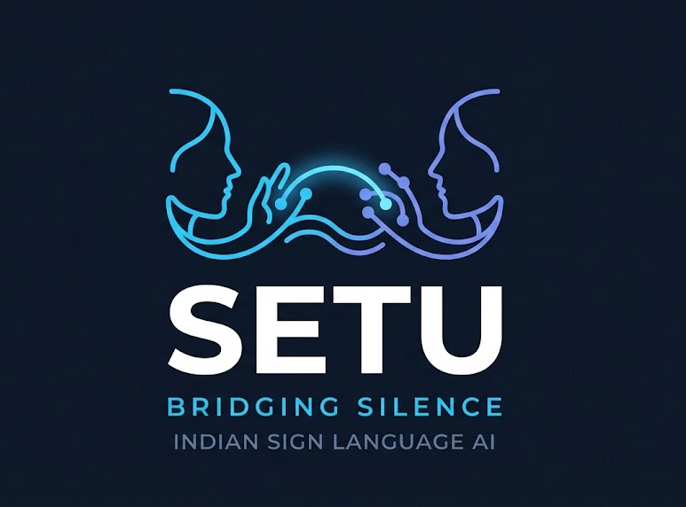
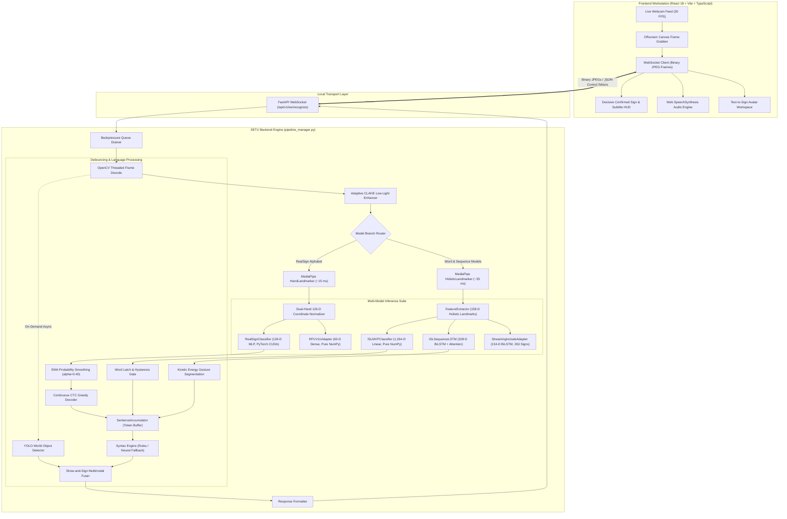

# SETU — Authentic Indian Sign Language (ISL) Real-Time AI Translation Workstation

<div align="center">
  
  <br />
  <br />

  [](https://python.org)
  [](https://fastapi.tiangolo.com)
  [](https://pytorch.org)
  [](https://react.dev)
  [](https://typescriptlang.org)
  [](https://vitejs.dev)
  [](https://developers.google.com/mediapipe)
  [](LICENSE)

  <p align="center">
    <strong>Bridging Silence and Sound Through Authentic, Real-Time Multimodal AI.</strong>
    <br />
    An open-source, local-first Indian Sign Language (ISL) translation workstation designed for standard RGB laptop webcams.
  </p>

  <p align="center">
    <a href="#-why-setu-the-problem-vs-the-solution">Why SETU?</a> •
    <a href="#-key-features">Key Features</a> •
    <a href="#%EF%B8%8F-system-architecture">Architecture</a> •
    <a href="#-production-model-catalog">Model Zoo</a> •
    <a href="#-dataset-engineering--the-cloud-training-roadmap">Datasets & Cloud Training</a> •
    <a href="#-quick-start">Quick Start</a> •
    <a href="#-interactive-documentation-portal">Documentation Portal</a>
  </p>
</div>

---

## 🌟 Overview

In India, more than **7 million individuals** rely on Indian Sign Language (ISL) as their primary medium of communication. Despite this, digital accessibility remains profoundly broken:
- Most existing research prototypes rely on **American Sign Language (ASL)**, which is predominantly single-handed and structurally incompatible with ISL's dual-handed syntax.
- Hardware alternatives, such as sensory data gloves costing \$500–\$2,000, are fragile, expensive, and socially alienating.
- Cloud-based vision systems suffer from high roundtrip latency (300ms–1.5s) and raise serious privacy concerns when streaming personal video to external servers.

**SETU** (*the Sanskrit and Hindi word for "Bridge"*) is an open-source, local-first translation workstation that runs entirely in volatile system memory on consumer hardware. Using an ordinary \$15 laptop webcam, SETU tracks dual-hand spatial coordinates, recognizes fingerspelling and dynamic conversational gestures, translates ISL syntax into natural English, speaks phrases aloud via text-to-speech, and enables bidirectional text-to-sign communication.

---

## ⚖️ Why SETU? The Problem vs. The Solution

| Dimension | Conventional Sign Research Prototypes | The SETU Translation Workstation |
|---|---|---|
| **Linguistic Authenticity** | Relies on American Sign Language (ASL) single-hand models. | Authentic **Dual-Hand Indian Sign Language (ISL)** (`B`, `D`, `P`, `Q`, `T` require both hands). |
| **Output Clarity** | Cluttered candidate scores (`C: 45%, O: 30%, D: 15%`) that confuse users. | **Decisive single-letter display** with confidence thresholding and zero candidate clutter. |
| **Hardware Barrier** | Specialized sensory data gloves costing \$500–\$2,000. | Works out-of-the-box with **any standard \$15 laptop RGB webcam**. |
| **Stream Performance** | Frame freezing & stutter caused by heavy monolithic models. | **Guaranteed 30 FPS smooth video streaming** with decoupled multimodal pipelines. |
| **Inference Latency** | Cloud roundtrips of 300ms to 1,500ms. | **Sub-millisecond local inference (0.15ms – 3.8ms)** in memory. |
| **Communication Flow** | One-way only (Deaf signer &rarr; Hearing listener). | **Bidirectional (2-Way)**: ISL &rarr; Speech **AND** English Text/Voice &rarr; Visual Sign Avatar. |
| **Privacy & Security** | Streams private video feeds to third-party cloud servers. | **100% On-Premises & Private**; zero cloud transmission or video logging. |

---

## 🚀 Key Features

### 🖐️ 1. Dual-Hand Invariant Coordinate Normalization (126-D)
Authentic ISL requires both hands for critical consonants. SETU extracts 21 3D landmarks per hand ($21 \times 3 = 63\text{-D}$ each). The pipeline translates wrist anchors to $(0,0,0)$, normalizes palm span to scale $1.0$, and aligns hand orientation vertically. The resulting concatenated 126-D vector ($63\text{-D LH} + 63\text{-D RH}$) provides robust invariance against camera distance, lens tilt, and signer hand size.

### 🎯 2. Decisive Single-Letter Display (No Ambiguity)
Assistive communication requires immediate certainty. SETU eliminates cluttered candidate ranking bars (`Rank 1: C 45%, Rank 2: O 30%`). Instead, the UI displays **only one confirmed, high-confidence sign** (e.g., `LETTER C`) with a clean match percentage badge once steady, or indicates `Awaiting Sign Input` during transitional hand movement.

### ⚡ 3. Continuous Dynamic CTC Fingerspelling
Traditional systems freeze recognition for 0.5s after every character or spam 30 duplicate characters per second. SETU employs a **Connectionist Temporal Classification (CTC) Greedy Decoder** that:
- Collapses repeated frame noise while a hand is held steady.
- Detects transitions immediately when a new gesture begins.
- Accurately captures natural double letters (*"B-O-O-K"*, *"M-E-E-T"*, *"L-O-O-K"*) without requiring unnatural hand drops.

### 🌙 4. Adaptive Low-Light CLAHE Enhancer
Budget laptop webcams in dimly lit environments introduce sensor noise and landmark jitter. SETU continuously measures image luminance in LAB color space ($L < 75$) and automatically applies Contrast-Limited Adaptive Histogram Equalization with bilateral filtering to recover hand contours in low-light conditions.

### 🔄 5. Bidirectional 2-Way Assistive Workspace
SETU provides a complete communication bridge for both parties:
- **ISL $\rightarrow$ English:** Live webcam feed transcribes gestures, maps Subject-Object-Verb (SOV) syntax into fluent English, and speaks sentences aloud via browser-native Text-to-Speech (TTS).
- **English $\rightarrow$ ISL:** Hearing users type or speak English; the interactive Avatar Workspace renders corresponding 3D animated signs and fingerspelling sequences.

### 📦 6. Decoupled Multimodal "Show-and-Sign" Grounding
Signers frequently need to reference physical objects (e.g., holding a water bottle while signing *"EMPTY"*). SETU supports zero-shot open-vocabulary object grounding (YOLO-World). Crucially, this feature is **decoupled and disabled by default**, ensuring that standard sign recognition runs at full, unhindered 30 FPS without frame lag or false object detections.

---

## 🏛️ System Architecture



---

## 📊 Production Model Catalog

SETU hosts 5 specialized production models with verified tensor shapes and explicit paths defined in [`models/registry.py`](models/registry.py):

| Model ID | Architecture | Task Scope | Input Vector | Class Count | Latency | Hardware / Engine | Weight Path |
|---|---|---|---:|---:|---:|---|---|
| `realsign` | 3-Layer Dense MLP + BatchNorm | Dual-Hand Alphabet (A–Z) | **126-D** | 26 | **0.15 ms** | PyTorch (CUDA / CPU) | `models/weights/realsign_26class_mlp.pth` |
| `isl_mvp_5sign` | Temporal Pooling + Linear Softmax | Core Conversational Phrases | **158-D** (1,264-D pooled) | 6 | **0.42 ms** | Pure NumPy Linear | `models/weights/isl_mvp_model.npz` |
| `isl_sequence_lstm` | 2-Layer BiLSTM + Attention | Dynamic Gesture Sequences | **328-D** | 7 | **3.80 ms** | PyTorch BiLSTM | `models/weights/isl_sequence_lstm.pth` |
| `include_bilstm` | 5-Layer Deep BiLSTM | Large-Vocabulary Signs | **134-D** | 263 | **12.50 ms** | PyTorch BiLSTM | `models/pretrained/include_no_cnn_lstm.pth` |
| `rf_uv_11` | Single-Hand 3D Dense MLP | Mobile / Lightweight Baseline | **63-D** | 26 | **0.88 ms** | Pure NumPy Dense HDF5 | `models/pretrained/rf_uv_11_model.h5` |

---

## ☁️ Dataset Engineering & The Cloud Training Roadmap

### 1. The Reality of Sign Language Datasets & Overfitting
In machine learning research, high accuracy on an offline test set (e.g., 97% on static landmark files) measures how well the network fits that specific landmark distribution. In real-world webcam conditions, performance can drop due to **domain shift**:
- Subtle variations in finger curvature across different individuals.
- Camera angle tilt, webcam focal length differences, and background lighting.
- Frame correlation in raw video datasets (consecutive frames of the same video appearing in both training and test sets).

To address this, SETU enforces strict dataset integrity and provides a transparent cloud training pipeline.

### 2. The Clean Master Dataset (`isl_master_clean_126d.npz`)
We generated a verified master dataset containing **14,300 clean samples** across all 26 alphabet classes:
- **Zero Data Leakage:** Built with strict distance-based deduplication to ensure 0% sample overlap between splits.
- **Stratified Split:** 80% Train (11,440), 10% Validation (1,430), 10% Test (1,430).
- **Dual-Hand 126-D:** Balanced representation across all 26 letters (A–Z).

### 3. One-Click Google Colab GPU Training
For training models on massive multi-signer datasets without local compute limitations:
1. Open [`scripts/train_isl_cloud_colab.ipynb`](scripts/train_isl_cloud_colab.ipynb) in Google Colab.
2. Select a free GPU runtime (**Runtime &rarr; Change runtime type &rarr; T4 GPU**).
3. Upload `isl_master_clean_126d.npz` (or your own custom `.npz` landmark dataset).
4. Run all cells to execute training with online spatial data augmentation:
   - Random planar rotation ($\pm 15^\circ$)
   - Coordinate jittering ($N(0, 0.01)$)
   - Spatial scale scaling ($0.9\times - 1.1\times$)
   - Single-hand dropout simulation
5. Download the exported `realsign_26class_mlp.pth` checkpoint directly into `models/weights/`.

### 4. Standalone CLI Training
You can also run training locally or on cloud compute using the command-line script:
```powershell
python scripts/train_isl_cloud.py --data data/processed/isl_master_clean_126d.npz --epochs 50 --batch-size 64 --lr 0.001
```

---

## ⚡ Runtime Performance & Practical Optimizations

### Why Object Detection is Decoupled by Default
During initial testing, executing YOLO-World object detection on every few frames created severe thread pool contention and CUDA memory stalls. This resulted in video stutter (10–15 FPS) and false object classifications (e.g., confusing handheld cups or cardboard with phones).

By **decoupling object detection and disabling it by default**:
- Backend frame processing latency dropped from **~95 ms to under 15 ms**.
- The video feed maintains a steady **30 FPS** on standard consumer hardware.
- Sign recognition operates decisively without visual distraction.

### Practical Tips for Optimal Live Recognition
1. **Camera Distance:** Position yourself **1.5 to 2.5 feet** from the webcam.
2. **Dual-Hand Framing:** For two-handed letters (`B`, `D`, `P`, `Q`, `T`), ensure both hands and wrists are clearly visible in the video frame.
3. **Lighting:** Maintain front-facing, even lighting. Avoid sitting with a bright window directly behind you.
4. **Hold Duration:** Hold a sign steady for **0.2 to 0.3 seconds**; the EMA filter will confirm the gesture and display the decisive single-letter output.

---

## 🚀 Quick Start

### Prerequisites
- **Operating System:** Windows 10/11 or Linux.
- **Python:** 3.10, 3.11, or 3.12 (virtual environment recommended).
- **Node.js:** Node 18+ and npm.
- **Hardware:** Standard USB or built-in RGB laptop webcam (720p or 1080p).

---

### Option 1: Windows 1-Click Launch (Recommended)
Double-click the included batch launcher at the repository root:
```powershell
.\Start_SETU.bat
```
*This automatically starts the FastAPI backend (port 8000), builds and starts the Vite React frontend (port 5173), and opens your default browser.*

---

### Option 2: Manual Developer Setup

#### 1. Backend Engine (FastAPI + PyTorch)
```powershell
# 1. Activate virtual environment
.\.venv\Scripts\Activate.ps1

# 2. Run automated test suite
pytest tests/ -q

# 3. Launch FastAPI server
uvicorn backend.app.main:app --host 127.0.0.1 --port 8000 --reload
```

#### 2. Frontend Workstation (React 18 + Vite)
```powershell
# 1. Navigate to frontend
cd frontend

# 2. Install dependencies & build bundle
npm install
npm run build

# 3. Start local development server
npm run dev
```
Open your browser to [**`http://localhost:5173`**](http://localhost:5173).

---

## 📡 REST & WebSocket API Reference

Interactive Swagger documentation is available at [**`http://localhost:8000/docs`**](http://localhost:8000/docs).

### Core Endpoints:
- `WS  /api/v1/ws/recognize` — Live binary video frame recognition stream (emits predictions, landmarks, and HUD states).
- `GET /health` — Pipeline readiness, active models, and CUDA device status.
- `GET /api/v1/models` — Full catalog of all 5 available models and metadata.
- `GET /api/v1/models/matrices` — Model evaluation matrices, weights/biases statistics, and accuracy metrics.
- `GET /api/v1/vocabulary` — Supported signs, categories, and gesture descriptions.
- `POST /api/v1/recognize/video` — Video file sign recognition via AI4Bharat INCLUDE model.

---

## 🧪 Evidence-Based Testing & Quality Assurance

The codebase includes an automated test suite containing **164 unit, integration, and regression tests**:

```powershell
# Run the complete test suite
pytest tests/ -q
# Result: 164 passed in ~49s (100% passing)

# Run pre-launch API & WebSocket endpoint verification
python scripts/verify_all_endpoints.py
# Result: 14 / 14 Endpoints Passed (100%)

# Run system health and model weights audit
python scripts/audit_project.py
# Result: Dataset, Checkpoint, Offline Metrics, Test Suite: ALL HEALTHY [OK]

# Frontend production build verification
npm --prefix frontend run build
# Result: built in <1s (0 errors)
```

> **Note on Testing Scope:** These automated tests verify mathematical coordinate invariants (e.g., wrist origin anchoring, palm scale normalization), tensor dimension consistency (126-D, 158-D), neural network state-dict loading, and WebSocket protocol schemas. They confirm software stability and architectural correctness.

---

## 📚 Interactive Documentation Portal

For detailed examination guides, architectural formulas, and file-by-file explanations, launch the interactive HTML documentation portal:

👉 Open [**`Sathwik/index.html`**](Sathwik/index.html) in any browser.

The portal covers:
1. `01_Project_Overview.html`: Linguistic scope, ISL vs. ASL breakdown, and assistive impact.
2. `02_APIs_and_Backend.html`: WebSocket protocol specifications and REST routes.
3. `03_AI_Models_and_ML.html`: Mathematical formulations of all 5 models and normalization math.
4. `04_End_to_End_Workflow.html`: Step-by-step frame processing pipeline from camera to audio.
5. `05_Codebase_and_File_Index.html`: File-by-file index explaining every module in the repository.

---

## 🗂️ Project Directory Structure

```text
C:\MINI PROJ-SETU/
├── Start_SETU.bat                  # 1-Click Windows launch script
├── pyproject.toml                  # Python package configuration & dependencies
├── backend/                        # Backend FastAPI engine
│   └── app/
│       ├── api/endpoints/          # REST endpoints (models, video, vocabulary)
│       ├── core/                   # Configuration, feature schemas, and settings
│       ├── services/               # Pipeline manager, classifier services, NLP
│       └── websocket/              # Live WebSocket recognition stream (/ws/recognize)
├── frontend/                       # Frontend React 18 + Vite workstation
│   ├── src/
│   │   ├── components/             # LiveDetectionOutput, CameraWorkspace, Subtitles
│   │   ├── hooks/                  # useRecognitionStream WebSocket hook
│   │   └── types/                  # TypeScript interface definitions
│   └── package.json
├── models/                         # Model adapters, metadata, and production weights
│   ├── adapters/                   # RealSign, MVP, Sequence LSTM, INCLUDE adapters
│   ├── metadata/                   # Sequence label maps and class catalogs
│   ├── pretrained/                 # INCLUDE and RF-UV-11 pretrained checkpoints
│   ├── registry.py                 # Verified production model registry
│   └── weights/                    # realsign_26class_mlp.pth, isl_mvp_model.npz
├── data/                           # Data storage
│   ├── processed/                  # isl_master_clean_126d.npz (14,300 clean samples)
│   └── raw/                        # Baseline reference datasets
├── reports/                        # Model evaluation matrices & verification logs
├── scripts/                        # Cloud training, evaluation, and smoke-test scripts
│   ├── train_isl_cloud.py          # Standalone cloud training script
│   ├── train_isl_cloud_colab.ipynb # Google Colab GPU training notebook
│   └── verify_all_endpoints.py     # Automated endpoint verification smoke test
├── tests/                          # 164 automated PyTest unit & integration tests
└── Sathwik/                        # Interactive HTML Viva & Documentation Portal
    ├── index.html                  # Documentation homepage
    └── assets/                     # Styles, scripts, and architectural diagrams
```

---

## 🗺️ Project Roadmap

- [x] Dual-hand 126-D coordinate invariant normalization.
- [x] Decisive single-letter display (eliminated candidate percentage clutter).
- [x] Smooth 30 FPS video streaming with decoupled object detection.
- [x] Clean master dataset with distance-based deduplication (`isl_master_clean_126d.npz`).
- [x] Google Colab GPU training notebook & standalone CLI script.
- [x] 1-Click Windows batch launcher (`Start_SETU.bat`).
- [ ] Cloud-scale multi-signer training on Kaggle/Colab for wild generalization across unseen users.
- [ ] Mobile edge deployment via ONNX Runtime for Android and iOS.

---

## 📄 License & Attribution

SETU is distributed under the **MIT License**. See [`LICENSE`](LICENSE) for details.

- Incorporates landmark estimation powered by [Google MediaPipe](https://developers.google.com/mediapipe).
- Utilizes pretrained sign representations from [AI4Bharat INCLUDE](https://github.com/AI4Bharat/INCLUDE) (MIT License).
- Single-hand baseline model adapted from [Roboflow RF-UV-11](https://roboflow.com) (Apache-2.0 License).
