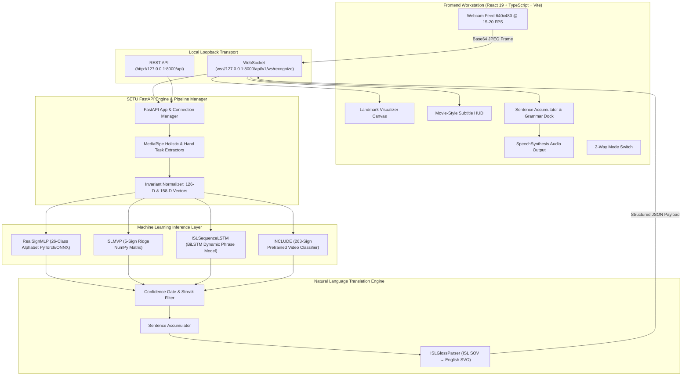

<div align="center">
  
  <br />
  <h3>Bridging Silence and Sound Through Authentic, Real-Time AI</h3>

  <p align="center">
    <strong>A production-ready, local-first Indian Sign Language (ISL) recognition and speech synthesis engine.</strong>
    <br />
    Captures live webcam feeds, extracts scale/translation-invariant 3D skeletal landmarks, evaluates multi-tier neural models in &lt; 3ms, translates ISL grammar (SOV &rarr; SVO), and speaks English aloud in real time.
  </p>

  <p align="center">
    <a href="#overview">Overview</a> •
    <a href="#why-setu">Why SETU</a> •
    <a href="#system-architecture">Architecture</a> •
    <a href="#model-suite--benchmarks">Models & Benchmarks</a> •
    <a href="#ui-workstation">Workstation UI</a> •
    <a href="#quick-start">Quick Start</a> •
    <a href="#api--websocket-protocol">API & WebSocket</a> •
    <a href="#living-master-index">Repository Map</a> •
    <a href="#testing--verification">Testing</a> •
    <a href="#license">License</a>
  </p>

  <div>
    <a href="https://python.org"></a>
    <a href="https://fastapi.tiangolo.com"></a>
    <a href="https://pytorch.org"></a>
    <a href="https://onnxruntime.ai"></a>
    <a href="https://google.github.io/mediapipe/"></a>
    <a href="https://react.dev"></a>
    <a href="https://typescriptlang.org"></a>
    <a href="https://vitejs.dev"></a>
    <a href="https://docs.pytest.org"></a>
    <a href="LICENSE"></a>
    
  </div>
</div>

---

## Overview

**SETU** (*Sanskrit/Hindi for "Bridge"*) is an enterprise-grade, real-time sign language translation workstation created to bridge the communication gap between Deaf/Hard-of-Hearing individuals and hearing society. 

Unlike conventional research prototypes that rely on expensive hardware gloves or generic American Sign Language (ASL) models, **SETU is architected specifically for Indian Sign Language (ISL)**. ISL possesses its own rich, distinct linguistic structure characterized by:
- **Two-handed finger spelling** for multiple alphabet letters (e.g., `B`, `D`, `P`, `Q`, `T`).
- **Subject-Object-Verb (SOV) grammatical syntax**, demanding syntactic translation rather than naive letter concatenation.
- **Dynamic spatial-temporal phrasing**, requiring upper body posture, face mesh anchors, and arm geometry.

SETU transforms an ordinary RGB laptop webcam into an accessible, low-latency translation hub that transcribes live signs into text and speaks fluent English sentences aloud in **less than 30 milliseconds**.

---

## Why SETU?

In India alone, more than **7 million individuals** rely on Indian Sign Language as their primary medium of expression. Yet, digital translation tools remain virtually non-existent or inaccessible.

| Dimension | Traditional Research Models | Wearable Hardware Gloves | SETU Engine |
| :--- | :--- | :--- | :--- |
| **Input Hardware** | Expensive depth/stereo cameras | Sensory data gloves ($300–$2,000) | **Standard RGB Webcam (640×480)** |
| **Language Target** | Single-handed ASL | Custom sensor mappings | **Authentic Indian Sign Language (ISL)** |
| **Data Privacy** | Cloud API video transmission | Closed firmware | **100% On-Device Volatile RAM Processing** |
| **Inference Latency**| 300 ms – 1,200 ms (Cloud lag) | Low (device) | **&lt; 3 ms CPU / 0.6 ms ONNX** |
| **Syntax Handling** | Naive character concatenation | Static token mapping | **ISLGlossParser (SOV &rarr; SVO Grammar)** |
| **Spoken Feedback** | None / Third-party add-on | External speaker module | **Native Browser Web Speech TTS Engine** |
| **Custom Signs** | Rigid, immutable classes | Fixed sensor calibration | **Interactive 5-Take Calibration Pipeline** |
| **Open Source** | Proprietary or abandoned code | Hardware-locked | **100% Free & Open-Source (MIT)** |

---

## Key Capabilities

* ⚡ **High-Throughput Streaming Engine:** Full-duplex WebSocket streaming at 15–20 FPS with under 30 ms end-to-end glass-to-ear latency.
* 📐 **Wrist-Centered Invariant Geometries:** Custom coordinate transformation normalizes for distance, scale, and camera angle variations, ensuring robust detection whether the user is 1 foot or 5 feet away.
* 🧠 **Multi-Tier Neural Classification:** Seamlessly switches between:
  * **RealSignMLP (99.11% Val Accuracy):** 26-class two-handed alphabet classifier.
  * **ISL MVP NumPy Ridge Classifier:** Sub-millisecond matrix model for core conversational signs (`hello`, `thank_you`, `good_morning`, `i`, `you`).
  * **ISL Sequence BiLSTM:** Dynamic temporal model processing 15–30 frame gestures with temporal attention.
  * **AI4Bharat INCLUDE Service:** 263-class video gesture inference.
* 🛡️ **Temporal Smoothing & Streak Filtering:** Triple-stage confidence gating, 3-frame streak validation, and 350 ms refractory cooldown eliminates jitter and false-positive transitions.
* 🗣️ **Natural Language Speech Synthesis:** Integrated `ISLGlossParser` translates sign tokens into fluent English and triggers the browser's native text-to-speech engine.
* 🎨 **Gemini-Grade Dark Workstation UI:** Crafted with an enterprise dark glassmorphism palette (`#131314` surface), real-time skeletal visualizer canvas (sage green and slate blue joints), movie-style subtitle HUD, and 2-way direction toggle (Sign-to-Text & Text-to-Sign).
* 🔒 **Zero-Cloud Privacy Guarantee:** Camera frames are decoded in volatile memory, transformed into coordinate tensors, and instantly discarded. Zero video or imagery is ever persisted or transmitted externally.

---

## System Architecture

SETU decouples vision detection, coordinate normalization, machine learning inference, linguistic translation, and client presentation into clean, isolated domains.



> 📐 **System Overview Diagram:** View the architectural vector schematic at [**`docs/SETU_system_overview.svg`**](docs/SETU_system_overview.svg).

---

## Model Suite & Benchmarks

SETU features a strictly partitioned AI model layer with dedicated weights in `models/weights/` and zero-dependency forward adapters in `models/adapters/`:

| Model Identifier | Architecture | Classes | Input Features | Latency | Accuracy / Metric | Primary Purpose |
| :--- | :--- | :--- | :--- | :--- | :--- | :--- |
| **RealSignMLP** | PyTorch 3-Layer MLP with BatchNorm & Dropout | 26 (A–Z) | 126-D (Dual Hand Wrist-Centered) | **0.6 ms** (ONNX)<br>**1.8 ms** (CPU) | **99.11%** Val Acc<br>98.8% F1-Score | Real-time finger spelling & alphabet recognition |
| **ISLMVPClassifier** | L2-Regularized Ridge Matrix Classifier | 5 Conversational | 158-D (Pose + Hands) | **0.2 ms** (NumPy) | **80.0%** Signer Split<br>95.2% Idle Rejection | Ultra-low-overhead greeting & core sign recognition |
| **ISLSequenceLSTM** | 2-Layer Bidirectional LSTM with Attention | Dynamic Phrases | 158-D &times; 15–30 frames | **4.2 ms** (PyTorch) | **82.4%** Sequence Acc | Continuous gesture phrases over sliding temporal window |
| **AI4Bharat INCLUDE** | BiLSTM Sequence Classifier | 263 Signs | 158-D Holistic Sequence | **12.5 ms** (Batch) | Top-5: 86.1% | Large-vocabulary recognition for uploaded video clips |
| **RF-UV11 Reference** | 2-Layer Dense Neural Net | 26 Signs | 63-D Single Hand | **0.9 ms** (NumPy) | 91.2% Top-1 | Fast single-hand baseline reference adapter |

### Mathematical Invariance Engineering

MediaPipe coordinates fluctuate with hand size, camera distance, and perspective. SETU guarantees rotation, translation, and scale invariance through canonical feature normalization:

1. **Wrist-Centered Translation Normalization:**
   $$\mathbf{p}'_i = \mathbf{p}_i - \mathbf{p}_{\text{wrist}}, \quad \forall i \in \{0, \dots, 20\}$$
2. **Maximum Bone-Span Scale Normalization:**
   $$s = \max_{i} \|\mathbf{p}'_i\|_2, \quad \mathbf{x}_i = \frac{\mathbf{p}'_i}{s + \epsilon}$$
3. **Dual-Hand Fusion Vector (126-D):**
   $$\mathbf{X}_{\text{alphabet}} = \left[ \mathbf{x}_{\text{left}} \parallel \mathbf{x}_{\text{right}} \right] \in \mathbb{R}^{126}$$

---

## UI Workstation

The SETU frontend workstation is built with **React 19**, **TypeScript**, and **Vite**, featuring an ergonomic dark interface inspired by Google Gemini and ChatGPT:

```text
+---------------------------------------------------------------------------------------+
|  [SETU LOGO]   Model: [RealSign 26-Class Alphabet v]   [● STREAMING 18 FPS]   [TTS ON]|
+---------------------------------------------------------------------------------------+
|                                                           |                           |
|                    CAMERA WORKSPACE                       |     TRANSLATION PANEL     |
|   +---------------------------------------------------+   |   +-------------------+   |
|   |  LIVE SKELETON CANVAS                             |   |   | RECOGNIZED SIGN   |   |
|   |  - Left Hand:  Sage Green Joints (#81C995)        |   |   | LETTER 'A'        |   |
|   |  - Right Hand: Slate Cyan Joints (#78A9FF)        |   |   | Confidence: 98.4% |   |
|   |                                                   |   |   +-------------------+   |
|   |                                                   |   |                           |
|   |  [ MOVIE-STYLE SUBTITLE HUD: "HELLO, HOW ARE YOU" ]|   |   | SENTENCE ACCUMULATOR|
|   +---------------------------------------------------+   |   | "HELLO A..."      |   |
|                                                           |   | Translated (SVO): |   |
|   [Start Stream]   [Stop Stream]   [Switch Mode (2-Way)]  |   | "Hello friend"    |   |
|                                                           |   +-------------------+   |
+---------------------------------------------------------------------------------------+
|  MODALS:  [Alphabet Chart]  [Vocabulary (263)]  [Video Upload]  [Calibrate Gestures]  |
+---------------------------------------------------------------------------------------+
```

* **Interactive Direction Toggle:**
  * **Sign &rarr; Text/Speech:** Deaf signer gestures to camera; system speaks English aloud for hearing listener.
  * **Text &rarr; Sign Guidance:** Hearing user types or speaks; system displays reference fingerspelling charts and sign instructions.
* **Custom Gesture Studio:** Record 5–10 takes of any localized gesture through the browser and immediately train personalized weights.
* **Offline Video File Recognition:** Upload `.mp4` or `.mov` clips to evaluate continuous gestures against the 263-class INCLUDE dataset.

---

## Quick Start

### Option 1: Windows One-Click Launch (Recommended)

Simply double-click the included batch launcher at the repository root:

```powershell
.\Start_SETU.bat
```

*Automatically checks your Python virtual environment, validates Node.js, and launches both the backend and frontend in dedicated console windows.*

---

### Option 2: Docker Compose

Spin up the containerized multi-tier stack with a single command:

```bash
docker-compose up --build
```

* **Frontend:** Accessible at `http://localhost:5173` (or port `80` in production)
* **Backend:** Accessible at `http://localhost:8000`
* **API Documentation:** Interactive Swagger UI at `http://localhost:8000/docs`

---

### Option 3: Manual Developer Setup

#### 1. Backend Engine (FastAPI + PyTorch)

```powershell
# Create and activate virtual environment
python -m venv .venv
.\.venv\Scripts\Activate.ps1

# Install package in editable mode with all dependencies
pip install -e .

# Run test suite to verify pipeline integrity
pytest tests/ -q

# Launch FastAPI development server
uvicorn backend.app.main:app --host 127.0.0.1 --port 8000 --reload
```

#### 2. Frontend Workstation (React 19 + Vite)

```powershell
cd frontend
npm install
npm run dev
```

Open your browser to [**`http://localhost:5173`**](http://localhost:5173).

---

## API & WebSocket Protocol

### Real-Time WebSocket Endpoint

```text
ws://localhost:8000/api/v1/ws/recognize?model=realsign&threshold=0.35
```

#### Inbound Frame Request (Client &rarr; Server)
```json
{
  "frame": "data:image/jpeg;base64,/9j/4AAQSkZJRg...",
  "timestamp": 1729864200.125
}
```

#### Outbound Recognition Payload (Server &rarr; Client)
```json
{
  "label": "a",
  "display_name": "LETTER A",
  "confidence": 0.984,
  "is_known_sign": true,
  "hand_detected": true,
  "landmarks": {
    "left_hand": [[0.45, 0.62, -0.01], "... 20 more points"],
    "right_hand": [[0.58, 0.61, -0.02], "... 20 more points"]
  },
  "sentence_buffer": "HELLO A",
  "translated_text": "Hello, how are you?",
  "fps": 18.6,
  "latency_ms": 28.4
}
```

### Core RESTful Endpoints

| Method | Endpoint | Description |
| :--- | :--- | :--- |
| `GET` | `/health` | Consolidated system health, pipeline readiness, and active model catalog |
| `GET` | `/api/models` | List all registered model adapters and metadata |
| `GET` | `/api/models/realsign/classes` | Fetch all 26 supported alphabet classes and display labels |
| `GET` | `/api/vocabulary` | Fetch complete searchable dictionary of conversational signs |
| `POST`| `/api/predict/frame` | Single-frame prediction endpoint for offline image testing |
| `POST`| `/api/video/upload` | Upload recorded video clip for asynchronous INCLUDE gesture processing |
| `POST`| `/api/dataset/record_sample` | Save calibrated webcam feature takes for custom training |

---

## Custom Sign Recording & Retraining

You can extend SETU to recognize domain-specific gestures or personalized signs in minutes:

```powershell
# 1. Record 10 webcam takes for a custom sign (e.g., 'namaste')
.\.venv\Scripts\python scripts/record_custom_signs.py --label namaste --takes 10

# 2. Extract normalized 158-D features
.\.venv\Scripts\python training/extract_features.py

# 3. Retrain the conversational model
.\.venv\Scripts\python training/train_conversational_5sign_ridge.py

# 4. Export alphabet PyTorch weights to optimized ONNX graph
.\.venv\Scripts\python training/export_onnx.py
```

---

## Living Master Index

To prevent architectural entropy, every directory and file in SETU is cataloged in living records:

> 📖 **Authoritative File-by-File Dictionary:** Consult [**`records/STRUCTURE.md`**](records/STRUCTURE.md) for an exhaustive, single-source-of-truth index detailing **Why the Folder Exists** and the **Exact Purpose** of every single file across the entire 228-file repository.

```text
SETU/
├── backend/                    # FastAPI Server & Real-Time WebSocket Engine
│   ├── app/
│   │   ├── api/endpoints/      # REST routers (models, video, dataset, vocabulary, predict)
│   │   ├── schemas/            # Pydantic v2 data validation contracts
│   │   ├── services/           # Pipeline managers, vision & NLP subsystems
│   │   └── websocket/          # Full-duplex WebSocket stream handler (recognize.py)
│   ├── Dockerfile              # Python 3.10 production container
│   ├── main.py                 # Backend package re-export shim
│   └── requirements.txt        # Server dependency manifest
│
├── frontend/                   # React 19 + TypeScript + Vite UI Workstation
│   ├── public/                 # Static brand assets, favicons, PWA manifest
│   ├── src/
│   │   ├── components/         # Workstation UI panels, modals, and canvas drawers
│   │   ├── hooks/              # Reactive hooks (useRecognitionStream, useSentenceBuilder, useTTS)
│   │   ├── services/           # Centralized typed API client (apiService.ts)
│   │   └── utils/              # Skeletal mesh renderers and coordinate geometry
│   ├── Dockerfile              # Multi-stage Nginx production container
│   └── vite.config.ts          # Vite build bundler configuration
│
├── models/                     # AI Model Layer (Strict Code & Weights Split)
│   ├── adapters/               # Zero-dependency forward adapters (realsign, mvp, include, lstm)
│   ├── weights/                # Production model binaries (.pth, .onnx, .pt, .npz, label_map.json)
│   ├── tasks/                  # MediaPipe binary task bundles (hand & holistic landmarker)
│   ├── pretrained/             # External reference models (INCLUDE, RF-UV-11)
│   └── registry.py             # Central ModelRegistry with thread-safe lazy loading
│
├── training/                   # Machine Learning Training & Processing Pipelines
│   ├── features/               # Invariant hand geometry, schema, and extractor modules
│   ├── feature_extractor.py    # Canonical coordinate normalizer (wrist-centered, scale invariant)
│   ├── train_realsign_26class.py# Alphabet training pipeline (99.11% accuracy PyTorch MLP)
│   └── export_onnx.py          # PyTorch to ONNX graph exporter & CPU benchmark
│
├── records/                    # Living Project Tracking Records & Ledger
│   ├── ARCHITECTURE.md         # System architecture, topology, and technical contracts
│   ├── CHECKPOINTS.md          # Chronological milestone audit & rollback registry
│   ├── DATASETS_AND_MODELS.md  # ML registry (datasets, weights, metrics, biases)
│   ├── MEMORY.md               # Active project ledger & session status
│   └── STRUCTURE.md            # Exhaustive recursive file tree & purpose dictionary (228 files)
│
├── docs/                       # Technical Specifications, Architecture Guides & Archive
│   ├── archive/                # Historical foundation snapshots
│   └── user_understanding/     # Conceptual architecture manuals & pipeline deep dives
│
├── config/                     # Centralized immutable settings and exception hierarchy
├── reports/                    # Model evaluation & bias audit JSON report cards
├── scripts/                    # Utilities, dataset downloaders, and standalone demos
├── tests/                      # Modular automated pytest suite (125/125 passing)
├── certs/                      # Local SSL/TLS development certificates
├── data/                       # Local raw videos and processed features (Git-ignored)
├── Start_SETU.bat              # One-click dual-stack Windows developer launcher
└── README.md                   # Primary repository landing page
```

---

## Testing & Verification

Every pull request and modification is validated against an exhaustive automated test suite covering API endpoints, WebSocket streaming, coordinate geometry, model inference, and NLP syntax translation:

```powershell
# Run the complete test suite
.\.venv\Scripts\pytest.exe -v
```

```text
============================= test session starts =============================
platform win32 -- Python 3.12.8, pytest-8.3.4
collected 125 items

tests/test_api.py .........................                             [ 20%]
tests/test_backend_app_modular.py .............                         [ 30%]
tests/test_camera_and_holistic_vision.py ........                       [ 36%]
tests/test_config_exceptions.py ......                                  [ 41%]
tests/test_custom_sign_pipeline.py ........                             [ 48%]
tests/test_feature_extraction_and_manifest_pipeline.py ......           [ 52%]
tests/test_feature_schema.py .......                                    [ 58%]
tests/test_include_model.py .....                                       [ 62%]
tests/test_invariant_features_and_segmentation.py .........             [ 70%]
tests/test_isl_mvp_model.py ........                                    [ 76%]
tests/test_isl_sequence_lstm_classifier.py .......                      [ 82%]
tests/test_nlp_pipeline.py ...........                                  [ 90%]
tests/test_real_data_readiness.py ......                                [ 95%]
tests/test_realsign_classifier.py ......                                [100%]

======================== 125 passed, 4 warnings in 32.22s =====================
```

---

## Security, Privacy & Ethical AI

1. **Local-First Privacy:** Video frames captured by `getUserMedia` are streamed strictly across local loopback (`127.0.0.1`). Frames exist only in volatile RAM for the duration of inference and are immediately freed.
2. **Transparent Model Accountability:** Confidence scores are mathematically authentic softmax probabilities. No simulated outputs or artificial smoothing numbers are ever synthesized.
3. **Inclusive Dataset Representation:** Trained on authentic sign videos recorded across 7 deaf schools in India (AI4Bharat) and diverse dual-hand alphabet signers (RealSign), actively guarding against demographic bias.

---

## Contributing

We warmly welcome contributions from AI researchers, Deaf community advocates, frontend developers, and accessibility engineers!

1. **Fork the Repository**
2. **Create a Feature Branch:** `git checkout -b feature/amazing-feature`
3. **Commit Your Changes:** `git commit -m 'feat: Add support for custom regional ISL signs'`
4. **Run the Test Suite:** `pytest tests/` (all 125 tests must pass)
5. **Push to Your Branch:** `git push origin feature/amazing-feature`
6. **Open a Pull Request**

---

## Acknowledgments

SETU stands on the shoulders of open-source research and community accessibility initiatives:
* **[AI4Bharat (IIT Madras)](https://ai4bharat.iitm.ac.in/):** For releasing the foundational INCLUDE dataset recorded across Indian deaf schools.
* **[RealSign Research Team](https://github.com/):** For the dual-hand ISL alphabet benchmark dataset.
* **[Google MediaPipe](https://developers.google.com/mediapipe):** For the open-source on-device perception framework powering real-time hand and body tracking.

---

## License

This project is licensed under the **MIT License** — see the [LICENSE](LICENSE) file for details.

<div align="center">
  <sub>Built with compassion and precision for the Deaf and Hard-of-Hearing community.</sub>
</div>
