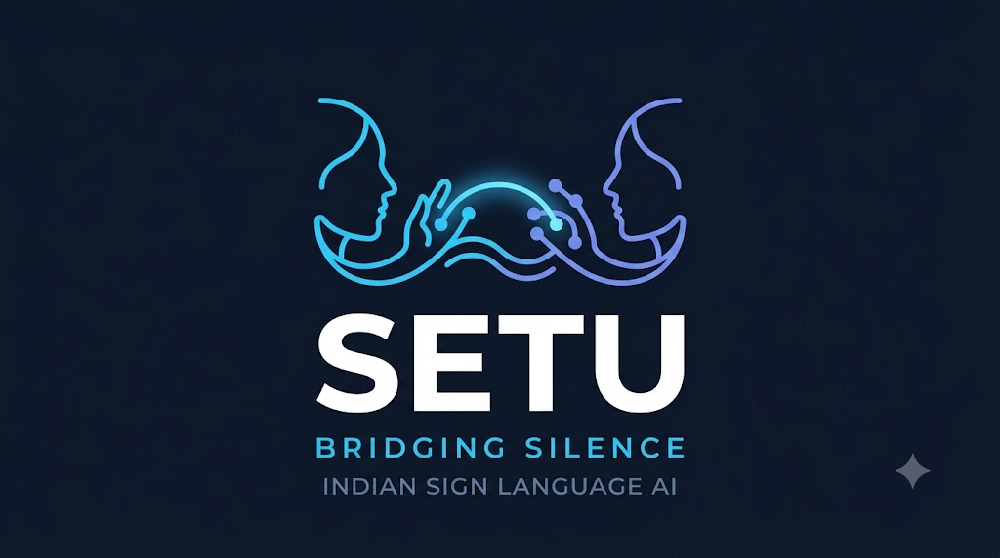

<div align="center">
  

  <br />

  [](https://python.org)
  [](https://fastapi.tiangolo.com)
  [](https://pytorch.org)
  [](https://google.github.io/mediapipe/)
  [](https://react.dev)
  [](https://typescriptlang.org)
  [](https://vitejs.dev)
  [](https://tailwindcss.com)
  []()
</div>

---

## 📌 Overview

**SETU** ("Bridge" in Sanskrit) is a high-performance, real-time Indian Sign Language (ISL) translation platform. It bridges accessibility gaps by interpreting both **static fingerspelling (A–Z)** and **dynamic multi-frame phrases** into fluent text using computer vision and deep learning.

Unlike basic gesture trackers, SETU analyzes **543 MediaPipe keypoints** (hands, pose, face mesh) to process spatial hand configurations alongside grammatical **Non-Manual Markers (NMMs)** like eyebrow movement, eye squints, and mouth opening ratios.

---

## ⚡ Key Highlights

| Feature | Architecture | Specification |
| :--- | :--- | :--- |
| **Streaming Pipeline** | Async FastAPI + WebSockets | 30 FPS non-blocking frame downsampling ($320 \times 240$) |
| **Alphabet Recognition** | 63-D Wrist-Normalized MLP | Instant single-frame A–Z fingerspelling |
| **Sequence Modeling** | Attention-based BiLSTM | 328-D spatiotemporal vector over 30-frame rolling window |
| **Facial NMM Ratios** | MediaPipe Face Mesh | 6-D scale-invariant metrics (MAR, EAR, Eyebrow Elevation) |
| **Noise Filtering** | Post-Processing Engine | Temporal debouncing, confidence hysteresis, 350 ms cooldown |
| **Dataset Engine** | In-App OpenCV CLI & API | Dynamic `.npz` sample recording and retraining loader |
| **Movie-Style Subtitle HUD** | React 18 + Tailwind | Cinema-grade live captioning with collision avoidance |
| **Voice Synthesis** | Web Speech API | Instant real-time text-to-speech for translated signs |

---

## 📐 System Architecture

```
                  ┌─────────────────────────────────────┐
                  │      Client Camera Stream (HD)      │
                  └──────────────────┬──────────────────┘
                                     │
                                     ▼
                  ┌─────────────────────────────────────┐
                  │ Offscreen Canvas Downsample 320x240 │
                  └──────────────────┬──────────────────┘
                                     │ WebSocket (Binary JPEG)
                                     ▼
                  ┌─────────────────────────────────────┐
                  │    FastAPI WebSocket Controller     │
                  │   (Asynchronous Thread Offloading)  │
                  └──────────────────┬──────────────────┘
                                     │
                                     ▼
                  ┌─────────────────────────────────────┐
                  │   MediaPipe Vision Inference Engine │
                  │   Holistic (Pose + Face) & Hands    │
                  └──────────────────┬──────────────────┘
                                     │
         ┌───────────────────────────┴───────────────────────────┐
         ▼                                                       ▼
┌─────────────────────────────────┐             ┌─────────────────────────────────┐
│     Alphabet Mode (A–Z)         │             │    Sequence / Phrase Mode       │
│  Wrist-Centered 63-D Vector     │             │ 164-D Position + 164-D Velocity │
│  - Origin at Wrist (0, 0, 0)    │             │  - 158-D Holistic coordinates   │
│  - Scaled by Palm Size (MCP 9)  │             │  - 6-D Facial NMM ratios        │
│  - Zero Sequence Delay          │             │  - 30-Frame Rolling Buffer      │
└────────────────┬────────────────┘             └────────────────┬────────────────┘
                 │                                               │
                 ▼                                               ▼
┌─────────────────────────────────┐             ┌─────────────────────────────────┐
│  RealSign 26-Class PyTorch MLP  │             │ Attention Bidirectional LSTM    │
│  Single-Frame Evaluation        │             │ Spatiotemporal 328-D Modeling   │
└────────────────┬────────────────┘             └────────────────┬────────────────┘
                 │                                               │
                 └───────────────────────┬───────────────────────┘
                                         │
                                         ▼
                  ┌──────────────────────────────────────────────┐
                  │     Temporal Stability & Filtering Engine    │
                  │  - Confidence Hysteresis (P >= 0.35)         │
                  │  - Consecutive Frame Streak Verification     │
                  │  - Refractory Duplicate Cooldown (350ms)     │
                  │  - Idle Baseline Transition Gate             │
                  └──────────────────────┬───────────────────────┘
                                         │
                                         ▼
                  ┌──────────────────────────────────────────────┐
                  │          React 18 Glassmorphic UI            │
                  │  - Real-Time Movie Subtitle HUD              │
                  │  - Dynamic Skeleton Joint Overlay            │
                  │  - Ergonomic Framing & Distance Guidance     │
                  │  - Web Speech Text-to-Speech Engine          │
                  └──────────────────────────────────────────────┘
```

---

## 🧮 Mathematical Formulations & Feature Engineering

### 1. The 328-D Spatiotemporal Representation

To capture dynamic signing gestures without background pixel bias, SETU extracts a **328-dimensional spatiotemporal vector** $\mathbf{F}_{328}$:

$$\mathbf{F}_{328} = \begin{bmatrix} \mathbf{x}_t^{(164)} & \Delta \mathbf{x}_t^{(164)} \end{bmatrix} \in \mathbb{R}^{328}$$

Where:
- $\mathbf{x}_t^{(164)}$ is the spatial feature state at frame $t$.
- $\Delta \mathbf{x}_t^{(164)} = \mathbf{x}_t - \mathbf{x}_{t-1}$ is the first-order finite difference capturing signing velocity and acceleration.

#### Detailed Feature Partition Breakdown:

| Index Range | Dimension | Category | Mathematical Description |
| :--- | :--- | :--- | :--- |
| **`[0 : 63]`** | 63-D | Right Hand Geometry | 21 keypoints $(x, y, z)$ wrist-centered and scaled by palm size |
| **`[63 : 68]`** | 5-D | Right Finger Distances | Euclidean distance from wrist $P_0$ to fingertips: $\|P_i - P_0\|_2, \, i \in \{4, 8, 12, 16, 20\}$ |
| **`[68 : 73]`** | 5-D | Right Finger Angles | Adjacent finger spread angles $\angle(P_{i}, P_0, P_{i+4})$ across all digits |
| **`[73 : 136]`** | 63-D | Left Hand Geometry | 21 keypoints $(x, y, z)$ wrist-centered and scaled by palm size |
| **`[136 : 141]`**| 5-D | Left Finger Distances | Euclidean distance from left wrist to all five left fingertips |
| **`[141 : 146]`**| 5-D | Left Finger Angles | Adjacent finger spread angles for the left hand |
| **`[146 : 148]`**| 2-D | Hand Presence | Binary indicators $[I_{\text{right}}, I_{\text{left}}]$ representing hand detection |
| **`[148 : 151]`**| 3-D | Inter-Wrist Vector | Spatial vector $\mathbf{v}_{\text{wrist}} = \mathbf{w}_{\text{right}} - \mathbf{w}_{\text{left}}$ |
| **`[151]`** | 1-D | Inter-Wrist Distance | Euclidean separation $\|\mathbf{w}_{\text{right}} - \mathbf{w}_{\text{left}}\|_2$ |
| **`[152 : 155]`**| 3-D | Inter-Index Vector | Spatial vector $\mathbf{v}_{\text{index}} = \mathbf{idx}_{\text{right}} - \mathbf{idx}_{\text{left}}$ |
| **`[155]`** | 1-D | Inter-Index Distance | Euclidean separation $\|\mathbf{idx}_{\text{right}} - \mathbf{idx}_{\text{left}}\|_2$ |
| **`[156]`** | 1-D | Inter-Thumb Distance | Euclidean separation $\|\mathbf{th}_{\text{right}} - \mathbf{th}_{\text{left}}\|_2$ |
| **`[157]`** | 1-D | Contact Score | Continuous hand proximity score $\exp(-\|\mathbf{v}_{\text{contact}}\|_2 / \sigma)$ |
| **`[158 : 164]`**| 6-D | Facial NMM Ratios | Scale-invariant expressions: MAR, Eyebrow Ratios, Eye Aspect Ratios |
| **`[164 : 328]`**| 164-D | Temporal Velocities | Frame-to-frame difference $\Delta \mathbf{x}_t^{(164)} = \mathbf{x}_t^{(164)} - \mathbf{x}_{t-1}^{(164)}$ |

---

### 2. Static A–Z Hand Normalization (63-D)

RealSign static alphabet fingerspelling processes isolated hand frames instantaneously. To ensure complete invariance against camera distance, hand size, and screen placement:

1. **Wrist-Centered Translation:**
   $$\mathbf{p}'_i = \mathbf{p}_i - \mathbf{p}_0 \quad \forall i \in \{0, 1, \dots, 20\}$$
   *(Sets wrist keypoint $\mathbf{p}'_0 = (0, 0, 0)$ as the local coordinate origin).*

2. **Palm-Scale Normalization:**
   $$S_{\text{palm}} = \max\left(\|\mathbf{p}_9 - \mathbf{p}_0\|_2, \, 10^{-6}\right)$$
   $$\hat{\mathbf{p}}_i = \frac{\mathbf{p}'_i}{S_{\text{palm}}}$$
   *(Divides all 21 keypoints by the Euclidean distance between wrist $P_0$ and the middle finger metacarpophalangeal joint $P_9$).*

3. **Inference Vector:**
   The normalized $21 \times 3$ matrix is flattened into $\hat{\mathbf{x}} \in \mathbb{R}^{63}$ and passed directly into the RealSign MLP.

---

### 3. Non-Manual Markers (NMM): 6-D Facial Ratios

Non-manual markers are essential syntactic components of Indian Sign Language. Questions, negations, and conditional clauses in ISL are conveyed using eyebrow position, mouth opening, and head gestures.

```
          10 (FOREHEAD_TOP)
               ▲
               │ (Face Height)
  105 (L_BROW) │    334 (R_BROW)
   •           │          •
  159 (L_EYE)  │    386 (R_EYE)
   •           │          •
               │
        61 •───────• 291 (Mouth Width)
          13 • / • 14 (Mouth Height)
               │
               ▼
           152 (CHIN)
```

1. **Mouth Aspect Ratio (MAR):** Quantifies open mouth shape (interrogatives, emphasis):
   $$\text{MAR} = \frac{\|P_{13} - P_{14}\|_2}{\max(\|P_{61} - P_{291}\|_2, \, 10^{-6})}$$
2. **Left Eyebrow Elevation Ratio (LEER):**
   $$\text{LEER} = \frac{\|P_{105} - P_{159}\|_2}{\max(\|P_{10} - P_{152}\|_2, \, 10^{-6})}$$
3. **Right Eyebrow Elevation Ratio (REER):**
   $$\text{REER} = \frac{\|P_{334} - P_{386}\|_2}{\max(\|P_{10} - P_{152}\|_2, \, 10^{-6})}$$
4. **Mean Eyebrow Elevation Ratio (MEER):**
   $$\text{MEER} = \frac{\text{LEER} + \text{REER}}{2}$$
5. **Left Eye Aspect Ratio (LEAR):**
   $$\text{LEAR} = \frac{\|P_{160} - P_{144}\|_2 + \|P_{158} - P_{153}\|_2}{2 \cdot \max(\|P_{33} - P_{133}\|_2, \, 10^{-6})}$$
6. **Right Eye Aspect Ratio (REAR):**
   $$\text{REAR} = \frac{\|P_{385} - P_{380}\|_2 + \|P_{387} - P_{373}\|_2}{2 \cdot \max(\|P_{362} - P_{263}\|_2, \, 10^{-6})}$$

---

### 4. MediaPipe Hand Landmark Keypoint Topology

```
                  8 (INDEX_TIP)    12 (MID_TIP)   16 (RING_TIP)   20 (PINKY_TIP)
                  │                │              │               │
                  7 (INDEX_DIP)    11 (MID_DIP)   15 (RING_DIP)   19 (PINKY_DIP)
                  │                │              │               │
                  6 (INDEX_PIP)    10 (MID_PIP)   14 (RING_PIP)   18 (PINKY_PIP)
 4 (THUMB_TIP)    │                │              │               │
      \           5 (INDEX_MCP)────9 (MID_MCP)───13 (RING_MCP)───17 (PINKY_MCP)
       3 (IP)           \          │             /
        \                \         │            /
         2 (MCP)──────────0 (WRIST_ORIGIN)─────┘
          \              /
           1 (CMC)──────┘
```

---

## 🛡️ Post-Processing & Temporal Stability Engine

Real-time sign language recognition faces three common challenges in practice:
1. **Prediction Flicker:** High-frequency flipping between adjacent classes.
2. **Runaway Letter Duplication:** Static letters repeating indefinitely every 33ms frame.
3. **Transition Artifacts:** Erroneous recognition during hand movement into/out of camera view.

SETU resolves these challenges through a **4-tier filtering pipeline**:

```
[Raw Softmax Prediction]
          │
          ▼
┌───────────────────────────────────────┐
│ Tier 1: Confidence Hysteresis Gate    │
│ Is Softmax Confidence >= 0.35?        │
└─────────┬───────────────────┬─────────┘
          │ NO                │ YES
          ▼                   ▼
[Awaiting Sign Input] ┌───────────────────────────────────────┐
                      │ Tier 2: Consecutive Streak Filter     │
                      │ A-Z: 2 frames (66ms)                  │
                      │ Sequence: 3 frames (100ms)            │
                      └───────┬───────────────────┬───────────┘
                              │ NO                │ YES
                              ▼                   ▼
                      [Accumulating...]   ┌───────────────────────────────────────┐
                                          │ Tier 3: Refractory Cooldown (350ms)   │
                                          │ Distinct new sign?                    │
                                          └───────┬───────────────────┬───────────┘
                                                  │ DUPLICATE         │ NEW SIGN
                                                  ▼                   ▼
                                          [Requires 350ms +   [Commit Immediately]
                                           Idle Baseline]             │
                                                  │                   │
                                                  └─────────┬─────────┘
                                                            │
                                                            ▼
                                          ┌───────────────────────────────────────┐
                                          │ Tier 4: Subtitle HUD & Voice Dispatch │
                                          └───────────────────────────────────────┘
```

- **Confidence Hysteresis Gate:** Predictions below $P < 0.35$ (adjustable via the client UI slider) are suppressed and displayed as `"Awaiting Sign Input"`.
- **Temporal Streak Filter:** Requires identical label predictions across 2 consecutive frames for static alphabet and 3 consecutive frames for phrases.
- **Refractory Duplicate Cooldown:** Identical consecutive signs must undergo a 350ms refractory period AND transition through an idle resting baseline (`no_sign` or relaxed hands).
- **Positioning Guidance:**
  * Shoulder width $> 0.70$: *"Too close to camera — please step back"*
  * Shoulder width $< 0.16$: *"Too far from camera — please move closer"*
  * Nose $y < 0.05$: *"Camera too low — tilt up or lower position"*
  * Nose $y > 0.45$: *"Camera too high — step back or raise camera"*
- **Subtitle Collision Prevention:** Detects if hands enter the lower viewport area ($y \in [0.72, 0.98]$ and $x \in [0.20, 0.80]$).

---

## 📹 Interactive Dataset Recorder Workflow

SETU allows non-engineers and signers to record, persist, and integrate custom signs into the model pipeline.

```
+--------------------------------------------------------------------------------+
|                        SETU DATASET RECORDER HUD                               |
|                                                                                |
|  [REC] Sign: 'NAMASTE' | Take: 3/10                                            |
|                                                                                |
|                     ┌───────────────────────────────┐                          |
|                     │                               │                          |
|                     │   RECORDING IN 2...           │                          |
|                     │                               │                          |
|                     └───────────────────────────────┘                          |
|                                                                                |
|  Frame: 18/30  [||||||||||||||...............]                                 |
|  Landmarks: Right Hand [OK] | Left Hand [OK] | Face [OK]                       |
+--------------------------------------------------------------------------------+
```

### CLI Recording Execution
```powershell
# Record 10 takes of a new sign (e.g., 'namaste')
.\.venv\Scripts\python scripts/record_custom_signs.py --label namaste --takes 10
```

1. **Sign Specification:** Provide the sign label via CLI arguments or interactive terminal prompt.
2. **Visual Countdown:** The camera displays an on-screen HUD countdown ("Recording in 3... 2... 1...").
3. **Automated Burst Capture:** Exactly 30 frames are recorded at 20–25 FPS.
4. **Feature Extraction:** Extracts 164-D vectors (158 Holistic + 6-D Facial Ratios) per frame.
5. **Storage:** Saved to `data/processed/custom_<label>_<timestamp>.npz` containing:
   - `features`: Array of shape `(30, 164)`
   - `label`: Clean string identifier
   - `created_at`: ISO timestamp

### Retraining with Custom Data
The Attention-based BiLSTM training pipeline automatically scans, balances, and incorporates custom `.npz` recordings:
```powershell
.\.venv\Scripts\python training/train_sequence_lstm.py --epochs 60 --lr 0.001
```

---

## 🔧 Diagnostics & Troubleshooting Guide

| Issue / Symptom | Probable Cause | Recommended Solution |
| :--- | :--- | :--- |
| **"Waiting for a hand..." persists** | Hand not entering MediaPipe bounding volume | Ensure entire wrist and all five fingers are in camera frame with clear lighting. |
| **"Too close / Step back" warning** | Shoulder keypoint width $> 0.70$ normalized width | Step back 1.5 to 2.0 meters from the camera so head, shoulders, and chest are visible. |
| **WebSocket Connection Drops** | Backend port 8000 busy or firewall restriction | Run `netstat -ano \| findstr :8000` to inspect port. Verify backend console logs. |
| **Low Streaming FPS (< 15 FPS)** | High-DPI frame capture choking WebSocket bandwidth | Ensure offscreen downsampling canvas in `useRecognitionStream.ts` is set to $320 \times 240$. |
| **Letter Flickering during Signing** | Confidence threshold set too low | Increase the UI Confidence Slider to $0.50 - 0.65$ to tighten the hysteresis gate. |
| **GPU Not Utilized** | CUDA PyTorch mismatch | Run `python -c "import torch; print(torch.cuda.is_available())"`. If `False`, reinstall CUDA wheels. |

---

## 🚀 Installation & Running Guide

### Prerequisites
- **Python:** 3.10 to 3.12 (Python 3.12 recommended)
- **Node.js:** 18+ and `npm`
- **Hardware:** Webcam (720p or 1080p recommended)

---

### One-Click Launch (Windows)

Launch the complete application (FastAPI backend + Vite frontend):
```powershell
.\Start_SETU.bat
```
Launch the standalone webcam alphabet demonstration:
```powershell
.\Start_Alphabet_Demo.bat
```

---

### Manual Setup

#### 1. Backend Service (FastAPI)
```powershell
# Navigate to repository root
cd c:\MINI PROJ-SETU

# Create and activate Python virtual environment
python -m venv .venv
.\.venv\Scripts\Activate.ps1

# Install editable SETU package and dependencies
pip install -e .

# Run test suite to verify installation
pytest -v

# Launch FastAPI Uvicorn server on port 8000
uvicorn setu.api.server:app --host 0.0.0.0 --port 8000 --reload
```

#### 2. Frontend Application (Vite + React)
```powershell
# Open a second terminal and navigate to frontend
cd frontend

# Install npm dependencies
npm install

# Start Vite development server
npm run dev
```

Open **`http://localhost:5173`** in your browser.

---

## 📡 REST & WebSocket API Specification

### 1. WebSocket Streaming Endpoint
- **URL:** `ws://localhost:8000/api/v1/ws/recognize?model=realsign&threshold=0.35`
- **Query Parameters:**
  * `model`: `realsign` (Alphabet), `isl_sequence_lstm` (Phrases), `isl_mvp` (5-Sign Baseline)
  * `threshold`: Softmax confidence cutoff ($0.10 - 0.95$)
- **Client Frame Transmission:** Binary JPEG blob ($320 \times 240$).
- **Client Control Messages:**
  * `{"action": "set_model", "model": "realsign" | "isl_sequence_lstm"}`
  * `{"action": "set_threshold", "threshold": 0.50}`
  * `{"action": "reset"}` (clears rolling sequence deque)

#### Response Payload Schema:
```json
{
  "type": "prediction",
  "active_model": "realsign",
  "label": "A",
  "display_name": "LETTER A",
  "confidence": 0.8924,
  "is_known_sign": true,
  "is_stable": true,
  "streak_count": 2,
  "required_streak": 2,
  "hand_detected": true,
  "hands_in_subtitle_zone": false,
  "guidance": "Position good — Ready to translate",
  "fps": 28.5,
  "latency_ms": 14.2,
  "landmarks": {
    "left_hand": [],
    "right_hand": [{"x": 0.521, "y": 0.612, "z": -0.012}],
    "pose": [...],
    "face": [...]
  },
  "realsign_prediction": {
    "letter": "A",
    "confidence": 0.8924,
    "is_known_sign": true,
    "top_3": [["A", 0.8924], ["S", 0.0512], ["E", 0.0211]],
    "logits": { "A": 4.12, "B": -1.25, "...": "..." }
  }
}
```

### 2. REST Endpoints
- `GET /api/v1/models` — Catalog of active classifiers and status metadata.
- `GET /api/v1/models/realsign/classes` — 26 alphabet letters and index map.
- `GET /api/v1/vocabulary` — Full 11-class phrase vocabulary with execution descriptions.
- `POST /api/v1/dataset/record_sample` — Uploads and stores a $30 \times 164$ custom sign sequence.
- `GET /api/v1/dataset/custom_samples` — Lists all custom `.npz` recordings in `data/processed/`.

---

## 🧪 Automated Testing & Verification Suite

SETU maintains 87 automated tests covering schema invariance, geometric scaling, signer isolation, and WebSocket API contracts:

```powershell
.\.venv\Scripts\pytest.exe -v
```

```
============================== test session starts ==============================
collected 87 items

tests/test_api.py::test_health_endpoint PASSED                           [  1%]
tests/test_api.py::test_models_catalog_endpoint PASSED                   [  2%]
tests/test_api.py::test_websocket_recognize_mock_frame PASSED            [  8%]
tests/test_custom_sign_pipeline.py::test_sanitize_label PASSED           [ 16%]
tests/test_custom_sign_pipeline.py::test_load_sequence_dataset_with_custom_files PASSED [ 19%]
tests/test_feature_schema.py::test_facial_expression_ratio_math PASSED   [ 34%]
tests/test_feature_schema.py::test_expanded_164_feature_vector_validation PASSED [ 35%]
tests/test_feature_schema.py::test_velocity_features_328_computation PASSED [ 36%]
tests/test_isl_mvp_model.py::test_hand_presence_gate_both_hands_absent PASSED [ 52%]
tests/test_isl_sequence_lstm_classifier.py::test_classifier_predict_sequence_shape_30x328 PASSED [ 66%]
tests/test_real_data_readiness.py::test_strict_signer_isolation_and_no_leakage PASSED [ 75%]
tests/test_realsign_classifier.py::test_extract_realsign_hand_features PASSED [ 81%]
tests/test_realsign_classifier.py::test_realsign_classifier_predict_direct PASSED [ 82%]
tests/test_vision.py::test_holistic_landmarker_pipeline_with_local_task PASSED [100%]

======================= 87 passed, 1 warning in 25.84s =======================
```

---

## 📂 Repository Directory Structure

```
SETU/
├── configs/                     # Application configurations and constants
├── data/
│   ├── manifests/               # Signer-isolated train/val/test manifests
│   └── processed/               # Preprocessed feature arrays (.npz)
├── docs/                        # Technical specifications & milestone reports
├── frontend/                    # Vite + React + TypeScript + Tailwind frontend
│   ├── src/
│   │   ├── components/          # Viewport, Translation HUD, Settings modals
│   │   ├── hooks/               # useRecognitionStream WebSocket hook
│   │   ├── types.ts             # Data contracts and API schemas
│   │   └── utils/               # Canvas landmark overlay renderer
│   └── package.json
├── models/                      # Serialized PyTorch weights & label mappings
│   ├── isl_sequence_lstm.pth    # Attention-based BiLSTM weights (3.8 MB)
│   ├── realsign_26class_mlp.pth # RealSign 26-Class Alphabet weights (76 KB)
│   └── label_map.json           # Class label dictionary
├── Project Main Files/          # Product Requirements, PRD, and Architecture docs
├── scripts/                     # Custom recorder CLI & webcam demo runners
├── setu/                        # Core Python application package
│   ├── api/                     # FastAPI REST & WebSocket streaming server
│   ├── features/                # 158-D / 164-D / 328-D / 63-D feature extractors
│   ├── models/                  # PyTorch model definitions & classifiers
│   ├── utils/                   # Geometry, distance, angle calculation helpers
│   └── vision/                  # MediaPipe Holistic & Hand landmarker wrappers
├── tests/                       # 87 automated pytest test suites
├── training/                    # Sequence LSTM and RealSign MLP training scripts
├── logo.png                     # Official SETU brand logo emblem
├── pyproject.toml               # Python package configuration
├── requirements.txt             # Pip dependencies
└── README.md                    # Primary technical documentation
```

---

## 📄 License & Attribution

- **License:** MIT License.
- **Dataset Attribution:** Indian Sign Language video subsets and vocabulary references from the **AI4Bharat INCLUDE** dataset, licensed under [Creative Commons Attribution 4.0 International (CC BY 4.0)](https://creativecommons.org/licenses/by/4.0/).
- **Vision Framework:** MediaPipe Holistic and HandLandmarker by Google LLC (Apache 2.0).
