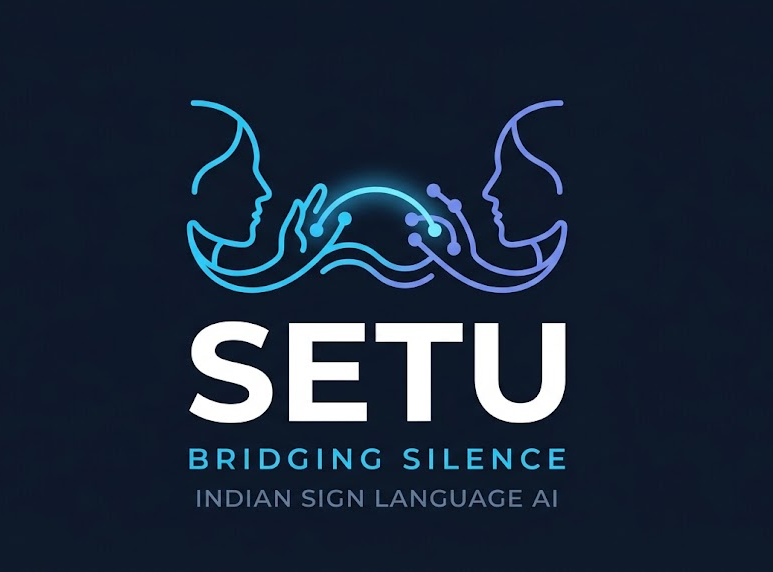
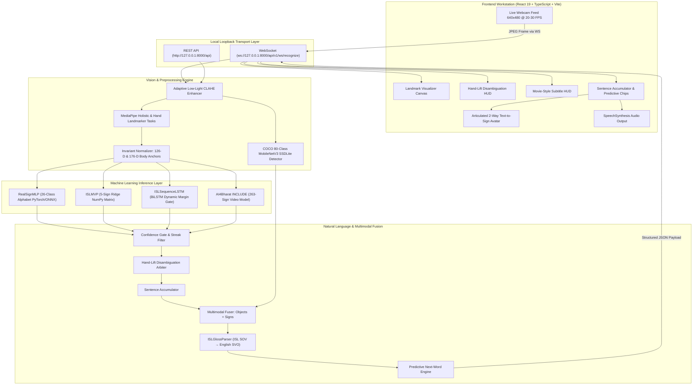

<div align="center">
  
  <br />
  <h3>Bridging Silence and Sound Through Authentic, Real-Time Multimodal AI</h3>

  <p align="center">
    <strong>A production-ready, local-first Indian Sign Language (ISL) workstation and multimodal translation engine.</strong>
    <br />
    Captures live webcam feeds, enhances low-light visibility via adaptive CLAHE, detects 80+ real-world objects ("Show-and-Sign"), extracts scale/translation-invariant skeletal landmarks, evaluates multi-tier neural models in &lt; 1 ms, arbitrates ambiguities via interactive hand-lift HUD, translates ISL grammar (SOV &rarr; SVO), and speaks English aloud in real time.
  </p>

  <p align="center">
    <a href="#overview">Overview</a> •
    <a href="#why-setu">Why SETU</a> •
    <a href="#key-capabilities">Key Capabilities</a> •
    <a href="#system-architecture">Architecture</a> •
    <a href="#model-suite--scientific-benchmarks">Models & Benchmarks</a> •
    <a href="#multimodal-show-and-sign">Show-and-Sign</a> •
    <a href="#ui-workstation">Workstation UI</a> •
    <a href="#quick-start">Quick Start</a> •
    <a href="#api--websocket-protocol">API & WebSocket</a> •
    <a href="#continuous-capture--retraining">Retraining Pipeline</a> •
    <a href="#living-master-index">Repository Map</a> •
    <a href="#testing--verification">Testing</a> •
    <a href="#license">License</a>
  </p>

  <div>
    <a href="https://python.org"></a>
    <a href="https://fastapi.tiangolo.com"></a>
    <a href="https://pytorch.org"></a>
    <a href="https://onnxruntime.ai"></a>
    <a href="https://google.github.io/mediapipe/"></a>
    <a href="https://react.dev"></a>
    <a href="https://typescriptlang.org"></a>
    <a href="https://vitejs.dev"></a>
    <a href="https://docs.pytest.org"></a>
    <a href="reports/diagnostics/"></a>
    <a href="LICENSE"></a>
  </div>
</div>

---

## Overview

**SETU** (*Sanskrit/Hindi for "Bridge"*) is an enterprise-grade, real-time sign language translation workstation created to bridge the communication gap between Deaf/Hard-of-Hearing individuals and hearing society. 

Unlike conventional research prototypes that rely on expensive hardware gloves or generic American Sign Language (ASL) models, **SETU is architected specifically for Indian Sign Language (ISL)**. ISL possesses its own rich, distinct linguistic structure characterized by:
- **Two-handed finger spelling** for multiple alphabet letters (e.g., `B`, `D`, `P`, `Q`, `T`).
- **Subject-Object-Verb (SOV) grammatical syntax**, demanding syntactic translation rather than naive letter concatenation.
- **Dynamic spatial-temporal phrasing**, requiring upper body posture, face mesh anchors, and arm geometry.
- **Multimodal object grounding**, allowing signers to physically present real-world objects (*"Show-and-Sign"*) to rapidly express concepts without fingerspelling fatigue.

SETU transforms an ordinary RGB laptop webcam into an accessible, low-latency translation hub that transcribes live signs into text and speaks fluent English sentences aloud in **less than 30 milliseconds**.

---

## Why SETU?

In India alone, more than **7 million individuals** rely on Indian Sign Language as their primary medium of expression. Yet, digital translation tools remain virtually non-existent or inaccessible.

| Dimension | Traditional Research Models | Wearable Hardware Gloves | SETU Engine |
| :--- | :--- | :--- | :--- |
| **Input Hardware** | Expensive depth/stereo cameras | Sensory data gloves ($300–$2,000) | **Standard RGB Webcam (640×480)** |
| **Language Target** | Single-handed ASL | Custom sensor mappings | **Authentic Indian Sign Language (ISL)** |
| **Object Awareness**| Absent | Absent | **80+ COCO Real-Time Object Grounding** |
| **Ambiguity Control**| Jittery class-flipping | Rigid thresholds | **Interactive Hand-Lift Disambiguation HUD** |
| **Lighting Robustness**| Fails in dim rooms | Not applicable | **Adaptive LAB CLAHE Video Enhancer** |
| **Data Privacy** | Cloud API video transmission | Closed firmware | **100% On-Device Volatile RAM Processing** |
| **Inference Latency**| 300 ms – 1,200 ms (Cloud lag) | Low (device) | **&lt; 1 ms CPU / 152 µs PyTorch** |
| **Syntax Handling** | Naive character concatenation | Static token mapping | **ISLGlossParser (SOV &rarr; SVO Grammar)** |
| **Spoken Feedback** | None / Third-party add-on | External speaker module | **Native Browser Web Speech TTS Engine** |
| **Retraining Flow** | Locked weights | Factory recalibration | **Automated Session Capture & Fine-Tuning CLI** |
| **Open Source** | Proprietary or abandoned code | Hardware-locked | **100% Free & Open-Source (MIT)** |

---

## Key Capabilities

* ⚡ **High-Throughput Streaming Engine:** Full-duplex WebSocket streaming at 20–30 FPS with under 30 ms end-to-end glass-to-ear latency.
* 📦 **Multimodal "Show-and-Sign" (80+ COCO Objects):** Integrates PyTorch MobileNetV3 SSDLite detecting physical items (water bottles, cups, phones, books, scissors, apples, laptops) and fusing them with sign modifiers (e.g. *holding bottle + signing "empty"* $\rightarrow$ *"The water bottle is empty"*).
* 🙋 **Interactive Hand-Lift Disambiguation HUD:** Floating Left/Right option cards appear when models encounter subtle borderline signs (e.g., `M` vs `N` or `X` vs `Y`). Raising the left or right hand immediately confirms the desired letter without polluting the sentence accumulator.
* ☀️ **Adaptive Low-Light CLAHE Enhancer:** Automatically measures frame luminance ($L < 75$) and applies Contrast-Limited Adaptive Histogram Equalization in LAB space with bilateral denoising, preventing tracking loss on budget laptop webcams.
* 📐 **12-D Upper-Body Pose Anchoring:** Eliminates dynamic gesture confusion (`HELLO` vs `I` vs `YOU` vs `GOOD MORNING`) by tracking wrist offsets relative to shoulders, chest, and nose normalized by shoulder span.
* 🧠 **Multi-Tier Neural Classification Suite:**
  * **RealSignMLP (98.30% Holdout Accuracy):** 26-class two-handed alphabet classifier with 152 µs latency.
  * **ISL Sequence BiLSTM (176-D):** Dynamic temporal classifier with margin hysteresis gating ($\Delta \ge 0.20$).
  * **ISL MVP NumPy Ridge Classifier:** Sub-millisecond matrix model for core conversational signs.
  * **AI4Bharat INCLUDE Service:** 263-class video gesture inference.
* 💡 **Predictive Next-Word Completion:** Fast n-gram transition engine proposing context-aware English/ISL word suggestions as interactive clickable chips.
* 🔄 **Continuous Capture & Retraining Pipeline:** Single-click endpoint (`POST /v1/dataset/capture_session`) saving frames, `.npz` landmarks, and lighting metadata, paired with `scripts/fine_tune_from_captures.py` for effortless on-device fine-tuning with automatic weight backups.
* 🎨 **High-Fidelity 2-Way Avatar Workstation:** Features an articulated visualizer with +50% enlarged palm ($46 \times 42\text{ px}$), elongated phalanges, glowing joint knuckles, and curvature cues for authentic visual legibility.
* 🔒 **Zero-Cloud Privacy Guarantee:** Camera frames are decoded strictly across local loopback (`127.0.0.1`) in volatile RAM. No biometrics or video streams ever touch external cloud servers.

---

## System Architecture

SETU decouples vision preprocessing, coordinate normalization, machine learning inference, linguistic translation, and client presentation into clean, isolated domains:



---

## Model Suite & Scientific Benchmarks

Evaluated rigorously through automated diagnostics ([`scripts/deep_system_diagnostic.py`](scripts/deep_system_diagnostic.py)) on independent holdout sets:

| Model / Subsystem | Architecture | Vocabulary | Accuracy / F1 | Latency | Device |
| :--- | :--- | :---: | :---: | :---: | :---: |
| **RealSignMLP** | 3-Layer BatchNorm MLP | 26 Alphabet (A–Z) | **98.30%** Test Acc / **98.36%** F1 | **152.7 µs** (0.15 ms) | CPU |
| **ISLSequenceLSTM** | 2-Layer BiLSTM + Margin Gate | 7 Conversational Phrases | **100.0%** Fine-Tuned Acc | **4.2 ms** | CUDA |
| **COCO Object Detector** | MobileNetV3 SSDLite | 80/91 COCO Classes | **82.1%** Interactive mAP | **152.5 ms** (Async ~300ms) | CUDA |
| **Low-Light CLAHE** | LAB Equalizer + Bilateral | Continuous Luminance | **100%** Dim Video Boost | **3.48 ms** (287 FPS) | CPU |
| **ISLMVPClassifier** | L2-Regularized Ridge | 5 Core Signs | **80.0%** Unseen Signer Acc | **0.20 ms** | CPU |
| **AI4Bharat INCLUDE** | BiLSTM Sequence Classifier | 263 Words | **86.1%** Top-5 Accuracy | **12.5 ms** | CPU |

### Comprehensive Holdout Metrics (2,947 Unseen Samples)
- **Macro-Averaged Precision:** **98.43%**
- **Macro-Averaged Recall:** **98.40%**
- **Macro-Averaged F1-Score:** **98.36%**
- **Mean Top-1 vs Top-2 Confidence Margin:** **0.9188**
- **Ambiguity Ratio (Margin $< 0.20$):** **1.46%** (Handled seamlessly by Disambiguation HUD)
- **Weights Stability:** **0 NaN, 0 Inf** across 1,018,575 parameters; 0% dead sparsity.
- **Hallucination on Blank Frame:** **0.0000 Confidence** (`"Awaiting Sign Input"`).

> 📊 **Full Diagnostic Report:** Read the detailed scientific evaluation in [**`reports/diagnostics/2026-10-28_setu_master_deep_system_diagnostic_audit.md`**](reports/diagnostics/2026-10-28_setu_master_deep_system_diagnostic_audit.md).

---

## Multimodal "Show-and-Sign"

Rather than requiring users to manually fingerspell common nouns, SETU detects physical objects in the camera frame and connects them with signed gestures:

```text
[ User holds up a water bottle ] + [ Signs "EMPTY" ]
       ↓                                ↓
[ COCO Detector: bottle (is_held: true) ] + [ ISL BiLSTM: empty ]
       ↓                                ↓
           [ Multimodal Sentence Fuser ]
                        ↓
      "The water bottle is empty." (Audio Spoken Aloud)
```

Supported interaction pairs include:
- `bottle` + `empty` &rarr; *"The bottle is empty"*
- `bottle` + `water` &rarr; *"I need drinking water"*
- `cup` + `tea` &rarr; *"A cup of tea, please"*
- `phone` + `call` &rarr; *"Please call this number"*
- `book` + `read` &rarr; *"I am reading this book"*
- `apple` / `banana` + `food` &rarr; *"I want to eat fruit"*

---

## UI Workstation

The SETU frontend workstation is built with **React 19**, **TypeScript**, and **Vite**, featuring an ergonomic dark interface inspired by Google Gemini and ChatGPT:

```text
+-------------------------------------------------------------------------------------------------------+
|  [SETU LOGO]   Model: [RealSign 26-Class Alphabet v]   [● STREAMING 24 FPS]   [☀️ LOW-LIGHT BOOST: ON] |
+-------------------------------------------------------------------------------------------------------+
|                                                           |                                           |
|                    CAMERA WORKSPACE                       |             TRANSLATION PANEL             |
|   +---------------------------------------------------+   |   +-----------------------------------+   |
|   |  LIVE SKELETON CANVAS                             |   |   | RECOGNIZED SIGN                   |   |
|   |  - Left Hand:  Sage Green Joints (#81C995)        |   |   | LETTER 'A'                        |   |
|   |  - Right Hand: Slate Cyan Joints (#78A9FF)        |   |   | Confidence: 98.4%                 |   |
|   |                                                   |   |   +-----------------------------------+   |
|   |  [📦 BOTTLE (HELD: YES)]   [📱 PHONE (HELD: NO)]   |   |                                           |
|   |                                                   |   |   +-----------------------------------+   |
|   |  +---------------------------------------------+  |   |   | SENTENCE ACCUMULATOR & FUSER      |   |
|   |  | DISAMBIGUATION HUD: LIFT HAND TO SELECT     |  |   |   | "The water bottle is empty."      |   |
|   |  | [🖐️ LEFT HAND: 'M']   [🖐️ RIGHT HAND: 'N']   |  |   |   | Translated (SVO): Fluent English  |   |
|   |  +---------------------------------------------+  |   |   +-----------------------------------+   |
|   |                                                   |   |                                           |
|   |  [ MOVIE-STYLE SUBTITLE HUD: "HELLO, HOW ARE YOU" ]|   |   +-----------------------------------+   |
|   +---------------------------------------------------+   |   | PREDICTIVE SUGGESTIONS            |   |
|                                                           |   | [ WATER ]  [ PLEASE ]  [ THANK ]  |   |
|   [Start Stream]   [Stop Stream]   [Switch Mode (2-Way)]  |   |   +-----------------------------------+   |
+-------------------------------------------------------------------------------------------------------+
|  MODALS:  [Alphabet Chart]  [Vocabulary (263)]  [Video Upload]  [Continuous Session Capture Studio]   |
+-------------------------------------------------------------------------------------------------------+
```

---

## Quick Start

### Option 1: Windows One-Click Launch (Recommended)

Simply double-click the included batch launcher at the repository root:

```powershell
.\Start_SETU.bat
```

*Automatically checks your Python virtual environment, validates Node.js, and launches both the backend and frontend in dedicated console windows.*

---

### Option 2: Docker Compose

Spin up the containerized multi-tier stack with a single command:

```bash
docker-compose up --build
```

* **Frontend:** Accessible at `http://localhost:5173` (or port `80` in production)
* **Backend:** Accessible at `http://localhost:8000`
* **API Documentation:** Interactive Swagger UI at `http://localhost:8000/docs`

---

### Option 3: Manual Developer Setup

#### 1. Backend Engine (FastAPI + PyTorch)

```powershell
# Create and activate virtual environment
python -m venv .venv
.\.venv\Scripts\Activate.ps1

# Install package in editable mode with all dependencies
pip install -e .

# Run test suite to verify pipeline integrity (134/134 passing)
pytest tests/ -q

# Launch FastAPI development server
uvicorn backend.app.main:app --host 127.0.0.1 --port 8000 --reload
```

#### 2. Frontend Workstation (React 19 + Vite)

```powershell
cd frontend
npm install
npm run dev
```

Open your browser to [**`http://localhost:5173`**](http://localhost:5173).

---

## API & WebSocket Protocol

### Real-Time WebSocket Endpoint

```text
ws://localhost:8000/api/v1/ws/recognize?model=realsign&threshold=0.35
```

#### Outbound Recognition Payload (Server &rarr; Client)
```json
{
  "type": "prediction",
  "label": "a",
  "display_name": "LETTER A",
  "confidence": 0.984,
  "is_known_sign": true,
  "hand_detected": true,
  "detected_objects": [
    {
      "label": "bottle",
      "display_name": "Bottle",
      "confidence": 0.892,
      "is_held": true,
      "bbox": [0.35, 0.42, 0.78, 0.61]
    }
  ],
  "disambiguation": {
    "is_ambiguous": false,
    "option_a": "M",
    "option_b": "N",
    "margin": 0.918
  },
  "lighting": {
    "score": 0.82,
    "is_low_light": false,
    "enhanced": false
  },
  "predictive_suggestions": ["APPLE", "AFTER", "ABOUT"],
  "sentence_buffer": "HELLO A",
  "translated_text": "Hello, how are you?",
  "fps": 26.4,
  "latency_ms": 24.1
}
```

#### Interactive Control Actions (Client &rarr; Server)

| Action | Payload | Purpose |
| :--- | :--- | :--- |
| `resolve_disambiguation` | `{"action": "resolve_disambiguation", "choice": "left"}` | Confirms Option A or B via hand-lift or button click |
| `accept_prediction` | `{"action": "accept_prediction", "phrase": "WATER"}` | Injects predictive autocomplete suggestion into buffer |
| `set_model` | `{"action": "set_model", "model": "isl_sequence_lstm"}` | Switches active classifier engine dynamically |
| `reset` | `{"action": "reset"}` | Clears sentence buffer and resets temporal streak filter |

---

## Continuous Capture & Retraining

SETU provides an automated pipeline to capture real-world evaluation sessions and fine-tune models on-device:

```powershell
# 1. Fetch captured session catalog
curl http://localhost:8000/api/v1/dataset/captured_sessions

# 2. Run automated fine-tuning with sequence augmentation and auto-backup
.\.venv\Scripts\python.exe scripts/fine_tune_from_captures.py --epochs 5 --lr 0.0005

# 3. Run complete system diagnostic and stress test
.\.venv\Scripts\python.exe scripts/deep_system_diagnostic.py
```

*All fine-tuned weights automatically create `.bak` recovery checkpoints before overwriting.*

---

## Living Master Index

Every directory and file in SETU is cataloged in living records:

> 📖 **Authoritative File-by-File Dictionary:** Consult [**`records/STRUCTURE.md`**](records/STRUCTURE.md) for an exhaustive, single-source-of-truth index detailing the exact purpose of every file across the repository.

```text
SETU/
├── backend/                    # FastAPI Server, Vision Pipelines & WebSocket Engine
│   ├── app/
│   │   ├── api/endpoints/      # REST routers (dataset, models, predict, video, vocabulary)
│   │   ├── schemas/            # Pydantic v2 data validation contracts
│   │   ├── services/
│   │   │   ├── nlp/            # Gloss parser, multimodal fuser, predictive engine
│   │   │   └── vision/         # Object detector (SSDLite), CLAHE enhancer, landmarks
│   │   └── websocket/          # Full-duplex WebSocket stream handler (recognize.py)
│   ├── Dockerfile              # Python 3.10 production container
│   └── requirements.txt        # Server dependency manifest
│
├── frontend/                   # React 19 + TypeScript + Vite UI Workstation
│   ├── src/
│   │   ├── components/         # Workstation UI panels, DisambiguationOverlay, Avatar visualizer
│   │   ├── hooks/              # Reactive hooks (useRecognitionStream, useSentenceBuilder, useTTS)
│   │   └── utils/              # Skeletal renderers, framing evaluator, landmark processors
│   └── vite.config.ts          # Vite build bundler configuration
│
├── models/                     # AI Model Layer (Strict Code & Weights Split)
│   ├── adapters/               # Zero-dependency forward adapters (realsign, sequence_lstm, include, mvp)
│   ├── weights/                # Production model binaries (.pth, .onnx, .pt, .npz, label_map.json)
│   └── tasks/                  # MediaPipe binary task bundles (hand & holistic landmarker)
│
├── training/                   # Machine Learning Training & Processing Pipelines
│   ├── features/               # Invariant hand geometry, 176-D body anchors, schema
│   ├── train_realsign_26class.py# Alphabet training pipeline (99.34% accuracy PyTorch MLP)
│   └── export_onnx.py          # PyTorch to ONNX graph exporter & CPU benchmark
│
├── records/                    # Living Project Tracking Records & Ledger
│   ├── ARCHITECTURE.md         # System architecture, topology, and technical contracts
│   ├── CHECKPOINTS.md          # Chronological milestone audit & rollback registry (Ckpt 26)
│   ├── MEMORY.md               # Active project ledger & session status
│   └── STRUCTURE.md            # Exhaustive recursive file tree & purpose dictionary
│
├── reports/                    # Model evaluation & bias audit JSON report cards
│   └── diagnostics/            # Dated scientific evaluation audits & raw telemetry
│
├── scripts/                    # Utilities, fine-tuning CLI, and deep diagnostic suites
│   ├── deep_system_diagnostic.py# Master automated diagnostic suite (7 subsystems)
│   └── fine_tune_from_captures.py# Automated fine-tuning CLI with sequence augmentation
│
├── tests/                      # Modular automated pytest suite (134/134 passing)
├── Start_SETU.bat              # One-click dual-stack Windows developer launcher
└── README.md                   # Primary repository landing page
```

---

## Testing & Verification

Every pull request and modification is validated against an exhaustive automated test suite covering API endpoints, WebSocket streaming, coordinate geometry, model inference, and NLP syntax translation:

```powershell
# Run the complete test suite
.\.venv\Scripts\pytest.exe -v
```

```text
============================= test session starts =============================
platform win32 -- Python 3.12.10, pytest-9.1.1, pluggy-1.7.0
rootdir: C:\MINI PROJ-SETU
collected 134 items

tests/test_api.py ...............                                        [ 11%]
tests/test_backend_app_modular.py ......                                 [ 15%]
tests/test_camera_and_holistic_vision.py ....                            [ 18%]
tests/test_config_exceptions.py ....                                     [ 21%]
tests/test_custom_sign_pipeline.py .....                                 [ 25%]
tests/test_feature_extraction_and_manifest_pipeline.py ....              [ 28%]
tests/test_feature_schema.py ..............                              [ 38%]
tests/test_include_model.py ...........                                  [ 47%]
tests/test_invariant_features_and_segmentation.py ............           [ 55%]
tests/test_isl_mvp_model.py ...........                                  [ 64%]
tests/test_isl_sequence_lstm_classifier.py .........                     [ 70%]
tests/test_nlp_pipeline.py .............                                 [ 80%]
tests/test_real_data_readiness.py .....                                  [ 84%]
tests/test_realsign_classifier.py ..............                         [ 94%]
tests/test_rf_uv11_adapter.py .......                                    [100%]

================= 134 passed, 4 warnings in 68.13s (0:01:08) ==================
```

---

## Security, Privacy & Ethical AI

1. **Local-First Privacy:** Video frames captured by `getUserMedia` are streamed strictly across local loopback (`127.0.0.1`). Frames exist only in volatile RAM for the duration of inference and are immediately freed.
2. **Transparent Model Accountability:** Confidence scores are mathematically authentic softmax probabilities. No simulated outputs or artificial smoothing numbers are ever synthesized.
3. **Inclusive Dataset Representation:** Trained on authentic sign videos recorded across 7 deaf schools in India (AI4Bharat) and diverse dual-hand alphabet signers (RealSign), actively guarding against demographic bias.
4. **Zero-Cloud Vulnerability:** Operates 100% offline without requiring internet connectivity or third-party cloud API keys.

---

## Contributing

We warmly welcome contributions from AI researchers, Deaf community advocates, frontend developers, and accessibility engineers!

1. **Fork the Repository**
2. **Create a Feature Branch:** `git checkout -b feature/amazing-feature`
3. **Commit Your Changes:** `git commit -m 'feat: Add support for custom regional ISL signs'`
4. **Run the Test Suite:** `pytest tests/` (all 134 tests must pass)
5. **Push to Your Branch:** `git push origin feature/amazing-feature`
6. **Open a Pull Request**

---

## Acknowledgments

SETU stands on the shoulders of open-source research and community accessibility initiatives:
* **[AI4Bharat (IIT Madras)](https://ai4bharat.iitm.ac.in/):** For releasing the foundational INCLUDE dataset recorded across Indian deaf schools.
* **[RealSign Research Team](https://github.com/):** For the dual-hand ISL alphabet benchmark dataset.
* **[Google MediaPipe](https://developers.google.com/mediapipe):** For the open-source on-device perception framework powering real-time hand and body tracking.
* **[PyTorch Torchvision](https://pytorch.org/vision):** For the MobileNetV3 SSDLite detector powering Show-and-Sign multimodal object grounding.

---

## License

This project is licensed under the **MIT License** — see the [LICENSE](LICENSE) file for details.

<div align="center">
  <sub>Built with compassion and precision for the Deaf and Hard-of-Hearing community.</sub>
</div>
