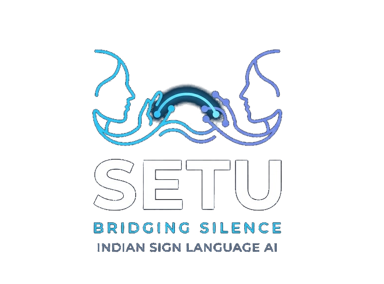

# SETU Documentation Hub & Knowledge Base

  
   
  <h3>Complete Architectural, Academic & Operational Reference Portal</h3>
  
<b>Everything you need to understand, evaluate, reproduce, and defend the SETU Indian Sign Language translation workstation.</b>

---

## 🧭 Master Documentation Index

| Section / Document | Purpose & Target Audience | Key Topics Covered |
| :--- | :--- | :--- |
| [**📄 SETU Project Factsheet**](SETU_PROJECT_FACTSHEET.md) | **Examiners, Recruiters & Project Evaluators** | Executive summary, model accuracy benchmarks, hardware telemetry, disambiguation math, and oral defense answers. |
| [**🎓 Viva Preparation Guide**](viva_prep/README.md) | **Students, Researchers & Defense Panels** | Deep-dive syllabus covering software engineering, spatial geometry, deep learning models, and real-time streaming questions. |
| [**📖 Official Sign Lexicon**](vocabulary/README.md) | **Signers, Educators & Evaluators** | Joint angle targets, palm orientations, and dual-handed contact points for 287+ ISL signs (A–Z, 0–9, vowels, phrases). |
| [**🏛️ Deep Architecture Guide**](architecture/SETU_DEEP_ARCHITECTURE_GUIDE.md) | **Engineers & System Architects** | 5-stage pipeline, scale invariance math, 60 FPS lerp drawing loop, WebSocket backpressure, and Indic SOV-to-SVO grammar. |
| [**☁️ Cloud Training Guide**](CLOUD_TRAINING_AND_DATASETS_GUIDE.md) | **ML Engineers & Data Scientists** | Feature extraction pipelines, Kaggle/Colab GPU workflows, and PyTorch training scripts for BiLSTM and RealSign MLP. |
| [**🌐 Offline Interactive Showcase**](showcase/index.html) | **Exhibitions & Offline Demonstrations** | Self-contained, zero-dependency HTML presentation portal with project slides, charts, and API catalogues. |

---

## 🗂️ Documentation Directory Breakdown

### 1. [`docs/viva_prep/`](viva_prep/) — University Defense & Viva Master Pack
- [**`SETU_EXAM_AND_VIVA_PREPARATION_GUIDE.md`**](viva_prep/SETU_EXAM_AND_VIVA_PREPARATION_GUIDE.md): 50+ examiner questions with concise, technically rigorous answers.
- [**`01_SOFTWARE_AND_WEB_ENGINEERING.md`**](viva_prep/01_SOFTWARE_AND_WEB_ENGINEERING.md): FastAPI architecture, WebSocket binary protocols, and React 18 state management.
- [**`02_SPATIAL_GEOMETRY_AND_FEATURES.md`**](viva_prep/02_SPATIAL_GEOMETRY_AND_FEATURES.md): Invariant coordinate spaces, wrist-relative translation, and DIP finger curls.
- [**`03_DEEP_LEARNING_AND_NEURAL_MODELS.md`**](viva_prep/03_DEEP_LEARNING_AND_NEURAL_MODELS.md): RealSign MLP, BiLSTM temporal sequences, and CTC greedy decoding.
- [**`04_PRODUCTION_TESTING_AND_ADVANCED_TOPICS.md`**](viva_prep/04_PRODUCTION_TESTING_AND_ADVANCED_TOPICS.md): TDD strategy, edge latency optimization, and non-manual facial markers.

### 2. [`docs/vocabulary/`](vocabulary/) — Authentic ISL Sign Dictionary
- [**`01_ALPHABET_A_TO_Z.md`**](vocabulary/01_ALPHABET_A_TO_Z.md): Single-handed vs. dual-handed ISL fingerspelling guidelines.
- [**`02_NUMERALS_0_TO_9.md`**](vocabulary/02_NUMERALS_0_TO_9.md): Authentic ISL numerical digit postures and spatial holds.
- [**`03_HINDI_VOWELS.md`**](vocabulary/03_HINDI_VOWELS.md): 8 authentic Indic vowels (अ–ऐ) with bimanual touch targets.
- [**`04_CONVERSATIONAL_PHRASES.md`**](vocabulary/04_CONVERSATIONAL_PHRASES.md): Core social greetings, emergency phrases, and hospital queries.
- [**`05_LARGE_VOCABULARY_INCLUDE_263.md`**](vocabulary/05_LARGE_VOCABULARY_INCLUDE_263.md): AI4Bharat INCLUDE educational concepts.
- [**`06_SIGNING_GUIDELINES_FOR_MAX_ACCURACY.md`**](vocabulary/06_SIGNING_GUIDELINES_FOR_MAX_ACCURACY.md): Calibration tips for optimal distance (50–70 cm) and lighting.

### 3. [`docs/architecture/`](architecture/) — Engineering Specifications & Topology
- [**`ARCHITECTURE.md`**](architecture/ARCHITECTURE.md): System components, data pipelines, and network contracts.
- [**`SETU_DEEP_ARCHITECTURE_GUIDE.md`**](architecture/SETU_DEEP_ARCHITECTURE_GUIDE.md): In-depth derivations and low-level subsystem workflows.
- [**`STRUCTURE.md`**](architecture/STRUCTURE.md): Detailed module-by-module codebase inventory.

### 4. [`docs/showcase/`](showcase/) — Interactive Presentation Portal
- Open `docs/showcase/index.html` in any web browser to view the interactive presentation without needing a running server. Includes slides, interactive code blocks, and model architecture animations.

---

  Part of the SETU Indian Sign Language AI Translation Workstation

