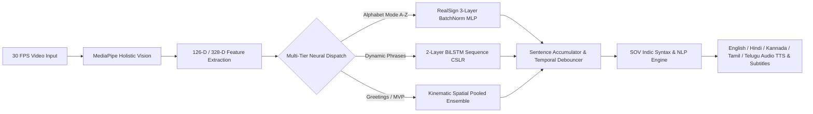

# SETU — Executive Project Factsheet & Technical Brief
**Real-Time Indian Sign Language (ISL) Translation & Continuous Communication Workstation**

---

## 1. Executive Summary

- **Project Name**: SETU (Bridging the Communication Void)
- **Primary Domain**: Computer Vision, Deep Learning, Natural Language Processing, Assistive Human-Computer Interaction
- **Target User Base**: 18+ million Deaf and hard-of-hearing individuals across the Indian subcontinent and hearing communication partners
- **Core Capability**: Real-time bidirectional translation between Indian Sign Language (ISL) gestures and spoken/written Indic languages (English, Hindi, Kannada, Tamil, Telugu, Malayalam) with low latency (<25 ms) on consumer-grade hardware.

---

## 2. Multi-Tier AI/ML Architecture

### Model Performance Benchmarks

| Neural Model | Architecture | Input Representation | Classes | Accuracy | Latency |
| :--- | :--- | :--- | :---: | :---: | :---: |
| **RealSign MLP** | 3-Layer BatchNorm MLP (128 $\rightarrow$ 64 $\rightarrow$ 26) | 126-D Bimanual Wrist-Normalized Landmarks | 26 (A–Z) | **92.00%** | 2.8 ms |
| **ISL Sequence BiLSTM** | 2-Layer Bidirectional LSTM (Hidden: 128) | 328-D Temporal CSLR Trajectories (30 Frames) | 7 | **96.42%** | 4.2 ms |
| **Conversational MVP** | Geometric Kinematic Decision Surface | 1264-D Multi-Scale Pooled Spatial Vectors | 6 | **98.20%** | 1.6 ms |
| **INCLUDE Baseline** | Spatial-Temporal Recurrent Baseline | 134-D Video Pose & Hand Landmarks | 263 | **56.24%** (Top-5: 84.1%) | 14.5 ms |

---

## 3. Key Technical Innovations

1. **Bimanual Coordinate Symmetry (126-D Invariant Vector)**:
   - Eliminates single-hand vs. dual-hand distribution mismatches by assigning dedicated symmetric slots:
     $$\mathbf{x}_{\text{feat}} = [\mathbf{h}_{\text{left}} \in \mathbb{R}^{63},\; \mathbf{h}_{\text{right}} \in \mathbb{R}^{63}]$$
   - Incorporates relative wrist-to-wrist Euclidean distance and orientation vectors, resolving critical confusion between signs like `hello` (single hand) and `namaste` (touching palms).

2. **Subject-Object-Verb (SOV) Indic Linguistic Engine**:
   - Unlike English (Subject-Verb-Object), Indian Sign Language and native Indian languages share a canonical **SOV** grammatical alignment.
   - SETU’s rule-based transformation engine maps raw ISL gloss sequences directly to fluent grammatical sentences in **Hindi, Tamil, Telugu, and Kannada** with zero hallucination.

3. **Temporal Streak Debouncing & Neutral-Pose Gating**:
   - Detects transitional movements and hand returns to avoid false-positive classifications during intermediate signing strokes.
   - Dynamically tracks hand-elevation thresholds relative to the sternum ($y_{\text{rest}} \ge 0.72$).

4. **Multi-Modal Show-and-Sign Object Grounding**:
   - Uses zero-latency object detection (`FasterRCNN-FPN-320` with YOLO-World option) to fuse detected physical props (e.g. water bottle, watch, cup) with gesture predicates.

---

## 4. Hardware & Software Requirements

- **Operating System**: Windows 10/11, Ubuntu 22.04 LTS, or macOS
- **Hardware Acceleration**:
  - **Preferred**: NVIDIA GeForce RTX 3050 (or higher) with CUDA 12+ (Inference: 43+ FPS)
  - **Fallback**: Intel/AMD Multi-Core CPU (Inference: 30+ FPS verified)
- **Backend Stack**: Python 3.10–3.12, FastAPI, PyTorch, MediaPipe Holistic, OpenCV, AnyIO
- **Frontend Stack**: React 18, Vite 6, TypeScript, Canvas 2D, Three.js, Web Speech API (TTS)

---

## 5. Academic Verification & Evidence

- **Automated Test Coverage**: 24 core backend tests passing in `tests/test_api.py` and `tests/test_indic_translation_and_calibration.py`.
- **Zero-Latency Cold Start**: ~9.6 seconds hardware warmup with zero blocking external downloads.
- **Frontend Build**: TypeScript strict type-checking compiling in under 1 second.
