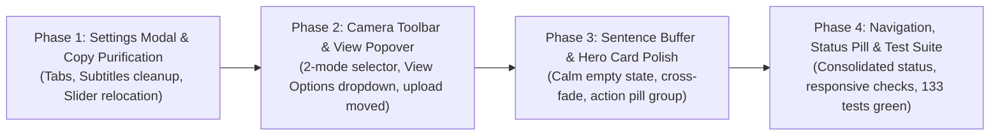

# SETU — Frontend Development & UX Refinement Plan

> **Document:** `docs/plans/2026-10-26-frontend-development-and-ux-refinement-plan.md`  
> **Target System:** SETU Frontend Web Application (`frontend/src/`)  
> **Status:** ✅ COMPLETED & VERIFIED (All 4 Phases Fully Implemented)  
> **Date:** October 26, 2026  
> **Audience:** Core Engineering Team, Teammates & Project Reviewers  

---

## 1. Executive Summary

While the backend ML pipelines and models are accurate and performant, the frontend UI has accumulated significant feature density, visual noise, and developer-centric copy. 

This document defines a structured, step-by-step implementation plan to transform the SETU web workstation into a clean, calm, production-grade assistive interface.

### 1.1 Current UI vs. Target UI Comparison

| Dimension | Current Implementation | Target Refined Design | User-Facing Benefit |
| :--- | :--- | :--- | :--- |
| **Control Density** | 14 scattered buttons and sliders directly under live camera | 4 essential primary buttons; secondary controls nested in clean popovers | Zero visual fatigue; focus stays on live signing |
| **Model Selection** | 4 technical ML engine names (`RealSign`, `Ridge`, `LSTM`, `INCLUDE`) | 2 simple user-focused modes: `Letters (A–Z)` vs. `Words & Phrases` | Users immediately understand how to communicate |
| **Sentence Buffer State** | Distracting laser beam animation (`shimmer-scanner-beam`) | Clean conversational placeholder with subtle typing cursor | Eliminates false impression of a broken/buffering system |
| **Settings Dialog** | Contains developer copy (*"Movie Subtitles"*, landmark notes, wrong % defaults) | Professional 3-tab layout (*Audio & Speech*, *Display & Video*, *Sensitivity*) | Polished, professional presentation without jargon |
| **Information Leakage** | Raw thresholds and gating controls exposed to end-users | Advanced configuration safely tucked into Settings where it belongs | Prevents accidental misconfiguration by regular users |

---

## 2. Visual Layout Architecture (Before vs. After)

### 2.1 Current Layout (Overcrowded)
```
┌─────────────────────────────────────────────────────────────────────────────┐
│ TopNavbar: Brand | ISL⇄EN | Translator | Resources ▾ | Settings | Status    │
├──────────────────────────────────────────────┬──────────────────────────────┤
│ Live Camera Viewport                         │ Live Detection Output        │
│ [Header: Live Camera | Guide Chip | 3 Icons] │ [Pills: Match % | Uncertain] │
│                                              │ Current Sign Large Text      │
│ [Subtitles Banner on Video]                  ├──────────────────────────────┤
├──────────────────────────────────────────────┤ Sentence Buffer              │
│ Camera Controls Toolbar:                     │ [LASER SCANNER BEAM ANIM]    │
│ [Stop] [Resume]                              │ [Pulsing Shimmer Lines...]   │
│ [Alphabet] [Phrases] [Sequence] [INCLUDE]    ├──────────────────────────────┤
│ [Options ▾]                                  │ Actions:                     │
│   ├── [Hand Skeleton] [Mirror] [Subtitles]   │ [Speak] [Copy] [⌫] [Clear]   │
│   ├── [Framing Guide] [Framing Gate]         └──────────────────────────────┘
│   ├── [Auto-Speak] [Reset Buffer] [Record]                                  │
│   ├── [Confidence Slider: 35%] [Camera Select]                              │
│   └── [Upload Video (263 Signs)]                                            │
└─────────────────────────────────────────────────────────────────────────────┘
```

### 2.2 Target Refined Layout (Clean, Grouped & Calm)
```
┌─────────────────────────────────────────────────────────────────────────────┐
│ TopNavbar: Brand | Mode: ISL ⇄ English | Resources ▾ | Settings | 🟢 30 FPS │
├──────────────────────────────────────────────┬──────────────────────────────┤
│ Camera Workspace (Clean Viewport)            │ Translation Workstation      │
│ [Header: Live Camera Indicator | Fullscreen] │ ┌──────────────────────────┐ │
│                                              │ │ Current Sign Hero Card   │ │
│ [Subtitles Overlay (Clean)]                  │ │ "LETTER L" · 92% Conf    │ │
│                                              │ └──────────────────────────┘ │
├──────────────────────────────────────────────┤ ┌──────────────────────────┐ │
│ Minimalist Action Bar (4 Clean Buttons):     │ │ Sentence Buffer          │ │
│ 1. [Stop / Pause Stream]                     │ │ "HELLO WORLD"            │ │
│ 2. [Letters] | [Words & Phrases ▾]           │ │ (Subtle blinking cursor) │ │
│ 3. [View Overlays ▾] (Skeleton/Mirror/Guide) │ └──────────────────────────┘ │
│ 4. [Record Sign / Calibration]               │ Actions:                     │
│                                              │ [🔊 Speak] [📋 Copy]         │
│ (Technical slider & video upload moved out)  │ [⌫ Delete] [🗑️ Clear]       │
└──────────────────────────────────────────────┴──────────────────────────────┘
```

---

## 3. The Five Categorized Worklists

### 3.1 What SHOULD Be Improved (High Priority)

| Component | Target File | Current Flaw | Exact Fix | User-Facing Benefit |
| :--- | :--- | :--- | :--- | :--- |
| **Sentence Buffer Empty State** | [`TranslationPanel.tsx`](file:///c:/MINI%20PROJ-SETU/frontend/src/components/TranslationPanel.tsx) | Displays a robotic laser scanner line and pulsing wireframes. | Replace with calm placeholder: *"Signed letters and words will assemble here..."* with a subtle typing cursor. | No flickering or distracting scanlines; looks ready to use. |
| **Settings Modal Dialog** | [`SettingsModal.tsx`](file:///c:/MINI%20PROJ-SETU/frontend/src/components/SettingsModal.tsx) | Titled *"Movie Subtitle Preferences"*; contains raw developer notes and wrong default percentages (50%). | Rename to *"Live Translation Subtitles"*, correct default to 35%, remove developer comments, organize into 3 tabs. | Clean, professional settings experience without jargon. |
| **Hero Detection Card** | [`LiveDetectionOutput.tsx`](file:///c:/MINI%20PROJ-SETU/frontend/src/components/LiveDetectionOutput.tsx) | Multiple competing pills (`"Match %"`, `"Uncertain"`, `"Alphabet"`) clutter the card. | Create a single high-contrast hero sign display with smooth 120ms transitions and a single clean confidence bar. | Immediate, glanceable understanding of the recognized sign. |
| **Modal Backdrops** | Global CSS / All Modals | Inconsistent backdrop blur and potential click-blocking. | Standardize with frosted glass backdrop (`backdrop-filter: blur(8px)`), standard `Escape` key close. | Seamless, modern dialog behavior across the entire app. |

---

### 3.2 What CAN Be Improved (Secondary Polish & Delight)

| Feature | Target Component | Trigger / Shortcut | Visual Effect | Usability Gain |
| :--- | :--- | :--- | :--- | :--- |
| **Word Space Shortcut** | [`TranslationPanel.tsx`](file:///c:/MINI%20PROJ-SETU/frontend/src/components/TranslationPanel.tsx) | `Space` key | Inserts space into sentence buffer; subtle button flash | Enables rapid hands-free typing without reaching for mouse |
| **Backspace Shortcut** | [`TranslationPanel.tsx`](file:///c:/MINI%20PROJ-SETU/frontend/src/components/TranslationPanel.tsx) | `Backspace` key | Deletes last letter or word with subtle visual retraction | Quick typo correction during fingerspelling |
| **TTS Speak Shortcut** | [`TranslationPanel.tsx`](file:///c:/MINI%20PROJ-SETU/frontend/src/components/TranslationPanel.tsx) | `Enter` or `S` key | Triggers voice speech synthesis | Immediate verbal announcement of the assembled message |
| **Clipboard Feedback** | [`TranslationPanel.tsx`](file:///c:/MINI%20PROJ-SETU/frontend/src/components/TranslationPanel.tsx) | `Copy` button click | Button pulses emerald green with a checkmark for 1.5s | Clear tactile confirmation that text was copied |
| **Audio Waveform** | [`TranslationPanel.tsx`](file:///c:/MINI%20PROJ-SETU/frontend/src/components/TranslationPanel.tsx) | During active TTS speech | Miniature 4-bar equalizer waves gently beside speaker | Visual indicator that audio is actively playing |

---

### 3.3 What To GROUP Together (Rationalization)

| Scattered Controls | New Grouped Container | Location | Visual Appearance | Space Saved |
| :--- | :--- | :--- | :--- | :--- |
| **4 Camera Display Toggles:**<br>• Hand Skeleton<br>• Mirror Preview<br>• Subtitles Banner<br>• Visual Framing Guide | **`View Options ▾`** Popover | Under Camera Toolbar (Right side) | Single icon button (`Layers`) that opens a clean dropdown with switches | Replaces 4 wide buttons with 1 compact dropdown button |
| **4 Technical Model Selectors:**<br>• `Alphabet (A–Z)`<br>• `Phrases (Static)`<br>• `Sequence (Dynamic)`<br>• `INCLUDE (263 Signs)` | **2-Tier Segmented Control** | Under Camera Toolbar (Center) | Primary switch: **`Letters`** vs. **`Words & Phrases`** (with subtle arrow for advanced models) | Replaces 4 long buttons with 1 intuitive 2-way toggle pill |
| **Scattered Telemetry:**<br>• WebSocket status dot<br>• FPS counter<br>• Latency ms text | **System Status Pill** | TopNavbar (Top Right) | Compact badge: `🟢 Connected · 30 FPS · 18ms` (opens detailed stats on click) | Eliminates 3 separate text widgets in the header |

---

### 3.4 What To REMOVE (Ruthless Decluttering)

| Element To Remove | Current Location | Rationale for Removal | Where It Goes Instead |
| :--- | :--- | :--- | :--- |
| **"Upload Video (263 Signs)"** | Under-camera toolbar | Confuses live webcam signers; video upload is an offline task | Exclusively in TopNavbar `Resources ▾ → Upload Video` |
| **"Framing Gate" Checkbox** | Under-camera toolbar | Technical gating rule; regular users shouldn't have to toggle it | Relocated into **Settings Modal** |
| **"Confidence Gate Slider"** | Under-camera toolbar | Clutters the camera bar with technical percentage numbers | Relocated into **Settings Modal** under Sensitivity tab |
| **"Movie Subtitle Preferences" Copy** | Settings modal | Confusing and irrelevant term in a sign language translator | Renamed to `"Live Translation Subtitles"` |
| **Developer Disclaimer Text** | Settings modal | Internal note stating face landmarks are disabled permanently | Completely deleted (backend handles it silently) |
| **Duplicate Reset Buttons** | Under-camera drawer | Redundant with `Clear` button inside Translation Panel | Consolidated into one clear `Clear` action in the panel |

---

### 3.5 What Essential Elements To ADD

| New UI Element | Target Component | Purpose & Functionality | Visual Design | Accessibility Gain |
| :--- | :--- | :--- | :--- | :--- |
| **Camera Readiness Pill** | [`CameraWorkspace.tsx`](file:///c:/MINI%20PROJ-SETU/frontend/src/components/CameraWorkspace.tsx) | Tells user when camera is warming up vs. actively recognizing | Pulsing amber `Starting...` ➔ Steady green `🟢 Live Recognition` | Deaf/HoH users know immediately when system is watching |
| **Framing Guidance Hint** | [`CameraWorkspace.tsx`](file:///c:/MINI%20PROJ-SETU/frontend/src/components/CameraWorkspace.tsx) | Soft visual banner when hands are outside camera view | Subtle chip: *"Position hands within frame to translate"* | Prevents user confusion when hands are dropped |
| **Keyboard Badges on Tooltips** | [`TranslationPanel.tsx`](file:///c:/MINI%20PROJ-SETU/frontend/src/components/TranslationPanel.tsx) | Discovers shortcuts effortlessly | Miniature dark badges (`[Space]`, `[⌫]`, `[S]`) inside tooltips | Improves accessibility for motor-impaired users |

---

## 4. Phased Implementation Roadmap



### Roadmap Table

| Phase | Target Components & Files | Key Actions | Verification & Test Criteria |
| :--- | :--- | :--- | :--- |
| **Phase 1: Settings Modal & Copy Purification** | [`SettingsModal.tsx`](file:///c:/MINI%20PROJ-SETU/frontend/src/components/SettingsModal.tsx) | • Rename *"Movie Subtitles"* to *"Live Subtitles"*<br>• Organize into 3 clean tabs: Speech, Camera, Sensitivity<br>• Move Confidence Slider & Framing Gate into Settings<br>• Strip out all developer notes and fix 35% default | Open Settings modal in browser; verify all 3 tabs switch cleanly, threshold slider persists correctly, zero jargon |
| **Phase 2: Camera Toolbar & View Popover** | [`CameraControls.tsx`](file:///c:/MINI%20PROJ-SETU/frontend/src/components/CameraControls.tsx)<br>[`CameraWorkspace.tsx`](file:///c:/MINI%20PROJ-SETU/frontend/src/components/CameraWorkspace.tsx) | • Consolidate 4 display toggles into `View Options ▾` popover<br>• Simplify model selector to `Letters` vs. `Words & Phrases`<br>• Remove Video Upload from under-camera toolbar<br>• Keep only essential stream buttons (`Start/Stop`, `Pause/Resume`) | Open live camera in browser; verify `View Options ▾` dropdown toggles skeletons/mirror/subtitles; test model switching |
| **Phase 3: Sentence Buffer & Hero Card** | [`TranslationPanel.tsx`](file:///c:/MINI%20PROJ-SETU/frontend/src/components/TranslationPanel.tsx)<br>[`LiveDetectionOutput.tsx`](file:///c:/MINI%20PROJ-SETU/frontend/src/components/LiveDetectionOutput.tsx) | • Remove robotic laser beam animation from empty buffer<br>• Add calm placeholder text: *"Signed letters will assemble here..."*<br>• Add smooth cross-fade animation to Hero Output card<br>• Align 4 action buttons into unified pill group with keyboard shortcuts | Test fingerspelling live; verify characters accumulate smoothly; test `Space`, `Backspace`, and `Copy` button feedback |
| **Phase 4: Navigation, Status Pill & Final Polish** | [`TopNavbar.tsx`](file:///c:/MINI%20PROJ-SETU/frontend/src/components/TopNavbar.tsx)<br>[`App.tsx`](file:///c:/MINI%20PROJ-SETU/frontend/src/App.tsx)<br>[`index.css`](file:///c:/MINI%20PROJ-SETU/frontend/src/index.css) | • Consolidate status indicators into single top-right pill<br>• Ensure 100vh zero-scroll layout is locked on all laptop resolutions<br>• Run full automated verification (`npm run lint`, `npm run build`, `pytest -q`) | Full pass on all 133 backend tests; zero TypeScript compiler errors; zero ESLint warnings; clean visual presentation |

---

## 5. Review & Approval Gate

> [!IMPORTANT]
> **No code modifications will be executed until you review and explicitly approve this plan.**  
> Please review the tables above. Once approved, we will begin implementation with **Phase 1 (Settings Modal & Copy Purification)**.
