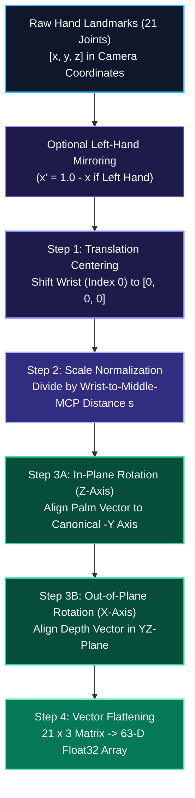
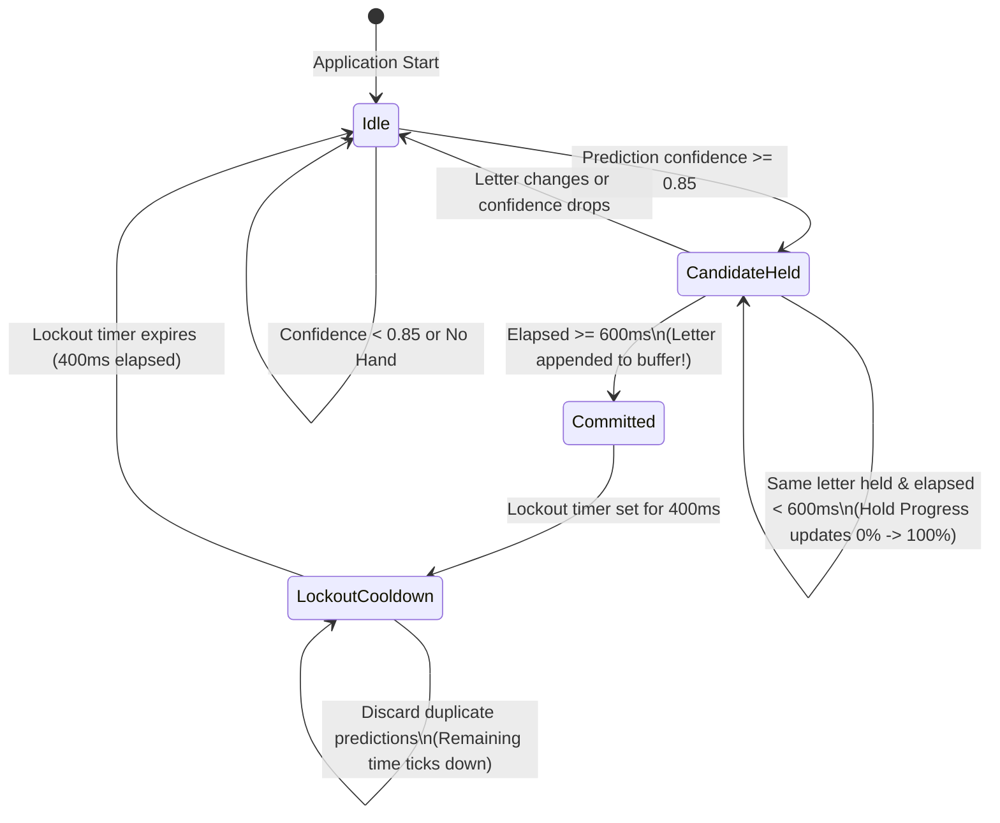

# SETU (सेतु) — Geometric Pipeline Mathematics & Text Buffer UX
### Mathematical Invariant Normalization and Temporal Hold-Gate Debouncing Engine

---

> 💡 **Plain-English Intuition:**  
> When you wave your hand in front of a camera, your hand looks bigger when it is close, smaller when it is far away, tilted if your arm is at an angle, and shifted depending on whether you sit on the left or right side of your chair. If an AI model only memorizes pixel positions, a simple hand tilt or sitting further back will completely confuse it. SETU uses elementary 3D geometry to automatically reposition your hand to the exact center of an imaginary graph, resize it to a standard unit size, and rotate it upright. To the AI, your hand sign always looks identical regardless of camera distance or tilt.

---

## 1. The 63-D Geometric Invariant Pipeline



---

### Step 0: Bilateral Symmetry (Left-Hand Mirroring)

> 💡 **Plain-English Intuition:**  
> An alphabet sign performed with the left hand is the mirror image of the same sign performed with the right hand. Rather than forcing the neural network to memorize two separate versions of every single letter, we simply flip left-hand coordinates horizontally so they look like a right hand.

If the incoming hand is tagged as a left hand (`is_left_hand = True`), the horizontal $x$-coordinates are reflected across the central axis:

$$x_i^{\text{mirrored}} = 1.0 - x_i, \quad \forall i \in \{0, 1, \dots, 20\}$$

---

### Step 1: Translation Invariance (Centering on Wrist Origin)

> 💡 **Plain-English Intuition:**  
> It does not matter whether you hold your hand near the top-left of the camera view or near the bottom-right. By setting your wrist as the zero point $(0, 0, 0)$ and measuring all other fingers relative to your wrist, your position on screen becomes completely irrelevant.

MediaPipe returns 21 joints $\mathbf{p}_i = [x_i, y_i, z_i]^T$. Landmark $\mathbf{p}_0$ corresponds to the **Wrist**. We subtract the wrist position from all 21 landmarks:

$$\mathbf{p}'_i = \mathbf{p}_i - \mathbf{p}_0, \quad \forall i \in \{0, 1, \dots, 20\}$$

After subtraction:

$$\mathbf{p}'_0 = [0.0, 0.0, 0.0]^T$$

---

### Step 2: Scale Invariance (Palm Span Unit Normalization)

> 💡 **Plain-English Intuition:**  
> If you sit close to your camera, your hand looks huge; if you sit back, it looks tiny. We measure the anatomical length of your palm bone—from your wrist to the knuckle of your middle finger—and divide all hand measurements by this length. Whether you are 2 feet or 10 feet from the camera, your hand is normalized to standard size 1.0.

We compute the Euclidean reference bone distance $s$ between the wrist ($\mathbf{p}'_0 = \mathbf{0}$) and the **Middle Finger Metacarpophalangeal (MCP) Joint** ($\mathbf{p}'_9$):

$$s = \|\mathbf{p}'_9 - \mathbf{p}'_0\|_2 = \sqrt{(x'_9)^2 + (y'_9)^2 + (z'_9)^2}$$

To prevent division by zero in degraded frames, a threshold $\epsilon = 10^{-6}$ is enforced:

$$\mathbf{p}''_i = \begin{cases} \frac{\mathbf{p}'_i}{s}, & \text{if } s \ge \epsilon \\ \mathbf{p}'_i, & \text{if } s < \epsilon \end{cases}, \quad \forall i \in \{0, 1, \dots, 20\}$$

After scaling, $\|\mathbf{p}''_9\|_2 = 1.0000$.

---

### Step 3: 2-Stage Planar Rotation Alignment

> 💡 **Plain-English Intuition:**  
> When you sign while resting your elbow on a table, your hand tilts sideways. We compute the exact angle your hand is leaning and rotate all 21 points backwards so your palm points straight up, just like a standard dictionary illustration.

#### Stage 3A: In-Plane Rotation (Around Z-Axis)
We align the 2D projection of the middle MCP joint $\mathbf{p}''_9 = [x''_9, y''_9, z''_9]^T$ so it points directly along the canonical negative vertical axis $(0, -1, 0)$ on the screen:

$$\theta = \operatorname{arctan2}(-x''_9, -y''_9)$$

Applying the 2D rotation matrix $R_z(\theta)$:

$$R_z(\theta) = \begin{bmatrix} \cos\theta & -\sin\theta & 0 \\ \sin\theta & \cos\theta & 0 \\ 0 & 0 & 1 \end{bmatrix}$$

$$\mathbf{p}^{(3A)}_i = R_z(\theta) \, \mathbf{p}''_i$$

#### Stage 3B: Out-of-Plane Depth Rotation (Around X-Axis)
If the hand is tilted forward toward the camera lens or backward away from it, we compute the pitch angle $\phi$ in the $YZ$-depth plane:

$$\phi = \operatorname{arctan2}(z^{(3A)}_9, -y^{(3A)}_9)$$

Applying the rotation matrix $R_x(\phi)$:

$$R_x(\phi) = \begin{bmatrix} 1 & 0 & 0 \\ 0 & \cos\phi & -\sin\phi \\ 0 & \sin\phi & \cos\phi \end{bmatrix}$$

$$\mathbf{p}^{\text{canonical}}_i = R_x(\phi) \, \mathbf{p}^{(3A)}_i$$

#### Boundary Invariants Enforced
At the end of this geometric pipeline:
$$\mathbf{p}^{\text{canonical}}_0 = [0.0, 0.0, 0.0]^T \quad \text{(Wrist locked at origin)}$$
$$\mathbf{p}^{\text{canonical}}_9 = [0.0, -1.0, 0.0]^T \quad \text{(Middle MCP locked at canonical coordinate)}$$

---

### Step 4: 63-D Vector Flattening

The 21 standardized 3D points are serialized into an unrolled 1D vector:

$$\mathbf{X} = \left[ x_0, y_0, z_0, \, x_1, y_1, z_1, \, \dots, \, x_{20}, y_{20}, z_{20} \right]^T \in \mathbb{R}^{63}$$

### Environmental Robustness Matrix

```
+------------------------+-----------------------------+----------------------------------------------+
| Environmental Factor   | Potential Failure Mode      | How SETU Neutralizes It                      |
+------------------------+-----------------------------+----------------------------------------------+
| Room Lighting / Shadows| Pixel intensity saturation  | MediaPipe extracts 3D skeleton; pixels shed  |
| Skin Tone Diversity    | Color thresholding bias     | Model processes topology, not melanin colors |
| Background Clutter     | Texture false-positives     | Palm detector segments hand before ML        |
| Distance from Camera   | Variable bounding box scale | Step 2 scales middle-MCP bone length to 1.0  |
| Wrist Angle & Tilt     | Off-axis angular distortion | Step 3 rotates hand vector to (0, -1, 0)     |
+------------------------+-----------------------------+----------------------------------------------+
```

---

## 2. Frontend Debouncing & Text Buffer Engine (`useTextBuffer.ts`)

> 💡 **Plain-English Intuition:**  
> When you type on a computer keyboard, you do not want the letter 'A' to type 30 times just because you rested your finger on the key for a second. Similarly, in sign language, your hand naturally passes through other letter shapes while moving from one sign to the next. The SETU Text Buffer requires you to hold a sign steadily for **600 milliseconds** before it accepts it. Once accepted, it locks out repeat letters for **400 milliseconds**, giving you time to relax your hand or transition to the next sign.



---

### ASCII UI Wireframe of the SETU Interface

```
+---------------------------------------------------------------------------------------------------------+
|  SETU (सेतु) — Indian Sign Language Alphabet Recognition                             [?] Help  [⚙] SSL  |
+---------------------------------------------------------------------------------------------------------+
|                                                                                                         |
|   +---------------------------------------------------+   +-----------------------------------------+   |
|   | 📷 LIVE WEBCAM FEED (1080p @ 30 FPS)              |   | 📊 REAL-TIME PREDICTION TELEMETRY       |   |
|   |                                                   |   +-----------------------------------------+   |
|   |             🖐️ [3D SKELETAL OVERLAY]             |   | CURRENT ACTIVE LETTER:                  |   |
|   |                   ●---●---● (Tip)                 |   |                                         |   |
|   |                   |   |   |                       |   |               [  S  ]                   |   |
|   |                   ●---●---● (MCP)                 |   |          Confidence: 97.4%              |   |
|   |                    \  |  /                        |   |                                         |   |
|   |                     \ | /                         |   | TOP CANDIDATE DISTRIBUTION:             |   |
|   |                      (0) [Wrist Origin]           |   |   1. S  [████████████████████░] 97.4%   |   |
|   |                                                   |   |   2. E  [█░░░░░░░░░░░░░░░░░░░░]  1.8%   |   |
|   |                                                   |   |   3. A  [░░░░░░░░░░░░░░░░░░░░░]  0.5%   |   |
|   |                                                   |   +-----------------------------------------+   |
|   |                                                   |   | ⏱️ HOLD CONFIRMATION PROGRESS:          |   |
|   |   TARGET: [ S ]  STATUS: HOLDING STEADY           |   |   [████████████████░░░░] 82% (490/600ms)|   |
|   +---------------------------------------------------+   +-----------------------------------------+   |
|                                                                                                         |
|   +-------------------------------------------------------------------------------------------------+   |
|   | 📝 RECOGNIZED SENTENCE BUFFER (ACCUMULATED TEXT)                                                |   |
|   |                                                                                                 |   |
|   |   "HELLO FRIENDS WELCOME TO SET_"                                                               |   |
|   |                                                                                                 |   |
|   |   [ ⎵ Space ]    [ ⌫ Backspace ]    [ 🗑️ Clear Buffer ]    [ 🔊 Speak Text (TTS) ]    [ 📋 Copy ]   |   |
|   +-------------------------------------------------------------------------------------------------+   |
|                                                                                                         |
+---------------------------------------------------------------------------------------------------------+
```

### The 4 Core State Parameters of `useTextBuffer`

| Parameter Name | Tuned Value | Operational Purpose & UX Defense |
| :--- | :---: | :--- |
| `holdDurationMs` | **600 ms** | Minimum continuous dwell time before a letter is committed to prevent transit flicker. |
| `confidenceThreshold` | **0.85** ($\ge 85\%$) | Strict probability floor that rejects ambiguous hand transitions. |
| `lockoutDurationMs` | **400 ms** | Cooldown window immediately following a letter commit to prevent unintended double characters. |
| `idleResetMs` | **300 ms** | Reset timer that clears the hold progress bar if the hand temporarily leaves the frame. |
