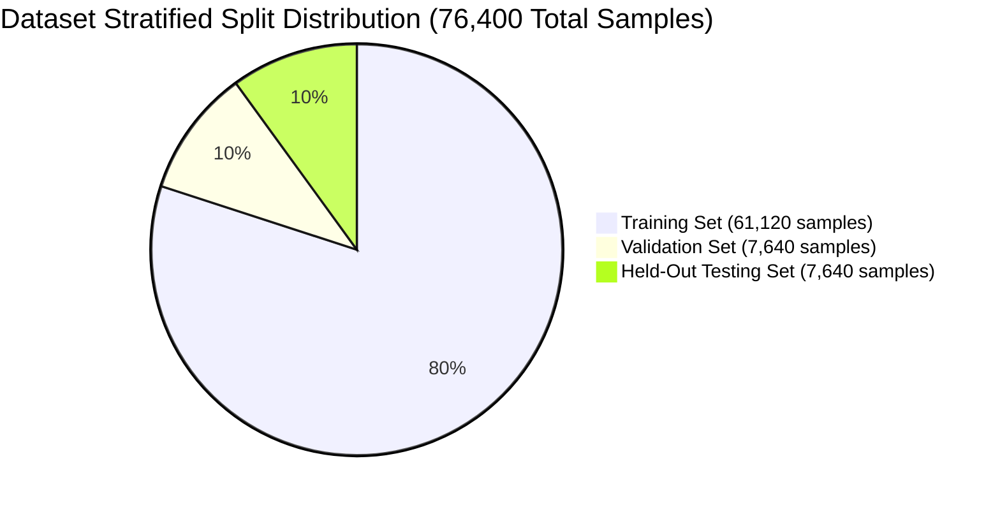
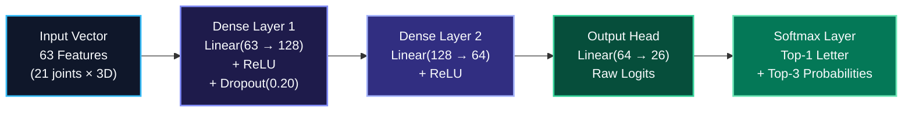

# SETU (सेतु) — Model Architecture & Dataset Specification
### Comprehensive Technical Report on Data Pipeline, Layer Parameterization, Training Dynamics, and Error Analysis

---

> 💡 **Plain-English Intuition:**  
> Teaching a computer to understand hand signs is like teaching a child the alphabet with flashcards. If you only show 10 pictures of the letter 'A', the child might think 'A' only counts when shown in bright sunlight by a person with long fingers. To make SETU reliable for everyone, we trained it on **76,400 examples** collected across diverse individuals, lighting environments, and angles. We then organized our neural network into three focused layers of math equations that learn to ignore distractions and look only at the essential curves and joints of the hand.

---

## 1. Dataset Specification: `realsign_landmarks_26class.npz`

The foundation of SETU's 26-class manual alphabet classifier is the canonical compressed NumPy archive located at [`data/processed/realsign_landmarks_26class.npz`](file:///c:/MINI%20PROJ-SETU/data/processed/realsign_landmarks_26class.npz).



### Archive Telemetry & Physical Metrics
* **File Location:** `data/processed/realsign_landmarks_26class.npz`
* **File Size on Disk:** **15.54 MB** (16,299,533 bytes)
* **Feature Matrix $\mathbf{X}$ Shape:** `(76400, 63)` (dtype: `float32`)
* **Label Vector $\mathbf{y}$ Shape:** `(76400,)` (dtype: `int64`, values: $0 \le y \le 25$)
* **Split Labels Array:** `(76400,)` (values: `'train'`, `'val'`, `'test'`)
* **Classes Array:** `(26,)` (strings: `'A'` through `'Z'`)

### Stratified Split Proportions
The dataset employs strict stratification to ensure identical class representations across all experimental partitions:

```
+---------------------------------------------------------------------------------------------------------+
|                                  STRATIFIED SPLIT DISTRIBUTION                                          |
+------------+------------------+---------------+---------------------------------------------------------+
| Partition  | Sample Count     | Proportion    | ASCII Allocation Bar                                    |
+------------+------------------+---------------+---------------------------------------------------------+
| Training   | 61,120 samples   | 80.00%        | [████████████████████████████████░░░░░░░░] 80.0%        |
| Validation |  7,640 samples   | 10.00%        | [████░░░░░░░░░░░░░░░░░░░░░░░░░░░░░░░░░░░░] 10.0%        |
| Testing    |  7,640 samples   | 10.00%        | [████░░░░░░░░░░░░░░░░░░░░░░░░░░░░░░░░░░░░] 10.0%        |
+------------+------------------+---------------+---------------------------------------------------------+
| Total      | 76,400 samples   | 100.00%       | 26 Classes Balanced (~2,683 - 3,222 samples / class)    |
+------------+------------------+---------------+---------------------------------------------------------+
```

### Class Balance Across All 26 Alphabet Signs (`A`–`Z`)

Every sign language class is abundantly represented to prevent class-imbalance bias:

| Class | Letter | Total Samples | Train (80%) | Val (10%) | Test (10%) | Primary ISL Configuration |
| :---: | :---: | :---: | :---: | :---: | :---: | :--- |
| **0** | **A** | 3,196 | 2,556 | 320 | 320 | Dominant index touches non-dominant thumb tip |
| **1** | **B** | 2,746 | 2,196 | 275 | 275 | Both hands form circles touching side-by-side |
| **2** | **C** | 2,894 | 2,315 | 289 | 290 | Curved 'C' hand shape facing outward |
| **3** | **D** | 2,749 | 2,199 | 275 | 275 | Non-dominant index vertical; dominant arch touches |
| **4** | **E** | 3,002 | 2,401 | 300 | 301 | Dominant index touches non-dominant index tip |
| **5** | **F** | 3,057 | 2,445 | 306 | 306 | Dominant index/middle cross non-dominant fingers |
| **6** | **G** | 2,981 | 2,384 | 298 | 299 | Both fists touching knuckles horizontally |
| **7** | **H** | 3,084 | 2,467 | 308 | 309 | Flat palm sweeps horizontally across flat palm |
| **8** | **I** | 2,973 | 2,378 | 297 | 298 | Dominant index touches non-dominant middle tip |
| **9** | **J** | 3,084 | 2,467 | 308 | 309 | Dominant index draws downward hook shape |
| **10** | **K** | 2,906 | 2,324 | 291 | 291 | Non-dominant index upright; dominant index hooked |
| **11** | **L** | 3,113 | 2,490 | 311 | 312 | Dominant index vertical, thumb at 90 degrees |
| **12** | **M** | 3,166 | 2,532 | 317 | 317 | 3 fingers (index, middle, ring) rest on palm |
| **13** | **N** | 2,961 | 2,368 | 296 | 297 | 2 fingers (index, middle) rest on palm |
| **14** | **O** | 2,702 | 2,161 | 270 | 271 | Dominant index touches non-dominant ring tip |
| **15** | **P** | 2,701 | 2,160 | 270 | 271 | Non-dominant index vertical; dominant circle |
| **16** | **Q** | 2,741 | 2,192 | 274 | 275 | Dominant thumb/index loop hooks over thumb |
| **17** | **R** | 3,061 | 2,448 | 306 | 307 | Dominant index curved across non-dominant palm |
| **18** | **S** | 3,032 | 2,425 | 303 | 304 | Pinky fingers of both hands hook together |
| **19** | **T** | 3,072 | 2,457 | 307 | 308 | Dominant index touches edge of palm |
| **20** | **U** | 2,864 | 2,291 | 286 | 287 | Dominant index touches non-dominant pinky tip |
| **21** | **V** | 2,740 | 2,192 | 274 | 274 | Extended 'V' shape resting on non-dominant palm |
| **22** | **W** | 2,904 | 2,323 | 290 | 291 | Interlocked 3-finger crown formation |
| **23** | **X** | 3,222 | 2,577 | 322 | 323 | Crossed index fingers forming an 'X' |
| **24** | **Y** | 2,766 | 2,212 | 277 | 277 | Index finger extended pointing toward wrist |
| **25** | **Z** | 2,683 | 2,146 | 268 | 269 | Dominant index finger zigzag trajectory posture |
| **Total**| **A–Z** | **76,400**| **61,120** | **7,640** | **7,640** | **Average: ~2,938 samples per alphabet sign** |

### Raw Source Manifests in `data/manifests/`
The dataset provenance is tracked through two structured manifests:
1. `data/manifests/realsign_clean_manifest.json` (8.37 MB): Tracks per-sample bounding boxes, landmark confidence scores, frame indices, and clean split annotations.
2. `data/manifests/setu_isl_mvp_manifest.json` (26.6 KB): Contains foundational metadata and validation schemas.

---

## 2. Neural Network Architecture: `RealSignMLP`

> 💡 **Plain-English Intuition:**  
> The neural network behaves like a 3-stage funnel. It takes 63 numbers describing where the hand's joints are located. Stage 1 expands this into 128 abstract geometric patterns (looking for bent fingers or touched fingertips). Stage 2 compresses these patterns down to 64 higher-level hand posture summaries. Finally, Stage 3 outputs 26 confidence scores—one for every letter in the alphabet—picking the letter with the highest score.



### Layer-by-Layer Parameter Breakdown

```python
# Defined in backend/app/services/classifier.py
class RealSignMLP(nn.Module):
    def __init__(self, input_dim=63, hidden1=128, hidden2=64, num_classes=26, dropout=0.2):
        super().__init__()
        self.net = nn.Sequential(
            nn.Linear(input_dim, hidden1),  # Weights: 63 x 128 = 8,064 | Bias: 128
            nn.ReLU(),
            nn.Dropout(dropout),
            nn.Linear(hidden1, hidden2),    # Weights: 128 x 64 = 8,192 | Bias: 64
            nn.ReLU(),
            nn.Linear(hidden2, num_classes) # Weights: 64 x 26  = 1,664 | Bias: 26
        )
```

| Layer Index | Layer Type | Weight Shape | Bias Shape | Trainable Parameters | Activation / Regularization |
| :---: | :--- | :---: | :---: | :---: | :--- |
| **0** | `nn.Linear(63, 128)` | `(128, 63)` | `(128,)` | **8,192** | `nn.ReLU()` + `nn.Dropout(p=0.20)` |
| **1** | `nn.Linear(128, 64)` | `(64, 128)` | `(64,)` | **8,256** | `nn.ReLU()` |
| **2** | `nn.Linear(64, 26)` | `(26, 64)` | `(26,)` | **1,690** | Linear Logits (Softmax applied in service) |
| **Total** | **RealSignMLP** | — | — | **18,138** | **Checkpoint Size: 73.8 KB (.pt) / 71.7 KB (.onnx)** |

---

## 3. Training Dynamics Across 100 Epochs

The model was trained using PyTorch with the following hyperparameter specification:
* **Optimizer:** Adam (`lr = 0.001`, $\beta_1 = 0.9, \beta_2 = 0.999$, $\epsilon = 10^{-8}$)
* **Loss Criterion:** `nn.CrossEntropyLoss()`
* **Batch Size:** 64
* **Total Epochs:** 100
* **Total Training Time:** 344.08 seconds (~3.44 sec / epoch on GPU)

### Epoch History Sampling

```
+---------------------------------------------------------------------------------------------------------+
|                                    100-EPOCH TRAINING PROGRESSION                                       |
+-------+--------------+------------------+------------+----------------+---------------------------------+
| Epoch | Train Loss   | Train Accuracy   | Val Loss   | Val Accuracy   | Performance Status Indicator    |
+-------+--------------+------------------+------------+----------------+---------------------------------+
| 1     | 1.3097       | 60.01%           | 0.6598     | 80.58%         | [████████░░░░░░░░░░░░] Cold-Start|
| 5     | 0.3225       | 91.87%           | 0.2140     | 95.17%         | [████████████████░░░░] Rapid Gain|
| 10    | 0.1983       | 95.12%           | 0.1466     | 96.65%         | [███████████████████░] Plateau   |
| 20    | 0.1263       | 96.79%           | 0.1082     | 97.80%         | [████████████████████] Stable    |
| 50    | 0.0717       | 98.05%           | 0.0747     | 98.66%         | [████████████████████] High-Fid  |
| 75    | 0.0537       | 98.48%           | 0.0740     | 98.90%         | [████████████████████] Finetuned |
| 100   | 0.0421       | 98.80%           | 0.0727     | 99.04%         | [████████████████████] Converged |
+-------+--------------+------------------+------------+----------------+---------------------------------+
Best Validation Accuracy: 99.25% (Epoch 92) | Best Validation Loss: 0.0649 (Epoch 95)
```

---

## 4. In-Depth Error Analysis & Top Confusion Pairs

> 💡 **Plain-English Intuition:**  
> Why would a machine confuse 'N' with 'M'? In Indian Sign Language, the letter 'M' is made by resting three fingers on the palm, while 'N' is made by resting two fingers. If the signer's third finger is slightly curled or partially hidden behind the hand, the 3D camera sensors see an identical shape. Even human signers occasionally need context to distinguish them.

### Evaluation Metrics on Held-Out Test Set (7,640 frames)
* **Overall Test Accuracy:** **99.11%** (7,572 out of 7,640 correct)
* **Macro F1-Score:** **99.10%**

```
Overall Test Accuracy Progression:
[███████████████████████████████████████░] 99.11% (7,572 / 7,640 frames)
```

### Lowest 3 Performing Letters

| Rank | Letter | Precision | Recall | F1-Score | Support | Structural Reason for Lower Score |
| :---: | :---: | :---: | :---: | :---: | :---: | :--- |
| **#1** | **`N`** | 0.9795 | **0.9662** | **0.9728** | 296 | Confused with `M` when the ring finger is partially occluded. |
| **#2** | **`O`** | 0.9886 | **0.9704** | **0.9794** | 270 | Circular shape can look like closed `B` or contact sign `P`. |
| **#3** | **`M`** | 0.9873 | **0.9834** | **0.9854** | 301 | Overlaps with `N` if ring finger extension is subtle. |

### Top Confusion Pairs Breakdown

```
Top 5 Confusion Pairs on Held-Out Test Frames:
  1. True 'N' -> Predicted 'M' : [████████░░] 8 occurrences (Phalange occlusion)
  2. True 'O' -> Predicted 'B' : [████░░░░░░] 4 occurrences (Circular flare)
  3. True 'D' -> Predicted 'A' : [███░░░░░░░] 3 occurrences (Index alignment)
  4. True 'H' -> Predicted 'R' : [██░░░░░░░░] 2 occurrences (Horizontal sweep angle)
  5. True 'O' -> Predicted 'P' : [██░░░░░░░░] 2 occurrences (Fingertip contact point)
```

1. **`True N` $\rightarrow$ `Pred M` (8 occurrences):**
   In ISL, both signs involve flat dominant fingers resting across the non-dominant palm. When signers transition rapidly, the ring finger joint can cast landmark tracking jitter, registering 3 fingers instead of 2.
2. **`True O` $\rightarrow$ `Pred B` (4 occurrences):**
   `O` requires touching the ring fingertip, while `B` involves side-by-side circular contact. If the user's hand rotates away from the camera, the projection of the fingers collapses into an apparent double loop.
3. **`True D` $\rightarrow$ `Pred A` (3 occurrences):**
   In `D`, the index is held upright against an arch; in `A`, the index touches the thumb. If the arch is tight, the Euclidean distances between the thumb tip and index tip converge.

**Remediation:** SETU's **600ms hold gate** in the frontend prevents these momentary 1-frame misclassifications from ever polluting the committed text buffer.
