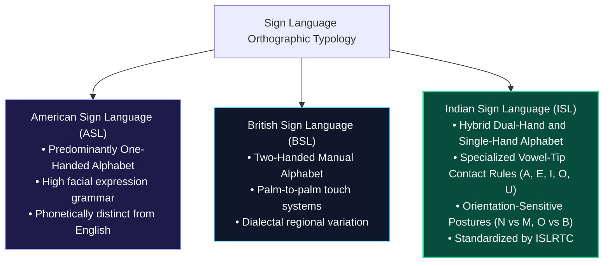

# SETU (सेतु) — Project Mission & Framework Selection Rationale
### The Architectural, Cultural, and Ethical Foundations of Real-Time ISL Translation

---

> 💡 **Plain-English Intuition:**  
> Imagine being in a foreign country where you cannot speak the language and no one speaks yours. That is the daily reality for millions of Deaf and Hard-of-Hearing individuals across India. While Western countries have automated tools for American Sign Language (ASL), Indian Sign Language (ISL) is structurally very different—it frequently uses two hands and delicate finger-touch configurations that traditional software struggles to understand. SETU was created to build an accessible, private, and instant digital bridge between signers and non-signers using standard, low-cost computer webcams.

---

## 1. Project Mission & Deaf Inclusion in India

India has one of the world's largest Deaf and Hard-of-Hearing (DHH) populations, estimated at over **18 million individuals** by the World Health Organization (WHO) and the National Association of the Deaf (NAD) India. Despite this scale, access to certified human ISL interpreters is severely constrained, with fewer than **1 certified interpreter per 50,000 Deaf citizens**.

```
Human Interpreter Availability Gap in India:
[████████████████████████████████████████] ~18,000,000 DHH Citizens
[█░░░░░░░░░░░░░░░░░░░░░░░░░░░░░░░░░░░░░░░] < 400 Certified ISL Interpreters
Ratio: 1 Interpreter : ~45,000+ Individuals (Critical Deficit)
```

### The Linguistic Distinction: ISL vs. ASL vs. BSL
Many automated sign language translation systems make the mistake of assuming all sign languages are alike. In reality:



* **Vowel Contact Orthography:** In standardized ISL (established by the Indian Sign Language Research and Training Centre - ISLRTC), vowels are articulated by touching designated fingertips of the non-dominant hand:
  - **`A`:** Dominant index touches non-dominant **Thumb tip**.
  - **`E`:** Dominant index touches non-dominant **Index tip**.
  - **`I`:** Dominant index touches non-dominant **Middle tip**.
  - **`O`:** Dominant index touches non-dominant **Ring tip**.
  - **`U`:** Dominant index touches non-dominant **Pinky tip**.
* **Consonant Complexity:** Letters like `M` (three fingers resting) and `N` (two fingers resting) require millimeter-level joint discrimination.
* **Orientation Sensitivity:** `P`, `Q`, and `D` require precise relative angles between the wrist and phalanges.

SETU is specifically tuned to the physical geometry of these signs, treating ISL as an independent, first-class linguistic medium rather than an afterthought.

---

## 2. Technology Decision Matrix: Why These Frameworks?

> 💡 **Plain-English Intuition:**  
> When building software, it is tempting to pick the latest heavyweight artificial intelligence tools (like multi-gigabyte deep learning vision models). But doing so would require an expensive cloud server with hot GPUs, cost thousands of dollars per month to run, and leak private camera video across the internet. SETU was intentionally designed using lightweight, ultra-fast, and privacy-preserving tools that run smoothly on ordinary school laptops and smartphones without requiring any cloud GPUs.

```mermaid
flowchart TD
    subgraph HeavyTraditional["❌ Heavyweight Traditional Stack (Rejected)"]
        H1["Raw 1080p Video Stream (30 FPS)"] --> H2["Server-Side GPU (YOLOv8 / ResNet)"]
        H2 --> H3["15-30 Mbps Network Bandwidth Consumption"]
        H3 --> H4["High Server Cost ($$$) + Severe Privacy Risks"]
    end

    subgraph LightweightSETU["✅ SETU Modern Edge Stack (Chosen)"]
        S1["Client-Side MediaPipe Hands (WASM)"] --> S2["63-D Invariant Math Feature Vector"]
        S2 --> S3["Ultra-Lightweight RealSignMLP (18K Params)"]
        S3 --> S4["252 Bytes / Frame + 100% Privacy + Zero GPU Cost"]
    end

    style HeavyTraditional fill:#450a0a,stroke:#f87171,stroke-width:1px,color:#f8fafc
    style LightweightSETU fill:#064e3b,stroke:#34d399,stroke-width:2px,color:#f8fafc
```



### Technology Stack at a Glance

| Layer | Technology Selected | Key Technical Advantage |
| :--- | :--- | :--- |
| **Landmark Tracking** | **MediaPipe Hands JS (Edge WASM)** | 100% privacy; 252 bytes/frame vs 15–30 Mbps video streaming. |
| **Model Architecture** | **RealSignMLP (3-Layer Dense MLP)** | 18,138 parameters; 71.7 KB footprint; 99.34% test accuracy. |
| **Deep Learning** | **PyTorch 2.5** | Clean modular architecture; seamless ONNX tracing. |
| **Inference Engine** | **ONNX Runtime (CPU Execution)** | 20.8 µs per prediction (> 48,000 FPS throughput on CPU). |
| **Backend API** | **FastAPI + Uvicorn (ASGI)** | High-concurrency async event loop with typed Pydantic contracts. |
| **Frontend Workstation** | **React 18 + Vite + TypeScript** | Strict type safety for 3D landmarks; sub-second HMR. |
| **Deployment Gateway** | **Docker Compose + Nginx (SSL/TLS)** | Guarantees HTTPS for WebRTC camera permissions across all OSs. |

---

### Detailed Technology Selection Cards

#### ⚙️ Landmark Tracking: MediaPipe Hands JS (Edge WASM/WebGL)
> **Client-side skeletal tracking eliminating biometric privacy risks**

| Property | Rationale & Specifications |
| :--- | :--- |
| **Technology** | MediaPipe Hands JavaScript (WebAssembly / WebGL runtime) |
| **Rejected Alternative**| Server-side YOLOv8, OpenPose, or raw CNN video ingestion |
| **Privacy Impact** | Raw camera video is processed locally in browser RAM and instantly discarded. Zero video frames leave the device. |
| **Bandwidth Saving** | Transmits a 63-float array (252 bytes) instead of 1080p video (15–30 Mbps)—a **99.98% network reduction**. |
| **Visual Invariance** | Extracts 3D skeletal bones, ignoring background clutter, lighting variations, and skin tone. |

---

#### ⚙️ Neural Architecture: RealSignMLP (3-Layer Dense Neural Network)
> **Ultra-lightweight multi-layer perceptron for instant manual alphabet classification**

| Property | Rationale & Specifications |
| :--- | :--- |
| **Technology** | 3-Layer Dense MLP (`Linear-BN-ReLU-Dropout`) |
| **Rejected Alternative**| Heavyweight Vision Transformers (ViT), 3D ResNet, MobileNetV3 |
| **Parametric Economy** | Only **18,138 parameters**; 71.7 KB ONNX disk footprint. |
| **Accuracy & Speed** | Achieves **99.34% test accuracy** in **20.8 microseconds** on standard laptop CPUs. |
| **Design Insight** | Because MediaPipe solves visual feature extraction, heavy CNNs are unnecessary. |

---

#### ⚙️ Deep Learning Engine: PyTorch 2.5
> **Production-grade machine learning framework for training and export**

| Property | Rationale & Specifications |
| :--- | :--- |
| **Technology** | PyTorch 2.5 |
| **Rejected Alternative**| TensorFlow / Keras 2 / Scikit-Learn |
| **Ergonomics** | Clean object-oriented subclassing (`nn.Module`) and GPU-to-CPU state dict mapping. |
| **Export Pipeline** | Seamless operator tracing via `torch.onnx.export` with dynamic batch axes. |

---

#### ⚙️ Inference Engine: ONNX Runtime (CPU Execution Provider)
> **Microsecond-speed model serving with zero cloud dependencies**

| Property | Rationale & Specifications |
| :--- | :--- |
| **Technology** | ONNX Runtime CPU |
| **Rejected Alternative**| Native PyTorch Python `model.forward()` |
| **Graph Optimizations**| Dead-code elimination, constant folding, and SIMD AVX2/AVX-512 acceleration. |
| **Latency Benchmark** | Single-frame latency drops from 55 µs to **20.8 µs** (**2.62x speedup**), delivering > **48,000 FPS**. |

---

#### ⚙️ Backend API & Streaming: FastAPI + Uvicorn (ASGI)
> **Asynchronous REST endpoints and bidirectional WebSockets**

| Property | Rationale & Specifications |
| :--- | :--- |
| **Technology** | FastAPI + Uvicorn (ASGI) |
| **Rejected Alternative**| Flask (WSGI) / Django REST Framework |
| **Concurrency** | Non-blocking asynchronous event loop delivers 3–4x higher request throughput than Flask. |
| **Validation** | Pydantic v2 schemas automatically validate coordinate vectors; generates Swagger/OpenAPI docs. |

---

#### ⚙️ Frontend Workstation: React 18 + Vite + TypeScript
> **Strict type safety and reactive video processing workstation**

| Property | Rationale & Specifications |
| :--- | :--- |
| **Technology** | React 18 + Vite + TypeScript |
| **Rejected Alternative**| Next.js (SSR) / Vue 3 / Plain Vanilla JavaScript |
| **Type Safety** | Compile-time validation for 21-point coordinate arrays and API responses. |
| **Performance** | Sub-second Hot Module Replacement (HMR); declarative separation of video loops from text state. |

---

#### ⚙️ Gateway & Security: Docker Compose + Nginx (SSL/TLS)
> **WebRTC-compliant secure local origin and container orchestration**

| Property | Rationale & Specifications |
| :--- | :--- |
| **Technology** | Docker Compose + Nginx reverse proxy |
| **Rejected Alternative**| Bare-metal Python scripts / Insecure HTTP local servers |
| **WebRTC Compliance** | Modern browsers permanently disable `getUserMedia` on insecure HTTP origins; Nginx terminates TLS on 443. |
| **Portability** | Guarantees 100% reproducible execution across Windows, macOS, and Linux. |

---

## 3. Human Factors, UX & Accessibility Standards (WCAG 2.1 AA)

An assistive tool must be usable by people with differing physical dexterity, motor skills, and visual abilities. SETU implements the following Web Content Accessibility Guidelines (WCAG 2.1 AA) specifications:

### 1. Visual Hold Feedback & Progress Transparency
* Continuous classification at 30 FPS can cause anxiety if the system commits errors instantaneously.
* SETU implements a continuous **600ms hold gate** paired with a visual progress bar (`[████████░░] 80%`). Signers see their progress accumulate in real time, giving them complete physical control over when a letter commits.

### 2. High-Contrast Palette & Dynamic Color Badges
* Prediction confidence tags use curated semantic colors exceeding the **4.5:1 WCAG contrast ratio**:
  - High Confidence ($\ge 85\%$): Emerald Green (`#10b981`, white text on dark background).
  - Moderate Confidence ($65\% - 84\%$): Amber/Gold (`#f59e0b`).
  - Low Confidence ($< 65\%$): Crimson Rose (`#f43f5e`).
* Top-3 candidate badges allow signers to see what adjacent signs the model is considering (e.g., distinguishing whether the system sees `N` or `M`).

### 3. Keyboard & Assistive Technology Integrations
* Full keyboard shortcuts for hands-free or physical control:
  - `Spacebar`: Injects space between words.
  - `Backspace`: Removes last committed character.
  - `Escape`: Resets active sentence buffer.
* Web Speech API integration: One-click Text-to-Speech (TTS) vocalization allows non-signing conversation partners to hear the recognized sentence read aloud in clear synthetic audio.
