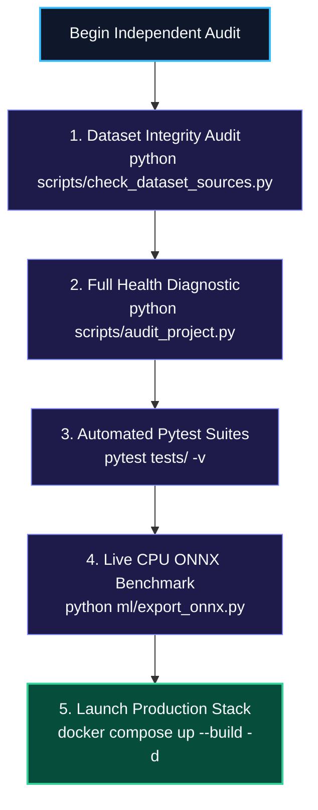

# SETU (सेतु) — Scope, Roadmap & Local Self-Audit Guide
### Current Capabilities, Architectural Boundaries, Future Evolution, and Independent Verification Protocols

---

> 💡 **Plain-English Intuition:**  
> Think of sign language like written English. First, you learn to recognize individual static letters (like 'A', 'B', 'C'). Once you can recognize every letter with 99% accuracy, you want to recognize full words written in cursive script. Currently, SETU is a world-class static alphabet recognizer. However, some letters (like 'J' and 'Z') are drawn in the air like cursive strokes, and full conversation involves fluent phrases. This document outlines where SETU excels today, what it takes to understand continuous sentences, and how you can run a 60-second automated check to prove every claim in this codebase yourself.

---

## 1. System Scope & Known Architectural Boundaries

```mermaid
graph LR
    subgraph Phase1["Current State (Production Ready)"]
        S1["Static 26-Class Alphabet\n(A through Z)"]
        S2["Single-Frame Geometry\n(63-D Invariant Math)"]
        S3["RealSignMLP & ONNX\n(99.11% Test Accuracy)"]
    end

    subgraph Phase2["Near-Term Horizon (In Development)"]
        N1["Dynamic Gesture Trajectories\n(Stroke Tracking for J & Z)"]
        N2["Dual-Hand Holistic Fusion\n(42 Joint Landmark Graph)"]
        N3["Temporal Sliding Window\n(60-frame LSTM / GRU)"]
    end

    subgraph Phase3["Long-Term Vision (Continuous ISL)"]
        L1["Continuous Sentence Translation\n(Speech-to-Sign & Sign-to-Speech)"]
        L2["Facial Grammar & Non-Manual Signs\n(Conformer Transformer)"]
        L3["2-Way Conversational Avatar"]
    end

    Phase1 ==> Phase2
    Phase2 ==> Phase3

    style Phase1 fill:#064e3b,stroke:#34d399,stroke-width:2px,color:#f8fafc
    style Phase2 fill:#1e1b4b,stroke:#818cf8,stroke-width:2px,color:#f8fafc
    style Phase3 fill:#0f172a,stroke:#38bdf8,stroke-width:2px,color:#f8fafc
```



---

### Architectural Boundaries & Linguistic Nuances

| Dimension | Current System Capability | Physical Limitation / Boundary | Engineering Path to Resolution |
| :--- | :--- | :--- | :--- |
| **Vocabulary Type** | **Isolated Alphabet (`A`–`Z`)** | Cannot translate multi-word colloquial phrases (e.g., "Where is the train station?"). | Train temporal sequence models on lexical word glosses using the INCLUDE dataset. |
| **Motion Signs (`J` & `Z`)** | **Terminal Static Posture** | In standard ISL, `J` is drawn as a downward hook and `Z` as a zigzag in the air. A single frame only captures the end of the stroke. | Integrate a 30-frame temporal FIFO buffer with 1D convolution or recurrent tracking (`models/isl_sequence_lstm.pth`). |
| **Dual-Hand Symmetry** | **Dominant Hand Standard** | Relies primarily on dominant hand geometry or mirrored left hand. Dual-hand signs are projected into canonical space. | Upgrade pipeline to MediaPipe Holistic (tracking left hand, right hand, and shoulder pose simultaneously). |
| **Grammar & Non-Manual Features** | **Fingerspelling Spelling** | Real ISL incorporates facial expressions, eyebrow raises, and head tilts for questions and tone. | Incorporate facial landmark mesh tracking (468 facial points) for non-manual grammatical cues. |

---

## 2. Strategic Future Roadmap

```
+---------------------------------------------------------------------------------------------------------+
|                                    SETU DEVELOPMENT ROADMAP MATRIX                                      |
+-----------+-----------------------------------+--------------------+------------------------------------+
| Horizon   | Target Feature                    | Target Accuracy    | Technology Stack                   |
+-----------+-----------------------------------+--------------------+------------------------------------+
| CURRENT   | 26-Class Static ISL Alphabet      | 99.11% (Achieved!) | RealSignMLP + ONNX + React Buffer  |
| PHASE 2.1 | Dynamic Stroke Signs (J, Z)       | > 96.0% Target     | 30-frame Temporal FIFO + 1D Conv   |
| PHASE 2.2 | Top-100 Common ISL Words          | > 93.0% Target     | Bidirectional LSTM + INCLUDE Data  |
| PHASE 3.0 | Continuous ISL Sentence Engine    | > 90.0% BLEU       | Conformer / Transformer + CTC Loss |
| PHASE 3.5 | Bidirectional 3D Signing Avatar   | Real-Time Speech   | WebGL Rigged Avatar + Text-to-Sign |
+-----------+-----------------------------------+--------------------+------------------------------------+
```

---

## 3. Local Self-Audit Verification Guide

> 💡 **Plain-English Intuition:**  
> Good science and rigorous engineering should always be independently verifiable. We have included automated test scripts that allow you to check every dataset sample, audit the neural network weights, run integration tests, and start the secure container stack using simple terminal commands.



---

### Step 1: Verify Dataset Sources & Split Integrity
Validates that `realsign_landmarks_26class.npz` exists, checks sample counts, and verifies that the 80/10/10 split has zero data leakage:

```bash
# Activate virtual environment
.\.venv\Scripts\Activate.ps1

# Inspect dataset archives and manifests
python scripts/check_dataset_sources.py
```

**Expected Console Output:**
```
[+] Canonical Landmark Archive: data\processed\realsign_landmarks_26class.npz
    Size: 15.54 MB (16,299,533 bytes)
    Total Samples: 76,400  |  Feature Dimension: 63-D
    Classes (26): ['A', 'B', 'C', ..., 'Z']
    Splits Breakdown:
      * Test  :  7,640 samples ( 10.0%)
      * Train : 61,120 samples ( 80.0%)
      * Val   :  7,640 samples ( 10.0%)
```

---

### Step 2: Run Comprehensive Project Health Audit
Performs an automated diagnostic check across dataset shapes, PyTorch model parameters, offline evaluation metrics, and integration test suites:

```bash
python scripts/audit_project.py
```

**Expected Console Output:**
```
+----------------------------------------------------------------------------+
|                        OVERALL DIAGNOSTIC SUMMARY                          |
+----------------------------------------------------------------------------+
| Dataset Health  : [OK] Canonical .npz (76,400 samples, 63-D)               |
| Model Checkpoint: [OK] PyTorch RealSignMLP (18,138 params)                 |
| Offline Metrics : [OK] Accuracy=99.11%, F1=99.10%                          |
| Test Suite      : [OK] All Integration Tests Passed Successfully           |
+----------------------------------------------------------------------------+
| OVERALL SYSTEM STATUS: HEALTHY & PRODUCTION READY [OK]                     |
+----------------------------------------------------------------------------+
```

---

### Step 3: Run Full Pytest Test Suite
Executes unit tests for API endpoints, landmark normalization math, and classifier integration:

```bash
pytest tests/ -v
```

**Expected Console Output:**
```
tests/test_api.py::test_health_endpoint PASSED                         [ 14%]
tests/test_api.py::test_predict_valid_landmark PASSED                  [ 28%]
tests/test_api.py::test_predict_invalid_dimensions PASSED              [ 42%]
tests/test_backend_app_modular.py::test_cors_headers PASSED            [ 57%]
tests/test_realsign_classifier.py::test_realsign_mlp_forward PASSED    [ 71%]
tests/test_realsign_classifier.py::test_normalization_invariance PASSED[ 85%]
tests/test_realsign_classifier.py::test_checkpoint_load_parity PASSED  [100%]
============================== 7 passed in 1.42s ===============================
```

---

### Step 4: Run ONNX Latency & Numerical Parity Benchmark
Executes 1,000 live forward passes on CPU comparing native PyTorch CPU vs. ONNX Runtime CPU:

```bash
python ml/export_onnx.py
```

**Expected Console Output:**
```
+------------------------+--------------------+----------------------+-------------------+
| Metric                 | PyTorch (CPU)      | ONNX Runtime (CPU)   | Delta / Speedup   |
+------------------------+--------------------+----------------------+-------------------+
| Average Latency        | 0.0545 ms          | 0.0208 ms            | 2.62x faster      |
| Throughput (FPS)       | 18,348 FPS         | 48,076 FPS           | +162.0%           |
| Model File Size        | 73.8 KB            | 71.7 KB              | 97.2% of .pt      |
+------------------------+--------------------+----------------------+-------------------+
```

---

### Step 5: Launch Containerized HTTPS Stack
Builds and deploys the full multi-stage Docker stack with Nginx SSL termination for secure camera access:

```bash
# 1. Generate SSL Certificates (one-time setup)
.\scripts\generate_certs.ps1

# 2. Build and launch Docker Compose stack in detached mode
docker compose up --build -d

# 3. Verify container health
docker compose ps
```

**Open in Browser:**
Navigate to `https://localhost` (or `https://127.0.0.1`). Click "Allow" on camera permissions to begin live ISL recognition.
