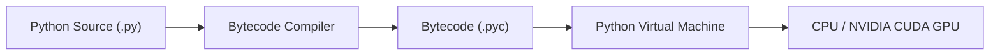
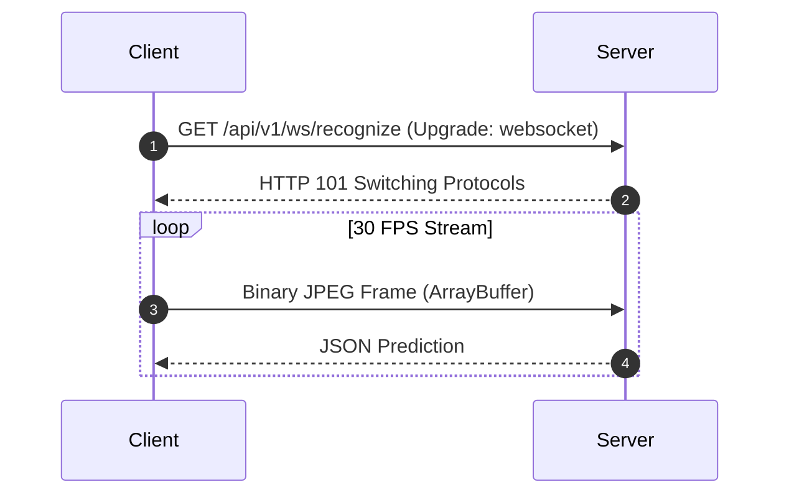

# Book 1: Software & Web Engineering in SETU
### Consolidated Modules 01 to 04 — Foundations, Programming, Architecture & Real-Time APIs

> **Target:** 3rd Year B.Tech AI & ML Student  
> **Mission:** A single, unified guide covering everything about how SETU executes, from Python bytecode and async event loops to React 19, TypeScript, FastAPI, and 30 FPS WebSocket protocols.

---

# Table of Contents
1. [Part 1: How Software and Python Execute](#part-1-how-software-and-python-execute)
2. [Part 2: Processes, Threads, and the Async Event Loop](#part-2-processes-threads-and-the-async-event-loop)
3. [Part 3: TypeScript, React 19, and Frontend State](#part-3-typescript-react-19-and-frontend-state)
4. [Part 4: Python OOP, Dataclasses, and Decorators](#part-4-python-oop-dataclasses-and-decorators)
5. [Part 5: Client-Server Architecture & Decoupled Pipelines](#part-5-client-server-architecture--decoupled-pipelines)
6. [Part 6: FastAPI, Uvicorn, and Lifespan Pre-Warming](#part-6-fastapi-uvicorn-and-lifespan-pre-warming)
7. [Part 7: HTTP REST versus Real-Time WebSockets](#part-7-http-rest-versus-real-time-websockets)
8. [Part 8: Binary Frame Streaming Protocols](#part-8-binary-frame-streaming-protocols)

---

## Part 1: How Software and Python Execute

### 1.1 The Problem & First Principles
Computers operate on binary physical voltage states (1s and 0s). High-level languages like Python bridge human logic with machine architecture.
When you run `python backend/app/main.py`, Python does not run raw machine code directly:
1. **Lexing & Parsing:** Python checks syntax and builds an Abstract Syntax Tree (AST).
2. **Bytecode Compilation:** Compiles code into platform-independent virtual instructions (stored as `.pyc` files in `__pycache__`).
3. **PVM Execution:** The Python Virtual Machine (PVM) interprets bytecode instructions sequentially, delegating heavy tensor math to pre-compiled C++ and CUDA libraries.



### 1.2 Virtual Environments (`.venv`)
Global Python installations cause dependency collisions. SETU uses an isolated virtual environment (`.venv/`):
* `.\.venv\Scripts\python.exe`: Isolated Python runtime.
* `.\.venv\Lib\site-packages\`: Local repository of packages (PyTorch 2.6, FastAPI, MediaPipe, OpenCV).
* **Golden Rule:** Always invoke commands with `.\.venv\Scripts\python.exe` to avoid Windows Store path stubs!

---

## Part 2: Processes, Threads, and the Async Event Loop

### 2.1 The 30 FPS Concurrency Problem
A webcam captures 30 frames per second. If processing one frame blocks the CPU for 100ms:
* Only 10 frames are processed per second.
* 20 frames buffer up every second, causing instant lag and memory crashes!

### 2.2 Concurrency Models Compared
* **Process:** An independent OS process with its own private memory. Heavyweight (~50 MB overhead).
* **Thread:** Multiple execution workers within one process sharing memory. In Python, the **Global Interpreter Lock (GIL)** restricts pure Python bytecode execution to 1 CPU core at a time.
* **AsyncIO (Event Loop):** A single master thread utilizing cooperative multitasking. When a task waits for network I/O (`await websocket.receive()`), the event loop instantly switches to process another task without thread overhead!

```mermaid
sequenceDiagram
    autonumber
    participant Loop as Async Event Loop
    participant Client as WebSocket Client
    participant Worker as ThreadPool Worker (C++/CUDA)

    Loop->>Client: await websocket.receive() (Non-blocking wait)
    Client-->>Loop: Frame arrives!
    Loop->>Worker: Offload PyTorch/OpenCV (run_in_executor)
    Note over Loop: Event loop is FREE to handle other clients!
    Worker-->>Loop: Predictions ready!
    Loop->>Client: await websocket.send_json(...)
```

---

## Part 3: TypeScript, React 19, and Frontend State

### 3.1 Why TypeScript Over Plain JavaScript
In raw JavaScript, reading `data.prediction.sign` on a missing key causes `TypeError: Cannot read properties of undefined`, resulting in a blank white crash in the user's browser.
TypeScript enforces compile-time interfaces:
```typescript
// File: frontend/src/types.ts
export interface RecognitionPayload {
  sign: string;
  confidence: number;
  landmarks?: { left_hand?: Landmark[]; right_hand?: Landmark[] };
  detected_objects?: DetectedObject[];
  sentence_buffer?: string;
}
```
If code attempts to read an invalid field, the TypeScript compiler (`tsc`) catches it before deployment.

### 3.2 State Management: `useState` vs `useRef`
* **`useState`:** Triggers a full React re-render. Used for UI that users see: current translated sentence, active modals, theme toggles.
* **`useRef`:** Updates an in-memory reference **without triggering re-renders**.
  * **Critical Optimization in SETU:** WebSockets and video locks run 30 times a second. Storing `wsRef`, `videoRef`, and `lastFrameSentTimeRef` in `useRef` avoids 30 costly DOM repaints per second!

---

## Part 4: Python OOP, Dataclasses, and Decorators

### 4.1 Immutable Dataclasses
In [`backend/app/services/vision/object_detector.py`](file:///c:/MINI%20PROJ-SETU/backend/app/services/vision/object_detector.py):
```python
@dataclass(frozen=True)
class DetectedObject:
    label: str
    display_name: str
    confidence: float
    bbox: Tuple[float, float, float, float]
    is_interactive: bool = False
    is_held: bool = False
```
* `@dataclass(frozen=True)` creates an immutable object. Downstream functions cannot accidentally overwrite `confidence` or `is_held`, ensuring reliable data pipelines.

### 4.2 The Singleton Pattern for AI Models
Loading PyTorch weights into GPU VRAM takes several seconds and hundreds of megabytes. If every user connection created a new instance of `RealSignClassifier`, VRAM would run out immediately.
SETU instantiates models once as module-level singletons (`pipeline = PipelineManager()`), shared across all connections.

---

## Part 5: Client-Server Architecture & Decoupled Pipelines

### 5.1 Why Decouple the Browser from the AI Engine?
* **Hardware:** Running 5 deep learning models in a browser chokes consumer laptops. Decoupling allows thin clients (phones, laptops) to connect to powerful CUDA servers.
* **Model Security:** Proprietary PyTorch `.pth` weights remain safe on the backend server rather than being exposed in browser Developer Tools.
* **Port Separation:**
  * Frontend: `http://localhost:5173` (Vite + React 19)
  * Backend: `http://127.0.0.1:8000` (FastAPI + PyTorch CUDA)

---

## Part 6: FastAPI, Uvicorn, and Lifespan Pre-Warming

### 6.1 Modern ASGI vs Legacy WSGI
Legacy Flask/Django (WSGI) blocks one thread per request and cannot handle WebSockets natively. FastAPI (ASGI) runs on asynchronous event loops, handling thousands of persistent streaming connections.

### 6.2 Pre-Warming CUDA Kernels via `lifespan`
In [`backend/app/main.py`](file:///c:/MINI%20PROJ-SETU/backend/app/main.py):
```python
@asynccontextmanager
async def lifespan(app: FastAPI):
    # Startup: Load models and run dummy forward passes
    classifier_service.load_model()
    pipeline.load()
    yield  # Server accepts live user requests!
    # Shutdown: Clean up pipelines
    pipeline.close()
```
Passing synthetic zero tensors through PyTorch during startup forces CUDA driver allocation and kernel compilation before users connect, eliminating the first-frame 2-second freeze.

---

## Part 7: HTTP REST versus Real-Time WebSockets

### 7.1 Protocol Comparison
* **HTTP REST (Half-Duplex):** Client sends request $\to$ waits for response $\to$ connection closes. Sending 30 HTTP POST requests per second incurs 24 KB/s of repetitive header overhead and high handshake latency.
* **WebSocket (Full-Duplex - RFC 6455):** Single handshake upgrades connection (`HTTP 101 Switching Protocols`). The TCP connection stays open indefinitely, sending frames with only 2–6 bytes of framing overhead!



---

## Part 8: Binary Frame Streaming Protocols

### 8.1 Why Not Base64?
Base64 string encoding converts 3 binary bytes into 4 ASCII characters, inflating bandwidth by **33.3%** and consuming CPU on string serialization.

### 8.2 The Raw Binary Pipeline
1. **Frontend:** Canvas captures video frame and compresses it to a JPEG blob at quality 0.70.
2. **Dispatch:** Converts blob to an `ArrayBuffer` and sends raw binary bytes over the WebSocket.
3. **Backend:** OpenCV decompresses bytes in memory in 1.2ms:
   ```python
   np_arr = np.frombuffer(raw_bytes, dtype=np.uint8)
   frame = cv2.imdecode(np_arr, cv2.IMREAD_COLOR)
   ```
4. **Bandwidth:** 24 KB per frame $\times$ 30 FPS $\approx$ **5.7 Mbps** (compared to 221 Mbps for uncompressed video)!

