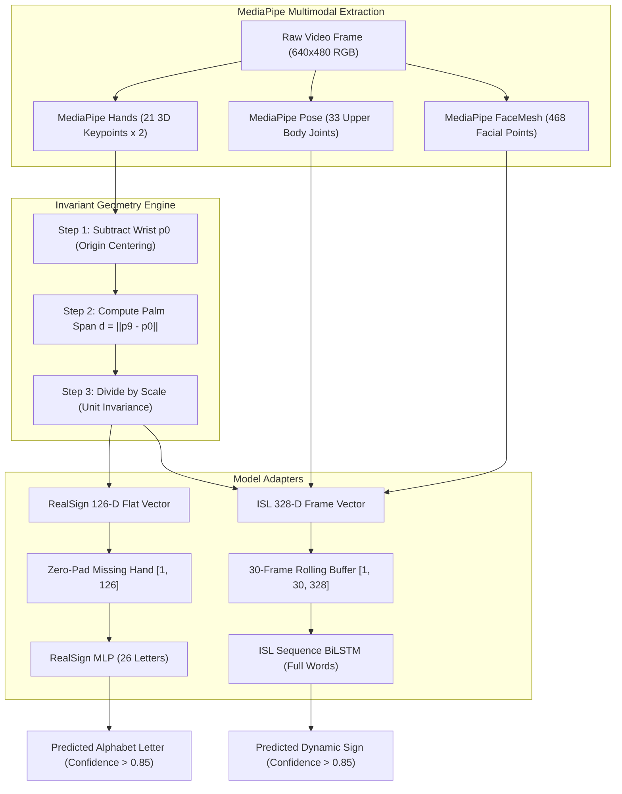

# BOOK 2: SPATIAL GEOMETRY, LANDMARKS, AND FEATURE VECTORS

> **Audience:** 3rd Year B.Tech Artificial Intelligence & Machine Learning Student  
> **Topic:** MediaPipe 3D Landmark Geometry, Coordinate Normalization, Scale Invariance, and Dual-Hand Feature Schemas (126-D & 328-D) in Project SETU  
> **Source Files Explored:**  
> - [`backend/app/services/vision/landmarks.py`](file:///c:/MINI%20PROJ-SETU/backend/app/services/vision/landmarks.py)  
> - [`frontend/src/utils/landmarksDrawer.ts`](file:///c:/MINI%20PROJ-SETU/frontend/src/utils/landmarksDrawer.ts)  
> - [`models/adapters/realsign.py`](file:///c:/MINI%20PROJ-SETU/models/adapters/realsign.py)  
> - [`models/adapters/sequence_lstm.py`](file:///c:/MINI%20PROJ-SETU/models/adapters/sequence_lstm.py)  
> - [`training/features/`](file:///c:/MINI%20PROJ-SETU/training/features/)

---

## TABLE OF CONTENTS
1. [Executive Summary & The Core Problem](#1-executive-summary--the-core-problem)
2. [MediaPipe Anatomical Landmarks & 3D Camera Space](#2-mediapipe-anatomical-landmarks--3d-camera-space)
3. [The Curse of Raw Pixels vs Skeletal Representation](#3-the-curse-of-raw-pixels-vs-skeletal-representation)
4. [Mathematical Formulation of Geometric Invariance](#4-mathematical-formulation-of-geometric-invariance)
   - Translation Invariance (Wrist Centering)
   - Scale Invariance (Palm Span Normalization)
5. [The RealSign 126-D Feature Vector Schema](#5-the-realsign-126-d-feature-vector-schema)
6. [The ISL Sequence 328-D Spatio-Temporal Feature Schema](#6-the-isl-sequence-328-d-spatio-temporal-feature-schema)
7. [Full Pipeline Architecture & Flow Diagram](#7-full-pipeline-architecture--flow-diagram)
8. [Codebase Deep Dive](#8-codebase-deep-dive)
9. [Small Independent Runnable Python Verification Scripts](#9-small-independent-runnable-python-verification-scripts)
10. [Viva Voce, Conceptual Checklist & Interview Defense](#10-viva-voce-conceptual-checklist--interview-defense)

---

## 1. Executive Summary & The Core Problem

When humans observe a sign language gesture, we do not pay attention to the exact color of the wall behind the signer, their shirt patterns, the lighting in the room, or their skin complexion. Our visual cortex instantly isolates the **skeletal articulation of the hands and body**—which fingers are curled, which knuckles are extended, and how the hands are oriented relative to each other.

If an AI attempted to recognize sign language directly from raw camera images:
- A $640 \times 480$ RGB camera frame contains $640 \times 480 \times 3 = 921,600$ numerical values (bytes).
- If the user moves their hand 2 inches to the left, or steps 1 foot closer to the camera, **almost all 921,600 numbers change dramatically**, even though the sign itself is 100% identical!
- Training a neural network directly on 921,600 pixel values to learn sign invariance requires tens of millions of diverse images and massive computational power (GPUs running for weeks).

**Project SETU solves this using a two-tier decoupled vision architecture:**
1. **Tier 1 (Geometric Perception):** Google MediaPipe transforms the $921,600$-pixel image into **21 anatomical 3D keypoints per hand**.
2. **Tier 2 (Invariant Feature Vectorization):** SETU applies mathematical normalization to convert raw coordinates into a **compact, translation-invariant, scale-invariant feature vector** ($126$ floating-point numbers for static letters, and $328$ numbers per frame for dynamic phrases).
3. **Tier 3 (Neural Classification):** Lightweight PyTorch models (an MLP and a BiLSTM) make instant predictions in less than $2\text{ ms}$, with near-zero GPU memory footprint!

---

## 2. MediaPipe Anatomical Landmarks & 3D Camera Space

### The 21 Keypoints per Hand
MediaPipe Hands detects **21 standardized 3D landmarks** per hand, corresponding precisely to human anatomical joints:

```
          8 (INDEX_TIP)    12 (MIDDLE_TIP)   16 (RING_TIP)    20 (PINKY_TIP)
          |                |                 |                |
          7 (INDEX_DIP)    11 (MIDDLE_DIP)   15 (RING_DIP)    19 (PINKY_DIP)
          |                |                 |                |
4 (THUMB) 6 (INDEX_PIP)    10 (MIDDLE_PIP)   14 (RING_PIP)    18 (PINKY_PIP)
   \      |                |                 |                |
    3     5 (INDEX_MCP)----9 (MIDDLE_MCP)----13 (RING_MCP)----17 (PINKY_MCP)
     \     \              /                 /                /
      2     \            /                 /                /
       \     \          /                 /                /
        1-----\--------/-----------------/----------------/
               \      /
                0 (WRIST)
```

### Joint Index Breakdown
- **Joint 0:** Wrist (Anatomical anchor / root of hand coordinates)
- **Joints 1–4:** Thumb (1: CMC, 2: MCP, 3: IP, 4: Thumb Tip)
- **Joints 5–8:** Index Finger (5: MCP / Knuckle, 6: PIP, 7: DIP, 8: Index Tip)
- **Joints 9–12:** Middle Finger (9: MCP / Knuckle, 10: PIP, 11: DIP, 12: Middle Tip)
- **Joints 13–16:** Ring Finger (13: MCP / Knuckle, 14: PIP, 15: DIP, 16: Ring Tip)
- **Joints 17–20:** Pinky Finger (17: MCP / Knuckle, 18: PIP, 19: DIP, 20: Pinky Tip)

> **Key Acronyms:**
> - **MCP:** Metacarpophalangeal joint (the main knuckle at the base of the finger).
> - **PIP:** Proximal Interphalangeal joint (the middle knuckle).
> - **DIP:** Distal Interphalangeal joint (the knuckle nearest the fingertip).
> - **CMC:** Carpometacarpal joint (the base joint of the thumb).

### The MediaPipe Coordinate Frame
Each landmark $i$ is represented as a 3D coordinate triple: $\mathbf{p}_i = (x_i, y_i, z_i)$.
1. **$x \in [0.0, 1.0]$:** Normalized horizontal position across the image width. ($0.0$ = leftmost column, $1.0$ = rightmost column).
2. **$y \in [0.0, 1.0]$:** Normalized vertical position down the image height. ($0.0$ = top row, $1.0$ = bottom row).
3. **$z$:** Relative depth magnitude with the wrist as the origin ($z=0$). Smaller / negative values indicate the landmark is closer to the camera than the wrist; positive values indicate it is further away.

---

## 3. The Curse of Raw Pixels vs Skeletal Representation

| Attribute | Raw RGB Image Approach | MediaPipe + Landmark Feature Vector (SETU) |
| :--- | :--- | :--- |
| **Input Dimensionality** | $640 \times 480 \times 3 = \mathbf{921,600\text{ dimensions}}$ | $21 \times 3 \times 2 = \mathbf{126\text{ dimensions}}$ |
| **Sensitivity to Lighting** | Extremely high. Shadows or dim lights distort pixel values completely. | **Zero.** Landmarks track geometry regardless of light intensity. |
| **Sensitivity to Skin Complexion** | High. Pixels carry pigment values directly. | **Zero.** The skeleton is neutral mathematical coordinates. |
| **Sensitivity to Background Clutter** | High. Moving curtains, posters, or passers-by confuse CNNs. | **Zero.** Background pixels are completely stripped away. |
| **Inference Latency** | Heavy 2D/3D CNNs require $40\text{ ms} - 120\text{ ms}$ on GPU. | Lightweight MLP runs in **$0.4\text{ ms}$** on standard CPU/GPU! |
| **Dataset Size Required** | Requires $50,000+$ images per class to prevent overfitting. | Requires only $200 - 500$ landmark samples per sign. |

---

## 4. Mathematical Formulation of Geometric Invariance

Even after MediaPipe extracts 21 coordinates $(x_i, y_i, z_i)$, raw coordinates still suffer from two severe physical variations:
1. **Translation Variance:** If you move your hand from the left side of the screen ($x \approx 0.2$) to the right side of the screen ($x \approx 0.8$), the numbers shift by $+0.6$.
2. **Scale Variance:** If you lean closer to the camera, your hand appears physically larger, causing the distance between all coordinates to increase.

SETU solves this using **Two-Stage Invariant Geometry Normalization**.


### Stage 1: Translation Invariance (Wrist Centering)
Let $\mathbf{p}_0 = (x_0, y_0, z_0)$ be the coordinates of the wrist (landmark 0).  
For every landmark $i \in \{0, 1, \dots, 20\}$, we subtract the wrist position:

$$\mathbf{p}'_i = \mathbf{p}_i - \mathbf{p}_0 = \begin{bmatrix} x_i - x_0 \\ y_i - y_0 \\ z_i - z_0 \end{bmatrix}$$

**Consequence:**
- The wrist coordinate becomes $\mathbf{p}'_0 = (0, 0, 0)$.
- All 20 finger joints are now directional displacement vectors originating from the wrist.
- Regardless of whether the signer's hand is in the top-left, center, or bottom-right corner of the video frame, $\mathbf{p}'_i$ is identical!

### Stage 2: Scale Invariance (Palm Span Normalization)
If the user steps closer to the webcam, every displacement vector $\mathbf{p}'_i$ expands proportionally. To normalize for distance, we need a stable physical reference distance on the hand.

> **Why not use the fingertip distance?**  
> Fingertips move, curl, and extend dynamically during signing. A curled fist has a tiny wrist-to-fingertip distance, while an open hand has a large distance. Fingertips are non-rigid!

SETU uses the **Palm Span ($d$)**: the Euclidean distance between the **Wrist (Joint 0)** and the **Middle Finger MCP Knuckle (Joint 9)**:
- In human anatomy, the palm bone (metacarpal) between the wrist and middle knuckle is rigid and does not bend.
- It provides a constant anatomical yardstick!

$$d = \|\mathbf{p}'_9\|_2 = \sqrt{(x_9 - x_0)^2 + (y_9 - y_0)^2 + (z_9 - z_0)^2}$$

We then divide every centered coordinate by $d$:

$$\hat{\mathbf{p}}_i = \frac{\mathbf{p}'_i}{d}$$

### Defensive Guard (Epsilon Smoothing)
If a hand is partially occluded or tracking fails, $d$ might approach zero, which would cause a catastrophic division-by-zero error (`NaN` / infinity). SETU adds a safety threshold:

$$\text{scale} = \begin{cases} d & \text{if } d > 10^{-4} \\ 1.0 & \text{otherwise} \end{cases}$$

$$\hat{\mathbf{p}}_i = \frac{\mathbf{p}'_i}{\text{scale}}$$

---

## 5. The RealSign 126-D Feature Vector Schema

The **RealSign MLP** classifier recognizes the 26 letters of the sign language alphabet (A–Z). Many signs are one-handed, but two-handed signs are common in Indian and British Sign Language.

SETU standardizes the input into a **fixed-size 126-dimensional float vector**:
- **Left Hand:** $21\text{ landmarks} \times 3\text{ coordinates } (x, y, z) = \mathbf{63\text{ floats}}$.
- **Right Hand:** $21\text{ landmarks} \times 3\text{ coordinates } (x, y, z) = \mathbf{63\text{ floats}}$.
- **Total Length:** $63 + 63 = \mathbf{126\text{ floats}}$.

```
[ L0_x, L0_y, L0_z, ..., L20_x, L20_y, L20_z | R0_x, R0_y, R0_z, ..., R20_x, R20_y, R20_z ]
|<---------------- 63 floats --------------->|<---------------- 63 floats --------------->|
|<----------------------------------- 126 floats ----------------------------------------->|
```

### Handling Missing Hands (Zero-Padding)
What if the user is only signing with their right hand?
- The left hand indices $[0 \dots 62]$ are populated with **63 zeros**.
- The right hand indices $[63 \dots 125]$ are populated with the normalized coordinates.
- This guarantees a deterministic input tensor shape `[1, 126]` into the PyTorch network, eliminating variable-length tensor errors!

---

## 6. The ISL Sequence 328-D Spatio-Temporal Feature Schema

Unlike static letters, full Indian Sign Language words (e.g., "Hello", "Thank you", "Please", "Father", "Mother") are **dynamic gestures that evolve over time** and incorporate upper-body posture and facial expressions.

SETU extracts a **328-dimensional spatio-temporal feature vector** per video frame:

| Component | Feature Source | Dimensionality | Description & Purpose |
| :--- | :--- | :--- | :--- |
| **Dual Hands** | MediaPipe Hands | $42 \times 3 = 126$ | Fully normalized 3D coordinates for both hands. |
| **Inter-Hand Geometry** | Vector arithmetic | $16$ | Relative distance vectors and angles between left and right wrists/fingertips (crucial for two-handed signs). |
| **Upper Body Pose** | MediaPipe Pose | $146$ | Normalized shoulders, elbows, wrists, and neck coordinates anchored to the sternum. Captures arm trajectories. |
| **Facial & Affective Markers** | MediaPipe FaceMesh | $40$ | Geometric ratios: Eyebrow raise ratio, mouth aspect ratio, smile curvature, eye squint. Essential for grammatical tone in ISL. |
| **Total per Frame** | — | $\mathbf{328\text{ floats}}$ | Complete spatial description of the signer at time $t$. |

### The Rolling Temporal Buffer (Sliding Window)
To recognize motion over time, SETU maintains a rolling FIFO queue of **30 consecutive frames**:
$$\mathbf{X}_{\text{sequence}} \in \mathbb{R}^{B \times 30 \times 328}$$
At 30 FPS, 30 frames represents exactly **1.0 second of physical gesture movement**. This tensor is passed to the bidirectional LSTM with self-attention!

---

## 7. Full Pipeline Architecture & Flow Diagram



---

## 8. Codebase Deep Dive

### Implementation in `models/adapters/realsign.py`
Let's trace how SETU implements this in production code:

```python
# File: models/adapters/realsign.py (Lines 82-105)
import numpy as np

def extract_126d_features(landmarks: np.ndarray) -> np.ndarray:
    """
    Transforms raw (21, 3) hand landmarks into a 126-D scale/translation invariant vector.
    """
    feat_126 = np.zeros(126, dtype=np.float32)
    
    if landmarks is None or len(landmarks) == 0:
        return feat_126

    # Verify input shape: 21 landmarks, 3 coordinates (x, y, z)
    if landmarks.ndim == 2 and landmarks.shape == (21, 3):
        # 1. Translation Invariance: Anchor coordinates to Wrist (joint 0)
        centered = landmarks - landmarks[0]
        
        # 2. Scale Invariance: Compute Palm Span (Joint 9 Middle MCP to Joint 0 Wrist)
        palm_span = np.linalg.norm(landmarks[9] - landmarks[0])
        scale = palm_span if palm_span > 1e-4 else 1.0
        
        # 3. Scale normalization and flattening
        normalized = (centered / scale).flatten() # 21 * 3 = 63 floats
        
        # 4. Copy into the 126-D array (assumed right hand by default)
        feat_126[:63] = normalized
        
    return feat_126
```

### Skeletal Connections in `frontend/src/utils/landmarksDrawer.ts`
How does the frontend draw the green skeleton over the camera stream?
It connects the 21 indices using predefined biological bones:

```typescript
// File: frontend/src/utils/landmarksDrawer.ts (Lines 43-65)
export const HAND_CONNECTIONS: [number, number][] = [
  [0, 1], [1, 2], [2, 3], [3, 4],        // Thumb
  [0, 5], [5, 6], [6, 7], [7, 8],        // Index Finger
  [5, 9], [9, 10], [10, 11], [11, 12],   // Middle Finger
  [9, 13], [13, 14], [14, 15], [15, 16], // Ring Finger
  [13, 17], [17, 18], [18, 19], [19, 20],// Pinky Finger
  [0, 17]                                // Palm base connection
];
```
For each pair $[A, B]$, the canvas multiplies the normalized $(x, y)$ floats by `canvas.width` and `canvas.height` and renders an anti-aliased line segment!

---

## 9. Small Independent Runnable Python Verification Scripts

Run these scripts inside PowerShell using your active virtual environment to inspect and verify every formula firsthand:

### Script 1: Mathematical Proof of Translation & Scale Invariance
```powershell
.\.venv\Scripts\python.exe -c "
import numpy as np

# Simulate a hand pose at 1.0 meter away from camera
# Joint 0 = Wrist (0.4, 0.5, 0.0), Joint 9 = Middle MCP (0.4, 0.6, 0.0)
hand_near = np.array([
    [0.40, 0.50, 0.0],
    [0.42, 0.55, 0.0],
    [0.40, 0.60, 0.0]
], dtype=np.float32)

# Simulate user moving to top-left corner and stepping back to 2.0 meters (50% scale + offset)
hand_far = (hand_near * 0.5) - np.array([0.15, 0.10, 0.0])

def normalize_hand(landmarks):
    # Anchor to wrist
    centered = landmarks - landmarks[0]
    # Palm span (between index 2 and index 0)
    span = np.linalg.norm(landmarks[2] - landmarks[0])
    return centered / span

norm_near = normalize_hand(hand_near)
norm_far = normalize_hand(hand_far)

print('--- Near Hand Normalized ---')
print(norm_near)
print('\n--- Far Hand Normalized ---')
print(norm_far)
print('\nAre normalized representations mathematically identical?:', np.allclose(norm_near, norm_far, atol=1e-5))
"
```

### Script 2: Verifying Production Model Feature Dimensions
```powershell
.\.venv\Scripts\python.exe -c "
from models.adapters.realsign import RealSignClassifier
from models.adapters.sequence_lstm import ISLSequenceLSTMClassifier

realsign = RealSignClassifier()
seq_lstm = ISLSequenceLSTMClassifier()

print('=== SETU PRODUCTION MODEL INPUT VERIFICATION ===')
print(f'RealSign MLP Input Layer Dimension : {realsign.model.net[0].in_features} features (Expected: 126)')
print(f'RealSign Number of Target Classes  : {realsign.model.net[-1].out_features} classes (Expected: 26 letters)')
print(f'ISL BiLSTM Input Dimension per Frame: {seq_lstm.model.lstm.input_size} features (Expected: 328)')
print(f'ISL BiLSTM Sequence Buffer Length   : {seq_lstm.sequence_length} frames (Expected: 30)')
print('================================================')
"
```

---

## 10. Viva Voce, Conceptual Checklist & Interview Defense

### Core Concepts You Must Own
- [ ] **Can you explain why tracking joints is better than convolutional kernels on pixels?**  
  Joints compress 921,600 noisy, skin-tone dependent, lighting-sensitive pixel variables into 126 pure geometric coordinates, yielding 100x lower training sample complexity and $0.4\text{ ms}$ inference.
- [ ] **Why do we use Joint 9 (Middle MCP) for palm span rather than Joint 8 (Index Tip)?**  
  Fingertips are articulated hinges that bend during signing (curled fist vs open palm). The metacarpal bone between the wrist (Joint 0) and Middle MCP (Joint 9) is physically rigid, providing a constant anatomical reference scale.
- [ ] **What is the difference between 126-D and 328-D?**  
  126-D covers dual-hand coordinates ($21 \times 3 \times 2$) for static alphabet recognition (A–Z). 328-D incorporates inter-hand relative vectors, upper-body pose joints, and facial expression ratios for full dynamic ISL sentence recognition across a 30-frame temporal window.
- [ ] **How is missing hand detection handled?**  
  Zero-padding. The missing 63 entries are filled with zeros, maintaining deterministic tensor shape `[B, 126]` and preventing memory allocation faults.

### Viva Defense Script
> *"In Project SETU, rather than running heavy convolutional networks on raw video frames, we employ a geometric abstraction pipeline. We track 21 three-dimensional anatomical landmarks per hand extracted via MediaPipe. To ensure robustness across different users and webcam distances, we apply two-stage normalization: first, we enforce translation invariance by subtracting the wrist coordinates (Joint 0), setting it as the local coordinate origin; second, we enforce scale invariance by dividing all coordinate vectors by the palm span—the Euclidean distance between the wrist and the rigid Middle MCP knuckle (Joint 9). For static fingerspelling, this produces a clean 126-dimensional dual-hand vector processed by our RealSign MLP in under 1 millisecond. For dynamic sign sequences, we expand this to a 328-dimensional multi-modal vector including pose and facial affect, evaluated over a 30-frame temporal buffer by our Bidirectional LSTM."*

