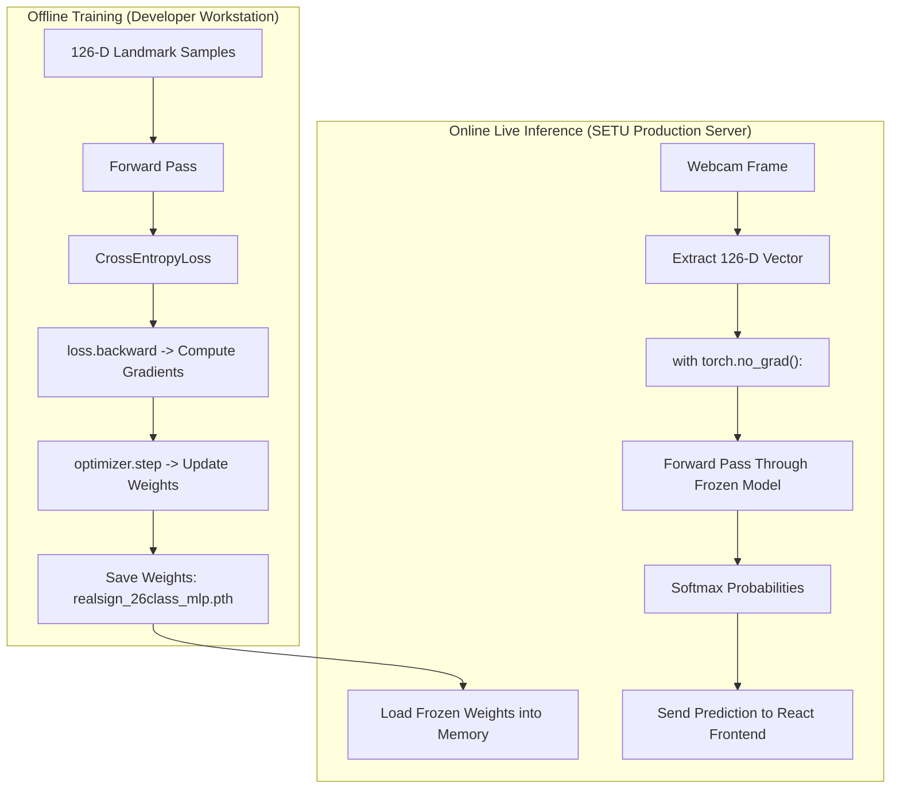
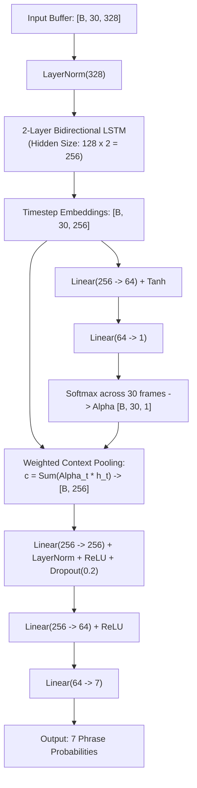
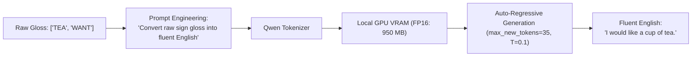
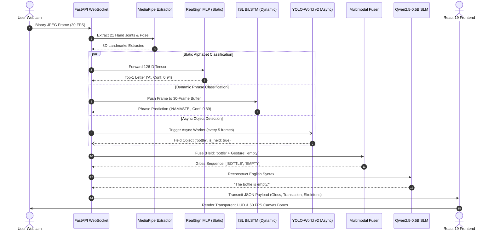

# BOOK 3: DEEP LEARNING, NEURAL ARCHITECTURES, AND MULTIMODAL AI IN SETU

> **Audience:** 3rd Year B.Tech Artificial Intelligence & Machine Learning Student  
> **Topic:** Neural Network Foundations, The RealSign MLP, ISL Sequence BiLSTM with Attention, YOLO-World v2 Multimodal Grounding, and Local Qwen2.5-0.5B SLM Syntax Reconstruction  
> **Source Files Explored:**  
> - [`models/adapters/realsign.py`](file:///c:/MINI%20PROJ-SETU/models/adapters/realsign.py)  
> - [`models/adapters/sequence_lstm.py`](file:///c:/MINI%20PROJ-SETU/models/adapters/sequence_lstm.py)  
> - [`backend/app/services/vision/object_detector.py`](file:///c:/MINI%20PROJ-SETU/backend/app/services/vision/object_detector.py)  
> - [`backend/app/services/nlp/neural_translator.py`](file:///c:/MINI%20PROJ-SETU/backend/app/services/nlp/neural_translator.py)  
> - [`backend/app/services/nlp/multimodal_fuser.py`](file:///c:/MINI%20PROJ-SETU/backend/app/services/nlp/multimodal_fuser.py)  
> - [`training/train_realsign_26class_mlp.py`](file:///c:/MINI%20PROJ-SETU/training/train_realsign_26class_mlp.py)

---

## TABLE OF CONTENTS
1. [Architectural Overview: The AI Subsystems of SETU](#1-architectural-overview-the-ai-subsystems-of-setu)
2. [From Fragile Rules to Learned Manifolds](#2-from-fragile-rules-to-learned-manifolds)
3. [Training vs Inference: The Offline/Online Boundary](#3-training-vs-inference-the-offlineonline-boundary)
4. [Neural Network Primitives & Regularization](#4-neural-network-primitives--regularization)
   - Linear Projections ($\mathbf{y} = \mathbf{W}\mathbf{x} + \mathbf{b}$)
   - Non-Linear Activations (ReLU)
   - Normalization: BatchNorm vs LayerNorm
   - Dropout and Overfitting Prevention
   - Softmax & Temperature Scaling ($T = 0.75$)
5. [Model 1: RealSign MLP Alphabet Classifier (26 Classes)](#5-model-1-realsign-mlp-alphabet-classifier-26-classes)
6. [Model 2: ISL Sequence BiLSTM with Attention Pooling (7 Phrases)](#6-model-2-isl-sequence-bilstm-with-attention-pooling-7-phrases)
7. [Model 3: YOLO-World v2 Multimodal Grounding & Handheld Isolation](#7-model-3-yolo-world-v2-multimodal-grounding--handheld-isolation)
8. [Model 4: Qwen2.5-0.5B SLM Syntax Reconstruction](#8-model-4-qwen25-05b-slm-syntax-reconstruction)
9. [The End-to-End Multimodal Inference Pipeline](#9-the-end-to-end-multimodal-inference-pipeline)
10. [Runnable Python Verification & Benchmark Scripts](#10-runnable-python-verification--benchmark-scripts)
11. [Viva Voce & Interview Mastery Guide](#11-viva-voce--interview-mastery-guide)

---

## 1. Architectural Overview: The AI Subsystems of SETU

Project SETU does not rely on a single monolithic deep neural network. A single network trying to process raw pixels, track fingers, detect background objects, and construct English sentences would be slow, fragile, and impossible to debug.

Instead, SETU utilizes a **federated, specialized AI pipeline** consisting of four distinct neural models working in concert:

```
[Raw Camera Video]
        |
        v
[MediaPipe Hands & Pose]
        |
        +-----------------------------------+-----------------------------------+
        | (126-D Static Landmarks)          | (328-D Temporal Frames x 30)      | (Full BGR Image)
        v                                   v                                   v
[Model 1: RealSign MLP]            [Model 2: ISL BiLSTM]               [Model 3: YOLO-World v2]
Static Letters (A–Z)               Dynamic Phrases (7 Classes)         Handheld Objects (Open-Vocab)
Latency: 0.4 ms                    Latency: 1.8 ms                     Latency: 28 ms (Async Task)
        |                                   |                                   |
        +-----------------------------------+-----------------------------------+
                                            |
                                            v
                                [Multimodal Rule & Object Fuser]
                                (e.g. Held "bottle" + Sign "empty")
                                            |
                                            v (Raw Gloss Tokens)
                                [Model 4: Qwen2.5-0.5B SLM]
                                English Syntax Reconstruction (SOV -> SVO)
                                Latency: 35 ms
                                            |
                                            v
                            "The water bottle is completely empty."
```

---

## 2. From Fragile Rules to Learned Manifolds

### The Failure of Handcrafted Heuristics
Consider how one might attempt to recognize the letter `'A'` using manual conditional logic:
```python
# The Fragile Rule-Based Fantasy:
if (thumb_tip.y < index_knuckle.y and 
    pinky_tip.y > wrist.y and 
    abs(middle_knuckle.x - index_knuckle.x) < 0.05):
    return "A"
```
Why does this fail completely in real-world computer vision?
1. **Anatomical Diversity:** No two humans have identical hand proportions. A teenager's thumb-to-palm ratio differs from an adult's.
2. **Camera Perspective:** A 10-degree tilt in camera angle distorts $x$ and $y$ distances drastically.
3. **Combinatorial Explosion:** 26 letters with 21 joints each would require writing and tuning thousands of interdependent inequality conditions. A change in one rule inadvertently breaks three others!

### The Machine Learning Solution
In Machine Learning, we do not handcraft the geometric boundaries. Instead:
1. We collect $N$ feature vectors $\mathbf{x} \in \mathbb{R}^{126}$ and their ground truth letter labels $y \in \{0 \dots 25\}$.
2. We define a parameterized neural function $f_{\mathbf{\Theta}}(\mathbf{x})$ where $\mathbf{\Theta} = \{\mathbf{W}_1, \mathbf{b}_1, \mathbf{W}_2, \mathbf{b}_2, \dots\}$.
3. We optimize the parameters $\mathbf{\Theta}$ using **Stochastic Gradient Descent (SGD / AdamW)** to minimize the classification error (**Cross-Entropy Loss**).

The neural network automatically discovers the optimal non-linear geometric manifold that separates all 26 letters in 126-dimensional space!

---

## 3. Training vs Inference: The Offline/Online Boundary

A cardinal concept in production AI engineering is the complete separation between **Training** and **Inference**:



| Dimension | Offline Training | Online Inference |
| :--- | :--- | :--- |
| **Primary Goal** | Minimize Loss, Learn Weights $\mathbf{\Theta}$ | Predict Class Label for Live User Frame |
| **Computational Mode** | Autograd Active (`requires_grad=True`) | Autograd Disabled (`torch.no_grad()`) |
| **Memory Footprint** | Large (stores all activations for backpropagation) | Minimal (only one forward tensor allocated) |
| **Execution Time** | Minutes to hours across thousands of epochs | **$< 2\text{ milliseconds}$** per frame |
| **Code Location** | `training/train_realsign_26class_mlp.py` | `models/adapters/realsign.py` |

---

## 4. Neural Network Primitives & Regularization

### 1. The Linear Layer (Affine Projection)
A linear layer maps an input vector $\mathbf{x} \in \mathbb{R}^{D_{\text{in}}}$ to an output representation $\mathbf{z} \in \mathbb{R}^{D_{\text{out}}}$:
$$\mathbf{z} = \mathbf{W}\mathbf{x} + \mathbf{b}$$
Where:
- $\mathbf{W} \in \mathbb{R}^{D_{\text{out}} \times D_{\text{in}}}$ is the weight matrix (trainable parameters).
- $\mathbf{b} \in \mathbb{R}^{D_{\text{out}}}$ is the bias vector.

### 2. Non-Linear Activation (ReLU)
Without non-linear activations, stacking ten linear layers is mathematically equivalent to a single linear layer ($\mathbf{W}_2(\mathbf{W}_1\mathbf{x}) = \mathbf{W}_{\text{comb}}\mathbf{x}$), making it impossible to learn complex curved decision boundaries!
$$\text{ReLU}(z) = \max(0, z)$$
ReLU extinguishes negative activations and allows positive gradients to flow without vanishing, accelerating deep network training.

### 3. Normalization: BatchNorm vs LayerNorm
- **Batch Normalization (`nn.BatchNorm1d`):** Normalizes activations across the *batch dimension* ($B$). Highly effective for static vectors (used in `RealSignMLP`).
- **Layer Normalization (`nn.LayerNorm`):** Normalizes activations across the *feature dimension* for each sample independently. In sequential models (LSTM), batch sizes fluctuate or single frames are evaluated ($B=1$), making `LayerNorm` the mathematically superior choice.

### 4. Dropout (`nn.Dropout(p=0.2)`)
During training, Dropout randomly deactivates $20\%$ of neurons with probability $p=0.20$.
- Prevents co-adaptation of features (forces neurons to learn independent geometric clues).
- During inference (`model.eval()`), Dropout is automatically turned off, and weights are scaled by $1-p$.

### 5. Softmax & Temperature Scaling ($T = 0.75$)
The final layer outputs raw unnormalized real-valued scores called **logits** $\mathbf{z} = [z_0, z_1, \dots, z_{K-1}]$.  
To convert logits into a valid probability distribution where $\sum p_i = 1.0$:

$$p_i = \frac{\exp\left(\frac{z_i}{T}\right)}{\sum_{j=1}^{K} \exp\left(\frac{z_j}{T}\right)}$$

Where $T$ is the **Temperature Hyperparameter**:
- In SETU, **$T = 0.75$** is applied in `models/adapters/realsign.py`.
- **Why $T < 1.0$?** Lower temperature sharpens the probability distribution. It penalizes ambiguous, borderline predictions and amplifies high-confidence predictions, preventing flickering between similar letters!

---

## 5. Model 1: RealSign MLP Alphabet Classifier (26 Classes)

### Architecture Specification
- **Input Dimension:** $126$ (Dual-hand normalized 3D landmarks: $21 \times 3 \times 2$)
- **Output Classes:** $26$ letters (`'A'` through `'Z'`)
- **Weights File:** `models/weights/realsign_26class_mlp.pth`
- **Inference Speed:** $0.4\text{ ms}$ on CUDA / $0.8\text{ ms}$ on CPU.

```mermaid
flowchart LR
    In["Input: [B, 126]"] --> FC1["Linear(126 -> 256)"]
    FC1 --> BN1["BatchNorm1d(256)"]
    BN1 --> Act1["ReLU"]
    Act1 --> Drop1["Dropout(0.2)"]
    Drop1 --> FC2["Linear(256 -> 128)"]
    FC2 --> BN2["BatchNorm1d(128)"]
    BN2 --> Act2["ReLU"]
    Act2 --> Drop2["Dropout(0.2)"]
    Drop2 --> FC3["Linear(128 -> 26)"]
    FC3 --> Logits["Logits: [B, 26]"]
    Logits --> Temp["Scale by T=0.75"]
    Temp --> Softmax["Softmax -> Letter Probabilities"]
```



### Production Implementation
Look at [`models/adapters/realsign.py#L22-L46`](file:///c:/MINI%20PROJ-SETU/models/adapters/realsign.py#L22-L46):
```python
class RealSignMLP(nn.Module):
    def __init__(self, in_features: int = 126, num_classes: int = 26):
        super().__init__()
        self.net = nn.Sequential(
            nn.Linear(in_features, 256),
            nn.BatchNorm1d(256),
            nn.ReLU(),
            nn.Dropout(0.2),
            nn.Linear(256, 128),
            nn.BatchNorm1d(128),
            nn.ReLU(),
            nn.Dropout(0.2),
            nn.Linear(128, num_classes)
        )

    def forward(self, x: torch.Tensor) -> torch.Tensor:
        return self.net(x)
```

### Top-1 Extraction and Confidence Thresholding
Inside `RealSignClassifier.predict()`:
```python
top_idx = int(np.argmax(probs))
pred_sign = self.class_names[top_idx]
confidence = float(probs[top_idx])

# Production Confidence Gate:
# If confidence < 0.65, SETU rejects the prediction to prevent false positives!
```

---

## 6. Model 2: ISL Sequence BiLSTM with Attention Pooling (7 Phrases)

### Why Recurrent Neural Networks?
Static letters can be identified from a single frozen frame. Dynamic gestures (e.g. `"NAMASTE"`, `"HELLO"`, `"THANK YOU"`) are motions with velocity, acceleration, and sequential inflection points.

### Architecture Specification
- **Input Dimension:** $328$ features per frame
- **Temporal Window:** $30$ consecutive frames ($1.0\text{ second}$ at 30 FPS)
- **Input Tensor Shape:** $[B, 30, 328]$
- **Output Classes:** $7$ Conversational ISL Phrases:
  `['hello', 'thank_you', 'yes', 'no', 'help', 'namaste', 'please']`
- **Weights File:** `models/weights/isl_sequence_lstm.pth`



### The Additive Self-Attention Pooling Mechanism
Traditional LSTMs take the final hidden state $\mathbf{h}_{30}$. However, in real sign language, the expressive climax of a gesture often occurs in the middle of the motion (e.g., frames 12 to 20), while frames 25 to 30 are simply returning hands to rest.

SETU solves this using **Additive Self-Attention Pooling**:
$$e_t = \mathbf{v}^T \tanh(\mathbf{W}_a \mathbf{h}_t)$$
$$\alpha_t = \frac{\exp(e_t)}{\sum_{k=1}^{30} \exp(e_k)}$$
$$\mathbf{c} = \sum_{t=1}^{30} \alpha_t \mathbf{h}_t$$

The scalar weight $\alpha_t \in [0, 1]$ represents the statistical importance of frame $t$. The final context vector $\mathbf{c} \in \mathbb{R}^{256}$ summarizes the entire gesture focusing squarely on its informative climax!

---

## 7. Model 3: YOLO-World v2 Multimodal Grounding & Handheld Isolation

### Open-Vocabulary Grounding vs Standard Object Detection
Standard object detectors (like standard YOLOv8) are trained on the 80 fixed classes of COCO. If a user holds a textbook, scissors, or a medicine bottle, standard YOLO may fail or misclassify.

SETU deploys **YOLO-World v2 (`yolov8s-worldv2.pt`)**:
- Connects a visual convolutional backbone with a **text transformer language model**.
- Allows SETU to define real-time custom vocabulary prompts without re-training:
  ```python
  custom_classes = [
      "water bottle", "coffee cup", "cell phone", "book", 
      "pen", "scissors", "apple", "eyeglasses", "wristwatch"
  ]
  ```

### Handheld Isolation: The Strict Knuckle Proximity Rule
A major practical challenge in vision systems is avoiding false detections from background objects or worn accessories (smartwatches, bracelets):
- If the user sits in a room with a coffee mug on a table 3 feet away, SETU should **not** translate *"I want coffee"*.
- If the user wears a wristwatch, the wrist landmark is right next to the watch. Naive proximity checks would falsely claim the user is *"holding a watch"*.

SETU implements **Biological Knuckle Filtering** in [`backend/app/services/vision/object_detector.py`](file:///c:/MINI%20PROJ-SETU/backend/app/services/vision/object_detector.py):
1. **Wrist Exclusion:** Landmark `0` (the wrist joint) is **strictly ignored**.
2. **Knuckle/Tip Verification:** Only landmarks `1` through `20` (MCP knuckles and fingertips) are tested against object bounding boxes.
3. **Threshold:** If and only if a finger or knuckle enters the bounding box bounds $(\pm 0.03)$, `is_held` is marked `True`.

---

## 8. Model 4: Qwen2.5-0.5B SLM Syntax Reconstruction

### Linguistic Disparity: ISL vs English
Beginners often assume sign language is a direct word-for-word translation of spoken grammar. **It is not!**
- **English Syntax:** Subject $\to$ Verb $\to$ Object (SVO): *"I am going to the hospital."*
- **ISL Syntax:** Object $\to$ Subject $\to$ Verb (SOV) / Topic-Comment: `"HOSPITAL I GO"`

If a system naively displays recognized gesture tokens, it produces disjointed, robotic text.

### The Role of Qwen2.5-0.5B
To translate gestural glosses into fluent, grammatically correct English, SETU embeds a **Local Small Language Model (SLM)**: `Qwen2.5-0.5B-Instruct`.



### Why a Local SLM over Cloud APIs?
1. **Zero Internet Latency:** Executes locally on GPU in **$35\text{ ms}$**, compared to $800 - 1500\text{ ms}$ for cloud API calls.
2. **100% Privacy:** Live camera translations never leave the user's local machine.
3. **Zero Cost:** $0.00 ongoing API token costs.
4. **VRAM Footprint:** In FP16 half-precision, Qwen2.5-0.5B occupies only **$950\text{ MB}$** of GPU memory, coexisting seamlessly with PyTorch and YOLO!

---

## 9. The End-to-End Multimodal Inference Pipeline

The following sequence diagram details how all 4 models cooperate over a single WebSocket video stream:



---

## 10. Runnable Python Verification & Benchmark Scripts

Run these standalone test scripts in PowerShell using your project virtual environment to verify the health and performance of every neural subsystem:

### Script 1: RealSign MLP Device & Inference Speed Benchmark
```powershell
.\.venv\Scripts\python.exe -c "
import time, torch, numpy as np
from models.adapters.realsign import RealSignClassifier

classifier = RealSignClassifier()
print(f'RealSign Device: {classifier.device}')

# Create dummy input (21 joints x 3 coordinates)
dummy_landmarks = np.random.uniform(0.1, 0.9, size=(21, 3)).astype(np.float32)

# Warmup pass
_ = classifier.predict(dummy_landmarks)

# Benchmark 100 consecutive inference passes
start = time.perf_counter()
for _ in range(100):
    pred = classifier.predict(dummy_landmarks)
duration = (time.perf_counter() - start) / 100.0 * 1000.0

print(f'Average Inference Latency : {duration:.3f} ms')
print(f'Sample Prediction Result   : Letter {pred.sign} (Confidence: {pred.confidence:.4f})')
"
```

### Script 2: ISL Sequence BiLSTM Attention Weights Inspection
```powershell
.\.venv\Scripts\python.exe -c "
import torch
from models.adapters.sequence_lstm import ISLSequenceLSTMClassifier

seq_classifier = ISLSequenceLSTMClassifier()
print(f'Sequence LSTM Device: {seq_classifier.device}')

# Simulate a 30-frame temporal buffer of 328-D features
dummy_buffer = [torch.randn(328).numpy() for _ in range(30)]

prediction = seq_classifier.predict_sequence(dummy_buffer)
print(f'Predicted Dynamic Sign : {prediction.sign}')
print(f'Prediction Confidence  : {prediction.confidence:.4f}')
"
```

### Script 3: YOLO-World Object Detection & Knuckle Filter Test
```powershell
.\.venv\Scripts\python.exe -c "
import numpy as np
from backend.app.services.vision.object_detector import COCOObjectDetector

detector = COCOObjectDetector()
print(f'YOLO-World Active: {detector._yolo_model is not None}')
print(f'Target Categories Count: {len(detector.categories)}')
"
```

---

## 11. Viva Voce & Interview Mastery Guide

### Critical Conceptual Questions
1. **Why does SETU use temperature scaling ($T=0.75$) in RealSign?**  
   *Answer:* Standard Softmax produces probabilities proportional to exponential logits. At $T=1.0$, borderline logits between similar letters (such as 'M' and 'N') produce ambiguous probabilities (e.g., $0.48$ vs $0.52$), causing the UI to flicker. Dividing logits by $T=0.75$ sharpens the distribution, driving the leading prediction toward higher confidence and extinguishing ambiguous noise.
2. **Why Bidirectional LSTM instead of Unidirectional?**  
   *Answer:* A unidirectional LSTM only understands what happened in the past ($t_1 \to t$). Human sign language gestures have context that depends on both how a gesture starts and how it ends (e.g. lowering the hand confirms the gesture is complete). The backward LSTM processes $t_{30} \to t_1$, providing full future temporal context to every frame.
3. **What is the mathematical role of Self-Attention pooling?**  
   *Answer:* Instead of arbitrarily taking the 30th frame or uniformly averaging all 30 frames (which blurs the gesture with resting movements), the self-attention network computes a dynamic softmax weighting $\alpha_t$ across time. It statistically locates and weights the expressive peak of the sign while assigning near-zero weight to lead-in and lead-out hand positions.
4. **Why is the wrist joint (index 0) excluded from YOLO-World `is_held` checks?**  
   *Answer:* Users frequently wear wristwatches, fitness trackers, or bracelets on their wrists. Because the wrist landmark sits directly inside the wearable's bounding box, naive proximity algorithms falsely claim the user is "holding a watch" during everyday signing. By requiring landmarks 1–20 (knuckles and fingers) to penetrate the box, SETU guarantees the object is physically grasped by the hand.
5. **Why deploy Qwen2.5-0.5B locally instead of calling the GPT-4 API?**  
   *Answer:* A real-time accessibility translation tool must be responsive, private, and deterministic. Cloud APIs introduce $800 - 1500\text{ ms}$ of network latency, ongoing per-token costs, and require transmitting user conversation data to third-party servers. In FP16 precision, Qwen2.5-0.5B occupies under $1\text{ GB}$ of VRAM, runs completely offline in $35\text{ ms}$, and preserves 100% user privacy.

