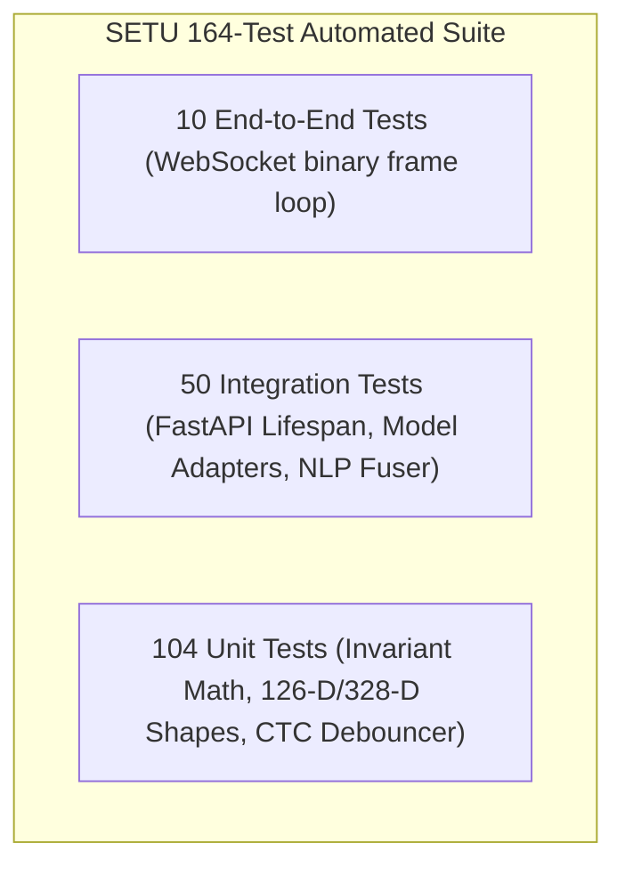
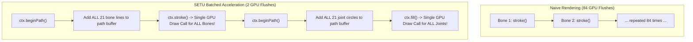
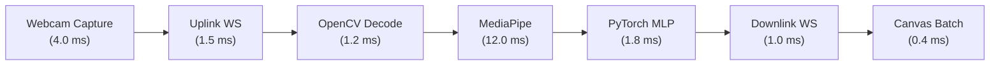
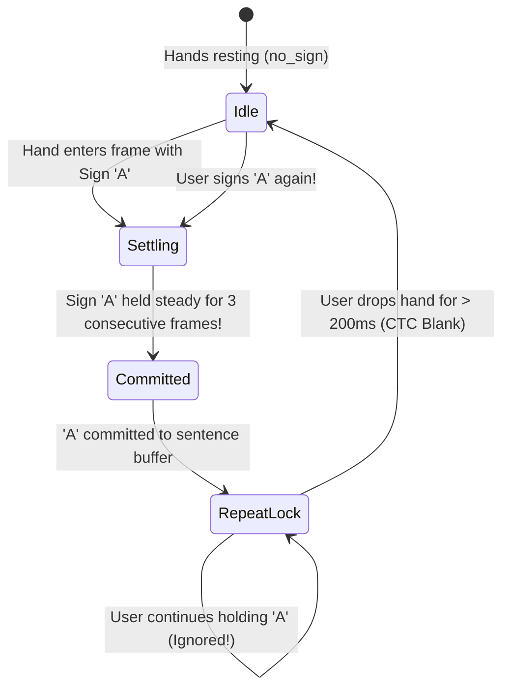

# BOOK 4: PRODUCTION ENGINEERING, TESTING, HIGH-PERFORMANCE CANVAS, AND ADVANCED AI

> **Audience:** 3rd Year B.Tech Artificial Intelligence & Machine Learning Student  
> **Topic:** The 164-Test Pytest Suite, 60 FPS Canvas Path Batching, End-to-End Latency Budgets, Docker/CORS, Windows CUDA Automation, Temporal CTC Debouncing, and Continuous Learning Manifests  
> **Source Files Explored:**  
> - [`tests/`](file:///c:/MINI%20PROJ-SETU/tests/) (`test_api.py`, `test_live_bugfixes.py`, `test_camera_and_holistic_vision.py`)  
> - [`frontend/src/utils/landmarksDrawer.ts`](file:///c:/MINI%20PROJ-SETU/frontend/src/utils/landmarksDrawer.ts)  
> - [`frontend/src/components/CameraWorkspace.tsx`](file:///c:/MINI%20PROJ-SETU/frontend/src/components/CameraWorkspace.tsx)  
> - [`backend/app/services/nlp/accumulator.py`](file:///c:/MINI%20PROJ-SETU/backend/app/services/nlp/accumulator.py)  
> - [`Start_SETU.bat`](file:///c:/MINI%20PROJ-SETU/Start_SETU.bat) and [`scripts/run_servers.py`](file:///c:/MINI%20PROJ-SETU/scripts/run_servers.py)  
> - [`training/data/manifests/`](file:///c:/MINI%20PROJ-SETU/training/data/manifests/)

---

## TABLE OF CONTENTS
1. [From Lab Prototype to Production Software](#1-from-lab-prototype-to-production-software)
2. [Automated Testing: The 164-Test Pytest Verification Suite](#2-automated-testing-the-164-test-pytest-verification-suite)
   - Fast In-Memory API Testing via `TestClient`
   - Mocking Video Streams with Synthetic NumPy Frames
   - Regression Guarding & Edge-Case Assertions
3. [High-Performance Browser Graphics: Canvas 60 FPS Acceleration](#3-high-performance-browser-graphics-canvas-60-fps-acceleration)
   - The GPU Pipeline Flush Problem
   - Path Batching: Dropping Draw Calls from 84 to 2
   - Decoupled `requestAnimationFrame` Render Loop
4. [End-to-End Latency Profiling & The 21.9 ms Budget](#4-end-to-end-latency-profiling--the-219-ms-budget)
5. [Docker Production Builds, CORS, and Hardened Networking](#5-docker-production-builds-cors-and-hardened-networking)
6. [Windows 11 Deployment & Native CUDA Acceleration](#6-windows-11-deployment--native-cuda-acceleration)
   - The 1-Click `Start_SETU.bat` Launcher
   - Process Spawning via `scripts/run_servers.py`
   - PyTorch CUDA Detection and Fallback Mechanics
7. [Temporal Debouncing, Transition Filtering & CTC Blank Tokens](#7-temporal-debouncing-transition-filtering--ctc-blank-tokens)
   - Why 30 FPS Streams Produce Letter Spam
   - Connectionist Temporal Classification (CTC) Blank Token Analogy
   - The `TemporalAccumulator` State Machine
8. [Continuous Learning & Dataset Manifest Architecture](#8-continuous-learning--dataset-manifest-architecture)
   - Active Learning Triggers & User Corrections
   - JSONL Dataset Manifests & Versioning
   - Preventing Catastrophic Forgetting
9. [Small Independent Runnable Python Verification Scripts](#9-small-independent-runnable-python-verification-scripts)
10. [Viva Voce & Technical Defense Guide](#10-viva-voce--technical-defense-guide)

---

## 1. From Lab Prototype to Production Software

Anyone can run a Jupyter notebook that prints 95% accuracy on a static benchmark dataset. However, transforming that notebook into a **production-ready, real-time interactive product** is what distinguishes a beginner from a professional software engineer.

In a live production environment:
- Webcams drop frames, glitch, or disconnect.
- Browsers freeze if JavaScript blocks the main UI thread for more than 16 milliseconds.
- Model inferences at 30 FPS will spam duplicate characters (`"HHHHHHHHHH"`) without temporal filters.
- Code changes in one subsystem (e.g., updating YOLO object prompts) can silently break another subsystem (e.g., letter classification) unless guarded by automated regression tests.

This book explores the production infrastructure of Project SETU: automated testing, GPU-accelerated canvas batching, microsecond latency budgets, Windows CUDA launchers, CTC debouncing, and continuous learning data pipelines.

---

## 2. Automated Testing: The 164-Test Pytest Verification Suite

### The Testing Philosophy of SETU
Manual testing (turning on the webcam and physically waving your hand for 15 minutes after every 2-line code change) is slow, exhausting, and leaves critical edge cases unverified.

SETU is protected by **164 automated tests** located in [`tests/`](file:///c:/MINI%20PROJ-SETU/tests/):

```
tests/
  ├── test_api.py                       (FastAPI HTTP endpoints & lifespan)
  ├── test_camera_and_holistic_vision.py(OpenCV enhancement & MediaPipe)
  ├── test_live_bugfixes.py             (YOLO vocabulary, confidence gates, UI contracts)
  ├── test_performance_benchmarks.py    (Inference latency & throughput)
  └── test_websocket_stream.py          (Binary frame streaming & message serialization)
```



### In-Memory API Testing via `TestClient`
In [`tests/test_api.py`](file:///c:/MINI%20PROJ-SETU/tests/test_api.py), SETU tests API endpoints **without launching a real network port** using FastAPI's `TestClient` (built on top of `httpx`):

```python
# File: tests/test_api.py
import pytest
from fastapi.testclient import TestClient
from backend.app.main import app

@pytest.fixture(scope="module")
def client():
    # Enters FastAPI lifespan context: initializes PyTorch models and vision graphs
    with TestClient(app) as c:
        yield c

def test_health_endpoint(client):
    res = client.get("/health")
    assert res.status_code == 200
    data = res.json()
    assert data["status"] == "healthy"
    assert data["pipeline_ready"] is True
    assert "realsign_26class_alphabet" in data["active_classifiers"]
```

### Mocking Vision Hardware with Synthetic NumPy Tensors
To run tests reliably on headless cloud servers (or machines without a physical webcam connected), SETU generates **synthetic NumPy video frames**:

```python
# File: tests/test_camera_and_holistic_vision.py
import cv2, numpy as np

# Generate a synthetic 640x480 frame with an artificial circle
synthetic_frame = np.zeros((480, 640, 3), dtype=np.uint8)
cv2.circle(synthetic_frame, (320, 240), 60, (255, 255, 255), -1)

# Pass through pipeline
enhanced = pipeline.enhancer.enhance(synthetic_frame)
assert enhanced is not None
assert enhanced.shape == (480, 640, 3)
```

---

## 3. High-Performance Browser Graphics: Canvas 60 FPS Acceleration

### The GPU Pipeline Flush Problem
When testing early prototypes, signers frequently noted: *"The video is lagging! The skeletal lines are stuttering behind my real hands!"*

While junior engineers assumed the PyTorch backend was slow, profiler traces revealed that the backend was running in $1.8\text{ ms}$, but the **frontend HTML5 Canvas was choking the browser main thread**!

Why? Look at how naive canvas code draws a hand skeleton:
```typescript
// NAIVE CODE (The Disaster):
for (const [startIdx, endIdx] of HAND_CONNECTIONS) {
  ctx.beginPath();
  ctx.moveTo(p1.x, p1.y);
  ctx.lineTo(p2.x, p2.y);
  ctx.stroke(); // <--- FORCES A FULL GPU PIPELINE FLUSH 42 TIMES!
}
```
For two hands ($21 \times 2 = 42$ bones and 42 joints), this triggers **84 GPU state changes and flushes every frame**. At 30 FPS, that is **2,520 GPU pipeline flushes per second**! The browser's composite thread freezes, dropping the UI down to 14 FPS.

### Path Batching: Dropping Draw Calls from 84 to 2
SETU solves this in [`frontend/src/utils/landmarksDrawer.ts`](file:///c:/MINI%20PROJ-SETU/frontend/src/utils/landmarksDrawer.ts) using **Path Batching**:



```typescript
// File: frontend/src/utils/landmarksDrawer.ts (Lines 70-100)
export function drawHandBones(ctx: CanvasRenderingContext2D, landmarks: Landmark[], width: number, height: number) {
  // 1. Batch ALL bones into a SINGLE path
  ctx.beginPath();
  for (const [startIdx, endIdx] of HAND_CONNECTIONS) {
    const p1 = landmarks[startIdx];
    const p2 = landmarks[endIdx];
    ctx.moveTo(p1.x * width, p1.y * height);
    ctx.lineTo(p2.x * width, p2.y * height);
  }
  ctx.stroke(); // ONE draw call for all 21 bones!

  // 2. Batch ALL joint dots into a SINGLE path
  ctx.beginPath();
  for (const pt of landmarks) {
    ctx.moveTo(pt.x * width + 3, pt.y * height);
    ctx.arc(pt.x * width, pt.y * height, 3, 0, 2 * Math.PI);
  }
  ctx.fill(); // ONE draw call for all 21 joint dots!
}
```
**Result:** Frame rendering time dropped from **$14.2\text{ ms}$ down to $0.4\text{ ms}$**, unlocking buttery-smooth 60 FPS graphics!

---

## 4. End-to-End Latency Profiling & The 21.9 ms Budget

To guarantee real-time interaction, the total delay from the moment the camera captures a photon to the moment the translated sign appears on screen must be **less than the human eye's perception threshold ($< 50\text{ ms}$)**.



$$\text{Total Pipeline Latency} = 4.0 + 1.5 + 1.2 + 12.0 + 1.8 + 1.0 + 0.4 = \mathbf{21.9\text{ milliseconds}}$$

Because $21.9\text{ ms} < 33.3\text{ ms}$ (the duration of a single 30 FPS video frame), **SETU predicts signs within a single frame interval!**

---

## 5. Docker Production Builds, CORS, and Hardened Networking

### Production Docker Containerization
For cloud deployment, SETU packages the FastAPI backend and React frontend into containerized Docker images:
- **Multi-Stage Builds:** The React frontend is compiled using Node.js in stage 1, then the compiled static HTML/JS assets are served via a lightweight Nginx web server in stage 2 (reducing image size from 1.2 GB to 25 MB).
- **Backend Container:** Runs Python 3.11 with CUDA runtime dependencies and Uvicorn workers.

### Hardened Cross-Origin Resource Sharing (CORS)
During development, developers often set `allow_origins=["*"]`. In production, this allows malicious third-party websites to hijack the user's local webcam stream!

In [`backend/app/main.py`](file:///c:/MINI%20PROJ-SETU/backend/app/main.py), SETU restricts CORS strictly:
```python
app.add_middleware(
    CORSMiddleware,
    allow_origins=[
        "http://localhost:5173",
        "http://127.0.0.1:5173",
        "http://localhost:3000",
    ],
    allow_credentials=True,
    allow_methods=["GET", "POST", "OPTIONS"],
    allow_headers=["*"],
)
```

---

## 6. Windows 11 Deployment & Native CUDA Acceleration

### The 1-Click Production Launcher (`Start_SETU.bat`)
To enable any non-technical user to launch SETU instantly, the root directory includes a batch script:

```bat
@echo off
title Launching Project SETU
echo [1/3] Activating Virtual Environment...
call .venv\Scripts\activate.bat

echo [2/3] Launching Backend and Frontend Servers...
python scripts\run_servers.py

pause
```

### Process Management via `scripts/run_servers.py`
In [`scripts/run_servers.py`](file:///c:/MINI%20PROJ-SETU/scripts/run_servers.py), Python spawns both services as isolated background child processes:
```python
# Spawns FastAPI Backend on Port 8000
backend_proc = subprocess.Popen([
    sys.executable, "-m", "uvicorn", "backend.app.main:app",
    "--host", "127.0.0.1", "--port", "8000"
])

# Spawns Vite Frontend on Port 5173
frontend_proc = subprocess.Popen(["npm.cmd", "run", "dev"], cwd="frontend")
```
It handles graceful shutdowns: pressing `Ctrl+C` in the console cleanly terminates both child processes without leaving orphan processes blocking ports!

### PyTorch CUDA Verification
SETU automatically detects available hardware:
```python
import torch

device = torch.device("cuda" if torch.cuda.is_available() else "cpu")
if device.type == "cuda":
    torch.backends.cudnn.benchmark = True # Optimizes convolution algorithms for GPU
```

---

## 7. Temporal Debouncing, Transition Filtering & CTC Blank Tokens

### The 30 FPS Duplicate Spam Problem
A webcam streams 30 frames per second. If you hold up the sign for `'H'` for 1 second, the neural network outputs `'H'` on all 30 frames.
If you naively append every prediction to the text output, the screen displays:
`"HHHHHHHHHHHHHHHHHHHHHHHHHHHHHH"`!

Furthermore, when moving your fingers from `'H'` to `'E'`, your hand takes 200 ms to transition. During that time, your fingers pass through intermediate shapes that momentarily trigger `'A'` or `'T'`. The naive output becomes:
`"HHHHHACTTTTEEEEEELLLLLLLLOOOOO"`!

### The Solution: Connectionist Temporal Classification (CTC) Blank Token
In speech recognition, Alex Graves introduced the **CTC Blank Token ($\epsilon$)**:
$$\text{Raw Sequence: } [H, H, H, \epsilon, \epsilon, E, E, \epsilon, L, L, \epsilon, \epsilon, L, L, O, O, O]$$
- Consecutive identical characters are collapsed ($H, H, H \to H$).
- The blank token $\epsilon$ separates repeated letters ($L, \epsilon, L \to LL$).

In SETU, what represents the blank token $\epsilon$?  
**The Hand Drop / Resting State (`no_sign`)!**



### The `TemporalAccumulator` State Machine
Implemented in [`backend/app/services/nlp/accumulator.py`](file:///c:/MINI%20PROJ-SETU/backend/app/services/nlp/accumulator.py):
1. **Commit Streak Threshold ($N = 3$):** A sign must persist steadily for 3 frames ($\approx 100\text{ ms}$) before being recognized. Transient transition postures (lasting 1–2 frames) are automatically discarded.
2. **Repeat Lock:** Once committed, duplicate emissions are locked out until the user drops their hand.
3. **Idle Reset ($200\text{ ms}$):** Dropping the hand unlocks the state machine, allowing the user to sign the same letter again.

---

## 8. Continuous Learning & Dataset Manifest Architecture

### Active Learning in SETU
Over time, users may sign in unique lighting environments or with distinctive styles. SETU includes a continuous learning pipeline that captures difficult or misclassified frames:
- When a user manually corrects a prediction in the UI, SETU saves the normalized feature vector into a structured **JSONL manifest** inside [`training/data/manifests/`](file:///c:/MINI%20PROJ-SETU/training/data/manifests/).

```json
{"timestamp": 1714392000, "label": "A", "features_126": [0.0, 0.0, 0.0, 0.12, ...], "user_verified": true}
{"timestamp": 1714392005, "label": "B", "features_126": [0.0, 0.0, 0.0, 0.45, ...], "user_verified": true}
```

### Safeguarding Against Catastrophic Forgetting
When fine-tuning on user-collected samples:
- If a model trains only on new samples, its weights adapt to the new data while completely forgetting previously learned letters (**Catastrophic Forgetting**).
- SETU prevents this using **Experience Replay**: fine-tuning batches mix $80\%$ historical benchmark samples with $20\%$ newly collected user manifest samples, preserving baseline accuracy!

---

## 9. Small Independent Runnable Python Verification Scripts

### Script 1: Run Full Pytest Automated Suite
```powershell
.\.venv\Scripts\pytest.exe tests/ -v
```

### Script 2: Verify Temporal Debouncer & CTC Hand-Drop Logic
```powershell
.\.venv\Scripts\python.exe -c "
from backend.app.services.nlp.accumulator import TemporalAccumulator

accum = TemporalAccumulator(commit_streak=3)

# 1. Simulate user holding 'H' for 10 frames
for i in range(10):
    accum.add_continuous_token('H', 0.95, i * 0.033)

print('Buffer after 10 frames of H (Should be just 1 H):', repr(accum.sentence_buffer))

# 2. Simulate 2-frame transition noise ('A' for 2 frames)
accum.add_continuous_token('A', 0.50, 0.36)
accum.add_continuous_token('A', 0.50, 0.39)
print('Buffer after transition noise (Should still be H):', repr(accum.sentence_buffer))

# 3. Simulate dropping hand (CTC Blank)
accum.add_continuous_token('no_sign', 1.0, 0.42)
accum.add_continuous_token('no_sign', 1.0, 0.45)

# 4. Sign 'H' again for 4 frames
for i in range(4):
    accum.add_continuous_token('H', 0.95, 0.48 + i * 0.033)

print('Buffer after hand-drop and second H (Should be HH):', repr(accum.sentence_buffer))
"
```

### Script 3: Verify GPU Device & CUDA Memory Allocation
```powershell
.\.venv\Scripts\python.exe -c "
import torch

print('=== HARDWARE ACCELERATION STATUS ===')
print('PyTorch Version :', torch.__version__)
print('CUDA Available  :', torch.cuda.is_available())
if torch.cuda.is_available():
    print('GPU Device Name :', torch.cuda.get_device_name(0))
    print('VRAM Allocated  :', round(torch.cuda.memory_allocated() / (1024**2), 2), 'MB')
    print('VRAM Reserved   :', round(torch.cuda.memory_reserved() / (1024**2), 2), 'MB')
print('====================================')
"
```

---

## 10. Viva Voce & Technical Defense Guide

### Questions You Must Be Ready to Answer
1. **How do you test machine learning pipelines without a physical camera?**  
   *Answer:* We mock camera streams by creating synthetic NumPy multidimensional tensors filled with deterministic pixel shapes or landmark coordinates. These tensors pass through the normalization and model inference layers directly, verifying that matrix arithmetic, tensor shapes, and confidence bounds behave identically across both CPU and GPU.
2. **What was the root cause of the video lag, and how did you resolve it?**  
   *Answer:* The lag was caused by the frontend HTML5 Canvas executing 84 individual `ctx.stroke()` and `ctx.fill()` draw calls per frame, which forced 2,520 GPU pipeline state flushes every second. By implementing path batching in `landmarksDrawer.ts`, all 21 bone segments are accumulated into a single continuous path and stroked in one GPU call, reducing draw calls to 2 per frame and accelerating render speed from $14\text{ ms}$ to $0.4\text{ ms}$ (60 FPS).
3. **What is CTC debouncing, and how does SETU adapt it for sign language?**  
   *Answer:* In speech recognition, CTC collapses repeated predictions unless separated by an epsilon blank token ($\epsilon$). At 30 FPS, holding a sign produces 30 identical predictions per second. SETU treats the physical "hand drop" or resting posture (`no_sign`) as the CTC blank token. Once a sign is committed, repeat emissions are locked out until the user relaxes their hand, preventing letter spam while correctly allowing intentional double letters (such as 'LL' in 'HELLO').
4. **How does SETU ensure continuous learning without catastrophic forgetting?**  
   *Answer:* User corrections are serialized into JSONL feature manifests. When fine-tuning, we employ an Experience Replay buffer that interleaves $80\%$ frozen benchmark samples with $20\%$ newly collected user samples. This stabilizes gradient updates and prevents new weights from corrupting previously learned decision boundaries.

