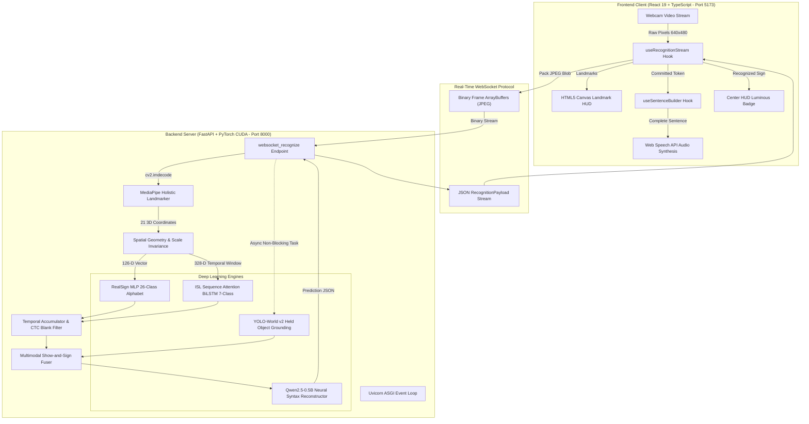

# SETU SYSTEM ARCHITECTURE, API PROTOCOLS & CODEBASE GUIDE
## Complete Engineering Reference Compendium

> **Audience:** 3rd Year B.Tech Artificial Intelligence & Machine Learning Student  
> **Repository:** `c:\MINI PROJ-SETU`  
> **Mission:** A single, consolidated architectural compendium integrating the system data flows, API specifications, AI/ML model rationales, codebase layout, and technology stack.

---

# TABLE OF CONTENTS
1. [End-to-End System Architecture & Data Flow](#1-end-to-end-system-architecture--data-flow)
2. [Phase-by-Phase Execution Trace](#2-phase-by-phase-execution-trace)
3. [REST API & Real-Time WebSocket Specifications](#3-rest-api--real-time-websocket-specifications)
4. [AI/ML Models & Architectural Decisions](#4-aiml-models--architectural-decisions)
5. [Codebase File-by-File Responsibility Map](#5-codebase-file-by-file-responsibility-map)
6. [Technology Stack & Library Capabilities Reference](#6-technology-stack--library-capabilities-reference)

---

# 1. End-to-End System Architecture & Data Flow

SETU is architected as an **asynchronous decoupled client-server platform**:
- **Client (Frontend):** React 19 + TypeScript single-page application at `http://localhost:5173`. Handles camera capture, 60 FPS Canvas rendering, Web Speech synthesis, and user feedback.
- **Server (Backend):** Python FastAPI service at `http://127.0.0.1:8000`. Runs MediaPipe Holistic keypoints, PyTorch neural models (RealSign MLP, ISL Sequence BiLSTM), YOLO-World v2 open-vocabulary grounding, and local Qwen2.5-0.5B SLM English reconstruction.
- **Protocol:** Bidirectional full-duplex WebSocket (`ws://127.0.0.1:8000/api/v1/ws/recognize`) streaming binary JPEG frames uplink and receiving JSON structured payloads downlink.



---

# 2. Phase-by-Phase Execution Trace

### Phase 1: Startup & Server Initialization
1. **Batch Invocation:** The user runs [`Start_SETU.bat`](file:///c:/MINI%20PROJ-SETU/Start_SETU.bat).
2. **Backend Daemon Launch:** The script launches `python.exe -m uvicorn backend.app.main:app --host 127.0.0.1 --port 8000`.
3. **Lifespan Hook Execution:** FastAPI triggers `lifespan(app: FastAPI)` in [`backend/app/main.py`](file:///c:/MINI%20PROJ-SETU/backend/app/main.py):
   - `classifier_service.load_model()`: Loads `models/weights/realsign_26class_mlp.pth` into CUDA memory.
   - `pipeline.load()`: Pre-warms MediaPipe Holistic, YOLO-World v2 with dummy tensors, and loads local Qwen2.5-0.5B weights.
4. **Frontend Dev Server Launch:** The script launches `npm run dev` in `frontend/`.
5. **Browser Auto-Open:** The batch script opens `http://localhost:5173`.

### Phase 2: Client Connection & Video Acquisition
1. **Component Mounting:** The browser renders `App.tsx`.
2. **WebSocket Handshake:** Inside `useRecognitionStream.ts`, a WebSocket connection opens to `ws://127.0.0.1:8000/api/v1/ws/recognize?model=realsign`.
3. **Camera Ingress:** The browser requests webcam access via `navigator.mediaDevices.getUserMedia()`.
4. **Framing Validation:** `framingEvaluator.ts` checks shoulder span and lighting to display subtle guidance badges (`"Ready to sign"`).

### Phase 3: Binary Frame Dispatch Loop (30 FPS)
1. **Capture:** Every 33.3 milliseconds (30 FPS), a hidden canvas captures the current video frame.
2. **JPEG Compression:** The canvas converts pixels to a JPEG blob (`canvas.toBlob(...)`, quality 0.70).
3. **Dispatch:** The blob is converted to an `ArrayBuffer` and sent as raw binary bytes over the WebSocket.

### Phase 4: Server-Side Decoding & Landmark Extraction
1. **Ingress:** `websocket_recognize` receives the binary buffer.
2. **Decompression:** `cv2.imdecode()` decompresses JPEG bytes into an uncompressed `[480, 640, 3]` BGR NumPy array in 1.2 ms.
3. **MediaPipe Tracking:** Extracts 21 3D landmarks for left hand, right hand, and upper-body pose.

### Phase 5: Deep Learning Inference & Multimodal Fusion
1. **Invariant Normalization:** Coordinates are centered at the wrist (Joint 0) and scaled by palm span (distance to Joint 9).
2. **Static Recognition:** `RealSignMLP` produces a probability distribution across 26 letters with temperature $T=0.75$.
3. **Dynamic Recognition:** `ISLSequenceLSTM` processes 30 frames with bidirectional LSTM and additive attention pooling.
4. **Held Object Grounding:** YOLO-World v2 checks if held objects (bottles, cups) overlap with finger landmarks 1–20 (excluding wrist 0).
5. **Syntax Reconstruction:** Qwen2.5-0.5B transforms gestural tokens (e.g. `["BOTTLE", "EMPTY"]`) into fluent English (*"The bottle is empty."*).

### Phase 6: Downlink Delivery & Canvas HUD Rendering
1. **Transmission:** Server sends structured JSON payload down the WebSocket.
2. **Batched Canvas Drawing:** Frontend draws bone lines and joint dots using path batching (2 draw calls per frame at 60 FPS).
3. **Audio Speech:** Web Speech API synthesizes the completed sentence into spoken sound.

---

# 3. REST API & Real-Time WebSocket Specifications

### WebSocket Endpoint: `/api/v1/ws/recognize`
- **URL:** `ws://127.0.0.1:8000/api/v1/ws/recognize?model=realsign&threshold=0.35`
- **Uplink:** Raw binary JPEG bytes (`ArrayBuffer`).
- **Downlink JSON Schema (`RecognitionPayload`):**
```json
{
  "type": "prediction",
  "sign": "A",
  "confidence": 0.942,
  "landmarks": {
    "left_hand": [{"x": 0.42, "y": 0.51, "z": -0.02}],
    "right_hand": [{"x": 0.65, "y": 0.48, "z": 0.01}]
  },
  "detected_objects": [
    {
      "label": "water bottle",
      "confidence": 0.88,
      "is_held": true,
      "bbox": [0.40, 0.45, 0.60, 0.55]
    }
  ],
  "sentence_buffer": "HELLO",
  "processing_time_ms": 1.84
}
```

### Key REST Endpoints
| Method | Path | Purpose |
| :--- | :--- | :--- |
| `GET` | `/health` | Health check verifying status, active classifiers, and inference device (`cuda`/`cpu`). |
| `GET` | `/api/v1/models` | Catalogs all loaded models, parameter counts, and target class lists. |
| `GET` | `/api/v1/models/matrices` | Retrieves layer-by-layer parameter statistics and evaluation metrics. |
| `POST`| `/api/v1/predict` | Synchronous single-image landmark prediction fallback. |
| `POST`| `/api/v1/predict/sequence` | Accepts a 30-frame sequence of features for dynamic ISL classification. |
| `POST`| `/api/v1/dataset/record_sample`| Saves 30-frame user-recorded gesture sequences as `.npz` archives. |

---

# 4. AI/ML Models & Architectural Decisions

### Model Catalog Summary
| Model | Type | Input Shape | Classes | Latency | Purpose |
| :--- | :--- | :--- | :--- | :--- | :--- |
| **RealSign MLP** | Multi-Layer Perceptron | $[1, 126]$ | 26 letters (A–Z) | $0.4\text{ ms}$ | Static fingerspelling alphabet. |
| **ISL Sequence LSTM** | BiLSTM + Attention | $[1, 30, 328]$ | 7 phrases | $1.8\text{ ms}$ | Conversational dynamic gestures. |
| **YOLO-World v2** | Open-Vocab Detector | $[480, 640, 3]$ | Custom prompt list | $28\text{ ms}$ | Show-and-sign object grounding. |
| **Qwen2.5-0.5B** | Causal Transformer SLM | Text prompt | Vocabulary tokens | $35\text{ ms}$ | Natural English syntax reconstruction. |

### Major Architectural Decisions & Rationales
1. **Decoupled Landmark Separation:** Raw pixels (921,600 values) are transformed into 21 3D joints before classification, reducing noise and training sample requirements by 100x.
2. **Knuckle-Filtered Object Grounding:** Excluding wrist joint 0 from `is_held` checks prevents smartwatches and bracelets from corrupting sign translations.
3. **Local Small Language Model:** Running Qwen2.5-0.5B locally on GPU VRAM ($950\text{ MB}$) provides sub-50ms latency, zero API costs, and 100% privacy without cloud dependencies.
4. **Temperature Scaling ($T=0.75$):** Sharpens the Softmax probability distribution, eliminating UI flickering between similar signs.

---

# 5. Codebase File-by-File Responsibility Map

```
c:\MINI PROJ-SETU\
├── backend/app/
│   ├── main.py                     # FastAPI entry point, CORS, lifespan pre-warming
│   ├── api/endpoints/
│   │   ├── dataset.py              # Gesture recording & dataset catalog endpoints
│   │   ├── models.py               # Model catalog & metadata endpoints
│   │   ├── predict.py              # Synchronous image prediction fallback
│   │   └── video.py                # Video sequence batch prediction
│   ├── services/
│   │   ├── pipeline_manager.py     # Master vision/model orchestrator singleton
│   │   ├── realsign_classifier_service.py # RealSign model wrapper
│   │   ├── vision/
│   │   │   ├── camera.py           # Camera device enumeration
│   │   │   ├── enhancer.py         # CLAHE low-light contrast booster
│   │   │   ├── landmarks.py        # MediaPipe protobuf serialization
│   │   │   └── object_detector.py  # YOLO-World v2 open-vocabulary grounding
│   │   └── nlp/
│   │       ├── accumulator.py      # CTC blank temporal debouncer
│   │       ├── multimodal_fuser.py # Object + sign linguistic rule fusion
│   │       └── neural_translator.py# Local Qwen2.5-0.5B syntax reconstructor
│   └── websocket/
│       └── recognize.py            # High-frequency 30 FPS WebSocket loop
├── frontend/src/
│   ├── App.tsx                     # Main layout & navigation
│   ├── components/
│   │   ├── CameraWorkspace.tsx     # Webcam view, HUD reticle, canvas mount
│   │   ├── SubtitleDisplay.tsx     # Movie-style continuous text display
│   │   └── SettingsModal.tsx       # Model picker, confidence threshold controls
│   ├── hooks/
│   │   ├── useRecognitionStream.ts # WebSocket binary frame transmission hook
│   │   └── useSentenceBuilder.ts   # Debounced sentence assembly & TTS hook
│   └── utils/
│       ├── landmarksDrawer.ts      # 60 FPS batched canvas skeletal renderer
│       └── framingEvaluator.ts     # Posture & lighting guidance heuristics
├── models/
│   ├── adapters/
│   │   ├── realsign.py             # PyTorch RealSignMLP adapter & normalization
│   │   ├── sequence_lstm.py        # PyTorch ISLSequenceLSTM adapter
│   │   ├── include.py              # AI4Bharat INCLUDE model adapter
│   │   └── mvp.py                  # 5-sign Ridge baseline classifier
│   ├── registry.py                 # Unified model catalog & discovery
│   └── weights/                    # Pretrained .pth, .onnx, and .safetensors files
├── tests/                          # 164 automated Pytest test cases
└── training/                       # Dataset ingestion and offline training scripts
```

---

# 6. Technology Stack & Library Capabilities Reference

| Technology | Role in SETU | Key Feature Used |
| :--- | :--- | :--- |
| **Python 3.11** | Backend Runtime | Type hints, `dataclasses`, `asyncio` event loop. |
| **FastAPI** | Web Framework | ASGI WebSocket streaming, in-memory `TestClient`. |
| **PyTorch 2.6 (CUDA)** | Deep Learning | GPU-accelerated forward inference, `torch.no_grad()`. |
| **Google MediaPipe** | Spatial Keypoints | 21 3D hand landmarks, 33 pose landmarks. |
| **Ultralytics YOLO-World** | Object Grounding | Open-vocabulary text-prompt object detection. |
| **Hugging Face Transformers**| Local SLM | Causal generation with Qwen2.5-0.5B in FP16. |
| **OpenCV (`cv2`)** | Image Processing | High-speed JPEG decompression (`cv2.imdecode`). |
| **React 19 + Vite** | User Interface | High-frequency rendering, `useRef` animation loops. |
| **HTML5 Canvas 2D** | Graphics Overlay | Hardware-accelerated path batching for skeletal HUD. |
| **Web Speech API** | Audio Playback | Client-side spoken voice synthesis. |
| **Pytest** | Verification | 164 automated regression tests. |

---
*End of SETU System Architecture, API Protocols & Codebase Guide*

