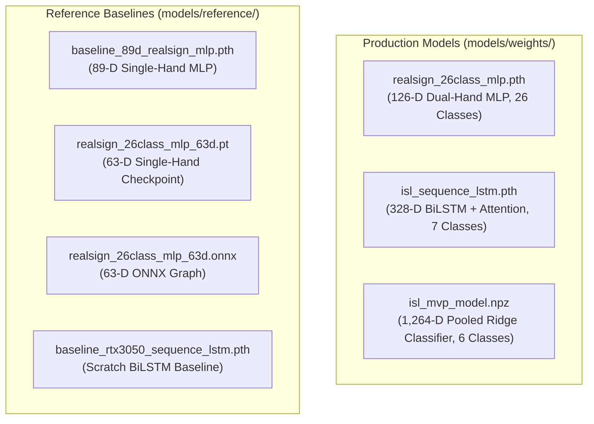

# SETU Reference & Baseline Model Repository

This directory archives historical baseline models and evaluation artifacts developed during earlier phases of SETU development.

> **CRITICAL ARCHITECTURAL BOUNDARY**:
> Models in this directory are **archived benchmarks and baselines**. They are strictly decoupled from SETU's active production runtime and must **never** be used as automatic fallbacks for live WebSocket or HTTP inference.

---

## Catalog of Reference Models

| Artifact | Type | Format | Input Dim | Classes | Historical Role |
| :--- | :--- | :--- | :---: | :---: | :--- |
| `baseline_89d_realsign_mlp.pth` | PyTorch MLP | `.pth` | 89-D | 26 (A–Z) | Early 89-D single-hand baseline trained with geometric angles and distance features. Predecessor to production 126-D bimanual model. |
| `realsign_26class_mlp_63d.pt` | PyTorch Checkpoint | `.pt` | 63-D | 26 (A–Z) | Pure 63-D (21 landmarks $\times$ 3) single-hand PyTorch state dictionary from initial alphabet prototype. |
| `realsign_26class_mlp_63d.onnx` | ONNX Graph | `.onnx` | 63-D | 26 (A–Z) | Exported ONNX graph of the 63-D model for CPU latency and edge runtime benchmarking. |
| `baseline_rtx3050_sequence_lstm.pth` | PyTorch BiLSTM | `.pth` | 158-D (328-D) | 7 | Scratch-trained baseline BiLSTM sequence classifier trained on RTX 3050 mobile GPU prior to production hyperparameter tuning. |
| `isl_model.h5` | Keras HDF5 | `.h5` | Quarantined | — | Pre-existing reference model under legal quarantine (see `models/reference/README.md`). |

---

## Comparison: Production vs. Reference Baselines



---

## Safe Evaluation Tooling

To evaluate these baselines against validation datasets without affecting production services, run:

```bash
python scripts/evaluate_reference_baselines.py --model baseline_89d
python scripts/evaluate_reference_baselines.py --model realsign_63d
python scripts/evaluate_reference_baselines.py --model sequence_lstm_baseline
```

