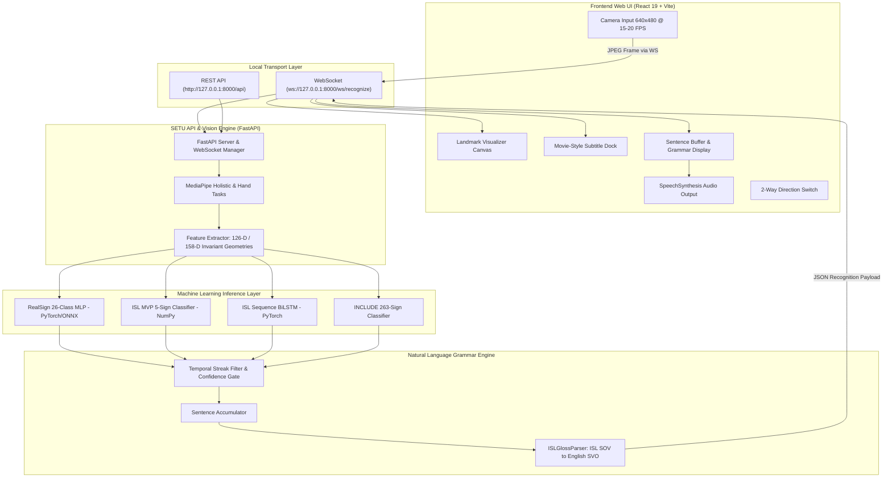

# SETU — System Architecture & Topology Guide

> **System:** SETU (Indian Sign Language Translator)  
> **Status:** Production-Ready Modular Architecture  
> **Target Platforms:** Local-First Web (Vite + React 19 + TypeScript) & Backend (FastAPI + PyTorch + MediaPipe)  
> **Last Updated:** October 2026  

---

## 1. Executive Summary & Design Principles

**SETU** ("Bridge") is an enterprise-grade, real-time Indian Sign Language (ISL) recognition and translation engine. It bridges communication gaps between Deaf/Hard-of-Hearing individuals and hearing individuals without requiring specialized hardware, wearable gloves, or third-party cloud data streaming.

### Core Architectural Axioms
1. **Radical Authenticity:** Zero fake telemetry, zero mock confidence numbers. Every landmark coordinate, classification score, and WebSocket event directly reflects an active underlying computational model.
2. **Local-First Privacy:** Video frames are captured and processed locally. Raw webcam pixels never leave the client except across a secured local loopback (`ws://127.0.0.1:8000/ws/recognize`) and are discarded immediately after feature extraction.
3. **Decoupled Multimodal Pipeline:** Separation between vision detection (MediaPipe), feature invariant transformation, ML classification (PyTorch/NumPy), natural language grammar synthesis (NLP), and the frontend presentation layer.

---

## 2. System Topology & Data Flow



---

## 3. End-to-End Execution Flow

### Step 1: Client Frame Acquisition
- Client opens camera via standard WebRTC `navigator.mediaDevices.getUserMedia`.
- Video feed is projected into a hidden DOM canvas scaled to 640×480 px.
- Frame capture throttles at 15–20 FPS to prevent CPU thermal throttling.
- Transmitted as base64-encoded JPEG payloads over `ws://127.0.0.1:8000/ws/recognize`.

### Step 2: MediaPipe Landmark Localization
- Backend decodes image bytes with OpenCV `cv2.imdecode`.
- MediaPipe task detectors locate landmark anchors:
  - **Hand Landmarker:** 21 landmarks per hand (x, y, z coordinates).
  - **Holistic Landmarker:** 33 body pose landmarks, 21 left hand, 21 right hand, 478 face mesh points.

### Step 3: Feature Invariant Transformations
- **Alphabet Mode (RealSign 126-D):**
  - Left Hand (21 × 3 = 63 values) + Right Hand (21 × 3 = 63 values) = 126 values.
  - Wrist-centered spatial normalization (translation invariant).
  - Maximum bone-distance scaling (scale invariant).
- **Conversational & Sequence Mode (158-D):**
  - Shoulders, elbows, wrists, nose, and full hand joints.
  - Normalized relative to shoulder span and torso center.

### Step 4: Machine Learning Inference
- **RealSign 26-Class MLP:** Evaluates single/double-hand A–Z letters. Evaluates in < 3ms on CPU using PyTorch / ONNX Runtime.
- **ISL MVP NumPy Classifier:** Fast matrix-vector dot product for 5 high-frequency conversational signs (`hello`, `thank_you`, `good_morning`, `i`, `you`).
- **ISL Sequence LSTM:** Sliding buffer (15–30 frames) for dynamic gesture recognition.

### Step 5: Post-Processing & Temporal Stabilization
- **Streak Filter:** Prevents single-frame noise glitches. Requires 3–5 consecutive matching predictions.
- **Cooldown Timer:** Enforces a 400ms pause after committing a character/word before next sign can register.
- **Sentence Accumulator & Gloss Parser:** Reconstructs words into sentences, converting ISL grammar (Subject-Object-Verb) into fluent English (Subject-Verb-Object).

### Step 6: Client Reaction & Subtitles
- WebSocket returns complete JSON payload:
  ```json
  {
    "label": "a",
    "display_name": "LETTER A",
    "confidence": 0.984,
    "is_known_sign": true,
    "hand_detected": true,
    "landmarks": { "left_hand": [...], "right_hand": [...] },
    "sentence_buffer": "HELLO A",
    "translated_text": "Hello, how are you?",
    "fps": 18.4,
    "latency_ms": 28
  }
  ```
- Subtitle dock updates movie-style overlay.
- Real landmarks canvas renders sage green (left) and slate (right) skeletons.
- Sentence buffer displays accumulated text with typing cursor and audio TTS playback.

---

## 4. Repository Directory Organization

```
SETU/
├── records/                    # Living Project Tracking Records
│   ├── ARCHITECTURE.md         # System architecture, topology & technical contracts
│   ├── CHECKPOINTS.md          # Chronological milestone audit & rollback registry
│   ├── DATASETS_AND_MODELS.md  # ML registry (datasets, weights, metrics, biases)
│   ├── MEMORY.md               # Active memory log & session status
│   └── STRUCTURE.md            # Exhaustive recursive file tree & purpose dictionary
│
├── config/                     # Centralized environment & runtime configuration
│   └── settings.py             # Frozen typed Settings dataclass with env loading
│
├── frontend/                   # React 19 + TypeScript + Vite UI
│   ├── public/                 # Static brand assets (favicons, manifest, logos)
│   ├── src/
│   │   ├── assets/             # Brand logos & imagery
│   │   ├── components/         # UI Components (TopNavbar, CameraWorkspace, TranslationPanel, Modals)
│   │   ├── hooks/              # Custom React hooks (useSentenceBuilder, useRecognitionStream, useTTS)
│   │   ├── services/           # Decoupled API service layer (apiService.ts)
│   │   ├── utils/              # Client helpers (landmarksDrawer.ts, landmarkProcessor.ts)
│   │   ├── types.ts            # Shared TypeScript type definitions
│   │   ├── App.tsx             # Root Application layout & state
│   │   ├── main.tsx            # Application entrypoint
│   │   └── index.css           # Curated Gemini/ChatGPT-inspired design system
│   ├── package.json            # Node.js dependencies
│   └── vite.config.ts          # Vite build & proxy configuration
│
├── backend/                    # FastAPI Server & Real-Time Engine
│   ├── Dockerfile              # Python 3.10 production container
│   ├── requirements.txt        # Server dependencies
│   ├── main.py                 # Backend entrypoint shim
│   └── app/
│       ├── api/endpoints/      # REST endpoints (models, video, dataset, vocabulary, predict)
│       ├── schemas/            # Pydantic data validation contracts
│       ├── services/           # Pipeline manager, classifier service, vision & NLP subsystems
│       │   ├── nlp/            # Sentence accumulator & ISL-to-English gloss parser
│       │   └── vision/         # OpenCV camera reader & MediaPipe landmark wrappers
│       ├── websocket/          # Real-time duplex video streaming handlers (recognize.py)
│       └── main.py             # FastAPI app factory, middleware & telemetry
│
├── models/                     # AI Model Layer (Code & Weights Split)
│   ├── adapters/               # Model adapters (realsign.py, mvp.py, include.py, sequence_lstm.py, rf_uv11.py)
│   ├── registry.py             # Central ModelRegistry interface
│   ├── weights/                # Production model binaries (.pth, .onnx, .pt, .npz, label_map.json)
│   ├── tasks/                  # MediaPipe binary task bundles (hand & holistic .task files)
│   ├── pretrained/             # External reference models (INCLUDE, Roboflow YOLOv11)
│   └── reference/              # Historical baseline reference models
│
├── training/                   # Machine Learning Training & Processing Pipelines
│   ├── dataset_manifest.py     # Signer-split manifest generation
│   ├── feature_extractor.py    # Canonical coordinate normalizer (wrist-centered, scale invariant)
│   ├── extract_features.py     # Batch video feature extraction pipeline
│   ├── ingest_raw_datasets.py  # Raw image dataset processor
│   ├── train_realsign_26class.py# Alphabet training script (99.11% accuracy PyTorch MLP)
│   ├── evaluate.py             # Confusion matrix & performance reporter
│   ├── export_onnx.py          # ONNX graph exporter & CPU benchmark
│   └── features/               # Invariant hand geometry, schema, and extractor
│
├── records/                    # Living Master Records & Ledger
│   ├── ARCHITECTURE.md         # System architecture specification
│   ├── CHECKPOINTS.md          # Milestone & rollback changelog
│   ├── DATASETS_AND_MODELS.md  # ML registry & training logs
│   ├── MEMORY.md               # Active project ledger
│   └── STRUCTURE.md            # Master file-by-file dictionary (Living Index)
│
├── config/                     # Centralized Settings & Exceptions
│   ├── settings.py             # Immutable dataclass parsing environment variables
│   └── exceptions.py           # Custom domain exception hierarchy
│
├── data/                       # Data layer (Git-ignored)
│   ├── raw/                    # Raw sign language images & video files
│   ├── processed/              # Feature arrays (.npz files)
│   └── manifests/              # Signer-split JSON manifests
│
├── reports/                    # Model evaluation & audit reports (JSON)
├── scripts/                    # Utility scripts, demos, verification harnesses
├── tests/                      # Automated test suites (pytest: 125/125 passing)
├── certs/                      # Local SSL/TLS development certificates
├── docs/                       # Technical specs, archive, and user_understanding guides
│   ├── archive/                # Historical foundation snapshots
│   └── user_understanding/     # Conceptual system architecture manuals
├── notebooks/                  # Interactive Jupyter walkthroughs
├── Start_SETU.bat              # One-click dual-stack Windows launcher
└── README.md                   # Main project overview with a direct link to records/STRUCTURE.md
```

---

## 5. Configuration & Environment Variables

| Variable | Default Value | Description |
| :--- | :--- | :--- |
| `SETU_HOST` | `127.0.0.1` | Host address for backend server |
| `SETU_PORT` | `8000` | Port for REST and WebSocket engine |
| `SETU_LOG_LEVEL` | `INFO` | Logging verbosity (`DEBUG`, `INFO`, `WARNING`, `ERROR`) |
| `SETU_CAMERA_BACKEND` | `cv2.CAP_DSHOW` | Windows DirectShow video capture backend |
| `CONFIDENCE_THRESHOLD_ALPHABET` | `0.30` | Minimum softmax score to accept alphabet sign |
| `CONFIDENCE_THRESHOLD_SEQUENCE` | `0.45` | Minimum score to accept conversational sequence |
| `STREAK_ALPHABET` | `2` | Consecutive identical frames required for letter |
| `STREAK_SEQUENCE` | `3` | Consecutive identical frames required for phrase |
| `COOLDOWN_MS` | `350` | Refractory period between emitted signs (ms) |

---

## 6. Security, Privacy & Reliability Guarantees

1. **Zero Ephemeral Storage:** Video frames delivered over WebSocket are decoded into volatile RAM, processed through numpy/torch tensor operations, and freed immediately. No video files or raw frames are ever saved to disk during standard operation.
2. **Graceful Disconnection Handling:** When client terminates the WebSocket connection, the backend cleans up per-client buffers and memory structures without throwing unhandled exceptions.
3. **Hardware Fallback Protection:** If no external GPU (CUDA) is detected, models seamlessly fall back to optimized PyTorch CPU / ONNX Runtime engines with intra-op multithreading.
