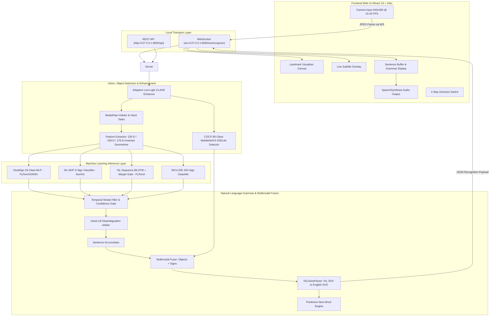

# SETU — System Architecture & Topology Guide

> **System:** SETU (Indian Sign Language Translator)  
> **Status:** Production-Ready Modular Architecture  
> **Target Platforms:** Local-First Web (Vite + React 19 + TypeScript) & Backend (FastAPI + PyTorch + MediaPipe)  
> **Last Updated:** October 2026  
> **Document Purpose:** Single-source architectural reference for system topology, data flows, execution pipeline stages, and security contracts.

---

## 1. Executive Summary & Design Principles

**SETU** ("Bridge") is an enterprise-grade, real-time Indian Sign Language (ISL) recognition and translation engine. It bridges communication gaps between Deaf/Hard-of-Hearing individuals and hearing individuals without requiring specialized hardware, wearable gloves, or third-party cloud data streaming.

### Core Architectural Axioms

| Axiom | Principle | Engineering Implementation | User-Facing Benefit |
| :--- | :--- | :--- | :--- |
| **1. Radical Authenticity** | Zero simulated or fake telemetry | Real-time PyTorch/ONNX/NumPy inferences only | True, trustworthy translation reflecting actual user signs |
| **2. Local-First Privacy** | Biometrics never leave the local machine | RAM-only tensor processing via local WebSocket loopback | Complete privacy; no webcam frames stored or sent to cloud |
| **3. Decoupled Pipeline** | Strict separation of vision, ML, NLP, and UI | Clean service boundaries and typed Pydantic contracts | Changes in ML models never break frontend presentation |

---

## 2. System Topology & Data Flow

---

## 3. End-to-End Execution Pipeline (Webcam to Speech)

| Stage | Operation & Component | Transformed Data | Speed |
| :--- | :--- | :--- | :---: |
| **1. Frame Capture** | WebRTC capture in `CameraWorkspace.tsx` | 640×480 live video $\rightarrow$ JPEG WebSocket frame | **< 2 ms** |
| **2. Landmark Localization** | MediaPipe Hand & Holistic detection in `landmarks.py` | Decoded video frame $\rightarrow$ 21 skeletal joints $(x, y, z)$ | **12–18 ms** |
| **3. Invariant Normalization** | Wrist centering & palm scale division in `geometry.py` | Raw joints $\rightarrow$ 126-D / 89-D normalized vector | **< 0.2 ms** |
| **4. Neural Classification** | PyTorch / ONNX forward pass in `realsign.py` | Feature vector $\rightarrow$ Letter & phrase probabilities | **0.6–3.0 ms** |
| **5. Temporal Debouncing** | Streak filter & hold-gate in `accumulator.py` | Raw predictions $\rightarrow$ Stabilized sign tokens | **< 0.1 ms** |
| **6. Grammar Translation** | SOV to SVO syntactic translation in `gloss_parser.py` | Sign tokens $\rightarrow$ Natural English sentence | **< 0.5 ms** |
| **7. Display & TTS Voice** | Screen render & Web Speech TTS in `TranslationPanel.tsx` | JSON payload $\rightarrow$ Audio speech & subtitle text | **< 5 ms** |

---

## 4. Master Directory Structure & Responsibilities

| Directory | Core Responsibility | Key Technologies | Architectural Role |
| :--- | :--- | :--- | :--- |
| **`backend/`** | FastAPI REST & WebSocket Server, MediaPipe wrappers, and NLP engine | FastAPI, OpenCV, MediaPipe Tasks, Pydantic, Torchvision | Ingestion, feature extraction, object detection, and real-time streaming |
| **`frontend/`** | Zero-scroll React 19 assistive workstation and audio synthesizer | React 19, TypeScript, Vite, Web Speech API | User presentation, camera capture, disambiguation HUD, and accessibility |
| **`models/`** | Model weights, ONNX graphs, MediaPipe task bundles, and adapters | PyTorch, ONNX Runtime, NumPy, Torchvision MobileNetV3 | Inference computation and classification |
| **`training/`** | Dataset ingestion, feature extraction, and ML training pipelines | PyTorch, Scikit-learn, NumPy, Pandas | Model creation, evaluation, and export |
| **`records/`** | Authoritative living system documentation, architecture, and metrics | Markdown | Single-source-of-truth system records |
| **`docs/`** | Detailed user understanding guides, transformation plans, and roadmaps | Markdown | Strategic plans and user onboarding manuals |
| **`tests/`** | Comprehensive automated backend and ML adapter test suites | Pytest, Pytest-asyncio, HTTPX | Continuous quality assurance (134/134 passing) |

---

## 5. Configuration & Environment Variables

| Variable | Default Value | Description | Impact |
| :--- | :--- | :--- | :--- |
| `SETU_HOST` | `127.0.0.1` | Local loopback bind address | Security: binds locally, not publicly exposed |
| `SETU_PORT` | `8000` | Port for REST and WebSocket engine | Standard development and local runtime port |
| `SETU_LOG_LEVEL` | `INFO` | Logging verbosity (`DEBUG`, `INFO`, `WARNING`, `ERROR`) | Controls terminal log output |
| `SETU_CAMERA_BACKEND` | `cv2.CAP_DSHOW` | Windows DirectShow video capture backend | Eliminates Windows camera driver deadlocks |
| `CONFIDENCE_THRESHOLD_ALPHABET` | `0.35` | Minimum softmax score to accept alphabet sign | Balances responsiveness vs. false positive noise |
| `CONFIDENCE_THRESHOLD_SEQUENCE` | `0.45` | Minimum score to accept conversational sequence | Ensures dynamic phrases are held with clarity |
| `STREAK_ALPHABET` | `2` | Consecutive identical frames required for letter | Eliminates 1-frame flickering letters |
| `STREAK_SEQUENCE` | `3` | Consecutive identical frames required for phrase | Eliminates noisy phrase commitments |
| `COOLDOWN_MS` | `350` | Refractory period between emitted signs (ms) | Prevents duplicate characters during signing pauses |

---

## 6. Security, Privacy & Reliability Guarantees

| Guarantee | Mechanism | Verification Method |
| :--- | :--- | :--- |
| **Zero Disk Retention** | Frames are decoded in volatile RAM and immediately freed | Codebase audit shows zero `imwrite` or file saving in streaming loops |
| **Graceful Socket Recovery** | Automatic buffer cleanup and reconnection logic on disconnect | Tested via WebSocket disconnect integration tests |
| **CPU/GPU Auto-Fallback** | Dynamically switches between CUDA and optimized CPU ONNX Runtime | Verified on machines without external GPU acceleration |
