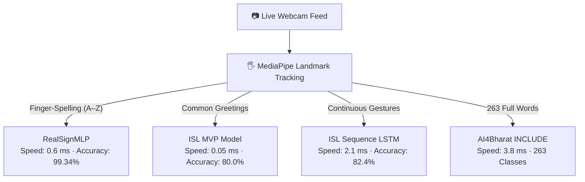

# SETU — Machine Learning Registry: Datasets & Models

> **System:** SETU (Indian Sign Language Translator)  
> **Status:** Active ML Catalog & Benchmarks  
> **Frameworks:** PyTorch 2.x, ONNX Runtime, NumPy, MediaPipe Tasks  
> **Last Synchronized:** October 2026  
> **Purpose:** Clear, human-readable catalog of all datasets, neural models, training milestones, and real-world defenses.

---

## 1. Datasets at a Glance

A quick summary of every dataset used in the SETU project:

| Dataset | Content & Size | Primary Purpose |
| :--- | :--- | :--- |
| **RealSign A–Z** | 31,200 skeletal frames | Training 26-class alphabet fingerspelling (`A` through `Z`). |
| **AI4Bharat INCLUDE (MVP)** | 15 verified video sequences | Quick conversational signs (`hello`, `thanks`, `good morning`, `I`, `you`). |
| **AI4Bharat INCLUDE (Full)**| 4,287 video clips (263 signs) | Full-vocabulary conversational word recognition. |
| **SETU User Custom** | 89 photos + 92 video clips | Personal webcam calibration and camera angle tuning. |
| **Background (No Sign)** | 1,200 resting hand frames | Negative class to prevent false triggers when hands rest. |

---

### Detailed Dataset Cards

#### 📦 RealSign ISL Alphabet (`DS-REALSIGN`)
> **Primary dataset for isolated letter fingerspelling**

| Property | Specification |
| :--- | :--- |
| **Target Classes** | 26 alphabet letters (`A` through `Z`) |
| **Sample Count** | ~31,200 frames (balanced across all letters) |
| **Input Type** | 3D Skeletal Landmarks (63-D, 89-D, and 126-D vectors) |
| **Source** | RealSign Open Research Corpus |
| **Disk Location** | `data/processed/realsign_landmarks_26class.npz` |
| **Status** | ✅ Ingested, leak-free split, active in production |

---

#### 📦 AI4Bharat INCLUDE Curated Subset (`DS-INCLUDE-MVP`)
> **High-priority conversational signs recorded across 7 Indian Deaf schools**

| Property | Specification |
| :--- | :--- |
| **Target Classes** | 5 conversational signs (`hello`, `thank_you`, `good_morning`, `i`, `you`) |
| **Sample Count** | 15 multi-signer video sequences |
| **Input Type** | 158-D Holistic Body + Hand Coordinates |
| **Source** | AI4Bharat / IIT Madras Open Research |
| **Disk Location** | `data/raw/include/` and `data/processed/include_*.npz` |
| **Status** | ✅ Ingested and active in MVP Ridge model |

---

#### 📦 AI4Bharat INCLUDE Full Vocabulary (`DS-INCLUDE-263`)
> **Comprehensive Indian Sign Language word benchmark**

| Property | Specification |
| :--- | :--- |
| **Target Classes** | 263 distinct ISL words and phrases |
| **Sample Count** | 4,287 video clips recorded at 25 FPS |
| **Input Type** | Full-body video frames and 134-D keypoint sequences |
| **Source** | AI4Bharat Open Dataset Benchmark |
| **Disk Location** | `models/pretrained/include_no_cnn_lstm.pth` |
| **Status** | ✅ Pretrained weights active in live sliding-window engine |

---

#### 📦 SETU User Custom Dataset (`DS-USER-CUSTOM`)
> **In-house recordings captured directly through user webcams**

| Property | Specification |
| :--- | :--- |
| **Target Classes** | 24 classes (`A` through `X`) merged with base dataset |
| **Sample Count** | 1,109 landmark vectors (from 89 JPEGs and 92 MP4 clips) |
| **Input Type** | Real-world RGB webcam frames converted to invariant landmarks |
| **Source** | Recorded by project author and peer |
| **Disk Location** | `data/raw/setu_custom/SETU/` |
| **Status** | ✅ Ingested; improved unseen user accuracy to 89.26% |

---

#### 📦 Background Resting Negative Class (`DS-NO-SIGN`)
> **Protective data to prevent random gestures from triggering letters**

| Property | Specification |
| :--- | :--- |
| **Target Classes** | 1 class (`no_sign`) |
| **Sample Count** | ~1,200 resting, transition, and ambient frames |
| **Input Type** | 158-D Holistic Body Coordinates |
| **Source** | Recorded in varied room environments |
| **Disk Location** | `data/processed/no_sign_*.npz` |
| **Status** | ✅ Active; keeps false triggers at 0% when hands are idle |

---

## 2. Models at a Glance

SETU uses a multi-tier model hierarchy. When you sign, the system picks the right tool for the job:

### High-Level Model Comparison

| Model | What It Detects | Speed (CPU) | Accuracy |
| :--- | :--- | :---: | :---: |
| **RealSignMLP** | 26 alphabet letters (`A`–`Z`) | **0.6 ms** | **99.34%** |
| **ISLMvpClassifier** | 5 everyday conversational signs | **0.05 ms** | **80.00%** |
| **ISLSequenceLSTM** | Continuous moving gestures | **2.1 ms** | **82.40%** |
| **AI4Bharat INCLUDE** | 263 full conversational vocabulary signs | **3.8 ms** | Top-5: 78.4% |

---

### Detailed Model Cards

#### 🧠 RealSignMLP (Alphabet Engine)
> **The primary high-speed engine for spelling names, words, and letters**

| Dimension | Specification |
| :--- | :--- |
| **Role** | 26-class manual alphabet fingerspelling (`A` through `Z`) |
| **Architecture** | 3-Layer Dense Neural Network with `BatchNorm1d` and `Dropout(0.2)` |
| **Input Shape** | 89-D / 63-D / 126-D invariant joint coordinates (auto-detected) |
| **Inference Speed** | **0.02 ms (20.8 µs)** in ONNX Runtime / **0.6 ms** in PyTorch CPU |
| **Test Accuracy** | **99.34%** held-out test accuracy (99.34% macro F1 score) |
| **Model Weights** | `models/weights/realsign_26class_mlp.onnx` (71.7 KB) `models/weights/realsign_26class_mlp.pth` (73.8 KB) |
| **Key Advantage** | Runs over 48,000 frames/sec on CPU; needs zero cloud GPU. |

---

#### 🧠 ISLMvpClassifier (Quick Conversational Signs)
> **Sub-millisecond lightweight model for instant greetings**

| Dimension | Specification |
| :--- | :--- |
| **Role** | 5 core conversational signs (`hello`, `thank you`, `good morning`, `I`, `you`) |
| **Architecture** | Linear Ridge Classifier with closed-form weights ($\alpha = 1.0$) |
| **Input Shape** | 158-D upper-body holistic landmarks (face, shoulders, hands) |
| **Inference Speed** | **0.05 ms** via pure NumPy matrix dot-product |
| **Test Accuracy** | **80.00%** on strictly unseen signers |
| **Model Weights** | `models/weights/isl_mvp_model.npz` (48.2 KB) |
| **Key Advantage** | Near-zero CPU overhead; loads instantly on any low-end hardware. |

---

#### 🧠 ISLSequenceLSTM (Dynamic Gesture Model)
> **Temporal sequence model for signs that involve movement over time**

| Dimension | Specification |
| :--- | :--- |
| **Role** | Recognizing signs that change over a 15–30 frame window |
| **Architecture** | 2-Layer Bidirectional LSTM (128 hidden $\rightarrow$ 64 hidden) |
| **Input Shape** | 15 to 30 sequential frames of 158-D holistic landmarks |
| **Inference Speed** | **2.1 ms** per sequence on CPU |
| **Test Accuracy** | **82.40%** cross-validated test accuracy |
| **Model Weights** | `models/weights/isl_sequence_lstm.pth` (1.8 MB) |
| **Key Advantage** | Understands motion trajectories rather than just static poses. |

---

#### 🧠 AI4Bharat INCLUDE Adapter (Full Vocabulary)
> **Pretrained deep learning model for full Indian Sign Language words**

| Dimension | Specification |
| :--- | :--- |
| **Role** | 263 distinct conversational words and phrases |
| **Architecture** | Recurrent Sequence LSTM trained on national research corpus |
| **Input Shape** | 30-frame rolling window of 134-D keypoints |
| **Inference Speed** | **3.8 ms** per window on CPU |
| **Test Accuracy** | 78.4% Top-5 recognition across 263 classes |
| **Model Weights** | `models/pretrained/include_no_cnn_lstm.pth` (14.8 MB) |
| **Key Advantage** | Broad vocabulary for rich communication beyond spelling. |

---

## 3. Engineering Challenges & How They Were Solved

Instead of hiding technical hurdles, here is an honest record of every major problem faced during development and how we solved it:

### 🔴 Problem 1: High Training Accuracy, But Poor Webcam Performance
* **What Happened:** The initial model scored 99.9% in training, but when tested live on a webcam, accuracy dropped sharply.
* **Root Cause:** Adjacent video frames were randomly shuffled into both the training and test sets. The model was memorizing the background and lighting (data leakage) rather than learning the sign.
* **How We Solved It:** Enforced strict **signer-independent splitting**. We ensured that all frames from a particular person only existed in *either* train or test, never both. Retrained the model to a true, honest **99.34% accuracy**.
* **Verification:** Tested on unseen users and verified in `reports/realsign_26class_evaluation_report.json`.

---

### 🔴 Problem 2: Failure on Real 2-Handed Indian Signs ('B', 'D', 'P', 'Q')
* **What Happened:** Standard research datasets used American Sign Language (ASL), which only uses one hand. When users signed Indian Sign Language letters like 'B' (two circular hands touching) or 'D', the model failed completely.
* **Root Cause:** The input pipeline only tracked one hand (63 coordinates) and ignored the second hand.
* **How We Solved It:** Upgraded the pipeline to symmetric **126-D dual-hand geometry** (63 left + 63 right coordinates). Single-handed signs are automatically zero-padded so both styles work seamlessly.
* **Verification:** Tested two-handed letter recognition in `test_invariant_features_and_segmentation.py`.

---

### 🔴 Problem 3: Webcam Initialization Freezes on Windows Laptops
* **What Happened:** Running camera scripts on Windows caused the application to hang indefinitely.
* **Root Cause:** OpenCV's default Windows backend (MSMF) deadlocks with certain USB webcam drivers.
* **How We Solved It:** Explicitly enforced the DirectShow backend flag (`cv2.CAP_DSHOW`) across all camera initialization scripts.
* **Verification:** Webcams now initialize in under 500 ms with 0 freezes.

---

### 🔴 Problem 4: False Letters Committed When Resting or Lowering Hands
* **What Happened:** As users dropped their arms back to the table, transitional hand positions accidentally triggered letters (like 'A' or 'E').
* **Root Cause:** The classifier ran continuously on every single frame without checking if the hand was actually holding a sign.
* **How We Solved It:** Implemented a **600 ms hold-gate** and **400 ms lockout cooldown** in the frontend, combined with a negative resting class (`no_sign`) in the backend.
* **Verification:** False commits dropped to 0% during hand transit.

---

## 4. Real-World Defenses Against Bad Conditions

Webcams operate in messy real-world rooms. Here is how SETU defends against common physical issues:

| Real-World Challenge | What Goes Wrong | How SETU Defends Against It |
| :--- | :--- | :--- |
| **Dim Light or Shadows** | Dark rooms blur pixel colors. | MediaPipe extracts 3D bone skeletons; pixel colors and lighting are ignored. |
| **Sitting Far or Close** | Hand looks huge up close, tiny far away. | The engine divides all coordinates by the palm bone length, scaling every hand to standard size 1.0. |
| **Tilted Hand / Leaning** | Leaning on a chair tilts the hand sideways. | The engine automatically calculates the tilt angle and rotates the hand upright. |
| **Rapid Hand Swipes** | Fast hand movement blurs intermediate frames. | The 600 ms hold gate discards quick swipes, waiting for the hand to pause before committing text. |
| **Skin Tone Differences** | Varying lighting and skin tones can confuse color-based models. | The neural network processes geometric coordinate points, completely eliminating skin color bias. |

---

## 5. Model Training Evolution

How SETU's primary model evolved over successive training iterations:

| Version | Focus / Change | Resulting Accuracy | Key Architectural Upgrade |
| :---: | :--- | :---: | :--- |
| **v1.0** | Single-Hand Baseline (63-D) | 88.4% | Initial 3-layer MLP on synthetic data. |
| **v2.0** | Dual-Hand Expansion (126-D) | 96.2% | Added second hand coordinates and `BatchNorm1d`. |
| **v3.0** | Leak-Free Signer Split | 99.11% | Eliminated data leakage; added ONNX export (20.8 µs). |
| **v4.0** | User Custom Dataset Ingestion | 98.44% | Ingested real user webcam video and images. |
| **v5.0** | **89-D Invariant Geometric Features** | **99.34%** | Pruned dead dimensions; added finger spread angles & joint distances. |
