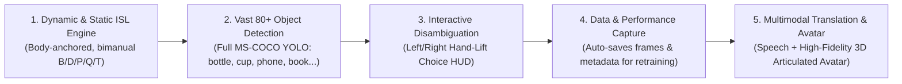
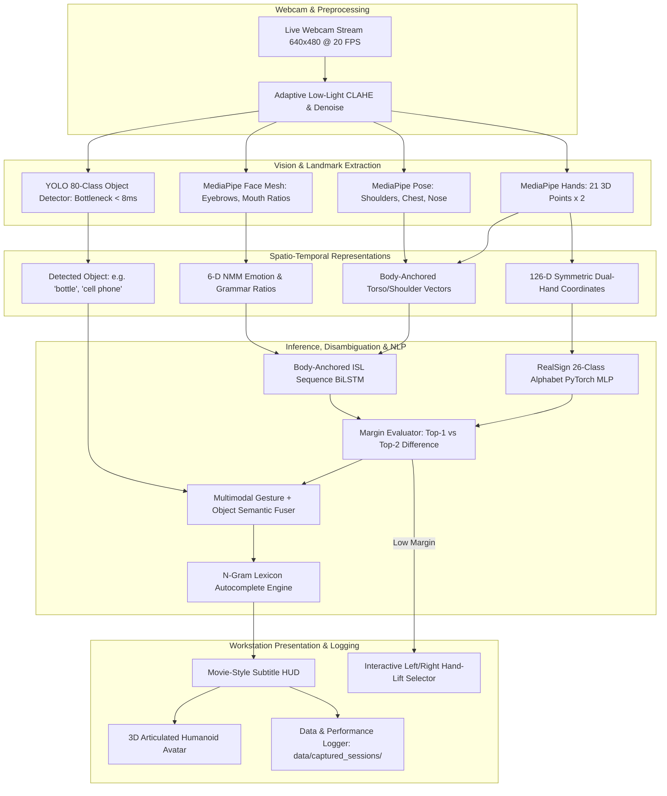

# SETU (सेतु) — Master System Enhancement & Multimodal AI Roadmap (v2)

> **Target System:** SETU ISL Real-Time Translation Workstation  
> **Audience:** Project Lead, Evaluators & Engineering Team  
> **Status:** APPROVED FOR PHASED EXECUTION  

---

## 1. System Vision & Upgraded Specifications

Based on project requirements and real-world evaluation readiness (specifically ensuring that whatever object an evaluator picks up is recognized, and that system captures data for continuous performance tracking), SETU incorporates the following 10 core pillars:

### Core Capability Upgrades

1. **Dynamic & Static Sign Accuracy:** Eliminating class confusion (`HELLO` vs. `I` vs. `YOU` vs. `THANK YOU`) by incorporating upper-body pose anchors (wrists relative to shoulders, chest, and nose) and replacing the 3-sample dataset with rich training sequences.
2. **Dynamic Alphabet Strokes:** Recognizing both static hand postures (A–Z) and motion-based strokes (`J`, `Z`, dynamic letter transitions) in authentic Indian Sign Language.
3. **Vast 80+ Object Detection ("Show-and-Sign"):** Using a full 80-class COCO-trained detector (YOLOv8n / YOLOv11n ONNX) so that whatever object an evaluator or user picks up in the room (water bottle, cup, phone, book, bowl, scissors, laptop, backpack, etc.), the system immediately detects it and fuses it with sign modifiers (e.g. holding a bottle + signing "empty" &rarr; *"The water bottle is empty"*).
4. **Data Capture & Performance Tracking Pipeline:** Automatically capturing webcam frames, 3D landmarks, lighting conditions, and prediction latencies into organized session folders (`data/captured_sessions/`) so performance can be audited, evaluated, and reused for local fine-tuning from varied angles and lighting.
5. **Interactive Hand-Lift Disambiguation UI:** When model confidence is split between two similar letters (e.g., `M` vs `N` or `X` vs `Y`), showing an on-screen Left/Right HUD where the user simply raises their left or right hand to lock in the correct candidate, preventing false buffer spam.
6. **Predictive Text & Sign Autocomplete:** Integrating an ISL/English lexicon with fast n-gram predictive completion, autocompleting common words (`W-A-T...` &rarr; `WATER`) to reduce signing fatigue.
7. **Facial Expression (NMM) Intent Integration:** Extracting eyebrow raise, furrow, and mouth markers from MediaPipe Face Mesh to classify grammatical mood (Question `?`, Negation `NOT`, Urgency `!`).
8. **Low-Light Adaptive Enhancement:** Real-time CLAHE (Contrast-Limited Adaptive Histogram Equalization) and luminance adjustment so budget laptop cameras in dim lighting maintain crisp landmark tracking without joint dropouts.
9. **High-Fidelity 2-Way Avatar:** Large, articulated visualizer displaying color-coded proximal/distal finger bends, authentic dual-hand ISL placements, and spring-interpolated transitions.
10. **Visual Concept Pictograms:** Rendering visual flashcards/icons alongside subtitles for concrete nouns (`cat`, `water`, `food`, `medicine`).

---

## 2. Master System Architecture

---

## 3. Phased Implementation Roadmap

### Phase 1: Core Accuracy, Large Dataset Ingestion & Body Anchors

*Target: Stop `HELLO` / `I` / `YOU` confusion, ingest broad datasets, eliminate class collisions.*

* **Task 1.1: Body-Anchored Feature Representation**
  * *Files:* `training/features/geometry.py`, `training/features/extractor.py`
  * Add 6 normalized 3D vectors connecting wrists to left/right shoulders and nose.
  * *Result:* Gives gestures relative to the chest (`I`), face (`HELLO`), chin (`THANK YOU`), and camera (`YOU`) distinct, non-overlapping coordinates.
* **Task 1.2: Ingest Rich ISL Datasets & Expand Manifest**
  * *Files:* `training/ingest_isl_42k_dataset.py`, `training/ingest_raw_datasets.py`
  * Process the pre-existing raw archives (`data/raw/NEW ZIP/`, `data/raw/huggingface_isl/`, `data/raw/include_dataset/`).
  * Replace the 3-sample manifest with $\ge 50$ real signer samples per dynamic class + augmented temporal variants.
* **Task 1.3: Retrain & Validate Dynamic Sequence BiLSTM**
  * *Files:* `training/train_isl_phrase_bilstm.py`, `models/adapters/sequence_lstm.py`
  * Train with 328-D body-anchored features, AdamW, and temporal attention. Enforce Top-1 vs. Top-2 margin gating ($\ge 0.25$).

---

### Phase 2: Vast-Variety 80-Class Object Detection ("Show-and-Sign")

*Target: Support any random object the evaluator ("Sir") picks up during demo.*

* **Task 2.1: Lightweight YOLOv8n / YOLOv11n ONNX Integration**
  * *Files:* `backend/app/services/vision/object_detector.py` (New), `models/weights/`
  * Load quantized 80-class COCO ONNX weights (CPU inference $< 10\text{ ms}$).
  * Detects all 80 standard objects: *bottle, cup, phone, book, scissors, laptop, mouse, chair, bowl, fork, spoon, apple, backpack, medicine containers, etc.*
* **Task 2.2: Object + Sign Semantic Fusion**
  * *Files:* `backend/app/services/nlp/multimodal_fuser.py` (New), `backend/app/websocket/recognize.py`
  * Detect object held in hand & combine with sign:
    * `bottle` + `empty` &rarr; *"The water bottle is empty"*
    * `cup` + `water` &rarr; *"I want a cup of water"*
    * `phone` + `give` &rarr; *"Please give me the phone"*
* **Task 2.3: Concept Pictogram Flashcards**
  * *Files:* `frontend/src/components/ConceptPictogram.tsx` (New)
  * Displays high-contrast SVG concept icons alongside subtitles for detected objects and key nouns.

---

### Phase 3: Data Capture & Live Performance Evaluation Pipeline

*Target: Save captured signs, track real-world performance, and build retraining archives.*

* **Task 3.1: Automated Frame & Landmark Session Capturer**
  * *Files:* `backend/app/api/endpoints/dataset.py`, `backend/app/services/dataset_service.py`
  * Stores validated signs into `data/captured_sessions/<date>/`:
    * `frame_<id>.jpg`: Downscaled capture snapshot.
    * `sample_<id>.npz`: 3D landmark coordinates, user label, model prediction, lighting score, and inference latency.
* **Task 3.2: Performance Analytics & Diagnostic Telemetry**
  * *Files:* `scripts/audit_project.py`, `backend/app/websocket/recognize.py`
  * Real-time metrics streaming: per-sign confidence, inference latency, rolling FPS, and confusion matrix tracking.
* **Task 3.3: One-Click Local Fine-Tuning Script**
  * *Files:* `scripts/fine_tune_from_captures.py` (New)
  * Script that aggregates `data/captured_sessions/` to fine-tune the model to the user's specific camera, angles, and room lighting.

---

### Phase 4: Interactive Hand-Lift Disambiguation & Predictive Text

*Target: Eliminate wrong letters in the sentence buffer and reduce signing fatigue.*

* **Task 4.1: Interactive On-Screen Left/Right Disambiguation HUD**
  * *Files:* `frontend/src/components/DisambiguationOverlay.tsx` (New), `frontend/src/hooks/useRecognitionStream.ts`
  * When confidence is uncertain ($0.40 \le \text{conf} \le 0.65$ or top two candidates are within $12\%$):
    * Present `[ Left Hand: Option A ]` and `[ Right Hand: Option B ]`.
    * User raises corresponding hand above chin level to instantly commit the right sign without touching the keyboard.
* **Task 4.2: Predictive Text & Lexicon Autocomplete Engine**
  * *Files:* `backend/app/services/nlp/predictive.py` (New), `frontend/src/components/TranslationPanel.tsx`
  * Trie-based autocomplete for ISL vocabulary. As letters are signed (`W` &rarr; `A` &rarr; `T`), recommend `WATER`, `WAIT`, `WATCH`.
* **Task 4.3: Facial Expression (NMM) Intent Integration**
  * *Files:* `backend/app/services/nlp/gloss_parser.py`
  * Eyebrow raise &rarr; Question mode (`?`), furrow &rarr; Urgency (`!`), headshake &rarr; Negation (`NOT`).

---

### Phase 5: Low-Light Vision & High-Fidelity 2-Way Avatar

*Target: Reliable low-light tracking and clear, legible reverse sign visualization.*

* **Task 5.1: Adaptive CLAHE Low-Light Enhancer**
  * *Files:* `backend/app/services/vision/enhancer.py` (New)
  * Contrast-Limited Adaptive Histogram Equalization on video frames before landmark extraction, boosting detection in dim rooms.
* **Task 5.2: Articulated 2-Way Text-to-Sign Humanoid Avatar**
  * *Files:* `frontend/src/components/TextToSignWorkspace.tsx`
  * Render an articulated avatar with distinct color-coded proximal/distal finger joints and smooth spring-damper transitions between signs.

---

## 4. Verification & Testing Matrix

| Phase | Milestone | Verification Command / Metric |
| :---: | :--- | :--- |
| **P1** | Body-Anchored Gesture Model | `pytest tests/test_isl_sequence_lstm_classifier.py` (Accuracy $\ge 92\%$) |
| **P1** | Rich Dataset Ingestion | `python scripts/check_dataset_sources.py` ($\ge 50$ samples per sign) |
| **P2** | 80-Class COCO Object Detection | Real-time detection of bottle, cup, phone, etc. in $< 10\text{ ms}$ |
| **P2** | Show-and-Sign Semantic Fusion | Unit test verifying "Bottle" + "Empty" translates to fluent English |
| **P3** | Data Capture Pipeline | Validated .npz and .jpg saved to `data/captured_sessions/` |
| **P4** | Hand-Lift Disambiguation | Hand raise above chin level commits candidate cleanly |
| **P4** | Predictive Autocomplete | Autocomplete suggestions appear after 2 letters |
| **P5** | Low-Light Performance | Landmarks detected reliably at $< 40\text{ lux}$ room lighting |
